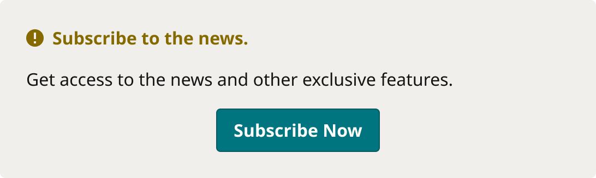

# InLineMessage: DashSubsNonSub (non-subscriber CTA panel)

> InLineMessage (2776:2), Priority=Medium, Location=DashSubsNonSub, PanelType=Alert: the locked-feature panel that invites a non-subscriber to subscribe. Used by the For You tab. Device = Desktop (3421:643), Mobile (3421:658), FOLD (3421:673); the variants live in the 114-variant InLineMessage set.

## Figma

- File: **MNG Web Design System** (`jFHYqhZbJjvWQmDI4myCsd`), page **In-Line Content Containers | 2026.01.02**
- Component set: [`Device=Desktop, Priority=Medium, Location=DashSubsNonSub, PanelType=Alert` · 3421:643](https://www.figma.com/design/jFHYqhZbJjvWQmDI4myCsd/?node-id=3421-643) · key `ce167115734b60fe196c4aa1b632535e1350f3e7`
- Documentation frame: [InLineMessage DashSubsNonSub Container](https://www.figma.com/design/jFHYqhZbJjvWQmDI4myCsd/?node-id=7419-19429) · overview: [previews/inline-message-dashsubsnonsub--documentation.png](previews/inline-message-dashsubsnonsub--documentation.png)

## Properties

No variant properties (single component).

## Variants

| Variant | Size | Node | Instances | Preview |
|---|---|---|---|---|
| `Device=Desktop, Priority=Medium, Location=DashSubsNonSub, PanelType=Alert` | 546×164 | [3421:643](https://www.figma.com/design/jFHYqhZbJjvWQmDI4myCsd/?node-id=3421-643) | 3 |  |

## Anatomy

Default variant `Device=Desktop, Priority=Medium, Location=DashSubsNonSub, PanelType=Alert` (hidden layers marked):

- **Device=Desktop, Priority=Medium, Location=DashSubsNonSub, PanelType=Alert** `COMPONENT`: 546×164, vertical, gap 16, padding 0/0/0/0, fixed×hug
  - **Close Button** `FRAME`: 40×40, horizontal, gap 8, padding 0/0/0/0, hug×hug, absolute, **hidden**
    - **Button** `FRAME`: 40×40, horizontal, gap 0, padding 0/0/0/0, fixed×fixed
      - **Icons** `INSTANCE`: 12×12, horizontal, gap 8, padding 0/0/0/0, fixed×fixed, instance of Icons (Name=close)
  - **Content** `FRAME`: 546×164, vertical, gap 16, padding 24/24/24/24, fill×hug
    - **Header** `FRAME`: 498×22, vertical, gap 8, padding 0/0/0/0, fill×hug
      - **Icon and Title** `FRAME`: 296×22, horizontal, gap 8, padding 0/0/0/0, fixed×hug
        - **Icons** `INSTANCE`: 16×16, horizontal, gap 8, padding 0/0/0/0, fixed×fixed, instance of Icons (Name=notification2)
        - **Title** `TEXT`: 180×22, hug×hug, "Subscribe to the news.", Noto Sans Bold 16px
    - **Description** `TEXT`: 498×22, fill×hug, "Get access to the news and other exclusi", Noto Sans Regular 16px
    - **Button Primary** `INSTANCE`: 166×40, vertical, gap 8, padding 0/8/0/8, fixed×hug, instance of Button Primary (Icon=None, State=Default, Breakpoint=Desktop)

## Component tokens

From `inline-message-dashsubsnonsub.tokens.json`. References point at system tokens (`tokens/core/`, `tokens/themes/`); the CSS variable is `--mng-` + the token path. A literal value means the Figma layer isn't bound to a token.

| Token | Value |
|---|---|
| `inline-message-dashsubsnonsub.base.content.gap` | `{spacing.200}` |
| `inline-message-dashsubsnonsub.base.content.padding-bottom` | `{spacing.300}` |
| `inline-message-dashsubsnonsub.base.content.padding-left` | `{spacing.300}` |
| `inline-message-dashsubsnonsub.base.content.padding-right` | `{spacing.300}` |
| `inline-message-dashsubsnonsub.base.content.padding-top` | `{spacing.300}` |
| `inline-message-dashsubsnonsub.base.content.button-primary.height` | 40px |
| `inline-message-dashsubsnonsub.base.content.button-primary.width` | 166px |
| `inline-message-dashsubsnonsub.base.content.description.color` | `{color.gray.min}` |
| `inline-message-dashsubsnonsub.base.content.description.font-family` | `{font.family.noto-sans}` |
| `inline-message-dashsubsnonsub.base.content.description.font-size` | `{font.size.16}` |
| `inline-message-dashsubsnonsub.base.content.description.font-weight` | `{font.weight.regular}` |
| `inline-message-dashsubsnonsub.base.content.header.icon-and-title.gap` | `{spacing.100}` |
| `inline-message-dashsubsnonsub.base.content.header.icon-and-title.width` | 296px |
| `inline-message-dashsubsnonsub.base.content.header.icon-and-title.icons.height` | 16px |
| `inline-message-dashsubsnonsub.base.content.header.icon-and-title.icons.icon-color` | `{color.feedback.medium}` |
| `inline-message-dashsubsnonsub.base.content.header.icon-and-title.icons.width` | 16px |
| `inline-message-dashsubsnonsub.base.content.header.icon-and-title.title.color` | `{color.feedback.medium}` |
| `inline-message-dashsubsnonsub.base.content.header.icon-and-title.title.font-family` | `{font.family.noto-sans}` |
| `inline-message-dashsubsnonsub.base.content.header.icon-and-title.title.font-size` | `{font.size.16}` |
| `inline-message-dashsubsnonsub.base.content.header.icon-and-title.title.font-weight` | `{font.weight.bold}` |
| `inline-message-dashsubsnonsub.base.root.background` | `{color.gray.600}` |
| `inline-message-dashsubsnonsub.base.root.border-radius` | `{radius.utility}` |
| `inline-message-dashsubsnonsub.base.root.width` | 546px |

## Behavior and breakpoints

| Device | Screen | Panel | Padding / gap |
|---|---|---|---|
| Desktop | 768 and up | 546px | 24 / 16 |
| Mobile | 360 | 328px | 16 / 8 |
| FOLD | 340 | 308px | 16 / 8 |

- **Panel:** `color/gray/600`, `radius/utility` (5px), no border or shadow. Desktop 546px wide; Mobile 328px and FOLD 308px (16px from each screen edge).
- **Padding:** 24px (`spacing/300`) Desktop; 16px (`spacing/200`) Mobile and FOLD.
- **Spacing:** 16px (`spacing/200`) between title, description and button on Desktop, 8px (`spacing/100`) on Mobile and FOLD; 8px (`spacing/100`) between icon and title.
- **Title:** `notification2` icon (16px) and Noto Sans Bold 16 (`font/size/16`), both `color/feedback/medium` (4.51:1 on `gray/600`); left-aligned with the description.
- **Description:** Noto Sans Regular 16, `color/gray/min`, full width.
- **Button:** Button Primary (Default), centered. Close button hidden in this Location.
- **For You copy:** title "Your personalized feed is waiting"; description "Subscribe to unlock a feed tailored to what you actually read — local news, sports, tech, and more."; button "Subscribe Now".

## Accessibility

- No InFocus state in Figma.
- Text color on its background must meet WCAG AA contrast (4.5:1 for text under 18px) in every theme; theme colors change per site.
- Icons inside a labelled control are decorative (`aria-hidden`); an icon-only control needs an accessible name (`aria-label`).

## Where it is used

Scope: instances in the Figma file **MNG Web Design System** only (other files that use the library are not counted). Total: **3**.

Placed on pages: Alerts and Icons ×1.

**Built from:** Icons ×1, Button Primary ×1
Icon variants: `notification2` ×1.

## Production

No production selector recorded yet. Production gaps go in `design-vs-production.md`.

## Known issues

1. Mobile and FOLD use a detached `notification2` vector (4px top padding) instead of the Icons component; Button Primary uses Breakpoint=Desktop on every device.
2. A simplified, reusable InLineMessage (copy, icon and CTA as properties) is planned after the For You export (Karl, 2026-10-27).

## Files

- `inline-message-dashsubsnonsub.tokens.json`: component tokens (DTCG 2025.10).
- `inline-message-dashsubsnonsub.html`: HTML/CSS skeleton of every variant, using the `dist/` CSS variables (open it in a browser).
- `previews/`: PNG of every variant @2x and the documentation frame.

*Generated 2026-10-28 by `scripts/component-export/export.py` (EXPORT-STANDARD.md section 7). Edit the text in `scripts/component-export/registry.json`, not here.*
