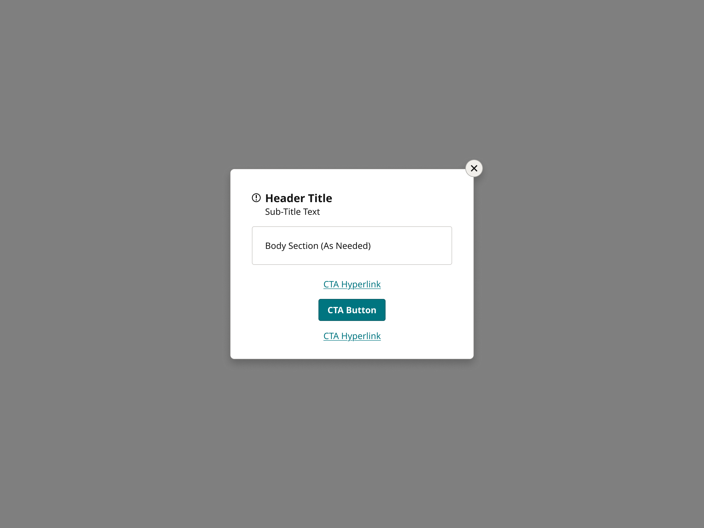
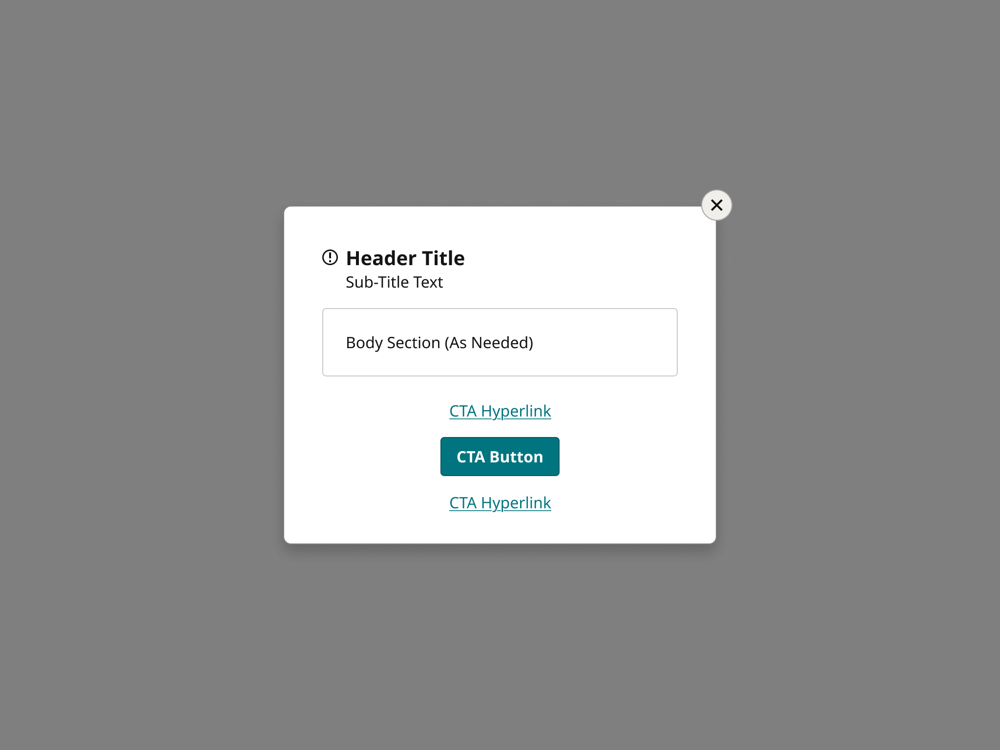
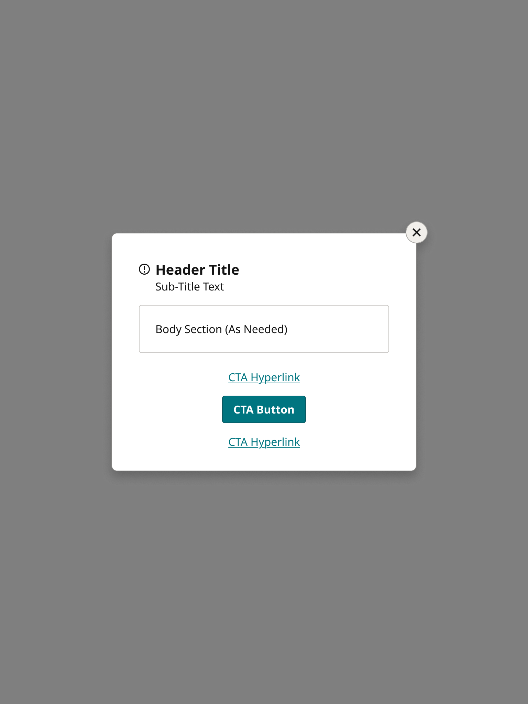
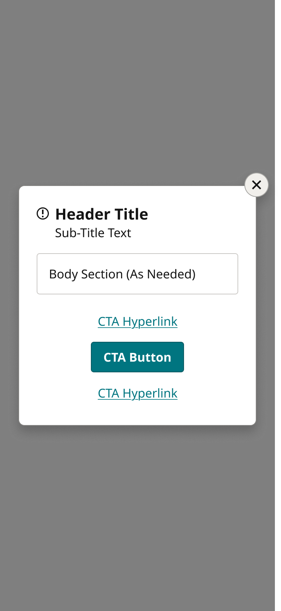
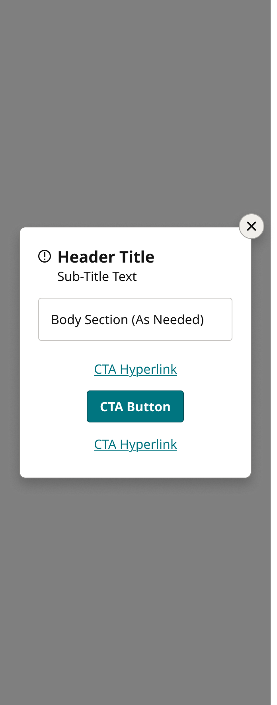
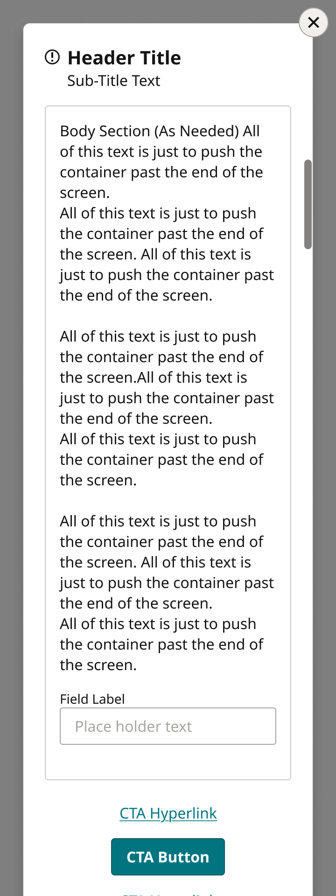

# ModalsCenter

> Centered pop-up modal (Reader Dashboard and every pop-up across the footprint). Device = Desktop, TabletH, TabletV, Mobile, MobileScroll, FOLD; each variant is the whole screen with the page overlay, so the card is shown in place.

## Figma

- File: **MNG Web Design System** (`jFHYqhZbJjvWQmDI4myCsd`), page **Modal Panels | 2025.12.29**
- Component set: [`ModalsCenter` · 3040:2262](https://www.figma.com/design/jFHYqhZbJjvWQmDI4myCsd/?node-id=3040-2262) · key `ee63f90bb43e86ecf93d65870821a8291c205a01`
- Documentation frame: [ModalsCenter Container](https://www.figma.com/design/jFHYqhZbJjvWQmDI4myCsd/?node-id=7418-3457) · overview: [previews/modals-center--documentation.png](previews/modals-center--documentation.png)

## Properties

| Property | Default | Options |
|---|---|---|
| Device | Desktop | Desktop, TabletH, TabletV, Mobile, FOLD, MobileScroll |

## Variants

| Variant | Size | Node | Instances | Preview |
|---|---|---|---|---|
| `Desktop` | 1280×960 | [3040:2263](https://www.figma.com/design/jFHYqhZbJjvWQmDI4myCsd/?node-id=3040-2263) | 3 |  |
| `TabletH` | 1024×768 | [3040:2289](https://www.figma.com/design/jFHYqhZbJjvWQmDI4myCsd/?node-id=3040-2289) | 0 |  |
| `TabletV` | 768×1024 | [3040:2315](https://www.figma.com/design/jFHYqhZbJjvWQmDI4myCsd/?node-id=3040-2315) | 1 |  |
| `Mobile` | 360×800 | [3040:2341](https://www.figma.com/design/jFHYqhZbJjvWQmDI4myCsd/?node-id=3040-2341) | 3 |  |
| `FOLD` | 340×882 | [3040:2367](https://www.figma.com/design/jFHYqhZbJjvWQmDI4myCsd/?node-id=3040-2367) | 4 |  |
| `MobileScroll` | 360×960 | [3693:1351](https://www.figma.com/design/jFHYqhZbJjvWQmDI4myCsd/?node-id=3693-1351) | 0 |  |

## Anatomy

Default variant `Desktop` (hidden layers marked):

- **Device=Desktop** `COMPONENT`: 1280×960, vertical, gap 0, padding 40/40/40/40, fixed×fixed
  - **Desktop** `FRAME`: 444×347, vertical, gap 0, padding 0/0/0/0, fixed×hug
    - **Modal Container** `FRAME`: 444×347, vertical, gap 0, padding 0/0/0/0, fill×hug
      - **Content Frame** `FRAME`: 444×347, vertical, gap 16, padding 40/40/24/40, fill×hug
        - **Header** `FRAME`: 364×49, horizontal, gap 8, padding 0/0/0/0, fill×hug
          - **Icon Container** `FRAME`: 16×16, horizontal, gap 8, padding 0/0/0/0, hug×hug
            - **Icons** `INSTANCE`: 16×16, horizontal, gap 8, padding 0/0/0/0, fixed×fixed, instance of Icons (Name=notification)
          - **Text Container** `FRAME`: 340×49, vertical, gap 0, padding 0/0/0/0, fill×hug
            - **Title** `FRAME`: 340×27, horizontal, gap 8, padding 0/0/0/0, fill×hug
            - **Subtitle** `FRAME`: 340×22, horizontal, gap 8, padding 0/0/0/0, fill×hug
        - **Body Container** `FRAME`: 364×70, vertical, gap 16, padding 24/24/24/24, fill×hug
          - **Body Content** `FRAME`: 316×22, vertical, gap 16, padding 0/0/0/0, fill×hug
            - **Body Content** `TEXT`: 316×22, fill×hug, "Body Section (As Needed)", Noto Sans Regular 16px
            - **Form Field** `INSTANCE`: 316×78, vertical, gap 0, padding 0/0/0/0, fixed×hug, instance of Form Field (Size=Desktop, State=Blank), **hidden**
        - **InLineMessage** `INSTANCE`: 364×104, vertical, gap 16, padding 0/0/0/0, fixed×hug, instance of InLineMessage (Device=Desktop, Priority=High, Location=ModalError, PanelType=Alert), **hidden**
        - **CTA** `FRAME`: 364×132, vertical, gap 8, padding 0/0/0/0, fill×hug
          - **Button Linkstyle** `INSTANCE`: 121×38, horizontal, gap 8, padding 8/8/8/8, hug×hug, instance of Button Linkstyle (Icon=None, Style=1 Row, State=Default)
          - **Button Primary** `INSTANCE`: 138×40, vertical, gap 8, padding 0/8/0/8, fixed×hug, instance of Button Primary (Icon=None, State=Default, Breakpoint=Desktop)
          - **Button Linkstyle** `INSTANCE`: 121×38, horizontal, gap 8, padding 8/8/8/8, hug×hug, instance of Button Linkstyle (Icon=None, Style=1 Row, State=Default)
        - **Button Modal Close** `INSTANCE`: 32×32, horizontal, gap 0, padding 0/0/0/0, fixed×fixed, absolute, instance of Button Modal Close (State=Default)

## Component tokens

From `modals-center.tokens.json`. References point at system tokens (`tokens/core/`, `tokens/themes/`); the CSS variable is `--mng-` + the token path. A literal value means the Figma layer isn't bound to a token.

| Token | Value |
|---|---|
| `modals-center.device-mobilescroll.controls-overlay.gap` | 123px |
| `modals-center.device-mobilescroll.controls-overlay.padding-bottom` | `{spacing.100}` |
| `modals-center.device-mobilescroll.controls-overlay.padding-right` | `{spacing.100}` |
| `modals-center.device-mobilescroll.controls-overlay.padding-top` | `{spacing.100}` |
| `modals-center.device-mobilescroll.controls-overlay.button-modal-close.height` | 32px |
| `modals-center.device-mobilescroll.controls-overlay.button-modal-close.width` | 32px |
| `modals-center.device-mobilescroll.controls-overlay.scroll-bar.padding-bottom` | `{spacing.100}` |
| `modals-center.device-mobilescroll.controls-overlay.scroll-bar.padding-left` | `{spacing.100}` |
| `modals-center.device-mobilescroll.controls-overlay.scroll-bar.padding-right` | 18px |
| `modals-center.device-mobilescroll.controls-overlay.scroll-bar.padding-top` | `{spacing.100}` |
| `modals-center.device-mobilescroll.controls-overlay.scroll-bar.scroll-indicator.background` | `{color.gray.300}` |
| `modals-center.device-mobilescroll.controls-overlay.scroll-bar.scroll-indicator.border-radius` | `{radius.lg}` |
| `modals-center.device-mobilescroll.controls-overlay.scroll-bar.scroll-indicator.height` | 96px |
| `modals-center.device-mobilescroll.controls-overlay.scroll-bar.scroll-indicator.width` | 8px |
| `modals-center.device-mobilescroll.mobile.padding-left` | `{spacing.300}` |
| `modals-center.device-mobilescroll.mobile.padding-right` | `{spacing.300}` |
| `modals-center.device-mobilescroll.mobile.modal-container.padding-bottom` | `{spacing.300}` |
| `modals-center.device-mobilescroll.mobile.modal-container.padding-top` | `{spacing.300}` |
| `modals-center.device-mobilescroll.mobile.modal-container.content-frame.background` | `{color.gray.max}` |
| `modals-center.device-mobilescroll.mobile.modal-container.content-frame.border-color` | `{color.gray.300}` |
| `modals-center.device-mobilescroll.mobile.modal-container.content-frame.border-radius` | `{radius.lg}` |
| `modals-center.device-mobilescroll.mobile.modal-container.content-frame.border-style` | solid |
| `modals-center.device-mobilescroll.mobile.modal-container.content-frame.border-width` | 1px |
| `modals-center.device-mobilescroll.mobile.modal-container.content-frame.gap` | `{spacing.200}` |
| `modals-center.device-mobilescroll.mobile.modal-container.content-frame.padding-bottom` | `{spacing.300}` |
| `modals-center.device-mobilescroll.mobile.modal-container.content-frame.padding-left` | `{spacing.300}` |
| `modals-center.device-mobilescroll.mobile.modal-container.content-frame.padding-right` | `{spacing.300}` |
| `modals-center.device-mobilescroll.mobile.modal-container.content-frame.padding-top` | `{spacing.300}` |
| `modals-center.device-mobilescroll.mobile.modal-container.content-frame.body-container.border-color` | `{color.gray.500}` |
| `modals-center.device-mobilescroll.mobile.modal-container.content-frame.body-container.border-radius` | `{radius.sm}` |
| `modals-center.device-mobilescroll.mobile.modal-container.content-frame.body-container.border-style` | solid |
| `modals-center.device-mobilescroll.mobile.modal-container.content-frame.body-container.border-width` | 1px |
| `modals-center.device-mobilescroll.mobile.modal-container.content-frame.body-container.gap` | `{spacing.200}` |
| `modals-center.device-mobilescroll.mobile.modal-container.content-frame.body-container.padding-bottom` | `{spacing.200}` |
| `modals-center.device-mobilescroll.mobile.modal-container.content-frame.body-container.padding-left` | `{spacing.200}` |
| `modals-center.device-mobilescroll.mobile.modal-container.content-frame.body-container.padding-right` | `{spacing.200}` |
| `modals-center.device-mobilescroll.mobile.modal-container.content-frame.body-container.padding-top` | `{spacing.200}` |
| `modals-center.device-mobilescroll.mobile.modal-container.content-frame.body-container.body-content.body-content.color` | `{color.gray.min}` |
| `modals-center.device-mobilescroll.mobile.modal-container.content-frame.body-container.body-content.body-content.font-family` | `{font.family.noto-sans}` |
| `modals-center.device-mobilescroll.mobile.modal-container.content-frame.body-container.body-content.body-content.font-size` | `{font.size.16}` |
| `modals-center.device-mobilescroll.mobile.modal-container.content-frame.body-container.body-content.body-content.font-weight` | `{font.weight.regular}` |
| `modals-center.device-mobilescroll.mobile.modal-container.content-frame.body-container.form-field.height` | 81px |
| `modals-center.device-mobilescroll.mobile.modal-container.content-frame.body-container.form-field.icon-color` | `{color.gray.min}` |
| `modals-center.device-mobilescroll.mobile.modal-container.content-frame.body-container.form-field.width` | 232px |
| `modals-center.device-mobilescroll.mobile.modal-container.content-frame.cta.gap` | `{spacing.100}` |
| `modals-center.device-mobilescroll.mobile.modal-container.content-frame.cta.button-linkstyle.height` | 38px |
| `modals-center.device-mobilescroll.mobile.modal-container.content-frame.cta.button-linkstyle.width` | 121px |
| `modals-center.device-mobilescroll.mobile.modal-container.content-frame.cta.button-primary.height` | 40px |
| `modals-center.device-mobilescroll.mobile.modal-container.content-frame.cta.button-primary.width` | 138px |
| `modals-center.device-mobilescroll.mobile.modal-container.content-frame.header.gap` | `{spacing.100}` |
| `modals-center.device-mobilescroll.mobile.modal-container.content-frame.header.icon-container.icons.height` | 16px |
| `modals-center.device-mobilescroll.mobile.modal-container.content-frame.header.icon-container.icons.icon-color` | `{color.gray.min}` |
| `modals-center.device-mobilescroll.mobile.modal-container.content-frame.header.icon-container.icons.width` | 16px |
| `modals-center.device-mobilescroll.mobile.modal-container.content-frame.header.text-container.subtitle.subtitle.color` | `{color.gray.min}` |
| `modals-center.device-mobilescroll.mobile.modal-container.content-frame.header.text-container.subtitle.subtitle.font-family` | `{font.family.noto-sans}` |
| `modals-center.device-mobilescroll.mobile.modal-container.content-frame.header.text-container.subtitle.subtitle.font-size` | `{font.size.16}` |
| `modals-center.device-mobilescroll.mobile.modal-container.content-frame.header.text-container.subtitle.subtitle.font-weight` | `{font.weight.regular}` |
| `modals-center.device-mobilescroll.mobile.modal-container.content-frame.header.text-container.title.title.color` | `{color.gray.min}` |
| `modals-center.device-mobilescroll.mobile.modal-container.content-frame.header.text-container.title.title.font-family` | `{font.family.noto-sans}` |
| `modals-center.device-mobilescroll.mobile.modal-container.content-frame.header.text-container.title.title.font-size` | `{font.size.20}` |
| `modals-center.device-mobilescroll.mobile.modal-container.content-frame.header.text-container.title.title.font-weight` | `{font.weight.bold}` |
| `modals-center.device-mobilescroll.root.height` | 960px |
| `modals-center.device-mobilescroll.root.width` | 360px |
| `modals-center.base.desktop.width` | 444px |
| `modals-center.base.desktop.modal-container.content-frame.background` | `{color.gray.max}` |
| `modals-center.base.desktop.modal-container.content-frame.border-color` | `{color.gray.300}` |
| `modals-center.base.desktop.modal-container.content-frame.border-radius` | `{radius.lg}` |
| `modals-center.base.desktop.modal-container.content-frame.border-style` | solid |
| `modals-center.base.desktop.modal-container.content-frame.border-width` | 1px |
| `modals-center.base.desktop.modal-container.content-frame.gap` | `{spacing.200}` |
| `modals-center.base.desktop.modal-container.content-frame.padding-bottom` | `{spacing.300}` |
| `modals-center.base.desktop.modal-container.content-frame.body-container.border-color` | `{color.gray.500}` |
| `modals-center.base.desktop.modal-container.content-frame.body-container.border-radius` | `{radius.sm}` |
| `modals-center.base.desktop.modal-container.content-frame.body-container.border-style` | solid |
| `modals-center.base.desktop.modal-container.content-frame.body-container.border-width` | 1px |
| `modals-center.base.desktop.modal-container.content-frame.body-container.body-content.body-content.color` | `{color.gray.min}` |
| `modals-center.base.desktop.modal-container.content-frame.body-container.body-content.body-content.font-family` | `{font.family.noto-sans}` |
| `modals-center.base.desktop.modal-container.content-frame.body-container.body-content.body-content.font-size` | `{font.size.16}` |
| `modals-center.base.desktop.modal-container.content-frame.body-container.body-content.body-content.font-weight` | `{font.weight.regular}` |
| `modals-center.base.desktop.modal-container.content-frame.button-modal-close.height` | 32px |
| `modals-center.base.desktop.modal-container.content-frame.button-modal-close.width` | 32px |
| `modals-center.base.desktop.modal-container.content-frame.cta.gap` | `{spacing.100}` |
| `modals-center.base.desktop.modal-container.content-frame.cta.button-linkstyle.height` | 38px |
| `modals-center.base.desktop.modal-container.content-frame.cta.button-linkstyle.width` | 121px |
| `modals-center.base.desktop.modal-container.content-frame.cta.button-primary.height` | 40px |
| `modals-center.base.desktop.modal-container.content-frame.cta.button-primary.width` | 138px |
| `modals-center.base.desktop.modal-container.content-frame.header.gap` | `{spacing.100}` |
| `modals-center.base.desktop.modal-container.content-frame.header.icon-container.icons.height` | 16px |
| `modals-center.base.desktop.modal-container.content-frame.header.icon-container.icons.icon-color` | `{color.gray.min}` |
| `modals-center.base.desktop.modal-container.content-frame.header.icon-container.icons.width` | 16px |
| `modals-center.base.desktop.modal-container.content-frame.header.text-container.subtitle.subtitle.color` | `{color.gray.min}` |
| `modals-center.base.desktop.modal-container.content-frame.header.text-container.subtitle.subtitle.font-family` | `{font.family.noto-sans}` |
| `modals-center.base.desktop.modal-container.content-frame.header.text-container.subtitle.subtitle.font-size` | `{font.size.16}` |
| `modals-center.base.desktop.modal-container.content-frame.header.text-container.subtitle.subtitle.font-weight` | `{font.weight.regular}` |
| `modals-center.base.desktop.modal-container.content-frame.header.text-container.title.title.color` | `{color.gray.min}` |
| `modals-center.base.desktop.modal-container.content-frame.header.text-container.title.title.font-family` | `{font.family.noto-sans}` |
| `modals-center.base.desktop.modal-container.content-frame.header.text-container.title.title.font-size` | `{font.size.20}` |
| `modals-center.base.desktop.modal-container.content-frame.header.text-container.title.title.font-weight` | `{font.weight.bold}` |
| `modals-center.base.root.background` | #000000 @ 0.5 |
| `modals-center.device-tableth.desktop.modal-container.button-modal-close.height` | 32px |
| `modals-center.device-tableth.desktop.modal-container.button-modal-close.width` | 32px |
| `modals-center.device-tableth.desktop.modal-container.content-frame.padding-left` | `{spacing.500}` |
| `modals-center.device-tableth.desktop.modal-container.content-frame.padding-right` | `{spacing.500}` |
| `modals-center.device-tableth.desktop.modal-container.content-frame.padding-top` | `{spacing.500}` |
| `modals-center.device-tableth.desktop.modal-container.content-frame.body-container.padding-bottom` | `{spacing.300}` |
| `modals-center.device-tableth.desktop.modal-container.content-frame.body-container.padding-left` | `{spacing.300}` |
| `modals-center.device-tableth.desktop.modal-container.content-frame.body-container.padding-right` | `{spacing.300}` |
| `modals-center.device-tableth.desktop.modal-container.content-frame.body-container.padding-top` | `{spacing.300}` |
| `modals-center.device-tableth.root.height` | 768px |
| `modals-center.device-tableth.root.padding-bottom` | `{spacing.500}` |
| `modals-center.device-tableth.root.padding-left` | `{spacing.500}` |
| `modals-center.device-tableth.root.padding-right` | `{spacing.500}` |
| `modals-center.device-tableth.root.padding-top` | `{spacing.500}` |
| `modals-center.device-tableth.root.width` | 1024px |
| `modals-center.device-desktop.desktop.modal-container.content-frame.padding-left` | `{spacing.500}` |
| `modals-center.device-desktop.desktop.modal-container.content-frame.padding-right` | `{spacing.500}` |
| `modals-center.device-desktop.desktop.modal-container.content-frame.padding-top` | `{spacing.500}` |
| `modals-center.device-desktop.desktop.modal-container.content-frame.body-container.padding-bottom` | `{spacing.300}` |
| `modals-center.device-desktop.desktop.modal-container.content-frame.body-container.padding-left` | `{spacing.300}` |
| `modals-center.device-desktop.desktop.modal-container.content-frame.body-container.padding-right` | `{spacing.300}` |
| `modals-center.device-desktop.desktop.modal-container.content-frame.body-container.padding-top` | `{spacing.300}` |
| `modals-center.device-desktop.root.height` | 960px |
| `modals-center.device-desktop.root.padding-bottom` | `{spacing.500}` |
| `modals-center.device-desktop.root.padding-left` | `{spacing.500}` |
| `modals-center.device-desktop.root.padding-right` | `{spacing.500}` |
| `modals-center.device-desktop.root.padding-top` | `{spacing.500}` |
| `modals-center.device-desktop.root.width` | 1280px |
| `modals-center.device-tabletv.desktop.modal-container.content-frame.padding-left` | `{spacing.500}` |
| `modals-center.device-tabletv.desktop.modal-container.content-frame.padding-right` | `{spacing.500}` |
| `modals-center.device-tabletv.desktop.modal-container.content-frame.padding-top` | `{spacing.500}` |
| `modals-center.device-tabletv.desktop.modal-container.content-frame.body-container.padding-bottom` | `{spacing.300}` |
| `modals-center.device-tabletv.desktop.modal-container.content-frame.body-container.padding-left` | `{spacing.300}` |
| `modals-center.device-tabletv.desktop.modal-container.content-frame.body-container.padding-right` | `{spacing.300}` |
| `modals-center.device-tabletv.desktop.modal-container.content-frame.body-container.padding-top` | `{spacing.300}` |
| `modals-center.device-tabletv.root.height` | 1024px |
| `modals-center.device-tabletv.root.padding-bottom` | `{spacing.500}` |
| `modals-center.device-tabletv.root.padding-left` | `{spacing.500}` |
| `modals-center.device-tabletv.root.padding-right` | `{spacing.500}` |
| `modals-center.device-tabletv.root.padding-top` | `{spacing.500}` |
| `modals-center.device-tabletv.root.width` | 768px |
| `modals-center.device-mobile.desktop.modal-container.content-frame.padding-left` | `{spacing.300}` |
| `modals-center.device-mobile.desktop.modal-container.content-frame.padding-right` | `{spacing.300}` |
| `modals-center.device-mobile.desktop.modal-container.content-frame.padding-top` | `{spacing.300}` |
| `modals-center.device-mobile.desktop.modal-container.content-frame.body-container.padding-bottom` | `{spacing.200}` |
| `modals-center.device-mobile.desktop.modal-container.content-frame.body-container.padding-left` | `{spacing.200}` |
| `modals-center.device-mobile.desktop.modal-container.content-frame.body-container.padding-right` | `{spacing.200}` |
| `modals-center.device-mobile.desktop.modal-container.content-frame.body-container.padding-top` | `{spacing.200}` |
| `modals-center.device-mobile.root.height` | 800px |
| `modals-center.device-mobile.root.padding-bottom` | `{spacing.300}` |
| `modals-center.device-mobile.root.padding-left` | `{spacing.300}` |
| `modals-center.device-mobile.root.padding-right` | `{spacing.300}` |
| `modals-center.device-mobile.root.padding-top` | `{spacing.300}` |
| `modals-center.device-mobile.root.width` | 360px |
| `modals-center.device-fold.fold-modal.modal-container.content-frame.background` | `{color.gray.max}` |
| `modals-center.device-fold.fold-modal.modal-container.content-frame.border-color` | `{color.gray.300}` |
| `modals-center.device-fold.fold-modal.modal-container.content-frame.border-radius` | `{radius.lg}` |
| `modals-center.device-fold.fold-modal.modal-container.content-frame.border-style` | solid |
| `modals-center.device-fold.fold-modal.modal-container.content-frame.border-width` | 1px |
| `modals-center.device-fold.fold-modal.modal-container.content-frame.gap` | `{spacing.200}` |
| `modals-center.device-fold.fold-modal.modal-container.content-frame.padding-bottom` | `{spacing.300}` |
| `modals-center.device-fold.fold-modal.modal-container.content-frame.padding-left` | `{spacing.300}` |
| `modals-center.device-fold.fold-modal.modal-container.content-frame.padding-right` | `{spacing.300}` |
| `modals-center.device-fold.fold-modal.modal-container.content-frame.padding-top` | `{spacing.300}` |
| `modals-center.device-fold.fold-modal.modal-container.content-frame.body-container.border-color` | `{color.gray.500}` |
| `modals-center.device-fold.fold-modal.modal-container.content-frame.body-container.border-radius` | `{radius.sm}` |
| `modals-center.device-fold.fold-modal.modal-container.content-frame.body-container.border-style` | solid |
| `modals-center.device-fold.fold-modal.modal-container.content-frame.body-container.border-width` | 1px |
| `modals-center.device-fold.fold-modal.modal-container.content-frame.body-container.padding-bottom` | `{spacing.200}` |
| `modals-center.device-fold.fold-modal.modal-container.content-frame.body-container.padding-left` | `{spacing.200}` |
| `modals-center.device-fold.fold-modal.modal-container.content-frame.body-container.padding-right` | `{spacing.200}` |
| `modals-center.device-fold.fold-modal.modal-container.content-frame.body-container.padding-top` | `{spacing.200}` |
| `modals-center.device-fold.fold-modal.modal-container.content-frame.body-container.body-content.body-content.color` | `{color.gray.min}` |
| `modals-center.device-fold.fold-modal.modal-container.content-frame.body-container.body-content.body-content.font-family` | `{font.family.noto-sans}` |
| `modals-center.device-fold.fold-modal.modal-container.content-frame.body-container.body-content.body-content.font-size` | `{font.size.16}` |
| `modals-center.device-fold.fold-modal.modal-container.content-frame.body-container.body-content.body-content.font-weight` | `{font.weight.regular}` |
| `modals-center.device-fold.fold-modal.modal-container.content-frame.button-modal-close.height` | 32px |
| `modals-center.device-fold.fold-modal.modal-container.content-frame.button-modal-close.width` | 32px |
| `modals-center.device-fold.fold-modal.modal-container.content-frame.cta.gap` | `{spacing.100}` |
| `modals-center.device-fold.fold-modal.modal-container.content-frame.cta.button-linkstyle.height` | 38px |
| `modals-center.device-fold.fold-modal.modal-container.content-frame.cta.button-linkstyle.width` | 121px |
| `modals-center.device-fold.fold-modal.modal-container.content-frame.cta.button-primary.height` | 40px |
| `modals-center.device-fold.fold-modal.modal-container.content-frame.cta.button-primary.width` | 138px |
| `modals-center.device-fold.fold-modal.modal-container.content-frame.header.gap` | `{spacing.100}` |
| `modals-center.device-fold.fold-modal.modal-container.content-frame.header.icon-container.icons.height` | 16px |
| `modals-center.device-fold.fold-modal.modal-container.content-frame.header.icon-container.icons.icon-color` | `{color.gray.min}` |
| `modals-center.device-fold.fold-modal.modal-container.content-frame.header.icon-container.icons.width` | 16px |
| `modals-center.device-fold.fold-modal.modal-container.content-frame.header.text-container.subtitle.subtitle.color` | `{color.gray.min}` |
| `modals-center.device-fold.fold-modal.modal-container.content-frame.header.text-container.subtitle.subtitle.font-family` | `{font.family.noto-sans}` |
| `modals-center.device-fold.fold-modal.modal-container.content-frame.header.text-container.subtitle.subtitle.font-size` | `{font.size.16}` |
| `modals-center.device-fold.fold-modal.modal-container.content-frame.header.text-container.subtitle.subtitle.font-weight` | `{font.weight.regular}` |
| `modals-center.device-fold.fold-modal.modal-container.content-frame.header.text-container.title.title.color` | `{color.gray.min}` |
| `modals-center.device-fold.fold-modal.modal-container.content-frame.header.text-container.title.title.font-family` | `{font.family.noto-sans}` |
| `modals-center.device-fold.fold-modal.modal-container.content-frame.header.text-container.title.title.font-size` | `{font.size.20}` |
| `modals-center.device-fold.fold-modal.modal-container.content-frame.header.text-container.title.title.font-weight` | `{font.weight.bold}` |
| `modals-center.device-fold.root.height` | 882px |
| `modals-center.device-fold.root.padding-bottom` | `{spacing.300}` |
| `modals-center.device-fold.root.padding-left` | `{spacing.300}` |
| `modals-center.device-fold.root.padding-right` | `{spacing.300}` |
| `modals-center.device-fold.root.padding-top` | `{spacing.300}` |
| `modals-center.device-fold.root.width` | 340px |

## Behavior and breakpoints

| Device | Screen | Card |
|---|---|---|
| Desktop, TabletH, TabletV | 1280, 1024, 768 | 444px, centered; padding 40/40/24/40 |
| Mobile, Fold | 360, 340 | screen width minus 24px each side; padding 24 |

- **Card:** `color/gray/max`, 1px `color/gray/300` border, `radius/lg` (8px), `shadow/lg`. Desktop and tablets: 444px wide, centered. Mobile and Fold: the screen width minus 24px each side (312 at 360, 292 at 340).
- **Card padding:** Desktop and tablets 40px (`spacing/500`) top, left and right, 24px (`spacing/300`) bottom. Mobile and Fold 24px (`spacing/300`) all round.
- **Spacing:** 16px (`spacing/200`) between the header, Body Container, InLineMessage and CTA stack; 8px (`spacing/100`) between CTAs and between the header icon and title; the optional header icon sits in its own container (so the subtitle lines up under the title) and is aligned to the title's first line by baseline alignment (`align-items: baseline`), no padding.
- **Body Container:** 1px `color/gray/500` border, `radius/sm`; padding 24px (`spacing/300`), 16px (`spacing/200`) on Mobile and Fold.
- **Text:** title Noto Sans Bold 20, subtitle and body Noto Sans Regular 16, all `color/gray/min`. CTAs: Button Linkstyle (`color/theme/primary`) and Button Primary, stacked and centered.
- **Close:** Button Modal Close (32×32, `pop-up-modal-close`) centered on the card's top-right corner; at least 24px (`spacing/300`) between the card and the screen edge.
- **Overlay:** black at 50% over the page below the masthead (no token yet). The masthead stays visible above it in most cases.
- **Closing:** the close button, an inline text link, or a click anywhere outside the card.
- **Where scroll is needed** (MobileScroll): no top or bottom margin; the close button stays 8px below the masthead (8px from the top of the viewport without one); the card scrolls inside and the page behind it doesn't.

## Accessibility

- No InFocus state in Figma.
- Text color on its background must meet WCAG AA contrast (4.5:1 for text under 18px) in every theme; theme colors change per site.
- Icons inside a labelled control are decorative (`aria-hidden`); an icon-only control needs an accessible name (`aria-label`).

## Where it is used

Scope: instances in the Figma file **MNG Web Design System** only (other files that use the library are not counted). Total: **11**.

Placed on pages: Modal Panels | 2025.12.29 ×6, Buttons | 2026.09.30 ×1.

**Built from:** Button Linkstyle ×12, Icons ×6, Button Primary ×6, Button Modal Close ×6, Form Field ×1
Icon variants: `notification` ×6.

## Production

Reader Dashboard modal (`react-modal`, `.ReactModal__Content`).

## Known issues

1. MobileScroll's scroll bar is a placeholder; revisit with the Embedded login project (Karl, 2026-10-27; status open item 15).
2. Production (Reader Dashboard) differences: design-vs-production entry 31.
3. **Values not bound to a token** (literal in the component tokens): `device-mobilescroll` controls-overlay gap = 123px; `device-mobilescroll` controls-overlay.scroll-bar padding-right = 18px; `base` root background = #000000 @ 0.5.

## Files

- `modals-center.tokens.json`: component tokens (DTCG 2025.10).
- `modals-center.html`: HTML/CSS skeleton of every variant, using the `dist/` CSS variables (open it in a browser).
- `previews/`: PNG of every variant @2x and the documentation frame.

*Generated 2026-10-28 by `scripts/component-export/export.py` (EXPORT-STANDARD.md section 7). Edit the text in `scripts/component-export/registry.json`, not here.*
