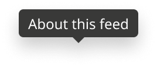
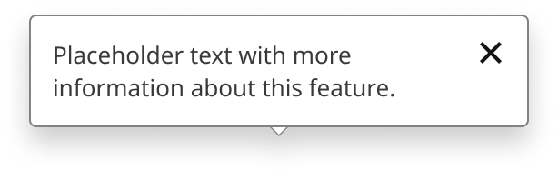
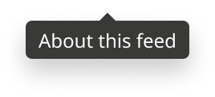
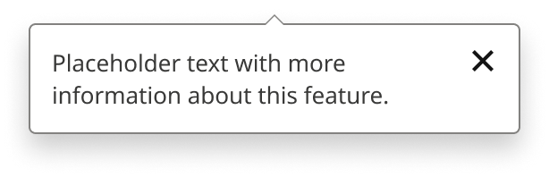

# Tooltip

> Two types in one set. Type=Tooltip: a short hover/focus label for icon-only buttons (Label property). Type=Toggletip: an explanation opened by clicking or tapping an info button (Text property; Show Close). Placement = Top, Bottom.

## Figma

- File: **MNG Web Design System** (`jFHYqhZbJjvWQmDI4myCsd`), page **Tooltips | 2026.10.23**
- Component set: [`Tooltip` · 7372:25744](https://www.figma.com/design/jFHYqhZbJjvWQmDI4myCsd/?node-id=7372-25744) · key `145f2a1ceb3b75e02401b3b60b397df9d4803fcd`
- Documentation frame: [Tooltip Container](https://www.figma.com/design/jFHYqhZbJjvWQmDI4myCsd/?node-id=7372-25704) · overview: [previews/tooltip--documentation.png](previews/tooltip--documentation.png)

## Properties

| Property | Default | Options |
|---|---|---|
| Placement | Top | Top, Bottom |
| Type | Tooltip | Tooltip, Toggletip |

| Other property | Type | Default |
|---|---|---|
| Text | text | Placeholder text with more information about this feature. |
| Show Close | boolean | True |
| Label | text | About this feed |

## Variants

| Variant | Size | Node | Instances | Preview |
|---|---|---|---|---|
| `Top / Tooltip` | 102×29 | [7372:25710](https://www.figma.com/design/jFHYqhZbJjvWQmDI4myCsd/?node-id=7372-25710) | 0 |  |
| `Top / Toggletip` | 275×67 | [7372:25720](https://www.figma.com/design/jFHYqhZbJjvWQmDI4myCsd/?node-id=7372-25720) | 0 |  |
| `Bottom / Tooltip` | 102×29 | [7372:25715](https://www.figma.com/design/jFHYqhZbJjvWQmDI4myCsd/?node-id=7372-25715) | 0 |  |
| `Bottom / Toggletip` | 275×67 | [7372:25732](https://www.figma.com/design/jFHYqhZbJjvWQmDI4myCsd/?node-id=7372-25732) | 1 |  |

## Anatomy

Default variant `Top / Tooltip` (hidden layers marked):

- **Type=Tooltip, Placement=Top** `COMPONENT`: 102×29, vertical, gap -1, padding 0/0/0/0, hug×hug
  - **Box** `FRAME`: 102×24, horizontal, gap 0, padding 4/8/4/8, hug×hug
    - **Label** `TEXT`: 86×16, fill×hug, "About this feed", Noto Sans Regular 12px
  - **Caret** `FRAME`: 12×6, fixed×fixed
    - **Caret Fill** `VECTOR`: 12×6, fixed×fixed

## Component tokens

From `tooltip.tokens.json`. References point at system tokens (`tokens/core/`, `tokens/themes/`); the CSS variable is `--mng-` + the token path. A literal value means the Figma layer isn't bound to a token.

| Token | Value |
|---|---|
| `tooltip.type-tooltip.box.background` | `{color.gray.100}` |
| `tooltip.type-tooltip.box.padding-bottom` | `{spacing.050}` |
| `tooltip.type-tooltip.box.padding-left` | `{spacing.100}` |
| `tooltip.type-tooltip.box.padding-right` | `{spacing.100}` |
| `tooltip.type-tooltip.box.padding-top` | `{spacing.050}` |
| `tooltip.type-tooltip.box.label.color` | `{color.gray.max}` |
| `tooltip.type-tooltip.box.label.font-family` | `{font.family.noto-sans}` |
| `tooltip.type-tooltip.box.label.font-size` | `{font.size.12}` |
| `tooltip.type-tooltip.box.label.font-weight` | `{font.weight.regular}` |
| `tooltip.type-tooltip.caret.caret-fill.background` | `{color.gray.100}` |
| `tooltip.type-tooltip.caret.caret-fill.height` | 6px |
| `tooltip.type-tooltip.caret.caret-fill.width` | 12px |
| `tooltip.type-toggletip.box.background` | `{color.gray.max}` |
| `tooltip.type-toggletip.box.border-color` | `{color.gray.300}` |
| `tooltip.type-toggletip.box.border-style` | solid |
| `tooltip.type-toggletip.box.border-width` | 1px |
| `tooltip.type-toggletip.box.width` | 275px |
| `tooltip.type-toggletip.box.close.height` | 40px |
| `tooltip.type-toggletip.box.close.width` | 40px |
| `tooltip.type-toggletip.box.text-container.padding-bottom` | `{spacing.150}` |
| `tooltip.type-toggletip.box.text-container.padding-left` | `{spacing.150}` |
| `tooltip.type-toggletip.box.text-container.padding-right` | `{spacing.150}` |
| `tooltip.type-toggletip.box.text-container.padding-top` | `{spacing.150}` |
| `tooltip.type-toggletip.box.text-container.text.color` | `{color.gray.100}` |
| `tooltip.type-toggletip.box.text-container.text.font-family` | `{font.family.noto-sans}` |
| `tooltip.type-toggletip.box.text-container.text.font-size` | `{font.size.13}` |
| `tooltip.type-toggletip.box.text-container.text.font-weight` | `{font.weight.regular}` |
| `tooltip.type-toggletip.caret.caret-border.background` | `{color.gray.300}` |
| `tooltip.type-toggletip.caret.caret-border.height` | 6px |
| `tooltip.type-toggletip.caret.caret-border.width` | 12px |
| `tooltip.type-toggletip.caret.caret-fill.background` | `{color.gray.max}` |
| `tooltip.type-toggletip.caret.caret-fill.height` | 5px |
| `tooltip.type-toggletip.caret.caret-fill.width` | 10px |
| `tooltip.base.box.border-radius` | `{radius.sm}` |
| `tooltip.base.caret.height` | 6px |
| `tooltip.base.caret.width` | 12px |
| `tooltip.base.root.gap` | -1px |

## Behavior and breakpoints

No Breakpoint property: one size at every width.

- **Tooltip:** `color/gray/100` box, `radius/sm`; label Noto Sans Regular 12 (`font/size/12`), `color/gray/max` (11.6:1), line height auto; 4px (`spacing/050`) top and bottom, 8px (`spacing/100`) left and right; hugs its text up to 240px, then wraps. Never holds links or anything interactive; not shown on touch.
- **Toggletip:** 275px wide, `color/gray/max`, 1px `color/gray/300` border, `radius/sm`; text Noto Sans Regular 13 (`font/size/13`), `color/gray/100`; 12px (`spacing/150`) around the text; Button In-Line Close (40×40) at the top right when Show Close is on (default).
- **Caret:** 12×6, centered on the box, pointing at the trigger (Top: caret down; Bottom: caret up). The toggletip caret has a 1px `color/gray/300` edge. It overlaps the box by 1px so no seam shows. It scales with the component.
- **Shadow:** `shadow/lg` on both types.
- **Placement:** centered on the trigger, 8px (`spacing/100`) between the trigger and the caret tip; flip to the other Placement when there isn't room.
- **Behavior:** Tooltip shows on hover or focus and hides on mouse-out, blur or Esc. Toggletip: the trigger is a button with `aria-expanded` and `aria-controls` (matching the popup's id); it opens on click or tap; Esc, the close button or a click outside closes it, and focus returns to the trigger.
- **First use:** the For You feed header info button (Section Title / Eyebrow, Show Info) opens Type=Toggletip, Placement=Bottom.

## Accessibility

- No InFocus state in Figma.
- Text color on its background must meet WCAG AA contrast (4.5:1 for text under 18px) in every theme; theme colors change per site.
- Icons inside a labelled control are decorative (`aria-hidden`); an icon-only control needs an accessible name (`aria-label`).

## Where it is used

Scope: instances in the Figma file **MNG Web Design System** only (other files that use the library are not counted). Total: **1**.

**Built from:** Button In-Line Close ×2

## Production

No tooltip on the homepage. Article "type of work" popup `#tiPopupContent` (ocregister, denverpost) is the toggletip pattern.

## Known issues

1. Production's article "type of work" popup is the same pattern with off-token values and a broken `aria-controls` (design-vs-production entry 35).
2. **Values not bound to a token** (literal in the component tokens): `base` root gap = -1px.

## Files

- `tooltip.tokens.json`: component tokens (DTCG 2025.10).
- `tooltip.html`: HTML/CSS skeleton of every variant, using the `dist/` CSS variables (open it in a browser).
- `previews/`: PNG of every variant @2x and the documentation frame.

*Generated 2026-10-28 by `scripts/component-export/export.py` (EXPORT-STANDARD.md section 7). Edit the text in `scripts/component-export/registry.json`, not here.*
