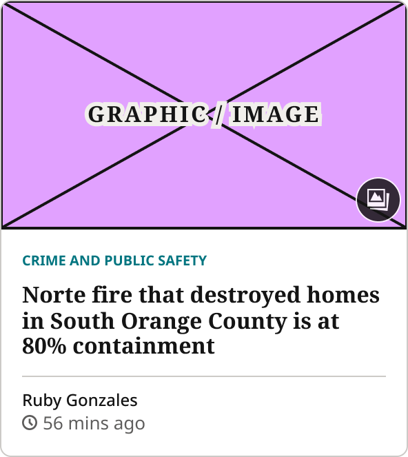

# 1Col Article Card

> Single-column article card. Style=Standard (4:3 image, CardQuaternary headline, compact excerpt: section-highlight lead cards), Style=Media Lead (16:9 image, TitleMedia headline, excerpt: the Photos lead) and Style=For You (bordered card for the For You tab).

## Figma

- File: **WordPress Elements** (`b1iZxkFwtAYq9rElmnCAzd`), page **Homepage**
- Component set: [`1Col Article Card` · 3536:39065](https://www.figma.com/design/b1iZxkFwtAYq9rElmnCAzd/?node-id=3536-39065) · key `d527b9d45b9d427355fa4f71183d2232ca6eaf27`
- Documentation frame: [1Col Article Card Container](https://www.figma.com/design/b1iZxkFwtAYq9rElmnCAzd/?node-id=3484-67695) · overview: [previews/1col-article-card--documentation.png](previews/1col-article-card--documentation.png)

## Properties

| Property | Default | Options |
|---|---|---|
| Style | Standard | Standard, Media Lead, For You |

| Other property | Type | Default |
|---|---|---|
| Show Image | boolean | True |
| Show Subscriber Badge | boolean | False |
| Show Excerpt | boolean | True |
| Show Meta | boolean | False |
| Show Gallery Icon | boolean | True |

## Variants

| Variant | Size | Node | Instances | Preview |
|---|---|---|---|---|
| `Standard` | 296×372 | [3352:24163](https://www.figma.com/design/b1iZxkFwtAYq9rElmnCAzd/?node-id=3352-24163) | 230 |  |
| `Media Lead` | 296×413.5 | [3536:39050](https://www.figma.com/design/b1iZxkFwtAYq9rElmnCAzd/?node-id=3536-39050) | 12 |  |
| `For You` | 296×331.5 | [3628:44640](https://www.figma.com/design/b1iZxkFwtAYq9rElmnCAzd/?node-id=3628-44640) | 0 |  |

## Anatomy

Default variant `Standard` (hidden layers marked):

- **Style=Standard** `COMPONENT`: 296×372, vertical, gap 8, padding 0/0/16/0, fixed×hug
  - **Article Graphic** `INSTANCE`: 296×222, vertical, gap 8, padding 0/0/0/0, fill×fixed, instance of Article Image Placeholder ()
  - **SubsOnlyBadge** `INSTANCE`: 127×27, horizontal, gap 8, padding 2/5/2/5, hug×hug, instance of Article Status Badge (Type=Subscriber), **hidden**
  - **Headline Container** `FRAME`: 296×72, vertical, gap 15, padding 0/0/0/0, fill×hug
    - **Article Headline on News paper homepage in first position on 1col section block** `TEXT`: 296×72, fill×hug, "Article Headline on News paper homepage ", Noto Sans SemiBold 19px
  - **Excerpt Container** `FRAME`: 296×38, horizontal, gap 8, padding 0/0/0/0, fill×hug
    - **Vanroy Evan Smith, 39, of Long Beach is being held on $1 million bail.** `TEXT`: 296×38, fill×hug, "Vanroy Evan Smith, 39, of Long Beach is ", Noto Sans Regular 15px
  - **Meta Container** `FRAME`: 296×18, vertical, gap 8, padding 0/0/0/0, fixed×hug, **hidden**
    - **56 mins ago** `TEXT`: 296×18, fill×hug, "56 mins ago", Noto Sans Regular 13px
  - **Bottom Border Line** `LINE`: 296×0, fill×fixed

## Component tokens

From `1col-article-card.tokens.json`. References point at system tokens (`tokens/core/`, `tokens/themes/`); the CSS variable is `--mng-` + the token path. A literal value means the Figma layer isn't bound to a token.

| Token | Value |
|---|---|
| `1col-article-card.style-standard.article-graphic.height` | 222px |
| `1col-article-card.style-standard.excerpt-container.vanroy-evan-smith-39-of-long-beach-is-being-held-on-1-million-bail.font-family` | `{font.theme.small-headline-family}` |
| `1col-article-card.style-standard.excerpt-container.vanroy-evan-smith-39-of-long-beach-is-being-held-on-1-million-bail.font-size` | 15px |
| `1col-article-card.style-standard.excerpt-container.vanroy-evan-smith-39-of-long-beach-is-being-held-on-1-million-bail.font-weight` | 400 |
| `1col-article-card.style-standard.excerpt-container.vanroy-evan-smith-39-of-long-beach-is-being-held-on-1-million-bail.line-height` | 19px |
| `1col-article-card.style-standard.headline-container.article-headline-on-news-paper-homepage-in-first-position-on-1col-section-block.font-family` | Noto Sans |
| `1col-article-card.style-standard.headline-container.article-headline-on-news-paper-homepage-in-first-position-on-1col-section-block.font-size` | 19px |
| `1col-article-card.style-standard.headline-container.article-headline-on-news-paper-homepage-in-first-position-on-1col-section-block.font-weight` | 600 |
| `1col-article-card.style-standard.headline-container.article-headline-on-news-paper-homepage-in-first-position-on-1col-section-block.letter-spacing` | -0.665px |
| `1col-article-card.style-standard.headline-container.article-headline-on-news-paper-homepage-in-first-position-on-1col-section-block.line-height` | 24px |
| `1col-article-card.style-media-lead.article-graphic.height` | 166.5px |
| `1col-article-card.style-media-lead.excerpt-container.vanroy-evan-smith-39-of-long-beach-is-being-held-on-1-million-bail.font-family` | Noto Sans |
| `1col-article-card.style-media-lead.excerpt-container.vanroy-evan-smith-39-of-long-beach-is-being-held-on-1-million-bail.font-size` | 15px |
| `1col-article-card.style-media-lead.excerpt-container.vanroy-evan-smith-39-of-long-beach-is-being-held-on-1-million-bail.font-weight` | 400 |
| `1col-article-card.style-media-lead.excerpt-container.vanroy-evan-smith-39-of-long-beach-is-being-held-on-1-million-bail.line-height` | 21px |
| `1col-article-card.style-media-lead.headline-container.article-headline-on-news-paper-homepage-in-first-position-on-1col-section-block.font-family` | Noto Serif |
| `1col-article-card.style-media-lead.headline-container.article-headline-on-news-paper-homepage-in-first-position-on-1col-section-block.font-size` | 29px |
| `1col-article-card.style-media-lead.headline-container.article-headline-on-news-paper-homepage-in-first-position-on-1col-section-block.font-weight` | 700 |
| `1col-article-card.style-media-lead.headline-container.article-headline-on-news-paper-homepage-in-first-position-on-1col-section-block.letter-spacing` | -1.16px |
| `1col-article-card.style-media-lead.headline-container.article-headline-on-news-paper-homepage-in-first-position-on-1col-section-block.line-height` | 33px |
| `1col-article-card.style-for-you.article-graphic.height` | 166.5px |
| `1col-article-card.style-for-you.card-body.gap` | `{spacing.150}` |
| `1col-article-card.style-for-you.card-body.padding-bottom` | `{spacing.200}` |
| `1col-article-card.style-for-you.card-body.padding-left` | `{spacing.200}` |
| `1col-article-card.style-for-you.card-body.padding-right` | `{spacing.200}` |
| `1col-article-card.style-for-you.card-body.padding-top` | `{spacing.200}` |
| `1col-article-card.style-for-you.card-body.card-footer.border-color` | `{color.gray.500}` |
| `1col-article-card.style-for-you.card-body.card-footer.border-style` | solid |
| `1col-article-card.style-for-you.card-body.card-footer.border-top-width` | 1px |
| `1col-article-card.style-for-you.card-body.card-footer.padding-top` | `{spacing.100}` |
| `1col-article-card.style-for-you.card-body.card-footer.article-author.height` | 16px |
| `1col-article-card.style-for-you.card-body.card-footer.article-author.icon-color` | `{color.gray.min}` |
| `1col-article-card.style-for-you.card-body.card-footer.article-author.width` | 84px |
| `1col-article-card.style-for-you.card-body.card-footer.article-timestamp.height` | 18px |
| `1col-article-card.style-for-you.card-body.card-footer.article-timestamp.width` | 90px |
| `1col-article-card.style-for-you.card-body.headline-container.gap` | `{spacing.100}` |
| `1col-article-card.style-for-you.card-body.headline-container.article-section-kicker.height` | 13px |
| `1col-article-card.style-for-you.card-body.headline-container.article-section-kicker.icon-color` | `{color.theme.primary}` |
| `1col-article-card.style-for-you.card-body.headline-container.article-section-kicker.width` | 135px |
| `1col-article-card.style-for-you.card-body.headline-container.headline.color` | `{color.gray.min}` |
| `1col-article-card.style-for-you.card-body.headline-container.headline.font-family` | Noto Serif |
| `1col-article-card.style-for-you.card-body.headline-container.headline.font-size` | 16px |
| `1col-article-card.style-for-you.card-body.headline-container.headline.font-weight` | 700 |
| `1col-article-card.style-for-you.card-body.headline-container.headline.line-height` | 18.88px |
| `1col-article-card.style-for-you.gallery-icon-badge.height` | 33px |
| `1col-article-card.style-for-you.gallery-icon-badge.width` | 33px |
| `1col-article-card.style-for-you.root.border-color` | `{color.gray.500}` |
| `1col-article-card.style-for-you.root.border-radius` | `{radius.lg}` |
| `1col-article-card.style-for-you.root.border-style` | solid |
| `1col-article-card.style-for-you.root.border-width` | 1px |
| `1col-article-card.base.article-graphic.icon-color` | `{color.gray.min}` |
| `1col-article-card.base.article-graphic.width` | 296px |
| `1col-article-card.base.bottom-border-line.border-color` | `{color.gray.500}` |
| `1col-article-card.base.bottom-border-line.border-style` | solid |
| `1col-article-card.base.bottom-border-line.border-width` | 1px |
| `1col-article-card.base.bottom-border-line.height` | 0px |
| `1col-article-card.base.excerpt-container.vanroy-evan-smith-39-of-long-beach-is-being-held-on-1-million-bail.color` | `{color.gray.100}` |
| `1col-article-card.base.headline-container.article-headline-on-news-paper-homepage-in-first-position-on-1col-section-block.color` | `{color.gray.min}` |
| `1col-article-card.base.root.background` | `{color.gray.max}` |
| `1col-article-card.base.root.gap` | 8px |
| `1col-article-card.base.root.padding-bottom` | 16px |
| `1col-article-card.base.root.width` | 296px |

## Behavior and breakpoints

No Breakpoint property: one size at every width.

- **Style=For You container:** `color/gray/max` fill, 1px `color/gray/500` border, `radius/lg` (8px) corners, clips its content. No shadow.
- **Style=For You content:** 16:9 Article Image Placeholder (Show Image applies); Article Section Kicker; headline in `Editorial/Titles/CardTertiaryCompact` (Noto Serif Bold 16/18.88, `color/gray/min`), max 5 lines with an ellipsis; footer with a 1px `color/gray/500` top border, Article Author with the Article Timestamp under it.
- **Style=For You spacing:** 16px (`spacing/200`) body padding; 8px (`spacing/100`) between kicker and headline; 12px (`spacing/150`) between the headline group and the footer; 8px (`spacing/100`) above the author.
- **Style=For You width:** fills its column, 16px between cards: 3-up from 800px, 2-up at 640–799px, 1-up below 640px. Built at 296px.
- **Equal-height rows:** in code the card body is also `justify-content: space-between`, so footers line up when cards in a row stretch to the same height. Figma can't combine that with a fixed gap, so the Figma card uses the 12px gap.
- **Properties:** Show Subscriber Badge, Show Excerpt and Show Meta apply to Standard and Media Lead only. Show Gallery Icon (added 2026-10-26) applies to For You: 28px badge, 6px in from the image's bottom-right corner, as in Horizontal Thumbnail Card.

## Accessibility

- No InFocus state in Figma.
- Text color on its background must meet WCAG AA contrast (4.5:1 for text under 18px) in every theme; theme colors change per site.
- Icons inside a labelled control are decorative (`aria-hidden`); an icon-only control needs an accessible name (`aria-label`).

## Where it is used

Scope: instances in the Figma file **WordPress Elements** only (other files that use the library are not counted). Total: **242**.

Inside components: Section Rail Card ×32, Feature + List Content Block ×6, Photos Block ×6.
Placed on pages: Homepage ×162.
36 instances are nested inside other instances.

**Built from:** Article Image Placeholder ×3, Article Section Kicker ×1, Article Author ×1, Article Timestamp ×1, Gallery Icon Badge ×1

## Production

No production selector recorded yet. Production gaps go in `design-vs-production.md`.

## Known issues

1. Style=For You is superseded by Blocks Card (2026-10-28), which has the Hover and Focus states.
2. **Values not bound to a token** (literal in the component tokens): `base` root gap = 8px; `base` root padding-bottom = 16px.

## Files

- `1col-article-card.tokens.json`: component tokens (DTCG 2025.10).
- `1col-article-card.html`: HTML/CSS skeleton of every variant, using the `dist/` CSS variables (open it in a browser).
- `previews/`: PNG of every variant @2x and the documentation frame.

*Generated 2026-10-28 by `scripts/component-export/export.py` (EXPORT-STANDARD.md section 7). Edit the text in `scripts/component-export/registry.json`, not here.*
