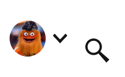

# AccountMenu

> The account control in the masthead and the dropdown it opens. Status = loggedIn, loggedOut, alert; View = Closed / Open; Device; UserType = loggedIn, loggedOut, nonSub, BasicSub, PremSub, groupSub, GroupAnon. Search is a slot property.

## Figma

- File: **WordPress Elements** (`b1iZxkFwtAYq9rElmnCAzd`), page **Menus and Parts**
- Component set: [`AccountMenu` · 910:16425](https://www.figma.com/design/b1iZxkFwtAYq9rElmnCAzd/?node-id=910-16425) · key `21db80b6ccdb88eb2a61326e46bce299f7aa1693`
- Documentation frame: [Account Dropdown Menu](https://www.figma.com/design/b1iZxkFwtAYq9rElmnCAzd/?node-id=910-15618) · overview: [previews/account-menu--documentation.png](previews/account-menu--documentation.png)

## Properties

| Property | Default | Options |
|---|---|---|
| Device | SM-Mobile | XS-Fold, SM-Mobile, MD-TabletV, XL-Desktop, LG-TabletH |
| Status | loggedOut | loggedIn, loggedOut, alert |
| UserType | loggedOut | loggedIn, nonSub, BasicSub, PremSub, loggedOut, groupSub, GroupAnon |
| View | Open | Open, Closed |

| Other property | Type | Default |
|---|---|---|
| Search | slot | None |
| Search | slot | None |
| Search | slot | None |
| Search | slot | None |
| Search | slot | None |
| Search | slot | None |
| Search | slot | None |
| Search | slot | None |
| Search | slot | None |
| Search | slot | None |

## Variants

| Variant | Size | Node | Instances | Preview |
|---|---|---|---|---|
| `XS-Fold / alert / PremSub / Open` | 340×1078 | [910:17329](https://www.figma.com/design/b1iZxkFwtAYq9rElmnCAzd/?node-id=910-17329) | 0 |  |
| `SM-Mobile / loggedIn / loggedIn / Closed` | 104×64 | [910:16520](https://www.figma.com/design/b1iZxkFwtAYq9rElmnCAzd/?node-id=910-16520) | 58 |  |
| `SM-Mobile / loggedIn / nonSub / Open` | 360×964 | [910:16600](https://www.figma.com/design/b1iZxkFwtAYq9rElmnCAzd/?node-id=910-16600) | 2 |  |
| `SM-Mobile / loggedIn / PremSub / Open` | 360×850 | [910:16993](https://www.figma.com/design/b1iZxkFwtAYq9rElmnCAzd/?node-id=910-16993) | 5 |  |
| `SM-Mobile / loggedOut / loggedOut / Open` | 360×644 | [910:16465](https://www.figma.com/design/b1iZxkFwtAYq9rElmnCAzd/?node-id=910-16465) | 2 |  |
| `SM-Mobile / loggedOut / loggedOut / Closed` | 104×64 | [910:16436](https://www.figma.com/design/b1iZxkFwtAYq9rElmnCAzd/?node-id=910-16436) | 30 |  |
| `SM-Mobile / alert / PremSub / Open` | 360×1078 | [910:17233](https://www.figma.com/design/b1iZxkFwtAYq9rElmnCAzd/?node-id=910-17233) | 1 |  |
| `MD-TabletV / loggedIn / loggedIn / Closed` | 104×64 | [910:16514](https://www.figma.com/design/b1iZxkFwtAYq9rElmnCAzd/?node-id=910-16514) | 21 |  |
| `MD-TabletV / loggedOut / loggedOut / Open` | 300×644 | [910:16443](https://www.figma.com/design/b1iZxkFwtAYq9rElmnCAzd/?node-id=910-16443) | 2 |  |
| `MD-TabletV / loggedOut / loggedOut / Closed` | 104×64 | [910:16429](https://www.figma.com/design/b1iZxkFwtAYq9rElmnCAzd/?node-id=910-16429) | 19 |  |
| `MD-TabletV / alert / PremSub / Open` | 300×1092 | [910:17160](https://www.figma.com/design/b1iZxkFwtAYq9rElmnCAzd/?node-id=910-17160) | 3 |  |
| `XL-Desktop / loggedIn / loggedIn / Closed` | 104×64 | [910:16508](https://www.figma.com/design/b1iZxkFwtAYq9rElmnCAzd/?node-id=910-16508) | 41 |  |
| `XL-Desktop / loggedIn / nonSub / Open` | 300×948 | [910:16526](https://www.figma.com/design/b1iZxkFwtAYq9rElmnCAzd/?node-id=910-16526) | 5 |  |
| `XL-Desktop / loggedIn / BasicSub / Open` | 300×856 | [910:16693](https://www.figma.com/design/b1iZxkFwtAYq9rElmnCAzd/?node-id=910-16693) | 10 |  |
| `XL-Desktop / loggedIn / PremSub / Open` | 300×826 | [910:16763](https://www.figma.com/design/b1iZxkFwtAYq9rElmnCAzd/?node-id=910-16763) | 6 |  |
| `XL-Desktop / loggedIn / groupSub / Open` | 300×870 | [910:16839](https://www.figma.com/design/b1iZxkFwtAYq9rElmnCAzd/?node-id=910-16839) | 0 |  |
| `XL-Desktop / loggedIn / GroupAnon / Open` | 300×870 | [910:16913](https://www.figma.com/design/b1iZxkFwtAYq9rElmnCAzd/?node-id=910-16913) | 0 |  |
| `XL-Desktop / loggedOut / loggedOut / Closed` | 293×64 | [910:16426](https://www.figma.com/design/b1iZxkFwtAYq9rElmnCAzd/?node-id=910-16426) | 23 |  |
| `XL-Desktop / alert / PremSub / Open` | 300×1092 | [910:17087](https://www.figma.com/design/b1iZxkFwtAYq9rElmnCAzd/?node-id=910-17087) | 0 |  |
| `LG-TabletH / loggedIn / loggedIn / Closed` | 104×64 | [3414:51875](https://www.figma.com/design/b1iZxkFwtAYq9rElmnCAzd/?node-id=3414-51875) | 9 |  |
| `LG-TabletH / loggedOut / loggedOut / Closed` | 104×64 | [3407:50999](https://www.figma.com/design/b1iZxkFwtAYq9rElmnCAzd/?node-id=3407-50999) | 9 |  |

## Anatomy

Default variant `XS-Fold / alert / PremSub / Open` (hidden layers marked):

- **Status=alert, View=Open, Device=XS-Fold, UserType=PremSub** `COMPONENT`: 340×1078, vertical, gap 0, padding 0/0/0/0, fixed×hug
  - **masthead** `FRAME`: 360×64, horizontal, gap 14, padding 0/0/0/0, fixed×fixed
    - **SectionMenu** `INSTANCE`: 64×64, vertical, gap 0, padding 0/0/0/0, hug×hug, instance of SectionMenu (View=Closed, Device=SM-Mobile, UserType=all)
    - **Logo** `GROUP`: 146×29.79, fixed×fixed
      - **Vector** `VECTOR`: 7.71×9.8, fixed×fixed
      - **Vector** `VECTOR`: 7.11×6.96, fixed×fixed
      - **Vector** `VECTOR`: 7.83×6.87, fixed×fixed
      - **Vector** `VECTOR`: 5.84×6.86, fixed×fixed
      - **Vector** `VECTOR`: 7.5×7.02, fixed×fixed
      - **Vector** `VECTOR`: 3.16×6.87, fixed×fixed
      - **Vector** `VECTOR`: 5.91×6.86, fixed×fixed
      - **Vector** `VECTOR`: 5.91×6.86, fixed×fixed
      - **Vector** `VECTOR`: 5.84×6.86, fixed×fixed
      - **Vector** `VECTOR`: 20.77×19.85, fixed×fixed
      - **Vector** `VECTOR`: 13.93×13.98, fixed×fixed
      - **Vector** `VECTOR`: 6.99×13.72, fixed×fixed
      - **Vector** `VECTOR`: 12.35×13.72, fixed×fixed
      - **Vector** `VECTOR`: 14.02×13.73, fixed×fixed
      - **Vector** `VECTOR`: 21.47×19.77, fixed×fixed
      - **Vector** `VECTOR`: 12.39×13.72, fixed×fixed
      - **Vector** `VECTOR`: 19.8×13.96, fixed×fixed
      - **Vector** `VECTOR`: 9.8×14.21, fixed×fixed
    - **Profile Container** `FRAME`: 96×64, horizontal, gap 8, padding 0/8/0/0, hug×fill
      - **Profile Image Container** `FRAME`: 50×64, horizontal, gap 4, padding 0/0/0/0, hug×fill
        - **UserStatus** `INSTANCE`: 30×64, horizontal, gap 15, padding 0/0/0/0, hug×fill, instance of UserStatus (Device=Desktop, status=subscriber)
        - **Profile Image** `FRAME`: 16×64, vertical, gap 8, padding 0/0/0/0, hug×fill
          - **Icons** `INSTANCE`: 16×16, vertical, gap 8, padding 3/2/3/2, fixed×fixed, instance of Icons (Name=arrow-upSmall)
      - **Search** `SLOT`: 30×64, fixed×fill
        - **SearchBar** `INSTANCE`: 30×64, horizontal, gap 8, padding 20/0/5/0, fixed×fixed, instance of SearchBar (Status=Default)
  - **Body** `FRAME`: 340×1014, vertical, gap 0, padding 0/0/0/0, fill×hug
    - **Section item** `FRAME`: 340×298, vertical, gap 0, padding 0/0/0/0, fill×hug
      - **User Info Container** `FRAME`: 340×298, vertical, gap 0, padding 0/16/0/16, fill×hug
        - **User Name** `TEXT`: 131×27, hug×hug, "Gritty McGee", Noto Sans Bold 20px
        - **gritty@gmail.com** `TEXT`: 117×19, hug×hug, "gritty@gmail.com", Noto Sans Regular 14px
        - **Reader Dashboard Label** `FRAME`: 268×30, vertical, gap 0, padding 8/0/0/0, fixed×hug, **hidden**
          - **Reader Dashboard** `TEXT`: 148×22, hug×hug, "Reader Dashboard", Noto Sans Bold 16px
        - **Alert Container** `FRAME`: 308×252, vertical, gap 0, padding 8/0/16/0, fill×hug
          - **InLineMessage** `INSTANCE`: 268×228, vertical, gap 8, padding 0/0/0/0, fixed×hug, instance of InLineMessage (Device=Menus, Priority=High, Location=AcctMenu, PanelType=HeaderAlert)
      - **Divider** `LINE`: 340×0, fill×fixed
    - **Section item** `FRAME`: 340×54, vertical, gap 0, padding 0/0/0/0, fill×hug
      - **Reader Dashboard Container** `FRAME`: 340×54, horizontal, gap 16, padding 16/16/16/16, fill×hug
        - **Reader Dashboard Text Container** `FRAME`: 276×22, vertical, gap 0, padding 0/0/0/0, fill×hug
          - **Reader Dashboard Text** `TEXT`: 148×22, hug×hug, "Reader Dashboard", Noto Sans Bold 16px
        - **Icons** `INSTANCE`: 16×16, horizontal, gap 8, padding 2/3/2/3, fixed×fixed, instance of Icons (Name=arrow-rightSMALL)
      - **Divider** `LINE`: 340×0, fill×fixed
    - **Section item** `FRAME`: 340×76, vertical, gap 0, padding 0/0/0/0, fill×hug
      - **Subscription Container** `FRAME`: 340×76, horizontal, gap 16, padding 16/16/16/16, fill×hug
        - **Subscription Text Container** `FRAME`: 276×44, vertical, gap 0, padding 0/0/0/0, fill×hug
          - **Subscription Text** `TEXT`: 101×22, hug×hug, "Subscription", Noto Sans Bold 16px
          - **Subscription Status Container** `FRAME`: 206×22, horizontal, gap 8, padding 0/0/0/0, hug×hug
            - **Subscription Status Text** `TEXT`: 206×22, hug×hug, "Premium Digital Subscriber", Noto Sans Regular 16px
        - **Icons** `INSTANCE`: 16×16, horizontal, gap 8, padding 2/3/2/3, fixed×fixed, instance of Icons (Name=arrow-rightSMALL)
      - **Divider** `LINE`: 340×0, fill×fixed
    - **Section item** `FRAME`: 340×54, vertical, gap 0, padding 0/0/0/0, fill×hug
      - **Gifted Articles Container** `FRAME`: 340×54, horizontal, gap 16, padding 16/16/16/16, fill×hug
        - **Gifted Articles Text Container** `FRAME`: 276×22, vertical, gap 0, padding 0/0/0/0, fill×hug
          - **Gifted Articles Text** `TEXT`: 114×22, hug×hug, "Gifted Articles", Noto Sans Bold 16px
          - **Gift Articles Label** `FRAME`: 185×22, horizontal, gap 8, padding 0/0/0/0, hug×hug, **hidden**
            - **Gift articles remaining: 6** `TEXT`: 185×22, hug×hug, "Gift articles remaining: 6", Noto Sans Regular 16px
        - **Icons** `INSTANCE`: 16×16, horizontal, gap 8, padding 2/3/2/3, fixed×fixed, instance of Icons (Name=arrow-rightSMALL)
      - **Divider** `LINE`: 340×0, fill×fixed
    - **Section item** `FRAME`: 340×54, vertical, gap 0, padding 0/0/0/0, fill×hug
      - **Saved Articles Container** `FRAME`: 340×54, horizontal, gap 16, padding 16/16/16/16, fill×hug
        - **Saved Articles Text Container** `FRAME`: 276×22, vertical, gap 0, padding 0/0/0/0, fill×hug
          - **Saved Articles Text** `TEXT`: 112×22, hug×hug, "Saved Articles", Noto Sans Bold 16px
          - **Saved Articles Label** `FRAME`: 168×22, horizontal, gap 8, padding 0/0/0/0, hug×hug, **hidden**
            - **You’ve saved 2 articles** `TEXT`: 168×22, hug×hug, "You’ve saved 2 articles", Noto Sans Regular 16px
        - **Icons** `INSTANCE`: 16×16, horizontal, gap 8, padding 2/3/2/3, fixed×fixed, instance of Icons (Name=arrow-rightSMALL)
      - **Divider** `LINE`: 340×0, fill×fixed
    - **Section item** `FRAME`: 340×54, vertical, gap 0, padding 0/0/0/0, fill×hug
      - **Contact Us Container** `FRAME`: 340×54, horizontal, gap 16, padding 16/16/16/16, fill×hug
        - **Contact Us Text Container** `FRAME`: 276×22, vertical, gap 0, padding 0/0/0/0, fill×hug
          - **Contact Us Text** `TEXT`: 85×22, hug×hug, "Contact us", Noto Sans Bold 16px
        - **Icons** `INSTANCE`: 16×16, horizontal, gap 8, padding 2/3/2/3, fixed×fixed, instance of Icons (Name=arrow-rightSMALL)
      - **Divider** `LINE`: 340×0, fill×fixed
    - **Section item** `FRAME`: 340×54, vertical, gap 0, padding 0/0/0/0, fill×hug
      - **Log Out Container** `FRAME`: 340×54, horizontal, gap 8, padding 16/16/16/16, fill×hug
        - **Log Out Text Container** `FRAME`: 308×22, vertical, gap 0, padding 0/0/0/0, fill×hug
          - **Log Out Text** `TEXT`: 64×22, hug×hug, "Log Out", Noto Sans Bold 16px
      - **Divider** `LINE`: 340×0, fill×fixed
    - **Ad Container** `FRAME`: 340×222, vertical, gap 0, padding 0/0/0/0, fill×hug
      - **Ad Content Container** `FRAME`: 340×222, vertical, gap 8, padding 16/16/16/16, fill×hug
        - **Ad Image Container** `FRAME`: 308×190, vertical, gap 0, padding 0/0/0/0, fill×fixed
          - **ad sample 1** `RECTANGLE`: 268×184, fixed×fixed
          - **Ad Text Container** `FRAME`: 139×82, vertical, gap 40, padding 8/8/8/8, hug×hug, absolute
            - **Ad Text** `TEXT`: 123×66, hug×hug, "SAMPLE 
Marketing Slot 
content", Noto Sans Bold 16px
      - **Divider** `LINE`: 340×0, fill×fixed
    - **Section item** `FRAME`: 340×148, vertical, gap 0, padding 0/0/0/0, fill×hug
      - **Divider** `LINE`: 340×0, fill×fixed
      - **Item** `FRAME`: 340×148, vertical, gap 0, padding 16/0/16/0, fill×hug
        - **Newsletter Container** `FRAME`: 340×44, horizontal, gap 8, padding 0/16/0/16, fill×hug
          - **Newsletter Text** `TEXT`: 308×44, fill×hug, "Get Morning Report and other email newsl", Noto Sans Bold 16px
        - **Sign Up Container** `FRAME`: 340×72, horizontal, gap 0, padding 16/16/16/16, fill×hug
          - **Button Primary** `INSTANCE`: 308×40, vertical, gap 8, padding 0/8/0/8, fill×hug, instance of Button Primary (Icon=None, State=Default, Breakpoint=Desktop)

## Component tokens

From `account-menu.tokens.json`. References point at system tokens (`tokens/core/`, `tokens/themes/`); the CSS variable is `--mng-` + the token path. A literal value means the Figma layer isn't bound to a token.

| Token | Value |
|---|---|
| `account-menu.usertype-groupsub.ad-container.background` | `{color.gray.max}` |
| `account-menu.usertype-groupsub.ad-container.width` | 300px |
| `account-menu.usertype-groupsub.ad-container.ad-content.padding-bottom` | `{spacing.200}` |
| `account-menu.usertype-groupsub.ad-container.ad-content.padding-left` | `{spacing.200}` |
| `account-menu.usertype-groupsub.ad-container.ad-content.padding-right` | `{spacing.200}` |
| `account-menu.usertype-groupsub.ad-container.ad-content.padding-top` | `{spacing.200}` |
| `account-menu.usertype-groupsub.ad-container.ad-content.ad-image-container.height` | 190px |
| `account-menu.usertype-groupsub.ad-container.ad-content.ad-image-container.ad-sample-1.height` | 196px |
| `account-menu.usertype-groupsub.ad-container.ad-content.ad-image-container.ad-sample-1.width` | 285px |
| `account-menu.usertype-groupsub.ad-container.ad-content.ad-image-container.ad-text-container.background` | #ffcc00 |
| `account-menu.usertype-groupsub.ad-container.ad-content.ad-image-container.ad-text-container.border-color` | `{color.gray.black}` |
| `account-menu.usertype-groupsub.ad-container.ad-content.ad-image-container.ad-text-container.border-radius` | `{radius.lg}` |
| `account-menu.usertype-groupsub.ad-container.ad-content.ad-image-container.ad-text-container.border-style` | solid |
| `account-menu.usertype-groupsub.ad-container.ad-content.ad-image-container.ad-text-container.border-width` | 16px |
| `account-menu.usertype-groupsub.ad-container.ad-content.ad-image-container.ad-text-container.opacity` | 0.9 |
| `account-menu.usertype-groupsub.ad-container.ad-content.ad-image-container.ad-text-container.padding-bottom` | `{spacing.100}` |
| `account-menu.usertype-groupsub.ad-container.ad-content.ad-image-container.ad-text-container.padding-left` | `{spacing.100}` |
| `account-menu.usertype-groupsub.ad-container.ad-content.ad-image-container.ad-text-container.padding-right` | `{spacing.100}` |
| `account-menu.usertype-groupsub.ad-container.ad-content.ad-image-container.ad-text-container.padding-top` | `{spacing.100}` |
| `account-menu.usertype-groupsub.ad-container.ad-content.ad-image-container.ad-text-container.ad-text.color` | `{color.gray.black}` |
| `account-menu.usertype-groupsub.ad-container.ad-content.ad-image-container.ad-text-container.ad-text.font-family` | `{font.family.noto-sans}` |
| `account-menu.usertype-groupsub.ad-container.ad-content.ad-image-container.ad-text-container.ad-text.font-size` | `{font.size.16}` |
| `account-menu.usertype-groupsub.ad-container.ad-content.ad-image-container.ad-text-container.ad-text.font-weight` | `{font.weight.bold}` |
| `account-menu.usertype-groupsub.ad-container.divider.border-color` | `{color.gray.500}` |
| `account-menu.usertype-groupsub.ad-container.divider.border-style` | solid |
| `account-menu.usertype-groupsub.ad-container.divider.border-width` | 1px |
| `account-menu.usertype-groupsub.ad-container.divider.height` | 0px |
| `account-menu.usertype-groupsub.item.newsletter-container.padding-left` | `{spacing.200}` |
| `account-menu.usertype-groupsub.item.newsletter-container.padding-right` | `{spacing.200}` |
| `account-menu.usertype-groupsub.item.newsletter-container.newsletter-text.color` | `{color.gray.min}` |
| `account-menu.usertype-groupsub.item.newsletter-container.newsletter-text.font-family` | `{font.family.noto-sans}` |
| `account-menu.usertype-groupsub.item.newsletter-container.newsletter-text.font-size` | `{font.size.16}` |
| `account-menu.usertype-groupsub.item.newsletter-container.newsletter-text.font-weight` | `{font.weight.bold}` |
| `account-menu.usertype-groupsub.item.sign-up-container.padding-bottom` | `{spacing.200}` |
| `account-menu.usertype-groupsub.item.sign-up-container.padding-left` | `{spacing.200}` |
| `account-menu.usertype-groupsub.item.sign-up-container.padding-right` | `{spacing.200}` |
| `account-menu.usertype-groupsub.item.sign-up-container.padding-top` | `{spacing.200}` |
| `account-menu.usertype-groupsub.item.sign-up-container.button-primary.height` | 40px |
| `account-menu.usertype-groupsub.item.sign-up-container.button-primary.width` | 268px |
| `account-menu.usertype-groupsub.section-item.account-info.padding-bottom` | `{spacing.200}` |
| `account-menu.usertype-groupsub.section-item.account-info.account-info-container.padding-right` | `{spacing.100}` |
| `account-menu.usertype-groupsub.section-item.account-info.account-info-container.account-info-content.gap` | `{spacing.100}` |
| `account-menu.usertype-groupsub.section-item.account-info.account-info-container.account-info-content.height` | 48px |
| `account-menu.usertype-groupsub.section-item.account-info.account-info-container.account-info-content.accountmenu-desktop.background` | `{color.gray.max}` |
| `account-menu.usertype-groupsub.section-item.account-info.account-info-container.account-info-content.accountmenu-desktop.gap` | `{spacing.050}` |
| `account-menu.usertype-groupsub.section-item.account-info.account-info-container.account-info-content.accountmenu-desktop.icons.height` | 48px |
| `account-menu.usertype-groupsub.section-item.account-info.account-info-container.account-info-content.accountmenu-desktop.icons.icon-color` | `{color.gray.min}` |
| `account-menu.usertype-groupsub.section-item.account-info.account-info-container.account-info-content.accountmenu-desktop.icons.width` | 48px |
| `account-menu.usertype-groupsub.section-item.account-info.account-info-container.account-info-content.accountmenu-desktop.userstatus.height` | 48px |
| `account-menu.usertype-groupsub.section-item.account-info.account-info-container.account-info-content.accountmenu-desktop.userstatus.width` | 30px |
| `account-menu.usertype-groupsub.section-item.account-info.account-info-container.account-info-content.searchbar.height` | 48px |
| `account-menu.usertype-groupsub.section-item.account-info.account-info-container.account-info-content.searchbar.width` | 30px |
| `account-menu.usertype-groupsub.section-item.account-info.user-info.padding-left` | `{spacing.200}` |
| `account-menu.usertype-groupsub.section-item.account-info.user-info.padding-right` | `{spacing.200}` |
| `account-menu.usertype-groupsub.section-item.account-info.user-info.user-email.color` | `{color.gray.min}` |
| `account-menu.usertype-groupsub.section-item.account-info.user-info.user-email.font-family` | `{font.family.noto-sans}` |
| `account-menu.usertype-groupsub.section-item.account-info.user-info.user-email.font-size` | `{font.size.14}` |
| `account-menu.usertype-groupsub.section-item.account-info.user-info.user-email.font-weight` | `{font.weight.regular}` |
| `account-menu.usertype-groupsub.section-item.account-info.user-info.user-name.color` | `{color.gray.min}` |
| `account-menu.usertype-groupsub.section-item.account-info.user-info.user-name.font-family` | `{font.family.noto-sans}` |
| `account-menu.usertype-groupsub.section-item.account-info.user-info.user-name.font-size` | `{font.size.20}` |
| `account-menu.usertype-groupsub.section-item.account-info.user-info.user-name.font-weight` | `{font.weight.bold}` |
| `account-menu.usertype-groupsub.section-item.contact-us-container.gap` | `{spacing.200}` |
| `account-menu.usertype-groupsub.section-item.contact-us-container.padding-bottom` | `{spacing.200}` |
| `account-menu.usertype-groupsub.section-item.contact-us-container.padding-left` | `{spacing.200}` |
| `account-menu.usertype-groupsub.section-item.contact-us-container.padding-right` | `{spacing.200}` |
| `account-menu.usertype-groupsub.section-item.contact-us-container.padding-top` | `{spacing.200}` |
| `account-menu.usertype-groupsub.section-item.contact-us-container.contact-us-content.contact-us-text.color` | `{color.gray.min}` |
| `account-menu.usertype-groupsub.section-item.contact-us-container.contact-us-content.contact-us-text.font-family` | `{font.family.noto-sans}` |
| `account-menu.usertype-groupsub.section-item.contact-us-container.contact-us-content.contact-us-text.font-size` | `{font.size.16}` |
| `account-menu.usertype-groupsub.section-item.contact-us-container.contact-us-content.contact-us-text.font-weight` | `{font.weight.bold}` |
| `account-menu.usertype-groupsub.section-item.contact-us-container.icons.height` | 16px |
| `account-menu.usertype-groupsub.section-item.contact-us-container.icons.icon-color` | `{color.gray.min}` |
| `account-menu.usertype-groupsub.section-item.contact-us-container.icons.width` | 16px |
| `account-menu.usertype-groupsub.section-item.gifted-articles-container.gap` | `{spacing.200}` |
| `account-menu.usertype-groupsub.section-item.gifted-articles-container.padding-bottom` | `{spacing.200}` |
| `account-menu.usertype-groupsub.section-item.gifted-articles-container.padding-left` | `{spacing.200}` |
| `account-menu.usertype-groupsub.section-item.gifted-articles-container.padding-right` | `{spacing.200}` |
| `account-menu.usertype-groupsub.section-item.gifted-articles-container.padding-top` | `{spacing.200}` |
| `account-menu.usertype-groupsub.section-item.gifted-articles-container.gifted-articles-content.gifted-articles-text.color` | `{color.gray.min}` |
| `account-menu.usertype-groupsub.section-item.gifted-articles-container.gifted-articles-content.gifted-articles-text.font-family` | `{font.family.noto-sans}` |
| `account-menu.usertype-groupsub.section-item.gifted-articles-container.gifted-articles-content.gifted-articles-text.font-size` | `{font.size.16}` |
| `account-menu.usertype-groupsub.section-item.gifted-articles-container.gifted-articles-content.gifted-articles-text.font-weight` | `{font.weight.bold}` |
| `account-menu.usertype-groupsub.section-item.gifted-articles-container.icons.height` | 16px |
| `account-menu.usertype-groupsub.section-item.gifted-articles-container.icons.icon-color` | `{color.gray.min}` |
| `account-menu.usertype-groupsub.section-item.gifted-articles-container.icons.width` | 16px |
| `account-menu.usertype-groupsub.section-item.log-out-container.padding-bottom` | `{spacing.200}` |
| `account-menu.usertype-groupsub.section-item.log-out-container.padding-left` | `{spacing.200}` |
| `account-menu.usertype-groupsub.section-item.log-out-container.padding-right` | `{spacing.200}` |
| `account-menu.usertype-groupsub.section-item.log-out-container.padding-top` | `{spacing.200}` |
| `account-menu.usertype-groupsub.section-item.log-out-container.log-out-content.log-out-text.color` | `{color.gray.min}` |
| `account-menu.usertype-groupsub.section-item.log-out-container.log-out-content.log-out-text.font-family` | `{font.family.noto-sans}` |
| `account-menu.usertype-groupsub.section-item.log-out-container.log-out-content.log-out-text.font-size` | `{font.size.16}` |
| `account-menu.usertype-groupsub.section-item.log-out-container.log-out-content.log-out-text.font-weight` | `{font.weight.bold}` |
| `account-menu.usertype-groupsub.section-item.reader-dashboard-container.gap` | `{spacing.200}` |
| `account-menu.usertype-groupsub.section-item.reader-dashboard-container.padding-bottom` | `{spacing.200}` |
| `account-menu.usertype-groupsub.section-item.reader-dashboard-container.padding-left` | `{spacing.200}` |
| `account-menu.usertype-groupsub.section-item.reader-dashboard-container.padding-right` | `{spacing.200}` |
| `account-menu.usertype-groupsub.section-item.reader-dashboard-container.padding-top` | `{spacing.200}` |
| `account-menu.usertype-groupsub.section-item.reader-dashboard-container.icons.height` | 16px |
| `account-menu.usertype-groupsub.section-item.reader-dashboard-container.icons.icon-color` | `{color.gray.min}` |
| `account-menu.usertype-groupsub.section-item.reader-dashboard-container.icons.width` | 16px |
| `account-menu.usertype-groupsub.section-item.reader-dashboard-container.reader-dashboard-content.reader-dashboard-text.color` | `{color.gray.min}` |
| `account-menu.usertype-groupsub.section-item.reader-dashboard-container.reader-dashboard-content.reader-dashboard-text.font-family` | `{font.family.noto-sans}` |
| `account-menu.usertype-groupsub.section-item.reader-dashboard-container.reader-dashboard-content.reader-dashboard-text.font-size` | `{font.size.16}` |
| `account-menu.usertype-groupsub.section-item.reader-dashboard-container.reader-dashboard-content.reader-dashboard-text.font-weight` | `{font.weight.bold}` |
| `account-menu.usertype-groupsub.section-item.saved-articles-container.gap` | `{spacing.200}` |
| `account-menu.usertype-groupsub.section-item.saved-articles-container.padding-bottom` | `{spacing.200}` |
| `account-menu.usertype-groupsub.section-item.saved-articles-container.padding-left` | `{spacing.200}` |
| `account-menu.usertype-groupsub.section-item.saved-articles-container.padding-right` | `{spacing.200}` |
| `account-menu.usertype-groupsub.section-item.saved-articles-container.padding-top` | `{spacing.200}` |
| `account-menu.usertype-groupsub.section-item.saved-articles-container.icons.height` | 16px |
| `account-menu.usertype-groupsub.section-item.saved-articles-container.icons.icon-color` | `{color.gray.min}` |
| `account-menu.usertype-groupsub.section-item.saved-articles-container.icons.width` | 16px |
| `account-menu.usertype-groupsub.section-item.saved-articles-container.saved-articles-content.saved-articles-text.color` | `{color.gray.min}` |
| `account-menu.usertype-groupsub.section-item.saved-articles-container.saved-articles-content.saved-articles-text.font-family` | `{font.family.noto-sans}` |
| `account-menu.usertype-groupsub.section-item.saved-articles-container.saved-articles-content.saved-articles-text.font-size` | `{font.size.16}` |
| `account-menu.usertype-groupsub.section-item.saved-articles-container.saved-articles-content.saved-articles-text.font-weight` | `{font.weight.bold}` |
| `account-menu.usertype-groupsub.section-item.subscription-container.gap` | `{spacing.200}` |
| `account-menu.usertype-groupsub.section-item.subscription-container.padding-bottom` | `{spacing.200}` |
| `account-menu.usertype-groupsub.section-item.subscription-container.padding-left` | `{spacing.200}` |
| `account-menu.usertype-groupsub.section-item.subscription-container.padding-right` | `{spacing.200}` |
| `account-menu.usertype-groupsub.section-item.subscription-container.padding-top` | `{spacing.200}` |
| `account-menu.usertype-groupsub.section-item.subscription-container.icons.height` | 16px |
| `account-menu.usertype-groupsub.section-item.subscription-container.icons.icon-color` | `{color.gray.min}` |
| `account-menu.usertype-groupsub.section-item.subscription-container.icons.width` | 16px |
| `account-menu.usertype-groupsub.section-item.subscription-container.subscription-content.subscription-details-container.subscription-details.color` | `{color.gray.min}` |
| `account-menu.usertype-groupsub.section-item.subscription-container.subscription-content.subscription-details-container.subscription-details.font-family` | `{font.family.noto-sans}` |
| `account-menu.usertype-groupsub.section-item.subscription-container.subscription-content.subscription-details-container.subscription-details.font-size` | `{font.size.16}` |
| `account-menu.usertype-groupsub.section-item.subscription-container.subscription-content.subscription-details-container.subscription-details.font-weight` | `{font.weight.regular}` |
| `account-menu.usertype-groupsub.section-item.subscription-container.subscription-content.subscription-title.color` | `{color.gray.min}` |
| `account-menu.usertype-groupsub.section-item.subscription-container.subscription-content.subscription-title.font-family` | `{font.family.noto-sans}` |
| `account-menu.usertype-groupsub.section-item.subscription-container.subscription-content.subscription-title.font-size` | `{font.size.16}` |
| `account-menu.usertype-groupsub.section-item.subscription-container.subscription-content.subscription-title.font-weight` | `{font.weight.bold}` |
| `account-menu.base.body.width` | 300px |
| `account-menu.base.body.ad-container.background` | `{color.gray.max}` |
| `account-menu.base.body.ad-container.width` | 300px |
| `account-menu.base.body.ad-container.ad-content-container.padding-bottom` | `{spacing.200}` |
| `account-menu.base.body.ad-container.ad-content-container.padding-left` | `{spacing.200}` |
| `account-menu.base.body.ad-container.ad-content-container.padding-right` | `{spacing.200}` |
| `account-menu.base.body.ad-container.ad-content-container.padding-top` | `{spacing.200}` |
| `account-menu.base.body.ad-container.ad-content-container.ad-image-container.height` | 190px |
| `account-menu.base.body.ad-container.ad-content-container.ad-image-container.ad-text-container.background` | #ffcc00 |
| `account-menu.base.body.ad-container.ad-content-container.ad-image-container.ad-text-container.border-color` | `{color.gray.black}` |
| `account-menu.base.body.ad-container.ad-content-container.ad-image-container.ad-text-container.border-radius` | `{radius.lg}` |
| `account-menu.base.body.ad-container.ad-content-container.ad-image-container.ad-text-container.border-style` | solid |
| `account-menu.base.body.ad-container.ad-content-container.ad-image-container.ad-text-container.border-width` | 16px |
| `account-menu.base.body.ad-container.ad-content-container.ad-image-container.ad-text-container.opacity` | 0.9 |
| `account-menu.base.body.ad-container.ad-content-container.ad-image-container.ad-text-container.padding-bottom` | `{spacing.100}` |
| `account-menu.base.body.ad-container.ad-content-container.ad-image-container.ad-text-container.padding-left` | `{spacing.100}` |
| `account-menu.base.body.ad-container.ad-content-container.ad-image-container.ad-text-container.padding-right` | `{spacing.100}` |
| `account-menu.base.body.ad-container.ad-content-container.ad-image-container.ad-text-container.padding-top` | `{spacing.100}` |
| `account-menu.base.body.ad-container.ad-content-container.ad-image-container.ad-text-container.ad-text.color` | `{color.gray.black}` |
| `account-menu.base.body.ad-container.ad-content-container.ad-image-container.ad-text-container.ad-text.font-family` | `{font.family.noto-sans}` |
| `account-menu.base.body.ad-container.ad-content-container.ad-image-container.ad-text-container.ad-text.font-size` | `{font.size.16}` |
| `account-menu.base.body.ad-container.ad-content-container.ad-image-container.ad-text-container.ad-text.font-weight` | `{font.weight.bold}` |
| `account-menu.base.body.ad-container.ad-info.padding-bottom` | `{spacing.200}` |
| `account-menu.base.body.ad-container.ad-info.padding-left` | `{spacing.200}` |
| `account-menu.base.body.ad-container.ad-info.padding-right` | `{spacing.200}` |
| `account-menu.base.body.ad-container.ad-info.padding-top` | `{spacing.200}` |
| `account-menu.base.body.ad-container.ad-info.ad-image-container.height` | 190px |
| `account-menu.base.body.ad-container.ad-info.ad-image-container.ad-sample-1.height` | 196px |
| `account-menu.base.body.ad-container.ad-info.ad-image-container.ad-sample-1.width` | 285px |
| `account-menu.base.body.ad-container.ad-info.ad-image-container.ad-text-container.background` | #ffcc00 |
| `account-menu.base.body.ad-container.ad-info.ad-image-container.ad-text-container.border-color` | `{color.gray.black}` |
| `account-menu.base.body.ad-container.ad-info.ad-image-container.ad-text-container.border-radius` | `{radius.lg}` |
| `account-menu.base.body.ad-container.ad-info.ad-image-container.ad-text-container.border-style` | solid |
| `account-menu.base.body.ad-container.ad-info.ad-image-container.ad-text-container.border-width` | 16px |
| `account-menu.base.body.ad-container.ad-info.ad-image-container.ad-text-container.opacity` | 0.9 |
| `account-menu.base.body.ad-container.ad-info.ad-image-container.ad-text-container.padding-bottom` | `{spacing.100}` |
| `account-menu.base.body.ad-container.ad-info.ad-image-container.ad-text-container.padding-left` | `{spacing.100}` |
| `account-menu.base.body.ad-container.ad-info.ad-image-container.ad-text-container.padding-right` | `{spacing.100}` |
| `account-menu.base.body.ad-container.ad-info.ad-image-container.ad-text-container.padding-top` | `{spacing.100}` |
| `account-menu.base.body.ad-container.ad-info.ad-image-container.ad-text-container.ad-text.color` | `{color.gray.black}` |
| `account-menu.base.body.ad-container.ad-info.ad-image-container.ad-text-container.ad-text.font-family` | `{font.family.noto-sans}` |
| `account-menu.base.body.ad-container.ad-info.ad-image-container.ad-text-container.ad-text.font-size` | `{font.size.16}` |
| `account-menu.base.body.ad-container.ad-info.ad-image-container.ad-text-container.ad-text.font-weight` | `{font.weight.bold}` |
| `account-menu.base.body.ad-container.divider.border-color` | `{color.gray.500}` |
| `account-menu.base.body.ad-container.divider.border-style` | solid |
| `account-menu.base.body.ad-container.divider.border-width` | 1px |
| `account-menu.base.body.ad-container.divider.height` | 0px |
| `account-menu.base.body.section-item.background` | `{color.gray.max}` |
| `account-menu.base.body.section-item.contact-us-container.gap` | `{spacing.200}` |
| `account-menu.base.body.section-item.contact-us-container.padding-bottom` | `{spacing.200}` |
| `account-menu.base.body.section-item.contact-us-container.padding-left` | `{spacing.200}` |
| `account-menu.base.body.section-item.contact-us-container.padding-right` | `{spacing.200}` |
| `account-menu.base.body.section-item.contact-us-container.padding-top` | `{spacing.200}` |
| `account-menu.base.body.section-item.contact-us-container.contact-us-info.contact-us-text.color` | `{color.gray.min}` |
| `account-menu.base.body.section-item.contact-us-container.contact-us-info.contact-us-text.font-family` | `{font.family.noto-sans}` |
| `account-menu.base.body.section-item.contact-us-container.contact-us-info.contact-us-text.font-size` | `{font.size.16}` |
| `account-menu.base.body.section-item.contact-us-container.contact-us-info.contact-us-text.font-weight` | `{font.weight.bold}` |
| `account-menu.base.body.section-item.contact-us-container.icons.height` | 16px |
| `account-menu.base.body.section-item.contact-us-container.icons.icon-color` | `{color.gray.min}` |
| `account-menu.base.body.section-item.contact-us-container.icons.width` | 16px |
| `account-menu.base.body.section-item.divider.border-color` | `{color.gray.500}` |
| `account-menu.base.body.section-item.divider.border-style` | solid |
| `account-menu.base.body.section-item.divider.border-width` | 1px |
| `account-menu.base.body.section-item.divider.height` | 0px |
| `account-menu.base.body.section-item.gifted-articles-container.gap` | `{spacing.200}` |
| `account-menu.base.body.section-item.gifted-articles-container.padding-bottom` | `{spacing.200}` |
| `account-menu.base.body.section-item.gifted-articles-container.padding-left` | `{spacing.200}` |
| `account-menu.base.body.section-item.gifted-articles-container.padding-right` | `{spacing.200}` |
| `account-menu.base.body.section-item.gifted-articles-container.padding-top` | `{spacing.200}` |
| `account-menu.base.body.section-item.gifted-articles-container.gifted-articles-info.gifted-articles-text.color` | `{color.gray.min}` |
| `account-menu.base.body.section-item.gifted-articles-container.gifted-articles-info.gifted-articles-text.font-family` | `{font.family.noto-sans}` |
| `account-menu.base.body.section-item.gifted-articles-container.gifted-articles-info.gifted-articles-text.font-size` | `{font.size.16}` |
| `account-menu.base.body.section-item.gifted-articles-container.gifted-articles-info.gifted-articles-text.font-weight` | `{font.weight.bold}` |
| `account-menu.base.body.section-item.gifted-articles-container.icons.height` | 16px |
| `account-menu.base.body.section-item.gifted-articles-container.icons.icon-color` | `{color.gray.min}` |
| `account-menu.base.body.section-item.gifted-articles-container.icons.width` | 16px |
| `account-menu.base.body.section-item.item.padding-bottom` | `{spacing.200}` |
| `account-menu.base.body.section-item.item.padding-top` | `{spacing.200}` |
| `account-menu.base.body.section-item.item.newsletter-button-container.padding-bottom` | `{spacing.200}` |
| `account-menu.base.body.section-item.item.newsletter-button-container.padding-left` | `{spacing.200}` |
| `account-menu.base.body.section-item.item.newsletter-button-container.padding-right` | `{spacing.200}` |
| `account-menu.base.body.section-item.item.newsletter-button-container.padding-top` | `{spacing.200}` |
| `account-menu.base.body.section-item.item.newsletter-button-container.button-primary.height` | 40px |
| `account-menu.base.body.section-item.item.newsletter-button-container.button-primary.width` | 268px |
| `account-menu.base.body.section-item.item.newsletter-container.padding-left` | `{spacing.200}` |
| `account-menu.base.body.section-item.item.newsletter-container.padding-right` | `{spacing.200}` |
| `account-menu.base.body.section-item.item.newsletter-container.newsletter-text.color` | `{color.gray.min}` |
| `account-menu.base.body.section-item.item.newsletter-container.newsletter-text.font-family` | `{font.family.noto-sans}` |
| `account-menu.base.body.section-item.item.newsletter-container.newsletter-text.font-size` | `{font.size.16}` |
| `account-menu.base.body.section-item.item.newsletter-container.newsletter-text.font-weight` | `{font.weight.bold}` |
| `account-menu.base.body.section-item.item.sign-up-container.padding-bottom` | `{spacing.200}` |
| `account-menu.base.body.section-item.item.sign-up-container.padding-left` | `{spacing.200}` |
| `account-menu.base.body.section-item.item.sign-up-container.padding-right` | `{spacing.200}` |
| `account-menu.base.body.section-item.item.sign-up-container.padding-top` | `{spacing.200}` |
| `account-menu.base.body.section-item.item.sign-up-container.button-primary.height` | 40px |
| `account-menu.base.body.section-item.log-out-container.padding-bottom` | `{spacing.200}` |
| `account-menu.base.body.section-item.log-out-container.padding-left` | `{spacing.200}` |
| `account-menu.base.body.section-item.log-out-container.padding-right` | `{spacing.200}` |
| `account-menu.base.body.section-item.log-out-container.padding-top` | `{spacing.200}` |
| `account-menu.base.body.section-item.log-out-container.log-out-info.log-out-text.color` | `{color.gray.min}` |
| `account-menu.base.body.section-item.log-out-container.log-out-info.log-out-text.font-family` | `{font.family.noto-sans}` |
| `account-menu.base.body.section-item.log-out-container.log-out-info.log-out-text.font-size` | `{font.size.16}` |
| `account-menu.base.body.section-item.log-out-container.log-out-info.log-out-text.font-weight` | `{font.weight.bold}` |
| `account-menu.base.body.section-item.reader-dashboard-container.gap` | `{spacing.200}` |
| `account-menu.base.body.section-item.reader-dashboard-container.padding-bottom` | `{spacing.200}` |
| `account-menu.base.body.section-item.reader-dashboard-container.padding-left` | `{spacing.200}` |
| `account-menu.base.body.section-item.reader-dashboard-container.padding-right` | `{spacing.200}` |
| `account-menu.base.body.section-item.reader-dashboard-container.padding-top` | `{spacing.200}` |
| `account-menu.base.body.section-item.reader-dashboard-container.icons.height` | 16px |
| `account-menu.base.body.section-item.reader-dashboard-container.icons.icon-color` | `{color.gray.min}` |
| `account-menu.base.body.section-item.reader-dashboard-container.icons.width` | 16px |
| `account-menu.base.body.section-item.reader-dashboard-container.reader-dashboard-info.reader-dashboard-text.color` | `{color.gray.min}` |
| `account-menu.base.body.section-item.reader-dashboard-container.reader-dashboard-info.reader-dashboard-text.font-family` | `{font.family.noto-sans}` |
| `account-menu.base.body.section-item.reader-dashboard-container.reader-dashboard-info.reader-dashboard-text.font-size` | `{font.size.16}` |
| `account-menu.base.body.section-item.reader-dashboard-container.reader-dashboard-info.reader-dashboard-text.font-weight` | `{font.weight.bold}` |
| `account-menu.base.body.section-item.saved-articles-container.gap` | `{spacing.200}` |
| `account-menu.base.body.section-item.saved-articles-container.padding-bottom` | `{spacing.200}` |
| `account-menu.base.body.section-item.saved-articles-container.padding-left` | `{spacing.200}` |
| `account-menu.base.body.section-item.saved-articles-container.padding-right` | `{spacing.200}` |
| `account-menu.base.body.section-item.saved-articles-container.padding-top` | `{spacing.200}` |
| `account-menu.base.body.section-item.saved-articles-container.icons.height` | 16px |
| `account-menu.base.body.section-item.saved-articles-container.icons.icon-color` | `{color.gray.min}` |
| `account-menu.base.body.section-item.saved-articles-container.icons.width` | 16px |
| `account-menu.base.body.section-item.saved-articles-container.saved-articles-info.saved-articles-text.color` | `{color.gray.min}` |
| `account-menu.base.body.section-item.saved-articles-container.saved-articles-info.saved-articles-text.font-family` | `{font.family.noto-sans}` |
| `account-menu.base.body.section-item.saved-articles-container.saved-articles-info.saved-articles-text.font-size` | `{font.size.16}` |
| `account-menu.base.body.section-item.saved-articles-container.saved-articles-info.saved-articles-text.font-weight` | `{font.weight.bold}` |
| `account-menu.base.body.section-item.section-container.gap` | `{spacing.200}` |
| `account-menu.base.body.section-item.section-container.padding-bottom` | `{spacing.200}` |
| `account-menu.base.body.section-item.section-container.padding-left` | `{spacing.200}` |
| `account-menu.base.body.section-item.section-container.padding-right` | `{spacing.200}` |
| `account-menu.base.body.section-item.section-container.padding-top` | `{spacing.200}` |
| `account-menu.base.body.section-item.section-container.icons.height` | 16px |
| `account-menu.base.body.section-item.section-container.icons.icon-color` | `{color.gray.min}` |
| `account-menu.base.body.section-item.section-container.icons.width` | 16px |
| `account-menu.base.body.section-item.section-container.section-content-container.section-subtitle.color` | `{color.theme.primary}` |
| `account-menu.base.body.section-item.section-container.section-content-container.section-subtitle.font-family` | `{font.family.noto-sans}` |
| `account-menu.base.body.section-item.section-container.section-content-container.section-subtitle.font-size` | `{font.size.16}` |
| `account-menu.base.body.section-item.section-container.section-content-container.section-subtitle.font-weight` | `{font.weight.regular}` |
| `account-menu.base.body.section-item.section-container.section-content-container.section-subtitle-container.section-subtitle.color` | `{color.gray.min}` |
| `account-menu.base.body.section-item.section-container.section-content-container.section-subtitle-container.section-subtitle.font-family` | `{font.family.noto-sans}` |
| `account-menu.base.body.section-item.section-container.section-content-container.section-subtitle-container.section-subtitle.font-size` | `{font.size.16}` |
| `account-menu.base.body.section-item.section-container.section-content-container.section-subtitle-container.section-subtitle.font-weight` | `{font.weight.regular}` |
| `account-menu.base.body.section-item.section-container.section-content-container.section-title.color` | `{color.gray.min}` |
| `account-menu.base.body.section-item.section-container.section-content-container.section-title.font-family` | `{font.family.noto-sans}` |
| `account-menu.base.body.section-item.section-container.section-content-container.section-title.font-size` | `{font.size.16}` |
| `account-menu.base.body.section-item.section-container.section-content-container.section-title.font-weight` | `{font.weight.bold}` |
| `account-menu.base.body.section-item.subscription-container.gap` | `{spacing.200}` |
| `account-menu.base.body.section-item.subscription-container.padding-bottom` | `{spacing.200}` |
| `account-menu.base.body.section-item.subscription-container.padding-left` | `{spacing.200}` |
| `account-menu.base.body.section-item.subscription-container.padding-right` | `{spacing.200}` |
| `account-menu.base.body.section-item.subscription-container.padding-top` | `{spacing.200}` |
| `account-menu.base.body.section-item.subscription-container.icons.height` | 16px |
| `account-menu.base.body.section-item.subscription-container.icons.icon-color` | `{color.gray.min}` |
| `account-menu.base.body.section-item.subscription-container.icons.width` | 16px |
| `account-menu.base.body.section-item.subscription-container.subscription-info.subscription-status-container.subscription-status-text.color` | `{color.gray.min}` |
| `account-menu.base.body.section-item.subscription-container.subscription-info.subscription-status-container.subscription-status-text.font-family` | `{font.family.noto-sans}` |
| `account-menu.base.body.section-item.subscription-container.subscription-info.subscription-status-container.subscription-status-text.font-size` | `{font.size.16}` |
| `account-menu.base.body.section-item.subscription-container.subscription-info.subscription-status-container.subscription-status-text.font-weight` | `{font.weight.regular}` |
| `account-menu.base.body.section-item.subscription-container.subscription-info.subscription-text.color` | `{color.gray.min}` |
| `account-menu.base.body.section-item.subscription-container.subscription-info.subscription-text.font-family` | `{font.family.noto-sans}` |
| `account-menu.base.body.section-item.subscription-container.subscription-info.subscription-text.font-size` | `{font.size.16}` |
| `account-menu.base.body.section-item.subscription-container.subscription-info.subscription-text.font-weight` | `{font.weight.bold}` |
| `account-menu.base.body.section-item.user-info.padding-left` | `{spacing.200}` |
| `account-menu.base.body.section-item.user-info.padding-right` | `{spacing.200}` |
| `account-menu.base.body.section-item.user-info.alert-container.padding-bottom` | `{spacing.200}` |
| `account-menu.base.body.section-item.user-info.alert-container.padding-top` | `{spacing.100}` |
| `account-menu.base.body.section-item.user-info.alert-container.width` | 268px |
| `account-menu.base.body.section-item.user-info.alert-container.inlinemessage.height` | 228px |
| `account-menu.base.body.section-item.user-info.alert-container.inlinemessage.width` | 268px |
| `account-menu.base.body.section-item.user-info.gritty-gmail-com.color` | `{color.gray.min}` |
| `account-menu.base.body.section-item.user-info.gritty-gmail-com.font-family` | `{font.family.noto-sans}` |
| `account-menu.base.body.section-item.user-info.gritty-gmail-com.font-size` | `{font.size.14}` |
| `account-menu.base.body.section-item.user-info.gritty-gmail-com.font-weight` | `{font.weight.regular}` |
| `account-menu.base.body.section-item.user-info.user-name.color` | `{color.gray.min}` |
| `account-menu.base.body.section-item.user-info.user-name.font-family` | `{font.family.noto-sans}` |
| `account-menu.base.body.section-item.user-info.user-name.font-size` | `{font.size.20}` |
| `account-menu.base.body.section-item.user-info.user-name.font-weight` | `{font.weight.bold}` |
| `account-menu.base.body.section-item.user-info-container.padding-bottom` | `{spacing.200}` |
| `account-menu.base.body.section-item.user-info-container.padding-left` | `{spacing.200}` |
| `account-menu.base.body.section-item.user-info-container.padding-right` | `{spacing.200}` |
| `account-menu.base.body.section-item.user-info-container.padding-top` | `{spacing.100}` |
| `account-menu.base.body.section-item.user-info-container.button.padding-top` | `{spacing.100}` |
| `account-menu.base.body.section-item.user-info-container.button.width` | 268px |
| `account-menu.base.body.section-item.user-info-container.button.button-primary.height` | 40px |
| `account-menu.base.body.section-item.user-info-container.button.button-primary.width` | 268px |
| `account-menu.base.body.section-item.user-info-container.user-email.color` | `{color.gray.min}` |
| `account-menu.base.body.section-item.user-info-container.user-email.font-family` | `{font.family.noto-sans}` |
| `account-menu.base.body.section-item.user-info-container.user-email.font-size` | `{font.size.14}` |
| `account-menu.base.body.section-item.user-info-container.user-email.font-weight` | `{font.weight.regular}` |
| `account-menu.base.body.section-item.user-info-container.user-name.color` | `{color.gray.min}` |
| `account-menu.base.body.section-item.user-info-container.user-name.font-family` | `{font.family.noto-sans}` |
| `account-menu.base.body.section-item.user-info-container.user-name.font-size` | `{font.size.20}` |
| `account-menu.base.body.section-item.user-info-container.user-name.font-weight` | `{font.weight.bold}` |
| `account-menu.base.container.background` | `{color.gray.max}` |
| `account-menu.base.container.gap` | `{spacing.050}` |
| `account-menu.base.container.width` | 300px |
| `account-menu.base.container.container.padding-bottom` | `{spacing.200}` |
| `account-menu.base.container.container.padding-left` | `{spacing.200}` |
| `account-menu.base.container.container.padding-right` | `{spacing.200}` |
| `account-menu.base.container.container.padding-top` | `{spacing.200}` |
| `account-menu.base.container.container.container.height` | 190px |
| `account-menu.base.container.container.container.ad-sample-1.height` | 196px |
| `account-menu.base.container.container.container.ad-sample-1.width` | 285px |
| `account-menu.base.container.container.container.container.background` | #ffcc00 |
| `account-menu.base.container.container.container.container.border-color` | `{color.gray.black}` |
| `account-menu.base.container.container.container.container.border-radius` | `{radius.lg}` |
| `account-menu.base.container.container.container.container.border-style` | solid |
| `account-menu.base.container.container.container.container.border-width` | 16px |
| `account-menu.base.container.container.container.container.opacity` | 0.9 |
| `account-menu.base.container.container.container.container.padding-bottom` | `{spacing.100}` |
| `account-menu.base.container.container.container.container.padding-left` | `{spacing.100}` |
| `account-menu.base.container.container.container.container.padding-right` | `{spacing.100}` |
| `account-menu.base.container.container.container.container.padding-top` | `{spacing.100}` |
| `account-menu.base.container.container.container.container.ad-content.color` | `{color.gray.black}` |
| `account-menu.base.container.container.container.container.ad-content.font-family` | `{font.family.noto-sans}` |
| `account-menu.base.container.container.container.container.ad-content.font-size` | `{font.size.16}` |
| `account-menu.base.container.container.container.container.ad-content.font-weight` | `{font.weight.bold}` |
| `account-menu.base.container.container.container.container.ad-text.color` | `{color.gray.black}` |
| `account-menu.base.container.container.container.container.ad-text.font-family` | `{font.family.noto-sans}` |
| `account-menu.base.container.container.container.container.ad-text.font-size` | `{font.size.16}` |
| `account-menu.base.container.container.container.container.ad-text.font-weight` | `{font.weight.bold}` |
| `account-menu.base.container.divider.border-color` | `{color.gray.500}` |
| `account-menu.base.container.divider.border-style` | solid |
| `account-menu.base.container.divider.border-width` | 1px |
| `account-menu.base.container.divider.height` | 0px |
| `account-menu.base.container.icon.icons.height` | 16px |
| `account-menu.base.container.icon.icons.icon-color` | `{color.gray.min}` |
| `account-menu.base.container.icon.icons.width` | 16px |
| `account-menu.base.container.userstatus.height` | 32px |
| `account-menu.base.container.userstatus.width` | 30px |
| `account-menu.base.item.padding-bottom` | `{spacing.200}` |
| `account-menu.base.item.padding-top` | `{spacing.200}` |
| `account-menu.base.item.container.padding-bottom` | `{spacing.200}` |
| `account-menu.base.item.container.padding-left` | `{spacing.200}` |
| `account-menu.base.item.container.padding-right` | `{spacing.200}` |
| `account-menu.base.item.container.padding-top` | `{spacing.200}` |
| `account-menu.base.item.container.button-primary.height` | 40px |
| `account-menu.base.item.container.button-primary.width` | 268px |
| `account-menu.base.item.container.newsletter-info.color` | `{color.gray.min}` |
| `account-menu.base.item.container.newsletter-info.font-family` | `{font.family.noto-sans}` |
| `account-menu.base.item.container.newsletter-info.font-size` | `{font.size.16}` |
| `account-menu.base.item.container.newsletter-info.font-weight` | `{font.weight.bold}` |
| `account-menu.base.item.container.newsletter-prompt.color` | `{color.gray.min}` |
| `account-menu.base.item.container.newsletter-prompt.font-family` | `{font.family.noto-sans}` |
| `account-menu.base.item.container.newsletter-prompt.font-size` | `{font.size.16}` |
| `account-menu.base.item.container.newsletter-prompt.font-weight` | `{font.weight.bold}` |
| `account-menu.base.item.container.section-title.color` | `{color.gray.min}` |
| `account-menu.base.item.container.section-title.font-family` | `{font.family.noto-sans}` |
| `account-menu.base.item.container.section-title.font-size` | `{font.size.16}` |
| `account-menu.base.item.container.section-title.font-weight` | `{font.weight.bold}` |
| `account-menu.base.main-content-container.width` | 300px |
| `account-menu.base.main-content-container.ad-container.background` | `{color.gray.max}` |
| `account-menu.base.main-content-container.ad-container.width` | 300px |
| `account-menu.base.main-content-container.ad-container.ad-content-container.padding-bottom` | `{spacing.200}` |
| `account-menu.base.main-content-container.ad-container.ad-content-container.padding-left` | `{spacing.200}` |
| `account-menu.base.main-content-container.ad-container.ad-content-container.padding-right` | `{spacing.200}` |
| `account-menu.base.main-content-container.ad-container.ad-content-container.padding-top` | `{spacing.200}` |
| `account-menu.base.main-content-container.ad-container.ad-content-container.ad-image-container.height` | 190px |
| `account-menu.base.main-content-container.ad-container.ad-content-container.ad-image-container.ad-sample-1.height` | 196px |
| `account-menu.base.main-content-container.ad-container.ad-content-container.ad-image-container.ad-sample-1.width` | 285px |
| `account-menu.base.main-content-container.ad-container.ad-content-container.ad-image-container.ad-text-container.background` | #ffcc00 |
| `account-menu.base.main-content-container.ad-container.ad-content-container.ad-image-container.ad-text-container.border-color` | `{color.gray.black}` |
| `account-menu.base.main-content-container.ad-container.ad-content-container.ad-image-container.ad-text-container.border-radius` | `{radius.lg}` |
| `account-menu.base.main-content-container.ad-container.ad-content-container.ad-image-container.ad-text-container.border-style` | solid |
| `account-menu.base.main-content-container.ad-container.ad-content-container.ad-image-container.ad-text-container.border-width` | 16px |
| `account-menu.base.main-content-container.ad-container.ad-content-container.ad-image-container.ad-text-container.opacity` | 0.9 |
| `account-menu.base.main-content-container.ad-container.ad-content-container.ad-image-container.ad-text-container.padding-bottom` | `{spacing.100}` |
| `account-menu.base.main-content-container.ad-container.ad-content-container.ad-image-container.ad-text-container.padding-left` | `{spacing.100}` |
| `account-menu.base.main-content-container.ad-container.ad-content-container.ad-image-container.ad-text-container.padding-right` | `{spacing.100}` |
| `account-menu.base.main-content-container.ad-container.ad-content-container.ad-image-container.ad-text-container.padding-top` | `{spacing.100}` |
| `account-menu.base.main-content-container.ad-container.ad-content-container.ad-image-container.ad-text-container.ad-text.color` | `{color.gray.black}` |
| `account-menu.base.main-content-container.ad-container.ad-content-container.ad-image-container.ad-text-container.ad-text.font-family` | `{font.family.noto-sans}` |
| `account-menu.base.main-content-container.ad-container.ad-content-container.ad-image-container.ad-text-container.ad-text.font-size` | `{font.size.16}` |
| `account-menu.base.main-content-container.ad-container.ad-content-container.ad-image-container.ad-text-container.ad-text.font-weight` | `{font.weight.bold}` |
| `account-menu.base.main-content-container.ad-container.divider.border-color` | `{color.gray.500}` |
| `account-menu.base.main-content-container.ad-container.divider.border-style` | solid |
| `account-menu.base.main-content-container.ad-container.divider.border-width` | 1px |
| `account-menu.base.main-content-container.ad-container.divider.height` | 0px |
| `account-menu.base.main-content-container.section-item.background` | `{color.gray.max}` |
| `account-menu.base.main-content-container.section-item.padding-top` | `{spacing.100}` |
| `account-menu.base.main-content-container.section-item.contact-us-container.gap` | `{spacing.200}` |
| `account-menu.base.main-content-container.section-item.contact-us-container.padding-bottom` | `{spacing.200}` |
| `account-menu.base.main-content-container.section-item.contact-us-container.padding-left` | `{spacing.200}` |
| `account-menu.base.main-content-container.section-item.contact-us-container.padding-right` | `{spacing.200}` |
| `account-menu.base.main-content-container.section-item.contact-us-container.padding-top` | `{spacing.200}` |
| `account-menu.base.main-content-container.section-item.contact-us-container.contact-us-text-container.contact-us-text.color` | `{color.gray.min}` |
| `account-menu.base.main-content-container.section-item.contact-us-container.contact-us-text-container.contact-us-text.font-family` | `{font.family.noto-sans}` |
| `account-menu.base.main-content-container.section-item.contact-us-container.contact-us-text-container.contact-us-text.font-size` | `{font.size.16}` |
| `account-menu.base.main-content-container.section-item.contact-us-container.contact-us-text-container.contact-us-text.font-weight` | `{font.weight.bold}` |
| `account-menu.base.main-content-container.section-item.contact-us-container.icons.height` | 16px |
| `account-menu.base.main-content-container.section-item.contact-us-container.icons.icon-color` | `{color.gray.min}` |
| `account-menu.base.main-content-container.section-item.contact-us-container.icons.width` | 16px |
| `account-menu.base.main-content-container.section-item.divider.border-color` | `{color.gray.500}` |
| `account-menu.base.main-content-container.section-item.divider.border-style` | solid |
| `account-menu.base.main-content-container.section-item.divider.border-width` | 1px |
| `account-menu.base.main-content-container.section-item.divider.height` | 0px |
| `account-menu.base.main-content-container.section-item.gifted-articles-container.gap` | `{spacing.200}` |
| `account-menu.base.main-content-container.section-item.gifted-articles-container.padding-bottom` | `{spacing.200}` |
| `account-menu.base.main-content-container.section-item.gifted-articles-container.padding-left` | `{spacing.200}` |
| `account-menu.base.main-content-container.section-item.gifted-articles-container.padding-right` | `{spacing.200}` |
| `account-menu.base.main-content-container.section-item.gifted-articles-container.padding-top` | `{spacing.200}` |
| `account-menu.base.main-content-container.section-item.gifted-articles-container.gifted-articles-text-container.gifted-articles-text.color` | `{color.gray.min}` |
| `account-menu.base.main-content-container.section-item.gifted-articles-container.gifted-articles-text-container.gifted-articles-text.font-family` | `{font.family.noto-sans}` |
| `account-menu.base.main-content-container.section-item.gifted-articles-container.gifted-articles-text-container.gifted-articles-text.font-size` | `{font.size.16}` |
| `account-menu.base.main-content-container.section-item.gifted-articles-container.gifted-articles-text-container.gifted-articles-text.font-weight` | `{font.weight.bold}` |
| `account-menu.base.main-content-container.section-item.gifted-articles-container.icons.height` | 16px |
| `account-menu.base.main-content-container.section-item.gifted-articles-container.icons.icon-color` | `{color.gray.min}` |
| `account-menu.base.main-content-container.section-item.gifted-articles-container.icons.width` | 16px |
| `account-menu.base.main-content-container.section-item.item.padding-bottom` | `{spacing.200}` |
| `account-menu.base.main-content-container.section-item.item.padding-top` | `{spacing.200}` |
| `account-menu.base.main-content-container.section-item.item.newsletter-container.padding-left` | `{spacing.200}` |
| `account-menu.base.main-content-container.section-item.item.newsletter-container.padding-right` | `{spacing.200}` |
| `account-menu.base.main-content-container.section-item.item.newsletter-container.newsletter-text.color` | `{color.gray.min}` |
| `account-menu.base.main-content-container.section-item.item.newsletter-container.newsletter-text.font-family` | `{font.family.noto-sans}` |
| `account-menu.base.main-content-container.section-item.item.newsletter-container.newsletter-text.font-size` | `{font.size.16}` |
| `account-menu.base.main-content-container.section-item.item.newsletter-container.newsletter-text.font-weight` | `{font.weight.bold}` |
| `account-menu.base.main-content-container.section-item.item.sign-up-container.padding-bottom` | `{spacing.200}` |
| `account-menu.base.main-content-container.section-item.item.sign-up-container.padding-left` | `{spacing.200}` |
| `account-menu.base.main-content-container.section-item.item.sign-up-container.padding-right` | `{spacing.200}` |
| `account-menu.base.main-content-container.section-item.item.sign-up-container.padding-top` | `{spacing.200}` |
| `account-menu.base.main-content-container.section-item.item.sign-up-container.button-primary.height` | 40px |
| `account-menu.base.main-content-container.section-item.item.sign-up-container.button-primary.width` | 268px |
| `account-menu.base.main-content-container.section-item.log-out-container.padding-bottom` | `{spacing.200}` |
| `account-menu.base.main-content-container.section-item.log-out-container.padding-left` | `{spacing.200}` |
| `account-menu.base.main-content-container.section-item.log-out-container.padding-right` | `{spacing.200}` |
| `account-menu.base.main-content-container.section-item.log-out-container.padding-top` | `{spacing.200}` |
| `account-menu.base.main-content-container.section-item.log-out-container.log-out-text-container.log-out-text.color` | `{color.gray.min}` |
| `account-menu.base.main-content-container.section-item.log-out-container.log-out-text-container.log-out-text.font-family` | `{font.family.noto-sans}` |
| `account-menu.base.main-content-container.section-item.log-out-container.log-out-text-container.log-out-text.font-size` | `{font.size.16}` |
| `account-menu.base.main-content-container.section-item.log-out-container.log-out-text-container.log-out-text.font-weight` | `{font.weight.bold}` |
| `account-menu.base.main-content-container.section-item.profile-info-container.padding-bottom` | `{spacing.200}` |
| `account-menu.base.main-content-container.section-item.profile-info-container.padding-left` | `{spacing.200}` |
| `account-menu.base.main-content-container.section-item.profile-info-container.padding-right` | `{spacing.200}` |
| `account-menu.base.main-content-container.section-item.profile-info-container.profile-email.color` | `{color.gray.min}` |
| `account-menu.base.main-content-container.section-item.profile-info-container.profile-email.font-family` | `{font.family.noto-sans}` |
| `account-menu.base.main-content-container.section-item.profile-info-container.profile-email.font-size` | `{font.size.14}` |
| `account-menu.base.main-content-container.section-item.profile-info-container.profile-email.font-weight` | `{font.weight.regular}` |
| `account-menu.base.main-content-container.section-item.profile-info-container.profile-name.color` | `{color.gray.min}` |
| `account-menu.base.main-content-container.section-item.profile-info-container.profile-name.font-family` | `{font.family.noto-sans}` |
| `account-menu.base.main-content-container.section-item.profile-info-container.profile-name.font-size` | `{font.size.20}` |
| `account-menu.base.main-content-container.section-item.profile-info-container.profile-name.font-weight` | `{font.weight.bold}` |
| `account-menu.base.main-content-container.section-item.reader-dashboard-container.gap` | `{spacing.200}` |
| `account-menu.base.main-content-container.section-item.reader-dashboard-container.padding-bottom` | `{spacing.200}` |
| `account-menu.base.main-content-container.section-item.reader-dashboard-container.padding-left` | `{spacing.200}` |
| `account-menu.base.main-content-container.section-item.reader-dashboard-container.padding-right` | `{spacing.200}` |
| `account-menu.base.main-content-container.section-item.reader-dashboard-container.padding-top` | `{spacing.200}` |
| `account-menu.base.main-content-container.section-item.reader-dashboard-container.icons.height` | 16px |
| `account-menu.base.main-content-container.section-item.reader-dashboard-container.icons.icon-color` | `{color.gray.min}` |
| `account-menu.base.main-content-container.section-item.reader-dashboard-container.icons.width` | 16px |
| `account-menu.base.main-content-container.section-item.reader-dashboard-container.reader-dashboard-text-container.reader-dashboard-text.color` | `{color.gray.min}` |
| `account-menu.base.main-content-container.section-item.reader-dashboard-container.reader-dashboard-text-container.reader-dashboard-text.font-family` | `{font.family.noto-sans}` |
| `account-menu.base.main-content-container.section-item.reader-dashboard-container.reader-dashboard-text-container.reader-dashboard-text.font-size` | `{font.size.16}` |
| `account-menu.base.main-content-container.section-item.reader-dashboard-container.reader-dashboard-text-container.reader-dashboard-text.font-weight` | `{font.weight.bold}` |
| `account-menu.base.main-content-container.section-item.saved-articles-container.gap` | `{spacing.200}` |
| `account-menu.base.main-content-container.section-item.saved-articles-container.padding-bottom` | `{spacing.200}` |
| `account-menu.base.main-content-container.section-item.saved-articles-container.padding-left` | `{spacing.200}` |
| `account-menu.base.main-content-container.section-item.saved-articles-container.padding-right` | `{spacing.200}` |
| `account-menu.base.main-content-container.section-item.saved-articles-container.padding-top` | `{spacing.200}` |
| `account-menu.base.main-content-container.section-item.saved-articles-container.icons.height` | 16px |
| `account-menu.base.main-content-container.section-item.saved-articles-container.icons.icon-color` | `{color.gray.min}` |
| `account-menu.base.main-content-container.section-item.saved-articles-container.icons.width` | 16px |
| `account-menu.base.main-content-container.section-item.saved-articles-container.saved-articles-text-container.saved-articles-text.color` | `{color.gray.min}` |
| `account-menu.base.main-content-container.section-item.saved-articles-container.saved-articles-text-container.saved-articles-text.font-family` | `{font.family.noto-sans}` |
| `account-menu.base.main-content-container.section-item.saved-articles-container.saved-articles-text-container.saved-articles-text.font-size` | `{font.size.16}` |
| `account-menu.base.main-content-container.section-item.saved-articles-container.saved-articles-text-container.saved-articles-text.font-weight` | `{font.weight.bold}` |
| `account-menu.base.main-content-container.section-item.subscription-container.gap` | `{spacing.200}` |
| `account-menu.base.main-content-container.section-item.subscription-container.padding-bottom` | `{spacing.200}` |
| `account-menu.base.main-content-container.section-item.subscription-container.padding-left` | `{spacing.200}` |
| `account-menu.base.main-content-container.section-item.subscription-container.padding-right` | `{spacing.200}` |
| `account-menu.base.main-content-container.section-item.subscription-container.padding-top` | `{spacing.200}` |
| `account-menu.base.main-content-container.section-item.subscription-container.icons.height` | 16px |
| `account-menu.base.main-content-container.section-item.subscription-container.icons.icon-color` | `{color.gray.min}` |
| `account-menu.base.main-content-container.section-item.subscription-container.icons.width` | 16px |
| `account-menu.base.main-content-container.section-item.subscription-container.subscription-text-container.subscription-detail-container.subscription-detail-text.color` | `{color.gray.min}` |
| `account-menu.base.main-content-container.section-item.subscription-container.subscription-text-container.subscription-detail-container.subscription-detail-text.font-family` | `{font.family.noto-sans}` |
| `account-menu.base.main-content-container.section-item.subscription-container.subscription-text-container.subscription-detail-container.subscription-detail-text.font-size` | `{font.size.16}` |
| `account-menu.base.main-content-container.section-item.subscription-container.subscription-text-container.subscription-detail-container.subscription-detail-text.font-weight` | `{font.weight.regular}` |
| `account-menu.base.main-content-container.section-item.subscription-container.subscription-text-container.subscription-text.color` | `{color.gray.min}` |
| `account-menu.base.main-content-container.section-item.subscription-container.subscription-text-container.subscription-text.font-family` | `{font.family.noto-sans}` |
| `account-menu.base.main-content-container.section-item.subscription-container.subscription-text-container.subscription-text.font-size` | `{font.size.16}` |
| `account-menu.base.main-content-container.section-item.subscription-container.subscription-text-container.subscription-text.font-weight` | `{font.weight.bold}` |
| `account-menu.base.masthead.background` | `{color.gray.max}` |
| `account-menu.base.masthead.gap` | 14px |
| `account-menu.base.masthead.height` | 64px |
| `account-menu.base.masthead.width` | 360px |
| `account-menu.base.masthead.logo.height` | 29.79px |
| `account-menu.base.masthead.logo.width` | 146px |
| `account-menu.base.masthead.logo.vector.background` | `{color.gray.min}` |
| `account-menu.base.masthead.logo.vector.height` | 14.21px |
| `account-menu.base.masthead.logo.vector.width` | 9.8px |
| `account-menu.base.masthead.profile-container.gap` | `{spacing.100}` |
| `account-menu.base.masthead.profile-container.padding-right` | `{spacing.100}` |
| `account-menu.base.masthead.profile-container.profile-picture-container.gap` | `{spacing.050}` |
| `account-menu.base.masthead.profile-container.profile-picture-container.profile-picture.icons.height` | 16px |
| `account-menu.base.masthead.profile-container.profile-picture-container.profile-picture.icons.icon-color` | `{color.gray.min}` |
| `account-menu.base.masthead.profile-container.profile-picture-container.profile-picture.icons.width` | 16px |
| `account-menu.base.masthead.profile-container.profile-picture-container.userstatus.height` | 64px |
| `account-menu.base.masthead.profile-container.profile-picture-container.userstatus.width` | 30px |
| `account-menu.base.masthead.profile-container.search.background` | `{color.gray.max}` |
| `account-menu.base.masthead.profile-container.search.width` | 30px |
| `account-menu.base.masthead.profile-container.search.searchbar.height` | 64px |
| `account-menu.base.masthead.profile-container.search.searchbar.width` | 30px |
| `account-menu.base.masthead.sectionmenu.height` | 64px |
| `account-menu.base.masthead.sectionmenu.icon-color` | `{color.gray.max}` |
| `account-menu.base.masthead.sectionmenu.width` | 64px |
| `account-menu.base.masthead.user-info-container.gap` | `{spacing.100}` |
| `account-menu.base.masthead.user-info-container.padding-right` | `{spacing.100}` |
| `account-menu.base.masthead.user-info-container.search.background` | `{color.gray.max}` |
| `account-menu.base.masthead.user-info-container.search.width` | 30px |
| `account-menu.base.masthead.user-info-container.search.searchbar.height` | 64px |
| `account-menu.base.masthead.user-info-container.search.searchbar.width` | 30px |
| `account-menu.base.masthead.user-info-container.user-avatar-container.gap` | `{spacing.050}` |
| `account-menu.base.masthead.user-info-container.user-avatar-container.user-avatar.icons.height` | 16px |
| `account-menu.base.masthead.user-info-container.user-avatar-container.user-avatar.icons.icon-color` | `{color.gray.min}` |
| `account-menu.base.masthead.user-info-container.user-avatar-container.user-avatar.icons.width` | 16px |
| `account-menu.base.masthead.user-info-container.user-avatar-container.userstatus.height` | 64px |
| `account-menu.base.masthead.user-info-container.user-avatar-container.userstatus.width` | 30px |
| `account-menu.base.menu-main.background` | `{color.gray.max}` |
| `account-menu.base.menu-main.width` | 360px |
| `account-menu.base.menu-main.body.height` | 432px |
| `account-menu.base.menu-main.body.padding-bottom` | 296px |
| `account-menu.base.menu-main.body.signin.gap` | `{spacing.200}` |
| `account-menu.base.menu-main.body.signin.padding-bottom` | `{spacing.200}` |
| `account-menu.base.menu-main.body.signin.padding-left` | `{spacing.200}` |
| `account-menu.base.menu-main.body.signin.padding-right` | `{spacing.200}` |
| `account-menu.base.menu-main.body.signin.padding-top` | `{spacing.200}` |
| `account-menu.base.menu-main.body.signin.button-primary.height` | 40px |
| `account-menu.base.menu-main.body.signin.button-primary.width` | 268px |
| `account-menu.base.menu-main.content.width` | 300px |
| `account-menu.base.menu-main.content.body.background` | `{color.gray.max}` |
| `account-menu.base.menu-main.content.body.height` | 432px |
| `account-menu.base.menu-main.content.body.padding-bottom` | 296px |
| `account-menu.base.menu-main.content.body.padding-left` | `{spacing.200}` |
| `account-menu.base.menu-main.content.body.padding-right` | `{spacing.200}` |
| `account-menu.base.menu-main.content.body.width` | 300px |
| `account-menu.base.menu-main.content.body.signin.gap` | `{spacing.200}` |
| `account-menu.base.menu-main.content.body.signin.padding-bottom` | `{spacing.200}` |
| `account-menu.base.menu-main.content.body.signin.padding-left` | `{spacing.200}` |
| `account-menu.base.menu-main.content.body.signin.padding-right` | `{spacing.200}` |
| `account-menu.base.menu-main.content.body.signin.padding-top` | `{spacing.200}` |
| `account-menu.base.menu-main.content.body.signin.button-primary.height` | 40px |
| `account-menu.base.menu-main.content.body.signin.button-primary.width` | 236px |
| `account-menu.base.menu-main.content.divider.border-color` | `{color.gray.500}` |
| `account-menu.base.menu-main.content.divider.border-style` | solid |
| `account-menu.base.menu-main.content.divider.border-width` | 1px |
| `account-menu.base.menu-main.content.divider.height` | 0px |
| `account-menu.base.menu-main.content.menu-footer.background` | `{color.gray.max}` |
| `account-menu.base.menu-main.content.menu-footer.width` | 300px |
| `account-menu.base.menu-main.content.menu-footer.item.padding-bottom` | `{spacing.200}` |
| `account-menu.base.menu-main.content.menu-footer.item.padding-top` | `{spacing.200}` |
| `account-menu.base.menu-main.content.menu-footer.item.newsletter-text-container.padding-left` | `{spacing.200}` |
| `account-menu.base.menu-main.content.menu-footer.item.newsletter-text-container.padding-right` | `{spacing.200}` |
| `account-menu.base.menu-main.content.menu-footer.item.newsletter-text-container.newsletter-text.color` | `{color.gray.min}` |
| `account-menu.base.menu-main.content.menu-footer.item.newsletter-text-container.newsletter-text.font-family` | `{font.family.noto-sans}` |
| `account-menu.base.menu-main.content.menu-footer.item.newsletter-text-container.newsletter-text.font-size` | `{font.size.16}` |
| `account-menu.base.menu-main.content.menu-footer.item.newsletter-text-container.newsletter-text.font-weight` | `{font.weight.bold}` |
| `account-menu.base.menu-main.content.menu-footer.item.sign-up-container.padding-bottom` | `{spacing.200}` |
| `account-menu.base.menu-main.content.menu-footer.item.sign-up-container.padding-left` | `{spacing.200}` |
| `account-menu.base.menu-main.content.menu-footer.item.sign-up-container.padding-right` | `{spacing.200}` |
| `account-menu.base.menu-main.content.menu-footer.item.sign-up-container.padding-top` | `{spacing.200}` |
| `account-menu.base.menu-main.content.menu-footer.item.sign-up-container.button-primary.height` | 40px |
| `account-menu.base.menu-main.content.menu-footer.item.sign-up-container.button-primary.width` | 268px |
| `account-menu.base.menu-main.divider.border-color` | `{color.gray.500}` |
| `account-menu.base.menu-main.divider.border-style` | solid |
| `account-menu.base.menu-main.divider.border-width` | 1px |
| `account-menu.base.menu-main.divider.height` | 0px |
| `account-menu.base.menu-main.header.background` | `{color.gray.max}` |
| `account-menu.base.menu-main.header.gap` | 8px |
| `account-menu.base.menu-main.header.padding-left` | `{spacing.100}` |
| `account-menu.base.menu-main.header.padding-right` | `{spacing.100}` |
| `account-menu.base.menu-main.header.accountmenu.height` | 64px |
| `account-menu.base.menu-main.header.accountmenu.icon-color` | `{color.gray.max}` |
| `account-menu.base.menu-main.header.accountmenu.width` | 104px |
| `account-menu.base.menu-main.header.logo.height` | 29.79px |
| `account-menu.base.menu-main.header.logo.width` | 146px |
| `account-menu.base.menu-main.header.logo.vector.background` | `{color.gray.min}` |
| `account-menu.base.menu-main.header.logo.vector.height` | 14.21px |
| `account-menu.base.menu-main.header.logo.vector.width` | 9.8px |
| `account-menu.base.menu-main.header.sectionmenu.height` | 64px |
| `account-menu.base.menu-main.header.sectionmenu.icon-color` | `{color.gray.max}` |
| `account-menu.base.menu-main.header.sectionmenu.width` | 64px |
| `account-menu.base.menu-main.menu-footer.background` | `{color.gray.max}` |
| `account-menu.base.menu-main.menu-footer.item.padding-bottom` | `{spacing.200}` |
| `account-menu.base.menu-main.menu-footer.item.padding-top` | `{spacing.200}` |
| `account-menu.base.menu-main.menu-footer.item.newsletter-container.padding-left` | `{spacing.200}` |
| `account-menu.base.menu-main.menu-footer.item.newsletter-container.padding-right` | `{spacing.200}` |
| `account-menu.base.menu-main.menu-footer.item.newsletter-container.newsletter-text.color` | `{color.gray.min}` |
| `account-menu.base.menu-main.menu-footer.item.newsletter-container.newsletter-text.font-family` | `{font.family.noto-sans}` |
| `account-menu.base.menu-main.menu-footer.item.newsletter-container.newsletter-text.font-size` | `{font.size.16}` |
| `account-menu.base.menu-main.menu-footer.item.newsletter-container.newsletter-text.font-weight` | `{font.weight.bold}` |
| `account-menu.base.menu-main.menu-footer.item.signup-container.padding-bottom` | `{spacing.200}` |
| `account-menu.base.menu-main.menu-footer.item.signup-container.padding-left` | `{spacing.200}` |
| `account-menu.base.menu-main.menu-footer.item.signup-container.padding-right` | `{spacing.200}` |
| `account-menu.base.menu-main.menu-footer.item.signup-container.padding-top` | `{spacing.200}` |
| `account-menu.base.menu-main.menu-footer.item.signup-container.button-primary.height` | 40px |
| `account-menu.base.menu-main.menu-footer.item.signup-container.button-primary.width` | 268px |
| `account-menu.base.profile-picture.gap` | `{spacing.050}` |
| `account-menu.base.profile-picture.arrow-icon.icons.height` | 16px |
| `account-menu.base.profile-picture.arrow-icon.icons.icon-color` | `{color.gray.min}` |
| `account-menu.base.profile-picture.arrow-icon.icons.width` | 16px |
| `account-menu.base.profile-picture.userstatus.height` | 32px |
| `account-menu.base.profile-picture.userstatus.width` | 30px |
| `account-menu.base.section-item.background` | `{color.gray.max}` |
| `account-menu.base.section-item.container.background` | `{color.gray.max}` |
| `account-menu.base.section-item.container.gap` | `{spacing.200}` |
| `account-menu.base.section-item.container.padding-bottom` | `{spacing.200}` |
| `account-menu.base.section-item.container.padding-left` | `{spacing.200}` |
| `account-menu.base.section-item.container.padding-right` | `{spacing.200}` |
| `account-menu.base.section-item.container.padding-top` | `{spacing.200}` |
| `account-menu.base.section-item.container.width` | 300px |
| `account-menu.base.section-item.container.container.padding-bottom` | `{spacing.200}` |
| `account-menu.base.section-item.container.container.padding-left` | `{spacing.200}` |
| `account-menu.base.section-item.container.container.padding-right` | `{spacing.200}` |
| `account-menu.base.section-item.container.container.contact-us.color` | `{color.gray.min}` |
| `account-menu.base.section-item.container.container.contact-us.font-family` | `{font.family.noto-sans}` |
| `account-menu.base.section-item.container.container.contact-us.font-size` | `{font.size.16}` |
| `account-menu.base.section-item.container.container.contact-us.font-weight` | `{font.weight.bold}` |
| `account-menu.base.section-item.container.container.container.gap` | `{spacing.100}` |
| `account-menu.base.section-item.container.container.container.padding-right` | `{spacing.100}` |
| `account-menu.base.section-item.container.container.container.padding-top` | `{spacing.100}` |
| `account-menu.base.section-item.container.container.container.width` | 268px |
| `account-menu.base.section-item.container.container.container.accountmenu-desktop.background` | `{color.gray.max}` |
| `account-menu.base.section-item.container.container.container.accountmenu-desktop.gap` | `{spacing.050}` |
| `account-menu.base.section-item.container.container.container.accountmenu-desktop.icons.height` | 48px |
| `account-menu.base.section-item.container.container.container.accountmenu-desktop.icons.icon-color` | `{color.gray.min}` |
| `account-menu.base.section-item.container.container.container.accountmenu-desktop.icons.width` | 48px |
| `account-menu.base.section-item.container.container.container.accountmenu-desktop.userstatus.height` | 48px |
| `account-menu.base.section-item.container.container.container.accountmenu-desktop.userstatus.width` | 30px |
| `account-menu.base.section-item.container.container.container.ad-sample-1.height` | 196px |
| `account-menu.base.section-item.container.container.container.ad-sample-1.width` | 285px |
| `account-menu.base.section-item.container.container.container.container.background` | #ffcc00 |
| `account-menu.base.section-item.container.container.container.container.border-color` | `{color.gray.black}` |
| `account-menu.base.section-item.container.container.container.container.border-radius` | `{radius.lg}` |
| `account-menu.base.section-item.container.container.container.container.border-style` | solid |
| `account-menu.base.section-item.container.container.container.container.border-width` | 16px |
| `account-menu.base.section-item.container.container.container.container.opacity` | 0.9 |
| `account-menu.base.section-item.container.container.container.container.padding-bottom` | `{spacing.100}` |
| `account-menu.base.section-item.container.container.container.container.padding-left` | `{spacing.100}` |
| `account-menu.base.section-item.container.container.container.container.padding-right` | `{spacing.100}` |
| `account-menu.base.section-item.container.container.container.container.padding-top` | `{spacing.100}` |
| `account-menu.base.section-item.container.container.container.container.ad-text.color` | `{color.gray.black}` |
| `account-menu.base.section-item.container.container.container.container.ad-text.font-family` | `{font.family.noto-sans}` |
| `account-menu.base.section-item.container.container.container.container.ad-text.font-size` | `{font.size.16}` |
| `account-menu.base.section-item.container.container.container.container.ad-text.font-weight` | `{font.weight.bold}` |
| `account-menu.base.section-item.container.container.container.inlinemessage.height` | 250px |
| `account-menu.base.section-item.container.container.container.inlinemessage.width` | 268px |
| `account-menu.base.section-item.container.container.container.searchbar.height` | 48px |
| `account-menu.base.section-item.container.container.container.searchbar.width` | 30px |
| `account-menu.base.section-item.container.container.container.section-subtitle.color` | `{color.gray.min}` |
| `account-menu.base.section-item.container.container.container.section-subtitle.font-family` | `{font.family.noto-sans}` |
| `account-menu.base.section-item.container.container.container.section-subtitle.font-size` | `{font.size.16}` |
| `account-menu.base.section-item.container.container.container.section-subtitle.font-weight` | `{font.weight.regular}` |
| `account-menu.base.section-item.container.container.container.subscription-type.color` | `{color.gray.min}` |
| `account-menu.base.section-item.container.container.container.subscription-type.font-family` | `{font.family.noto-sans}` |
| `account-menu.base.section-item.container.container.container.subscription-type.font-size` | `{font.size.16}` |
| `account-menu.base.section-item.container.container.container.subscription-type.font-weight` | `{font.weight.regular}` |
| `account-menu.base.section-item.container.container.email.color` | `{color.gray.min}` |
| `account-menu.base.section-item.container.container.email.font-family` | `{font.family.noto-sans}` |
| `account-menu.base.section-item.container.container.email.font-size` | `{font.size.14}` |
| `account-menu.base.section-item.container.container.email.font-weight` | `{font.weight.regular}` |
| `account-menu.base.section-item.container.container.gifted-articles.color` | `{color.gray.min}` |
| `account-menu.base.section-item.container.container.gifted-articles.font-family` | `{font.family.noto-sans}` |
| `account-menu.base.section-item.container.container.gifted-articles.font-size` | `{font.size.16}` |
| `account-menu.base.section-item.container.container.gifted-articles.font-weight` | `{font.weight.bold}` |
| `account-menu.base.section-item.container.container.gritty-gmail-com.color` | `{color.gray.min}` |
| `account-menu.base.section-item.container.container.gritty-gmail-com.font-family` | `{font.family.noto-sans}` |
| `account-menu.base.section-item.container.container.gritty-gmail-com.font-size` | `{font.size.14}` |
| `account-menu.base.section-item.container.container.gritty-gmail-com.font-weight` | `{font.weight.regular}` |
| `account-menu.base.section-item.container.container.log-out.color` | `{color.gray.min}` |
| `account-menu.base.section-item.container.container.log-out.font-family` | `{font.family.noto-sans}` |
| `account-menu.base.section-item.container.container.log-out.font-size` | `{font.size.16}` |
| `account-menu.base.section-item.container.container.log-out.font-weight` | `{font.weight.bold}` |
| `account-menu.base.section-item.container.container.name.color` | `{color.gray.min}` |
| `account-menu.base.section-item.container.container.name.font-family` | `{font.family.noto-sans}` |
| `account-menu.base.section-item.container.container.name.font-size` | `{font.size.20}` |
| `account-menu.base.section-item.container.container.name.font-weight` | `{font.weight.bold}` |
| `account-menu.base.section-item.container.container.reader-dashboard.color` | `{color.gray.min}` |
| `account-menu.base.section-item.container.container.reader-dashboard.font-family` | `{font.family.noto-sans}` |
| `account-menu.base.section-item.container.container.reader-dashboard.font-size` | `{font.size.16}` |
| `account-menu.base.section-item.container.container.reader-dashboard.font-weight` | `{font.weight.bold}` |
| `account-menu.base.section-item.container.container.saved-articles.color` | `{color.gray.min}` |
| `account-menu.base.section-item.container.container.saved-articles.font-family` | `{font.family.noto-sans}` |
| `account-menu.base.section-item.container.container.saved-articles.font-size` | `{font.size.16}` |
| `account-menu.base.section-item.container.container.saved-articles.font-weight` | `{font.weight.bold}` |
| `account-menu.base.section-item.container.container.section-subtitle.color` | `{color.theme.primary}` |
| `account-menu.base.section-item.container.container.section-subtitle.font-family` | `{font.family.noto-sans}` |
| `account-menu.base.section-item.container.container.section-subtitle.font-size` | `{font.size.16}` |
| `account-menu.base.section-item.container.container.section-subtitle.font-weight` | `{font.weight.regular}` |
| `account-menu.base.section-item.container.container.section-title.color` | `{color.gray.min}` |
| `account-menu.base.section-item.container.container.section-title.font-family` | `{font.family.noto-sans}` |
| `account-menu.base.section-item.container.container.section-title.font-size` | `{font.size.16}` |
| `account-menu.base.section-item.container.container.section-title.font-weight` | `{font.weight.bold}` |
| `account-menu.base.section-item.container.container.subscription.color` | `{color.gray.min}` |
| `account-menu.base.section-item.container.container.subscription.font-family` | `{font.family.noto-sans}` |
| `account-menu.base.section-item.container.container.subscription.font-size` | `{font.size.16}` |
| `account-menu.base.section-item.container.container.subscription.font-weight` | `{font.weight.bold}` |
| `account-menu.base.section-item.container.divider.border-color` | `{color.gray.500}` |
| `account-menu.base.section-item.container.divider.border-style` | solid |
| `account-menu.base.section-item.container.divider.border-width` | 1px |
| `account-menu.base.section-item.container.divider.height` | 0px |
| `account-menu.base.section-item.container.icons.height` | 16px |
| `account-menu.base.section-item.container.icons.icon-color` | `{color.gray.min}` |
| `account-menu.base.section-item.container.icons.width` | 16px |
| `account-menu.base.section-item.divider.border-color` | `{color.gray.500}` |
| `account-menu.base.section-item.divider.border-style` | solid |
| `account-menu.base.section-item.divider.border-width` | 1px |
| `account-menu.base.section-item.divider.height` | 0px |
| `account-menu.base.section-item.section-item.gap` | `{spacing.200}` |
| `account-menu.base.section-item.section-item.padding-bottom` | `{spacing.200}` |
| `account-menu.base.section-item.section-item.padding-left` | `{spacing.200}` |
| `account-menu.base.section-item.section-item.padding-right` | `{spacing.200}` |
| `account-menu.base.section-item.section-item.padding-top` | `{spacing.200}` |
| `account-menu.base.section-item.section-item.container.padding-left` | `{spacing.200}` |
| `account-menu.base.section-item.section-item.container.padding-right` | `{spacing.200}` |
| `account-menu.base.section-item.section-item.container.padding-top` | `{spacing.100}` |
| `account-menu.base.section-item.section-item.container.button.padding-top` | `{spacing.100}` |
| `account-menu.base.section-item.section-item.container.button.width` | 268px |
| `account-menu.base.section-item.section-item.container.button.button-primary.height` | 40px |
| `account-menu.base.section-item.section-item.container.button.button-primary.width` | 268px |
| `account-menu.base.section-item.section-item.container.container.gap` | `{spacing.100}` |
| `account-menu.base.section-item.section-item.container.container.height` | 48px |
| `account-menu.base.section-item.section-item.container.container.padding-right` | `{spacing.100}` |
| `account-menu.base.section-item.section-item.container.container.accountmenu-desktop.background` | `{color.gray.max}` |
| `account-menu.base.section-item.section-item.container.container.accountmenu-desktop.gap` | `{spacing.050}` |
| `account-menu.base.section-item.section-item.container.container.accountmenu-desktop.icons.height` | 48px |
| `account-menu.base.section-item.section-item.container.container.accountmenu-desktop.icons.icon-color` | `{color.gray.min}` |
| `account-menu.base.section-item.section-item.container.container.accountmenu-desktop.icons.width` | 48px |
| `account-menu.base.section-item.section-item.container.container.accountmenu-desktop.userstatus.height` | 48px |
| `account-menu.base.section-item.section-item.container.container.accountmenu-desktop.userstatus.width` | 30px |
| `account-menu.base.section-item.section-item.container.container.searchbar.height` | 48px |
| `account-menu.base.section-item.section-item.container.container.searchbar.width` | 30px |
| `account-menu.base.section-item.section-item.container.section-title.color` | `{color.gray.min}` |
| `account-menu.base.section-item.section-item.container.section-title.font-family` | `{font.family.noto-sans}` |
| `account-menu.base.section-item.section-item.container.section-title.font-size` | `{font.size.16}` |
| `account-menu.base.section-item.section-item.container.section-title.font-weight` | `{font.weight.bold}` |
| `account-menu.base.section-item.section-item.container.user-email.color` | `{color.gray.min}` |
| `account-menu.base.section-item.section-item.container.user-email.font-family` | `{font.family.noto-sans}` |
| `account-menu.base.section-item.section-item.container.user-email.font-size` | `{font.size.14}` |
| `account-menu.base.section-item.section-item.container.user-email.font-weight` | `{font.weight.regular}` |
| `account-menu.base.section-item.section-item.container.user-name.color` | `{color.gray.min}` |
| `account-menu.base.section-item.section-item.container.user-name.font-family` | `{font.family.noto-sans}` |
| `account-menu.base.section-item.section-item.container.user-name.font-size` | `{font.size.20}` |
| `account-menu.base.section-item.section-item.container.user-name.font-weight` | `{font.weight.bold}` |
| `account-menu.base.section-item.section-item.icons.height` | 16px |
| `account-menu.base.section-item.section-item.icons.icon-color` | `{color.gray.min}` |
| `account-menu.base.section-item.section-item.icons.width` | 16px |
| `account-menu.base.user-icon.gap` | `{spacing.050}` |
| `account-menu.base.user-icon.arrow-icon.icons.height` | 16px |
| `account-menu.base.user-icon.arrow-icon.icons.icon-color` | `{color.gray.min}` |
| `account-menu.base.user-icon.arrow-icon.icons.width` | 16px |
| `account-menu.base.user-icon.userstatus.height` | 32px |
| `account-menu.base.user-icon.userstatus.icon-color` | `{color.gray.max}` |
| `account-menu.base.user-icon.userstatus.width` | 30px |
| `account-menu.base.userstatus.gap` | `{spacing.050}` |
| `account-menu.base.userstatus.height` | 32px |
| `account-menu.base.userstatus.width` | 239px |
| `account-menu.base.userstatus.arrowdown.icons.height` | 16px |
| `account-menu.base.userstatus.arrowdown.icons.icon-color` | `{color.gray.min}` |
| `account-menu.base.userstatus.arrowdown.icons.width` | 16px |
| `account-menu.base.userstatus.userstatus.height` | 32px |
| `account-menu.base.userstatus.userstatus.icon-color` | `{color.gray.max}` |
| `account-menu.base.userstatus.userstatus.width` | 30px |
| `account-menu.device-xs-fold.body.ad-container.ad-content-container.ad-image-container.ad-sample-1.height` | 184px |
| `account-menu.device-xs-fold.body.ad-container.ad-content-container.ad-image-container.ad-sample-1.width` | 268px |
| `account-menu.device-xs-fold.body.section-item.contact-us-container.contact-us-text-container.contact-us-text.color` | `{color.gray.min}` |
| `account-menu.device-xs-fold.body.section-item.contact-us-container.contact-us-text-container.contact-us-text.font-family` | `{font.family.noto-sans}` |
| `account-menu.device-xs-fold.body.section-item.contact-us-container.contact-us-text-container.contact-us-text.font-size` | `{font.size.16}` |
| `account-menu.device-xs-fold.body.section-item.contact-us-container.contact-us-text-container.contact-us-text.font-weight` | `{font.weight.bold}` |
| `account-menu.device-xs-fold.body.section-item.gifted-articles-container.gifted-articles-text-container.gifted-articles-text.color` | `{color.gray.min}` |
| `account-menu.device-xs-fold.body.section-item.gifted-articles-container.gifted-articles-text-container.gifted-articles-text.font-family` | `{font.family.noto-sans}` |
| `account-menu.device-xs-fold.body.section-item.gifted-articles-container.gifted-articles-text-container.gifted-articles-text.font-size` | `{font.size.16}` |
| `account-menu.device-xs-fold.body.section-item.gifted-articles-container.gifted-articles-text-container.gifted-articles-text.font-weight` | `{font.weight.bold}` |
| `account-menu.device-xs-fold.body.section-item.item.sign-up-container.button-primary.width` | 308px |
| `account-menu.device-xs-fold.body.section-item.log-out-container.log-out-text-container.log-out-text.color` | `{color.gray.min}` |
| `account-menu.device-xs-fold.body.section-item.log-out-container.log-out-text-container.log-out-text.font-family` | `{font.family.noto-sans}` |
| `account-menu.device-xs-fold.body.section-item.log-out-container.log-out-text-container.log-out-text.font-size` | `{font.size.16}` |
| `account-menu.device-xs-fold.body.section-item.log-out-container.log-out-text-container.log-out-text.font-weight` | `{font.weight.bold}` |
| `account-menu.device-xs-fold.body.section-item.reader-dashboard-container.reader-dashboard-text-container.reader-dashboard-text.color` | `{color.gray.min}` |
| `account-menu.device-xs-fold.body.section-item.reader-dashboard-container.reader-dashboard-text-container.reader-dashboard-text.font-family` | `{font.family.noto-sans}` |
| `account-menu.device-xs-fold.body.section-item.reader-dashboard-container.reader-dashboard-text-container.reader-dashboard-text.font-size` | `{font.size.16}` |
| `account-menu.device-xs-fold.body.section-item.reader-dashboard-container.reader-dashboard-text-container.reader-dashboard-text.font-weight` | `{font.weight.bold}` |
| `account-menu.device-xs-fold.body.section-item.saved-articles-container.saved-articles-text-container.saved-articles-text.color` | `{color.gray.min}` |
| `account-menu.device-xs-fold.body.section-item.saved-articles-container.saved-articles-text-container.saved-articles-text.font-family` | `{font.family.noto-sans}` |
| `account-menu.device-xs-fold.body.section-item.saved-articles-container.saved-articles-text-container.saved-articles-text.font-size` | `{font.size.16}` |
| `account-menu.device-xs-fold.body.section-item.saved-articles-container.saved-articles-text-container.saved-articles-text.font-weight` | `{font.weight.bold}` |
| `account-menu.device-xs-fold.body.section-item.subscription-container.subscription-text-container.subscription-status-container.subscription-status-text.color` | `{color.gray.min}` |
| `account-menu.device-xs-fold.body.section-item.subscription-container.subscription-text-container.subscription-status-container.subscription-status-text.font-family` | `{font.family.noto-sans}` |
| `account-menu.device-xs-fold.body.section-item.subscription-container.subscription-text-container.subscription-status-container.subscription-status-text.font-size` | `{font.size.16}` |
| `account-menu.device-xs-fold.body.section-item.subscription-container.subscription-text-container.subscription-status-container.subscription-status-text.font-weight` | `{font.weight.regular}` |
| `account-menu.device-xs-fold.body.section-item.subscription-container.subscription-text-container.subscription-text.color` | `{color.gray.min}` |
| `account-menu.device-xs-fold.body.section-item.subscription-container.subscription-text-container.subscription-text.font-family` | `{font.family.noto-sans}` |
| `account-menu.device-xs-fold.body.section-item.subscription-container.subscription-text-container.subscription-text.font-size` | `{font.size.16}` |
| `account-menu.device-xs-fold.body.section-item.subscription-container.subscription-text-container.subscription-text.font-weight` | `{font.weight.bold}` |
| `account-menu.device-xs-fold.body.section-item.user-info-container.alert-container.padding-bottom` | `{spacing.200}` |
| `account-menu.device-xs-fold.body.section-item.user-info-container.alert-container.padding-top` | `{spacing.100}` |
| `account-menu.device-xs-fold.body.section-item.user-info-container.alert-container.inlinemessage.height` | 228px |
| `account-menu.device-xs-fold.body.section-item.user-info-container.alert-container.inlinemessage.width` | 268px |
| `account-menu.device-xs-fold.body.section-item.user-info-container.gritty-gmail-com.color` | `{color.gray.min}` |
| `account-menu.device-xs-fold.body.section-item.user-info-container.gritty-gmail-com.font-family` | `{font.family.noto-sans}` |
| `account-menu.device-xs-fold.body.section-item.user-info-container.gritty-gmail-com.font-size` | `{font.size.14}` |
| `account-menu.device-xs-fold.body.section-item.user-info-container.gritty-gmail-com.font-weight` | `{font.weight.regular}` |
| `account-menu.device-xs-fold.masthead.profile-container.profile-image-container.gap` | `{spacing.050}` |
| `account-menu.device-xs-fold.masthead.profile-container.profile-image-container.profile-image.icons.height` | 16px |
| `account-menu.device-xs-fold.masthead.profile-container.profile-image-container.profile-image.icons.icon-color` | `{color.gray.min}` |
| `account-menu.device-xs-fold.masthead.profile-container.profile-image-container.profile-image.icons.width` | 16px |
| `account-menu.device-xs-fold.masthead.profile-container.profile-image-container.userstatus.height` | 64px |
| `account-menu.device-xs-fold.masthead.profile-container.profile-image-container.userstatus.width` | 30px |
| `account-menu.device-xs-fold.root.width` | 340px |
| `account-menu.device-sm-mobile.body.ad-container.ad-content-container.ad-image-container.ad-sample-1.height` | 196px |
| `account-menu.device-sm-mobile.body.ad-container.ad-content-container.ad-image-container.ad-sample-1.width` | 285px |
| `account-menu.device-sm-mobile.body.section-item.item.sign-up-container.button-primary.width` | 268px |
| `account-menu.device-sm-mobile.root.width` | 360px |
| `account-menu.device-xs-fold.view-open.root.background` | `{color.gray.black}` |
| `account-menu.device-sm-mobile.view-closed.root.background` | `{color.gray.max}` |
| `account-menu.device-sm-mobile.view-open.root.background` | `{color.gray.black}` |
| `account-menu.device-md-tabletv.view-closed.root.background` | `{color.gray.max}` |
| `account-menu.device-md-tabletv.view-open.root.background` | `{color.gray.max}` |
| `account-menu.device-xl-desktop.view-closed.root.background` | `{color.gray.max}` |
| `account-menu.device-xl-desktop.view-open.root.background` | `{color.gray.max}` |
| `account-menu.device-lg-tableth.view-closed.root.background` | `{color.gray.max}` |
| `account-menu.view-closed.root.gap` | `{spacing.100}` |
| `account-menu.view-closed.root.height` | 64px |
| `account-menu.view-closed.root.padding-left` | `{spacing.100}` |
| `account-menu.view-closed.root.padding-right` | `{spacing.100}` |
| `account-menu.view-closed.search.background` | `{color.gray.max}` |
| `account-menu.view-closed.search.width` | 30px |
| `account-menu.view-closed.search.searchbar.height` | 64px |
| `account-menu.view-closed.search.searchbar.width` | 30px |
| `account-menu.device-md-tabletv.root.width` | 300px |
| `account-menu.device-xl-desktop.root.width` | 300px |
| `account-menu.status-alert.section-item.container.container.padding-top` | `{spacing.100}` |
| `account-menu.status-loggedin.section-item.container.container.padding-top` | `{spacing.200}` |
| `account-menu.usertype-premsub.section-item.container.container.container.height` | 48px |
| `account-menu.usertype-nonsub.section-item.container.container.container.height` | 190px |
| `account-menu.usertype-groupanon.section-item.container.container.container.height` | 48px |
| `account-menu.usertype-groupanon.section-item.container.container.container.accountmenu-desktop.userstatus.padding-top` | `{spacing.200}` |
| `account-menu.usertype-groupanon.section-item.container.container.container.accountmenu-desktop.userstatus.userimage.background` | `{color.gray.500}` |
| `account-menu.usertype-groupanon.section-item.container.container.container.accountmenu-desktop.userstatus.userimage.border-radius` | 80px |
| `account-menu.usertype-groupanon.section-item.container.container.container.accountmenu-desktop.userstatus.userimage.height` | 30px |
| `account-menu.usertype-groupanon.section-item.container.container.container.accountmenu-desktop.userstatus.userimage.width` | 30px |
| `account-menu.usertype-groupanon.section-item.container.container.container.accountmenu-desktop.userstatus.userimage.library2-1.height` | 16px |
| `account-menu.usertype-groupanon.section-item.container.container.container.accountmenu-desktop.userstatus.userimage.library2-1.width` | 16px |
| `account-menu.usertype-groupanon.section-item.container.container.container.accountmenu-desktop.userstatus.userimage.library2-1.vector.background` | `{color.gray.min}` |
| `account-menu.usertype-groupanon.section-item.container.container.container.accountmenu-desktop.userstatus.userimage.library2-1.vector.height` | 6px |
| `account-menu.usertype-groupanon.section-item.container.container.container.accountmenu-desktop.userstatus.userimage.library2-1.vector.width` | 16px |
| `account-menu.usertype-groupanon.section-item.container.container.container.subscription-details.color` | `{color.gray.min}` |
| `account-menu.usertype-groupanon.section-item.container.container.container.subscription-details.font-family` | `{font.family.noto-sans}` |
| `account-menu.usertype-groupanon.section-item.container.container.container.subscription-details.font-size` | `{font.size.16}` |
| `account-menu.usertype-groupanon.section-item.container.container.container.subscription-details.font-weight` | `{font.weight.regular}` |
| `account-menu.usertype-groupanon.section-item.container.container.user-id.color` | `{color.gray.min}` |
| `account-menu.usertype-groupanon.section-item.container.container.user-id.font-family` | `{font.family.noto-sans}` |
| `account-menu.usertype-groupanon.section-item.container.container.user-id.font-size` | `{font.size.14}` |
| `account-menu.usertype-groupanon.section-item.container.container.user-id.font-weight` | `{font.weight.regular}` |
| `account-menu.usertype-groupanon.section-item.container.container.username.color` | `{color.gray.min}` |
| `account-menu.usertype-groupanon.section-item.container.container.username.font-family` | `{font.family.noto-sans}` |
| `account-menu.usertype-groupanon.section-item.container.container.username.font-size` | `{font.size.20}` |
| `account-menu.usertype-groupanon.section-item.container.container.username.font-weight` | `{font.weight.bold}` |
| `account-menu.usertype-basicsub.section-item.container.container.subscription-prompt.color` | `{color.theme.primary}` |
| `account-menu.usertype-basicsub.section-item.container.container.subscription-prompt.font-family` | `{font.family.noto-sans}` |
| `account-menu.usertype-basicsub.section-item.container.container.subscription-prompt.font-size` | `{font.size.16}` |
| `account-menu.usertype-basicsub.section-item.container.container.subscription-prompt.font-weight` | `{font.weight.regular}` |
| `account-menu.usertype-basicsub.section-item.section-item.container.email.color` | `{color.gray.min}` |
| `account-menu.usertype-basicsub.section-item.section-item.container.email.font-family` | `{font.family.noto-sans}` |
| `account-menu.usertype-basicsub.section-item.section-item.container.email.font-size` | `{font.size.14}` |
| `account-menu.usertype-basicsub.section-item.section-item.container.email.font-weight` | `{font.weight.regular}` |
| `account-menu.usertype-basicsub.section-item.section-item.container.name.color` | `{color.gray.min}` |
| `account-menu.usertype-basicsub.section-item.section-item.container.name.font-family` | `{font.family.noto-sans}` |
| `account-menu.usertype-basicsub.section-item.section-item.container.name.font-size` | `{font.size.20}` |
| `account-menu.usertype-basicsub.section-item.section-item.container.name.font-weight` | `{font.weight.bold}` |

## Behavior and breakpoints

| Device | Viewport | Built at |
|---|---|---|
| XS-Fold | below 640px | 340px |
| SM-Mobile | below 640px | 360px |
| MD-TabletV | 640–799px | 768px |
| LG-TabletH | 800–1039px | 1024px |
| XL-Desktop | 1040px and up | 1040px (Masthead) / 1280px |

- **Closed:** UserStatus decides what shows: Subscribe and Log In (logged out, 1040px and up), the account icon (logged out, below 1040px) or the avatar (logged in).
- **Open:** a dropdown panel with `shadow/lg` (production's differs: design-vs-production 11).
- **Accessibility:** the trigger is a button with aria-expanded and aria-haspopup; the panel is a list of links.

## Accessibility

- No InFocus state in Figma.
- Text color on its background must meet WCAG AA contrast (4.5:1 for text under 18px) in every theme; theme colors change per site.
- Icons inside a labelled control are decorative (`aria-hidden`); an icon-only control needs an accessible name (`aria-label`).

## Where it is used

Scope: instances in the Figma file **WordPress Elements** only (other files that use the library are not counted). Total: **246**.

Inside components: Masthead ×92, ObitMastHead ×41.
Placed on pages: Menus and Parts ×95, Homepage ×6, Article Page ×4, Section Front ×2.

**Built from:** Icons ×73, SearchBar ×19, Button Primary ×19, UserStatus ×18, SectionMenu ×5, InLineMessage ×4, AccountMenu ×2
Icon variants: `arrow-rightSMALL` ×55, `arrow-upSmall` ×11, `arrow-downSMALL` ×7.

## Production

Production account dropdown (Bootstrap-style dropdown, open item 1); shadow gap: design-vs-production 11.

## Known issues

1. Several Open, XL-Desktop variants (nonSub / BasicSub / GroupAnon / PremSub) render empty or broken (set description).
2. Raw values with no token: 15px and 296px spacing, 80px avatar radius; the alert dot is #FFCC00, not a token.
3. **Values not bound to a token** (literal in the component tokens): `usertype-groupsub` ad-container.ad-content.ad-image-container.ad-text-container background = #ffcc00; `base` body.ad-container.ad-content-container.ad-image-container.ad-text-container background = #ffcc00; `base` body.ad-container.ad-info.ad-image-container.ad-text-container background = #ffcc00; `base` container.container.container.container background = #ffcc00; `base` main-content-container.ad-container.ad-content-container.ad-image-container.ad-text-container background = #ffcc00; `base` masthead gap = 14px; `base` menu-main.body padding-bottom = 296px; `base` menu-main.content.body padding-bottom = 296px; `base` menu-main.header gap = 8px; `usertype-groupanon` section-item.container.container.container.accountmenu-desktop.userstatus.userimage border-radius = 80px; `base` section-item.container.container.container.container background = #ffcc00.

## Files

- `account-menu.tokens.json`: component tokens (DTCG 2025.10).
- `account-menu.html`: HTML/CSS skeleton of every variant, using the `dist/` CSS variables (open it in a browser).
- `previews/`: PNG of every variant @2x and the documentation frame.

*Generated 2026-10-30 by `scripts/component-export/export.py` (EXPORT-STANDARD.md section 7). Edit the text in `scripts/component-export/registry.json`, not here.*
