# Ad Blocks

> Ad slot placeholders: one variant per production ad unit and size (Name), with Device = Desktop, Mobile or All. Units: Sponsorship 1, Top Leaderboard, Sponsorship 2, Cube 1 RRail ATF, Cube 2 RRail Mid, Cube 3 RRail Lower, Cube Article, Sidebar Rectangle, Outstream Video, Mid-Article Banner, Bottom Leaderboard, Mobile Adhesion, plus PLACE HOLDER (not an ad unit).

## Figma

- File: **WordPress Elements** (`b1iZxkFwtAYq9rElmnCAzd`), page **Ads and Sponsored**
- Component set: [`Ad Blocks` · 517:4304](https://www.figma.com/design/b1iZxkFwtAYq9rElmnCAzd/?node-id=517-4304) · key `5da625d2f68424f0047851c324cef05324a2964c`
- Documentation frame: [Ad Blocks Container](https://www.figma.com/design/b1iZxkFwtAYq9rElmnCAzd/?node-id=517-10347) · overview: [previews/ad-blocks--documentation.png](previews/ad-blocks--documentation.png)

## Properties

| Property | Default | Options |
|---|---|---|
| Device | All | Desktop, Mobile, All |
| Name | Sponsorship 1 320x50 | Sponsorship 1 320x50, Sponsorship 1 300x50, Top Leaderboard 970x250, Top Leaderboard 970x90, Top Leaderboard 728x90, Top Leaderboard 320x100, Top Leaderboard 320x50, Cube 1 RRail ATF 300x1050, Cube 1 RRail ATF 300x600, Cube 2 RRail Mid 300x600, Cube 1 RRail ATF 160x600, Cube Article 300x250, Sidebar Rectangle 300x250, Mid-Article Banner 300x250, Mid-Article Banner 728x90, Bottom Leaderboard 728x90, Bottom Leaderboard 320x100, Sponsorship 2 970x250, Sponsorship 2 970x90, Sponsorship 2 728x90, Sponsorship 2 320x50, Cube 3 RRail Lower 300x600, Mobile Adhesion 320x50, Mobile Adhesion 728x90, PLACE HOLDER, Top Leaderboard 300x50, Sponsorship 2 300x50, Bottom Leaderboard 300x50, Mobile Adhesion 300x50, Bottom Leaderboard 320x50, Cube 1 RRail ATF 300x250, Cube 2 RRail Mid 300x250, Cube 3 RRail Lower 300x250, Outstream Video 300x250, Outstream Video 480x360, Bottom Leaderboard 970x90, Bottom Leaderboard 970x250 |

## Variants

| Variant | Size | Node | Instances | Preview |
|---|---|---|---|---|
| `Desktop / Top Leaderboard 970x250` | 970×250 | [517:4303](https://www.figma.com/design/b1iZxkFwtAYq9rElmnCAzd/?node-id=517-4303) | 23 | 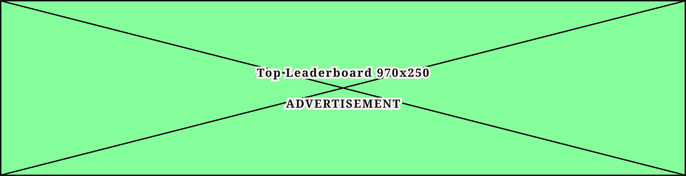 |
| `Desktop / Top Leaderboard 970x90` | 970×90 | [1207:17444](https://www.figma.com/design/b1iZxkFwtAYq9rElmnCAzd/?node-id=1207-17444) | 0 | 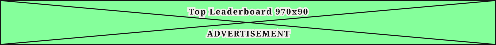 |
| `Desktop / Cube 1 RRail ATF 300x1050` | 300×1050 | [530:2611](https://www.figma.com/design/b1iZxkFwtAYq9rElmnCAzd/?node-id=530-2611) | 6 | 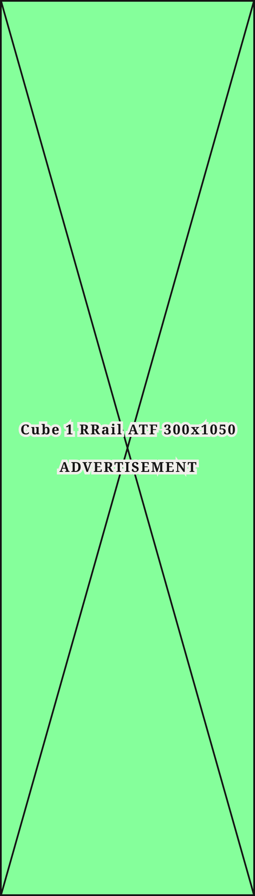 |
| `Desktop / Cube 2 RRail Mid 300x600` | 300×600 | [527:2400](https://www.figma.com/design/b1iZxkFwtAYq9rElmnCAzd/?node-id=527-2400) | 8 | 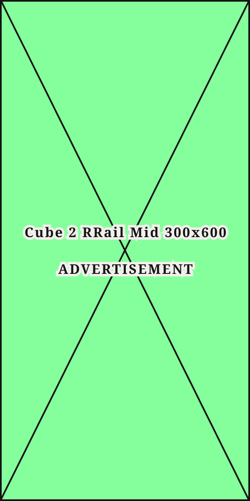 |
| `Desktop / Mid-Article Banner 728x90` | 728×90 | [517:10324](https://www.figma.com/design/b1iZxkFwtAYq9rElmnCAzd/?node-id=517-10324) | 4 | 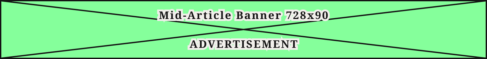 |
| `Desktop / Bottom Leaderboard 728x90` | 728×90 | [517:10337](https://www.figma.com/design/b1iZxkFwtAYq9rElmnCAzd/?node-id=517-10337) | 1 | 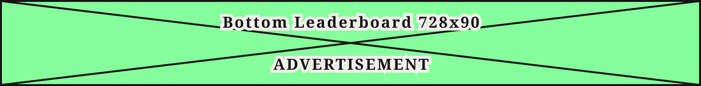 |
| `Desktop / Sponsorship 2 970x250` | 970×250 | [530:2621](https://www.figma.com/design/b1iZxkFwtAYq9rElmnCAzd/?node-id=530-2621) | 9 | 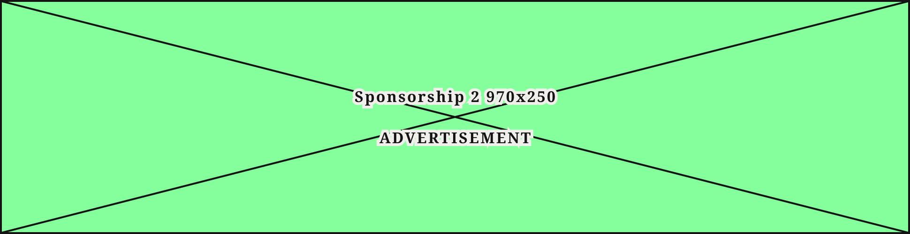 |
| `Desktop / Sponsorship 2 970x90` | 970×90 | [530:2626](https://www.figma.com/design/b1iZxkFwtAYq9rElmnCAzd/?node-id=530-2626) | 0 | 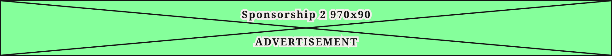 |
| `Desktop / Outstream Video 480x360` | 480×360 | [3536:36859](https://www.figma.com/design/b1iZxkFwtAYq9rElmnCAzd/?node-id=3536-36859) | 0 | 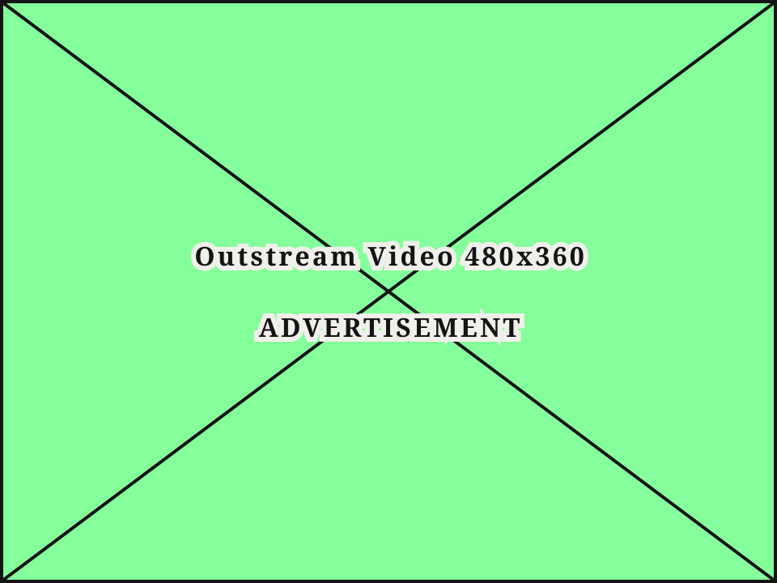 |
| `Desktop / Bottom Leaderboard 970x90` | 970×90 | [3536:36864](https://www.figma.com/design/b1iZxkFwtAYq9rElmnCAzd/?node-id=3536-36864) | 0 | 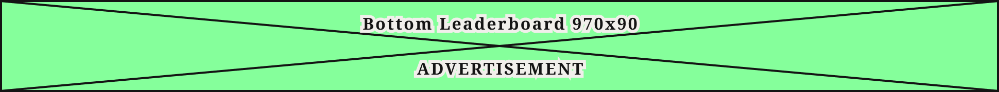 |
| `Desktop / Bottom Leaderboard 970x250` | 970×250 | [3536:36869](https://www.figma.com/design/b1iZxkFwtAYq9rElmnCAzd/?node-id=3536-36869) | 3 | 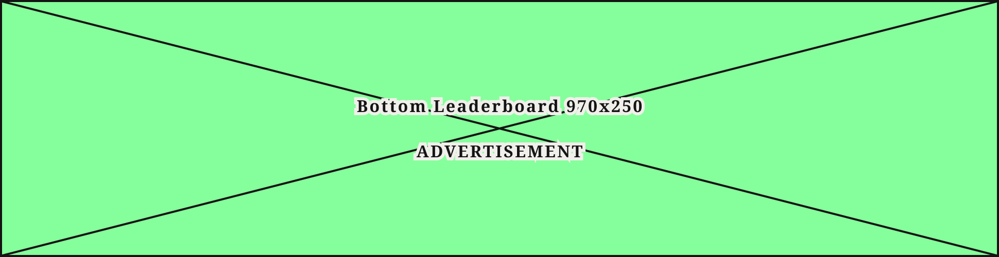 |
| `Mobile / Top Leaderboard 320x100` | 320×100 | [1216:17586](https://www.figma.com/design/b1iZxkFwtAYq9rElmnCAzd/?node-id=1216-17586) | 4 | 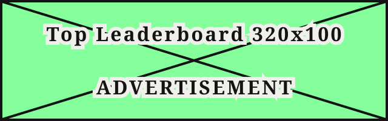 |
| `Mobile / Top Leaderboard 320x50` | 320×50 | [517:10290](https://www.figma.com/design/b1iZxkFwtAYq9rElmnCAzd/?node-id=517-10290) | 15 |  |
| `Mobile / Mid-Article Banner 300x250` | 300×250 | [517:10329](https://www.figma.com/design/b1iZxkFwtAYq9rElmnCAzd/?node-id=517-10329) | 0 |  |
| `Mobile / Bottom Leaderboard 320x100` | 320×100 | [517:10342](https://www.figma.com/design/b1iZxkFwtAYq9rElmnCAzd/?node-id=517-10342) | 2 | 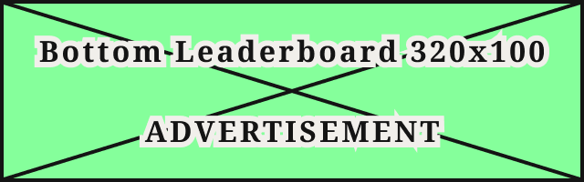 |
| `Mobile / Mobile Adhesion 320x50` | 320×50 | [3432:55710](https://www.figma.com/design/b1iZxkFwtAYq9rElmnCAzd/?node-id=3432-55710) | 3 |  |
| `Mobile / Top Leaderboard 300x50` | 300×50 | [3536:36814](https://www.figma.com/design/b1iZxkFwtAYq9rElmnCAzd/?node-id=3536-36814) | 0 |  |
| `Mobile / Sponsorship 2 300x50` | 300×50 | [3536:36819](https://www.figma.com/design/b1iZxkFwtAYq9rElmnCAzd/?node-id=3536-36819) | 0 |  |
| `Mobile / Bottom Leaderboard 300x50` | 300×50 | [3536:36824](https://www.figma.com/design/b1iZxkFwtAYq9rElmnCAzd/?node-id=3536-36824) | 0 | 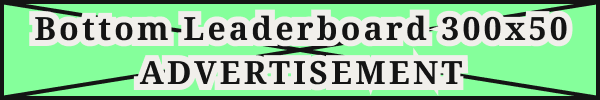 |
| `Mobile / Mobile Adhesion 300x50` | 300×50 | [3536:36829](https://www.figma.com/design/b1iZxkFwtAYq9rElmnCAzd/?node-id=3536-36829) | 0 |  |
| `Mobile / Bottom Leaderboard 320x50` | 320×50 | [3536:36834](https://www.figma.com/design/b1iZxkFwtAYq9rElmnCAzd/?node-id=3536-36834) | 0 |  |
| `Mobile / Outstream Video 300x250` | 300×250 | [3536:36854](https://www.figma.com/design/b1iZxkFwtAYq9rElmnCAzd/?node-id=3536-36854) | 0 |  |
| `All / Sponsorship 1 320x50` | 320×50 | [526:8814](https://www.figma.com/design/b1iZxkFwtAYq9rElmnCAzd/?node-id=526-8814) | 16 | 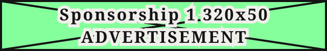 |
| `All / Sponsorship 1 300x50` | 300×50 | [526:8809](https://www.figma.com/design/b1iZxkFwtAYq9rElmnCAzd/?node-id=526-8809) | 41 | 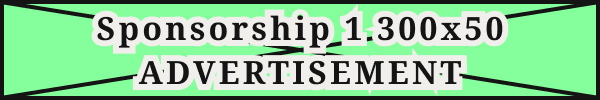 |
| `All / Top Leaderboard 728x90` | 728×90 | [517:10300](https://www.figma.com/design/b1iZxkFwtAYq9rElmnCAzd/?node-id=517-10300) | 23 | 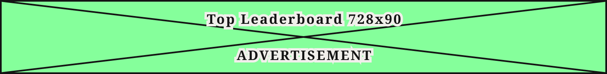 |
| `All / Cube 1 RRail ATF 300x600` | 300×600 | [527:2551](https://www.figma.com/design/b1iZxkFwtAYq9rElmnCAzd/?node-id=527-2551) | 4 | 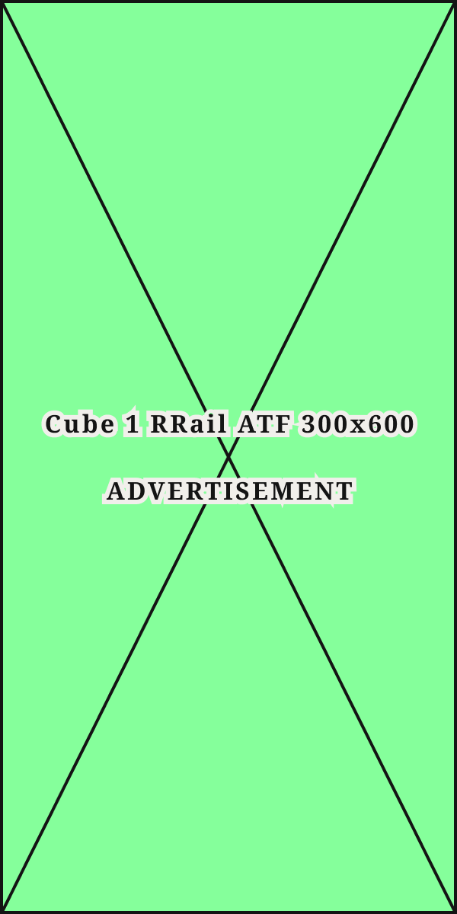 |
| `All / Cube 1 RRail ATF 160x600` | 160×600 | [530:2651](https://www.figma.com/design/b1iZxkFwtAYq9rElmnCAzd/?node-id=530-2651) | 0 | 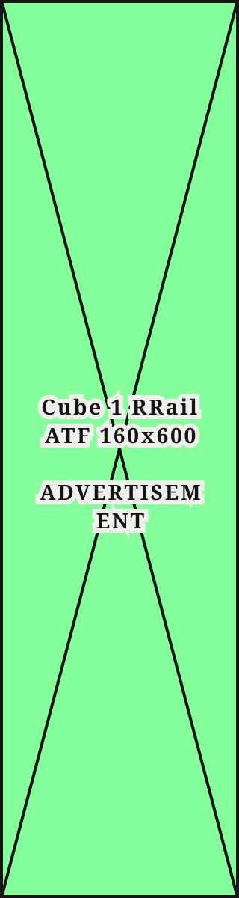 |
| `All / Cube Article 300x250` | 300×250 | [527:2495](https://www.figma.com/design/b1iZxkFwtAYq9rElmnCAzd/?node-id=527-2495) | 0 |  |
| `All / Sidebar Rectangle 300x250` | 300×250 | [527:2405](https://www.figma.com/design/b1iZxkFwtAYq9rElmnCAzd/?node-id=527-2405) | 55 | 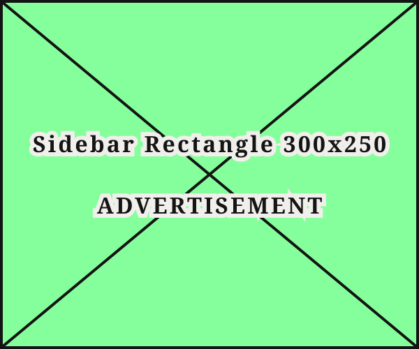 |
| `All / Sponsorship 2 728x90` | 728×90 | [530:2631](https://www.figma.com/design/b1iZxkFwtAYq9rElmnCAzd/?node-id=530-2631) | 3 | 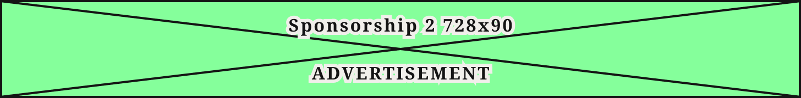 |
| `All / Sponsorship 2 320x50` | 320×50 | [3382:44806](https://www.figma.com/design/b1iZxkFwtAYq9rElmnCAzd/?node-id=3382-44806) | 6 |  |
| `All / Cube 3 RRail Lower 300x600` | 300×600 | [3382:44811](https://www.figma.com/design/b1iZxkFwtAYq9rElmnCAzd/?node-id=3382-44811) | 3 | 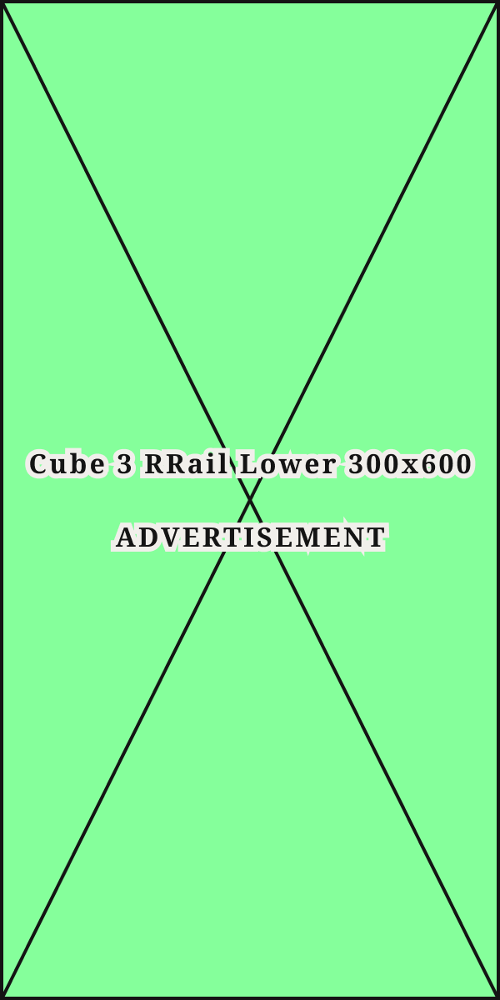 |
| `All / Mobile Adhesion 728x90` | 728×90 | [3434:55897](https://www.figma.com/design/b1iZxkFwtAYq9rElmnCAzd/?node-id=3434-55897) | 1 | 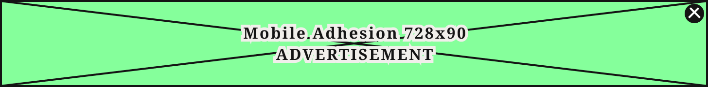 |
| `All / PLACE HOLDER` | 300×250 | [3473:51691](https://www.figma.com/design/b1iZxkFwtAYq9rElmnCAzd/?node-id=3473-51691) | 0 | 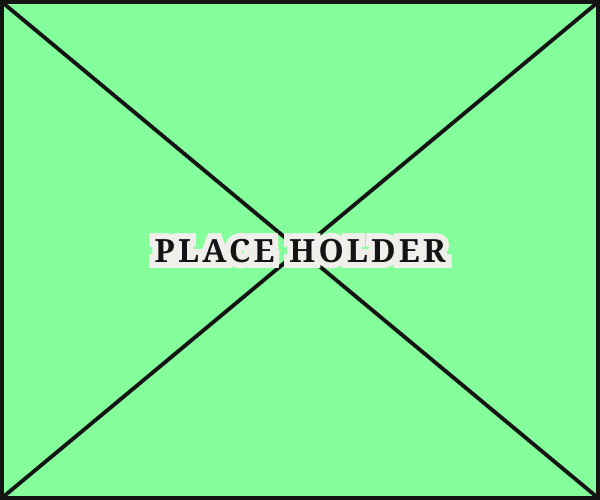 |
| `All / Cube 1 RRail ATF 300x250` | 300×250 | [3536:36839](https://www.figma.com/design/b1iZxkFwtAYq9rElmnCAzd/?node-id=3536-36839) | 5 | 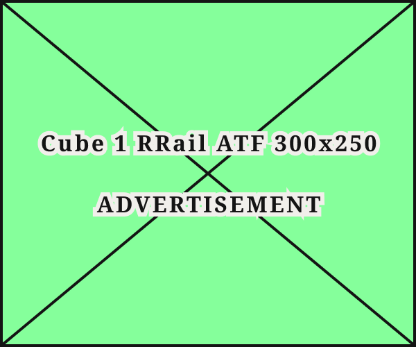 |
| `All / Cube 2 RRail Mid 300x250` | 300×250 | [3536:36844](https://www.figma.com/design/b1iZxkFwtAYq9rElmnCAzd/?node-id=3536-36844) | 3 |  |
| `All / Cube 3 RRail Lower 300x250` | 300×250 | [3536:36849](https://www.figma.com/design/b1iZxkFwtAYq9rElmnCAzd/?node-id=3536-36849) | 3 |  |

## Anatomy

Default variant `Desktop / Top Leaderboard 970x250` (hidden layers marked):

- **Device=Desktop, Name=Top Leaderboard 970x250** `COMPONENT`: 970×250, vertical, gap 8, padding 0/0/0/0, fixed×fixed
  - **Union** `BOOLEAN_OPERATION`: 970×250, fill×fill
    - **Vector 1** `VECTOR`: 969.5×248.06, fixed×fixed
    - **Vector 2** `VECTOR`: 969.5×248.06, fixed×fixed
  - **Top Leaderboard 970x250 ADVERTISEMENT** `TEXT`: 244×66, fixed×fixed, absolute, "Top Leaderboard 970x250

ADVERTISEMENT", Noto Serif Bold 16px

## Component tokens

From `ad-blocks.tokens.json`. References point at system tokens (`tokens/core/`, `tokens/themes/`); the CSS variable is `--mng-` + the token path. A literal value means the Figma layer isn't bound to a token.

| Token | Value |
|---|---|
| `ad-blocks.name-bottom-leaderboard-300x50.bottom-leaderboard-300x50-advertisement.color` | `{color.gray.min}` |
| `ad-blocks.name-bottom-leaderboard-300x50.bottom-leaderboard-300x50-advertisement.font-family` | `{font.family.noto-serif}` |
| `ad-blocks.name-bottom-leaderboard-300x50.bottom-leaderboard-300x50-advertisement.font-size` | `{font.size.16}` |
| `ad-blocks.name-bottom-leaderboard-300x50.bottom-leaderboard-300x50-advertisement.font-weight` | `{font.weight.bold}` |
| `ad-blocks.name-bottom-leaderboard-300x50.bottom-leaderboard-300x50-advertisement.letter-spacing` | 1.6px |
| `ad-blocks.name-bottom-leaderboard-300x50.root.height` | 50px |
| `ad-blocks.name-bottom-leaderboard-300x50.root.width` | 300px |
| `ad-blocks.name-bottom-leaderboard-300x50.union.vector-1.height` | 48.02px |
| `ad-blocks.name-bottom-leaderboard-300x50.union.vector-1.width` | 299.68px |
| `ad-blocks.name-bottom-leaderboard-300x50.union.vector-2.height` | 48.02px |
| `ad-blocks.name-bottom-leaderboard-300x50.union.vector-2.width` | 299.68px |
| `ad-blocks.name-bottom-leaderboard-320x100.bottom-leaderboard-320x100-advertisement.color` | `{color.gray.min}` |
| `ad-blocks.name-bottom-leaderboard-320x100.bottom-leaderboard-320x100-advertisement.font-family` | `{font.family.noto-serif}` |
| `ad-blocks.name-bottom-leaderboard-320x100.bottom-leaderboard-320x100-advertisement.font-size` | `{font.size.16}` |
| `ad-blocks.name-bottom-leaderboard-320x100.bottom-leaderboard-320x100-advertisement.font-weight` | `{font.weight.bold}` |
| `ad-blocks.name-bottom-leaderboard-320x100.bottom-leaderboard-320x100-advertisement.letter-spacing` | 1.6px |
| `ad-blocks.name-bottom-leaderboard-320x100.root.height` | 100px |
| `ad-blocks.name-bottom-leaderboard-320x100.root.width` | 320px |
| `ad-blocks.name-bottom-leaderboard-320x100.union.vector-1.height` | 98.09px |
| `ad-blocks.name-bottom-leaderboard-320x100.union.vector-1.width` | 319.41px |
| `ad-blocks.name-bottom-leaderboard-320x100.union.vector-2.height` | 98.09px |
| `ad-blocks.name-bottom-leaderboard-320x100.union.vector-2.width` | 319.41px |
| `ad-blocks.name-bottom-leaderboard-320x50.bottom-leaderboard-320x50-advertisement.color` | `{color.gray.min}` |
| `ad-blocks.name-bottom-leaderboard-320x50.bottom-leaderboard-320x50-advertisement.font-family` | `{font.family.noto-serif}` |
| `ad-blocks.name-bottom-leaderboard-320x50.bottom-leaderboard-320x50-advertisement.font-size` | `{font.size.16}` |
| `ad-blocks.name-bottom-leaderboard-320x50.bottom-leaderboard-320x50-advertisement.font-weight` | `{font.weight.bold}` |
| `ad-blocks.name-bottom-leaderboard-320x50.bottom-leaderboard-320x50-advertisement.letter-spacing` | 1.6px |
| `ad-blocks.name-bottom-leaderboard-320x50.root.height` | 50px |
| `ad-blocks.name-bottom-leaderboard-320x50.root.width` | 320px |
| `ad-blocks.name-bottom-leaderboard-320x50.union.vector-1.height` | 48.02px |
| `ad-blocks.name-bottom-leaderboard-320x50.union.vector-1.width` | 319.7px |
| `ad-blocks.name-bottom-leaderboard-320x50.union.vector-2.height` | 48.02px |
| `ad-blocks.name-bottom-leaderboard-320x50.union.vector-2.width` | 319.7px |
| `ad-blocks.name-bottom-leaderboard-728x90.bottom-leaderboard-728x90-advertisement.color` | `{color.gray.min}` |
| `ad-blocks.name-bottom-leaderboard-728x90.bottom-leaderboard-728x90-advertisement.font-family` | `{font.family.noto-serif}` |
| `ad-blocks.name-bottom-leaderboard-728x90.bottom-leaderboard-728x90-advertisement.font-size` | `{font.size.16}` |
| `ad-blocks.name-bottom-leaderboard-728x90.bottom-leaderboard-728x90-advertisement.font-weight` | `{font.weight.bold}` |
| `ad-blocks.name-bottom-leaderboard-728x90.bottom-leaderboard-728x90-advertisement.letter-spacing` | 1.6px |
| `ad-blocks.name-bottom-leaderboard-728x90.root.height` | 90px |
| `ad-blocks.name-bottom-leaderboard-728x90.root.width` | 728px |
| `ad-blocks.name-bottom-leaderboard-728x90.union.vector-1.height` | 88.01px |
| `ad-blocks.name-bottom-leaderboard-728x90.union.vector-1.width` | 727.76px |
| `ad-blocks.name-bottom-leaderboard-728x90.union.vector-2.height` | 88.01px |
| `ad-blocks.name-bottom-leaderboard-728x90.union.vector-2.width` | 727.76px |
| `ad-blocks.name-bottom-leaderboard-970x250.bottom-leaderboard-970x250-advertisement.color` | `{color.gray.min}` |
| `ad-blocks.name-bottom-leaderboard-970x250.bottom-leaderboard-970x250-advertisement.font-family` | `{font.family.noto-serif}` |
| `ad-blocks.name-bottom-leaderboard-970x250.bottom-leaderboard-970x250-advertisement.font-size` | `{font.size.16}` |
| `ad-blocks.name-bottom-leaderboard-970x250.bottom-leaderboard-970x250-advertisement.font-weight` | `{font.weight.bold}` |
| `ad-blocks.name-bottom-leaderboard-970x250.bottom-leaderboard-970x250-advertisement.letter-spacing` | 1.6px |
| `ad-blocks.name-bottom-leaderboard-970x250.root.height` | 250px |
| `ad-blocks.name-bottom-leaderboard-970x250.root.width` | 970px |
| `ad-blocks.name-bottom-leaderboard-970x250.union.vector-1.height` | 248.06px |
| `ad-blocks.name-bottom-leaderboard-970x250.union.vector-1.width` | 969.5px |
| `ad-blocks.name-bottom-leaderboard-970x250.union.vector-2.height` | 248.06px |
| `ad-blocks.name-bottom-leaderboard-970x250.union.vector-2.width` | 969.5px |
| `ad-blocks.name-bottom-leaderboard-970x90.bottom-leaderboard-970x90-advertisement.color` | `{color.gray.min}` |
| `ad-blocks.name-bottom-leaderboard-970x90.bottom-leaderboard-970x90-advertisement.font-family` | `{font.family.noto-serif}` |
| `ad-blocks.name-bottom-leaderboard-970x90.bottom-leaderboard-970x90-advertisement.font-size` | `{font.size.16}` |
| `ad-blocks.name-bottom-leaderboard-970x90.bottom-leaderboard-970x90-advertisement.font-weight` | `{font.weight.bold}` |
| `ad-blocks.name-bottom-leaderboard-970x90.bottom-leaderboard-970x90-advertisement.letter-spacing` | 1.6px |
| `ad-blocks.name-bottom-leaderboard-970x90.root.height` | 90px |
| `ad-blocks.name-bottom-leaderboard-970x90.root.width` | 970px |
| `ad-blocks.name-bottom-leaderboard-970x90.union.vector-1.height` | 88.01px |
| `ad-blocks.name-bottom-leaderboard-970x90.union.vector-1.width` | 969.82px |
| `ad-blocks.name-bottom-leaderboard-970x90.union.vector-2.height` | 88.01px |
| `ad-blocks.name-bottom-leaderboard-970x90.union.vector-2.width` | 969.82px |
| `ad-blocks.base.close-button-bg.background` | `{color.gray.min}` |
| `ad-blocks.base.root.background` | #85ff9b |
| `ad-blocks.base.root.border-color` | `{color.gray.min}` |
| `ad-blocks.base.root.border-style` | solid |
| `ad-blocks.base.root.border-width` | 2px |
| `ad-blocks.base.union.background` | `{color.gray.min}` |
| `ad-blocks.base.union.vector-1.border-color` | #111111 |
| `ad-blocks.base.union.vector-1.border-style` | solid |
| `ad-blocks.base.union.vector-1.border-width` | 2px |
| `ad-blocks.base.union.vector-2.border-color` | #111111 |
| `ad-blocks.base.union.vector-2.border-style` | solid |
| `ad-blocks.base.union.vector-2.border-width` | 2px |
| `ad-blocks.base.x-line-1.border-color` | `{color.gray.max}` |
| `ad-blocks.base.x-line-1.border-style` | solid |
| `ad-blocks.base.x-line-1.border-width` | 2px |
| `ad-blocks.base.x-line-2.border-color` | `{color.gray.max}` |
| `ad-blocks.base.x-line-2.border-style` | solid |
| `ad-blocks.base.x-line-2.border-width` | 2px |
| `ad-blocks.name-cube-1-rrail-atf-160x600.cube-1-rrail-atf-160x600-advertisement.color` | `{color.gray.min}` |
| `ad-blocks.name-cube-1-rrail-atf-160x600.cube-1-rrail-atf-160x600-advertisement.font-family` | `{font.family.noto-serif}` |
| `ad-blocks.name-cube-1-rrail-atf-160x600.cube-1-rrail-atf-160x600-advertisement.font-size` | `{font.size.14}` |
| `ad-blocks.name-cube-1-rrail-atf-160x600.cube-1-rrail-atf-160x600-advertisement.font-weight` | `{font.weight.bold}` |
| `ad-blocks.name-cube-1-rrail-atf-160x600.cube-1-rrail-atf-160x600-advertisement.letter-spacing` | 1.4px |
| `ad-blocks.name-cube-1-rrail-atf-160x600.root.height` | 600px |
| `ad-blocks.name-cube-1-rrail-atf-160x600.root.width` | 160px |
| `ad-blocks.name-cube-1-rrail-atf-160x600.union.vector-1.height` | 599.49px |
| `ad-blocks.name-cube-1-rrail-atf-160x600.union.vector-1.width` | 158.07px |
| `ad-blocks.name-cube-1-rrail-atf-160x600.union.vector-2.height` | 599.49px |
| `ad-blocks.name-cube-1-rrail-atf-160x600.union.vector-2.width` | 158.07px |
| `ad-blocks.name-cube-1-rrail-atf-300x1050.cube-1-rrail-atf-300x1050-advertisement.color` | `{color.gray.min}` |
| `ad-blocks.name-cube-1-rrail-atf-300x1050.cube-1-rrail-atf-300x1050-advertisement.font-family` | `{font.family.noto-serif}` |
| `ad-blocks.name-cube-1-rrail-atf-300x1050.cube-1-rrail-atf-300x1050-advertisement.font-size` | `{font.size.16}` |
| `ad-blocks.name-cube-1-rrail-atf-300x1050.cube-1-rrail-atf-300x1050-advertisement.font-weight` | `{font.weight.bold}` |
| `ad-blocks.name-cube-1-rrail-atf-300x1050.cube-1-rrail-atf-300x1050-advertisement.letter-spacing` | 1.6px |
| `ad-blocks.name-cube-1-rrail-atf-300x1050.root.height` | 1050px |
| `ad-blocks.name-cube-1-rrail-atf-300x1050.root.width` | 300px |
| `ad-blocks.name-cube-1-rrail-atf-300x1050.union.vector-1.height` | 1049.45px |
| `ad-blocks.name-cube-1-rrail-atf-300x1050.union.vector-1.width` | 298.08px |
| `ad-blocks.name-cube-1-rrail-atf-300x1050.union.vector-2.height` | 1049.45px |
| `ad-blocks.name-cube-1-rrail-atf-300x1050.union.vector-2.width` | 298.08px |
| `ad-blocks.name-cube-1-rrail-atf-300x250.cube-1-rrail-atf-300x250-advertisement.color` | `{color.gray.min}` |
| `ad-blocks.name-cube-1-rrail-atf-300x250.cube-1-rrail-atf-300x250-advertisement.font-family` | `{font.family.noto-serif}` |
| `ad-blocks.name-cube-1-rrail-atf-300x250.cube-1-rrail-atf-300x250-advertisement.font-size` | `{font.size.16}` |
| `ad-blocks.name-cube-1-rrail-atf-300x250.cube-1-rrail-atf-300x250-advertisement.font-weight` | `{font.weight.bold}` |
| `ad-blocks.name-cube-1-rrail-atf-300x250.cube-1-rrail-atf-300x250-advertisement.letter-spacing` | 1.6px |
| `ad-blocks.name-cube-1-rrail-atf-300x250.root.height` | 250px |
| `ad-blocks.name-cube-1-rrail-atf-300x250.root.width` | 300px |
| `ad-blocks.name-cube-1-rrail-atf-300x250.union.vector-1.height` | 248.46px |
| `ad-blocks.name-cube-1-rrail-atf-300x250.union.vector-1.width` | 298.72px |
| `ad-blocks.name-cube-1-rrail-atf-300x250.union.vector-2.height` | 248.46px |
| `ad-blocks.name-cube-1-rrail-atf-300x250.union.vector-2.width` | 298.72px |
| `ad-blocks.name-cube-1-rrail-atf-300x600.cube-1-rrail-atf-300x600-advertisement.color` | `{color.gray.min}` |
| `ad-blocks.name-cube-1-rrail-atf-300x600.cube-1-rrail-atf-300x600-advertisement.font-family` | `{font.family.noto-serif}` |
| `ad-blocks.name-cube-1-rrail-atf-300x600.cube-1-rrail-atf-300x600-advertisement.font-size` | `{font.size.16}` |
| `ad-blocks.name-cube-1-rrail-atf-300x600.cube-1-rrail-atf-300x600-advertisement.font-weight` | `{font.weight.bold}` |
| `ad-blocks.name-cube-1-rrail-atf-300x600.cube-1-rrail-atf-300x600-advertisement.letter-spacing` | 1.6px |
| `ad-blocks.name-cube-1-rrail-atf-300x600.root.height` | 600px |
| `ad-blocks.name-cube-1-rrail-atf-300x600.root.width` | 300px |
| `ad-blocks.name-cube-1-rrail-atf-300x600.union.vector-1.height` | 599.11px |
| `ad-blocks.name-cube-1-rrail-atf-300x600.union.vector-1.width` | 298.21px |
| `ad-blocks.name-cube-1-rrail-atf-300x600.union.vector-2.height` | 599.11px |
| `ad-blocks.name-cube-1-rrail-atf-300x600.union.vector-2.width` | 298.21px |
| `ad-blocks.name-cube-2-rrail-mid-300x250.cube-2-rrail-mid-300x250-advertisement.color` | `{color.gray.min}` |
| `ad-blocks.name-cube-2-rrail-mid-300x250.cube-2-rrail-mid-300x250-advertisement.font-family` | `{font.family.noto-serif}` |
| `ad-blocks.name-cube-2-rrail-mid-300x250.cube-2-rrail-mid-300x250-advertisement.font-size` | `{font.size.16}` |
| `ad-blocks.name-cube-2-rrail-mid-300x250.cube-2-rrail-mid-300x250-advertisement.font-weight` | `{font.weight.bold}` |
| `ad-blocks.name-cube-2-rrail-mid-300x250.cube-2-rrail-mid-300x250-advertisement.letter-spacing` | 1.6px |
| `ad-blocks.name-cube-2-rrail-mid-300x250.root.height` | 250px |
| `ad-blocks.name-cube-2-rrail-mid-300x250.root.width` | 300px |
| `ad-blocks.name-cube-2-rrail-mid-300x250.union.vector-1.height` | 248.46px |
| `ad-blocks.name-cube-2-rrail-mid-300x250.union.vector-1.width` | 298.72px |
| `ad-blocks.name-cube-2-rrail-mid-300x250.union.vector-2.height` | 248.46px |
| `ad-blocks.name-cube-2-rrail-mid-300x250.union.vector-2.width` | 298.72px |
| `ad-blocks.name-cube-2-rrail-mid-300x600.cube-2-rrail-mid-300x600-advertisement.color` | `{color.gray.min}` |
| `ad-blocks.name-cube-2-rrail-mid-300x600.cube-2-rrail-mid-300x600-advertisement.font-family` | `{font.family.noto-serif}` |
| `ad-blocks.name-cube-2-rrail-mid-300x600.cube-2-rrail-mid-300x600-advertisement.font-size` | `{font.size.16}` |
| `ad-blocks.name-cube-2-rrail-mid-300x600.cube-2-rrail-mid-300x600-advertisement.font-weight` | `{font.weight.bold}` |
| `ad-blocks.name-cube-2-rrail-mid-300x600.cube-2-rrail-mid-300x600-advertisement.letter-spacing` | 1.6px |
| `ad-blocks.name-cube-2-rrail-mid-300x600.root.height` | 600px |
| `ad-blocks.name-cube-2-rrail-mid-300x600.root.width` | 300px |
| `ad-blocks.name-cube-2-rrail-mid-300x600.union.height` | 600.29px |
| `ad-blocks.name-cube-2-rrail-mid-300x600.union.vector-1.height` | 599.4px |
| `ad-blocks.name-cube-2-rrail-mid-300x600.union.vector-1.width` | 298.21px |
| `ad-blocks.name-cube-2-rrail-mid-300x600.union.vector-2.height` | 598.41px |
| `ad-blocks.name-cube-2-rrail-mid-300x600.union.vector-2.width` | 298.21px |
| `ad-blocks.name-cube-3-rrail-lower-300x250.cube-3-rrail-lower-300x250-advertisement.color` | `{color.gray.min}` |
| `ad-blocks.name-cube-3-rrail-lower-300x250.cube-3-rrail-lower-300x250-advertisement.font-family` | `{font.family.noto-serif}` |
| `ad-blocks.name-cube-3-rrail-lower-300x250.cube-3-rrail-lower-300x250-advertisement.font-size` | `{font.size.16}` |
| `ad-blocks.name-cube-3-rrail-lower-300x250.cube-3-rrail-lower-300x250-advertisement.font-weight` | `{font.weight.bold}` |
| `ad-blocks.name-cube-3-rrail-lower-300x250.cube-3-rrail-lower-300x250-advertisement.letter-spacing` | 1.6px |
| `ad-blocks.name-cube-3-rrail-lower-300x250.root.height` | 250px |
| `ad-blocks.name-cube-3-rrail-lower-300x250.root.width` | 300px |
| `ad-blocks.name-cube-3-rrail-lower-300x250.union.vector-1.height` | 248.46px |
| `ad-blocks.name-cube-3-rrail-lower-300x250.union.vector-1.width` | 298.72px |
| `ad-blocks.name-cube-3-rrail-lower-300x250.union.vector-2.height` | 248.46px |
| `ad-blocks.name-cube-3-rrail-lower-300x250.union.vector-2.width` | 298.72px |
| `ad-blocks.name-cube-3-rrail-lower-300x600.cube-3-rrail-lower-300x600-advertisement.color` | `{color.gray.min}` |
| `ad-blocks.name-cube-3-rrail-lower-300x600.cube-3-rrail-lower-300x600-advertisement.font-family` | `{font.family.noto-serif}` |
| `ad-blocks.name-cube-3-rrail-lower-300x600.cube-3-rrail-lower-300x600-advertisement.font-size` | `{font.size.16}` |
| `ad-blocks.name-cube-3-rrail-lower-300x600.cube-3-rrail-lower-300x600-advertisement.font-weight` | `{font.weight.bold}` |
| `ad-blocks.name-cube-3-rrail-lower-300x600.cube-3-rrail-lower-300x600-advertisement.letter-spacing` | 1.6px |
| `ad-blocks.name-cube-3-rrail-lower-300x600.root.height` | 600px |
| `ad-blocks.name-cube-3-rrail-lower-300x600.root.width` | 300px |
| `ad-blocks.name-cube-3-rrail-lower-300x600.union.vector-1.height` | 599.11px |
| `ad-blocks.name-cube-3-rrail-lower-300x600.union.vector-1.width` | 298.21px |
| `ad-blocks.name-cube-3-rrail-lower-300x600.union.vector-2.height` | 599.11px |
| `ad-blocks.name-cube-3-rrail-lower-300x600.union.vector-2.width` | 298.21px |
| `ad-blocks.name-cube-article-300x250.cube-article-300x250-advertisement.color` | `{color.gray.min}` |
| `ad-blocks.name-cube-article-300x250.cube-article-300x250-advertisement.font-family` | `{font.family.noto-serif}` |
| `ad-blocks.name-cube-article-300x250.cube-article-300x250-advertisement.font-size` | `{font.size.16}` |
| `ad-blocks.name-cube-article-300x250.cube-article-300x250-advertisement.font-weight` | `{font.weight.bold}` |
| `ad-blocks.name-cube-article-300x250.cube-article-300x250-advertisement.letter-spacing` | 1.6px |
| `ad-blocks.name-cube-article-300x250.root.height` | 250px |
| `ad-blocks.name-cube-article-300x250.root.width` | 300px |
| `ad-blocks.name-cube-article-300x250.union.vector-1.height` | 248.46px |
| `ad-blocks.name-cube-article-300x250.union.vector-1.width` | 298.72px |
| `ad-blocks.name-cube-article-300x250.union.vector-2.height` | 248.46px |
| `ad-blocks.name-cube-article-300x250.union.vector-2.width` | 298.72px |
| `ad-blocks.name-mid-article-banner-300x250.mid-article-banner-300x250-advertisement.color` | `{color.gray.min}` |
| `ad-blocks.name-mid-article-banner-300x250.mid-article-banner-300x250-advertisement.font-family` | `{font.family.noto-serif}` |
| `ad-blocks.name-mid-article-banner-300x250.mid-article-banner-300x250-advertisement.font-size` | `{font.size.16}` |
| `ad-blocks.name-mid-article-banner-300x250.mid-article-banner-300x250-advertisement.font-weight` | `{font.weight.bold}` |
| `ad-blocks.name-mid-article-banner-300x250.mid-article-banner-300x250-advertisement.letter-spacing` | 1.6px |
| `ad-blocks.name-mid-article-banner-300x250.root.height` | 250px |
| `ad-blocks.name-mid-article-banner-300x250.root.width` | 300px |
| `ad-blocks.name-mid-article-banner-300x250.union.vector-1.height` | 248.46px |
| `ad-blocks.name-mid-article-banner-300x250.union.vector-1.width` | 298.72px |
| `ad-blocks.name-mid-article-banner-300x250.union.vector-2.height` | 248.46px |
| `ad-blocks.name-mid-article-banner-300x250.union.vector-2.width` | 298.72px |
| `ad-blocks.name-mid-article-banner-728x90.mid-article-banner-728x90-advertisement.color` | `{color.gray.min}` |
| `ad-blocks.name-mid-article-banner-728x90.mid-article-banner-728x90-advertisement.font-family` | `{font.family.noto-serif}` |
| `ad-blocks.name-mid-article-banner-728x90.mid-article-banner-728x90-advertisement.font-size` | `{font.size.16}` |
| `ad-blocks.name-mid-article-banner-728x90.mid-article-banner-728x90-advertisement.font-weight` | `{font.weight.bold}` |
| `ad-blocks.name-mid-article-banner-728x90.mid-article-banner-728x90-advertisement.letter-spacing` | 1.6px |
| `ad-blocks.name-mid-article-banner-728x90.root.height` | 90px |
| `ad-blocks.name-mid-article-banner-728x90.root.width` | 728px |
| `ad-blocks.name-mid-article-banner-728x90.union.vector-1.height` | 88.01px |
| `ad-blocks.name-mid-article-banner-728x90.union.vector-1.width` | 727.76px |
| `ad-blocks.name-mid-article-banner-728x90.union.vector-2.height` | 88.01px |
| `ad-blocks.name-mid-article-banner-728x90.union.vector-2.width` | 727.76px |
| `ad-blocks.name-mobile-adhesion-300x50.mobile-adhesion-300x50-advertisement.color` | `{color.gray.min}` |
| `ad-blocks.name-mobile-adhesion-300x50.mobile-adhesion-300x50-advertisement.font-family` | `{font.family.noto-serif}` |
| `ad-blocks.name-mobile-adhesion-300x50.mobile-adhesion-300x50-advertisement.font-size` | `{font.size.16}` |
| `ad-blocks.name-mobile-adhesion-300x50.mobile-adhesion-300x50-advertisement.font-weight` | `{font.weight.bold}` |
| `ad-blocks.name-mobile-adhesion-300x50.mobile-adhesion-300x50-advertisement.letter-spacing` | 1.6px |
| `ad-blocks.name-mobile-adhesion-300x50.root.height` | 50px |
| `ad-blocks.name-mobile-adhesion-300x50.root.width` | 300px |
| `ad-blocks.name-mobile-adhesion-300x50.union.vector-1.height` | 48.02px |
| `ad-blocks.name-mobile-adhesion-300x50.union.vector-1.width` | 299.68px |
| `ad-blocks.name-mobile-adhesion-300x50.union.vector-2.height` | 48.02px |
| `ad-blocks.name-mobile-adhesion-300x50.union.vector-2.width` | 299.68px |
| `ad-blocks.name-mobile-adhesion-320x50.mobile-adhesion-320x50-advertisement.color` | `{color.gray.min}` |
| `ad-blocks.name-mobile-adhesion-320x50.mobile-adhesion-320x50-advertisement.font-family` | `{font.family.noto-serif}` |
| `ad-blocks.name-mobile-adhesion-320x50.mobile-adhesion-320x50-advertisement.font-size` | `{font.size.16}` |
| `ad-blocks.name-mobile-adhesion-320x50.mobile-adhesion-320x50-advertisement.font-weight` | `{font.weight.bold}` |
| `ad-blocks.name-mobile-adhesion-320x50.mobile-adhesion-320x50-advertisement.letter-spacing` | 1.6px |
| `ad-blocks.name-mobile-adhesion-320x50.root.height` | 50px |
| `ad-blocks.name-mobile-adhesion-320x50.root.width` | 320px |
| `ad-blocks.name-mobile-adhesion-320x50.union.vector-1.height` | 48.02px |
| `ad-blocks.name-mobile-adhesion-320x50.union.vector-1.width` | 319.7px |
| `ad-blocks.name-mobile-adhesion-320x50.union.vector-2.height` | 48.02px |
| `ad-blocks.name-mobile-adhesion-320x50.union.vector-2.width` | 319.7px |
| `ad-blocks.name-mobile-adhesion-728x90.mobile-adhesion-728x90-advertisement.color` | `{color.gray.min}` |
| `ad-blocks.name-mobile-adhesion-728x90.mobile-adhesion-728x90-advertisement.font-family` | `{font.family.noto-serif}` |
| `ad-blocks.name-mobile-adhesion-728x90.mobile-adhesion-728x90-advertisement.font-size` | `{font.size.16}` |
| `ad-blocks.name-mobile-adhesion-728x90.mobile-adhesion-728x90-advertisement.font-weight` | `{font.weight.bold}` |
| `ad-blocks.name-mobile-adhesion-728x90.mobile-adhesion-728x90-advertisement.letter-spacing` | 1.6px |
| `ad-blocks.name-mobile-adhesion-728x90.root.height` | 90px |
| `ad-blocks.name-mobile-adhesion-728x90.root.width` | 728px |
| `ad-blocks.name-mobile-adhesion-728x90.union.vector-1.height` | 88.01px |
| `ad-blocks.name-mobile-adhesion-728x90.union.vector-1.width` | 727.76px |
| `ad-blocks.name-mobile-adhesion-728x90.union.vector-2.height` | 88.01px |
| `ad-blocks.name-mobile-adhesion-728x90.union.vector-2.width` | 727.76px |
| `ad-blocks.name-outstream-video-300x250.outstream-video-300x250-advertisement.color` | `{color.gray.min}` |
| `ad-blocks.name-outstream-video-300x250.outstream-video-300x250-advertisement.font-family` | `{font.family.noto-serif}` |
| `ad-blocks.name-outstream-video-300x250.outstream-video-300x250-advertisement.font-size` | `{font.size.16}` |
| `ad-blocks.name-outstream-video-300x250.outstream-video-300x250-advertisement.font-weight` | `{font.weight.bold}` |
| `ad-blocks.name-outstream-video-300x250.outstream-video-300x250-advertisement.letter-spacing` | 1.6px |
| `ad-blocks.name-outstream-video-300x250.root.height` | 250px |
| `ad-blocks.name-outstream-video-300x250.root.width` | 300px |
| `ad-blocks.name-outstream-video-300x250.union.vector-1.height` | 248.46px |
| `ad-blocks.name-outstream-video-300x250.union.vector-1.width` | 298.72px |
| `ad-blocks.name-outstream-video-300x250.union.vector-2.height` | 248.46px |
| `ad-blocks.name-outstream-video-300x250.union.vector-2.width` | 298.72px |
| `ad-blocks.name-outstream-video-480x360.outstream-video-480x360-advertisement.color` | `{color.gray.min}` |
| `ad-blocks.name-outstream-video-480x360.outstream-video-480x360-advertisement.font-family` | `{font.family.noto-serif}` |
| `ad-blocks.name-outstream-video-480x360.outstream-video-480x360-advertisement.font-size` | `{font.size.16}` |
| `ad-blocks.name-outstream-video-480x360.outstream-video-480x360-advertisement.font-weight` | `{font.weight.bold}` |
| `ad-blocks.name-outstream-video-480x360.outstream-video-480x360-advertisement.letter-spacing` | 1.6px |
| `ad-blocks.name-outstream-video-480x360.root.height` | 360px |
| `ad-blocks.name-outstream-video-480x360.root.width` | 480px |
| `ad-blocks.name-outstream-video-480x360.union.height` | 360px |
| `ad-blocks.name-outstream-video-480x360.union.width` | 480px |
| `ad-blocks.name-outstream-video-480x360.union.vector-1.height` | 358.4px |
| `ad-blocks.name-outstream-video-480x360.union.vector-1.width` | 478.8px |
| `ad-blocks.name-outstream-video-480x360.union.vector-2.height` | 358.4px |
| `ad-blocks.name-outstream-video-480x360.union.vector-2.width` | 478.8px |
| `ad-blocks.name-place-holder.place-holder.color` | `{color.gray.min}` |
| `ad-blocks.name-place-holder.place-holder.font-family` | `{font.family.noto-serif}` |
| `ad-blocks.name-place-holder.place-holder.font-size` | `{font.size.16}` |
| `ad-blocks.name-place-holder.place-holder.font-weight` | `{font.weight.bold}` |
| `ad-blocks.name-place-holder.place-holder.letter-spacing` | 1.6px |
| `ad-blocks.name-place-holder.root.height` | 250px |
| `ad-blocks.name-place-holder.root.width` | 300px |
| `ad-blocks.name-place-holder.union.vector-1.height` | 248.46px |
| `ad-blocks.name-place-holder.union.vector-1.width` | 298.72px |
| `ad-blocks.name-place-holder.union.vector-2.height` | 248.46px |
| `ad-blocks.name-place-holder.union.vector-2.width` | 298.72px |
| `ad-blocks.name-top-leaderboard-970x250.root.height` | 250px |
| `ad-blocks.name-top-leaderboard-970x250.root.width` | 970px |
| `ad-blocks.name-top-leaderboard-970x250.top-leaderboard-970x250-advertisement.color` | `{color.gray.min}` |
| `ad-blocks.name-top-leaderboard-970x250.top-leaderboard-970x250-advertisement.font-family` | `{font.family.noto-serif}` |
| `ad-blocks.name-top-leaderboard-970x250.top-leaderboard-970x250-advertisement.font-size` | `{font.size.16}` |
| `ad-blocks.name-top-leaderboard-970x250.top-leaderboard-970x250-advertisement.font-weight` | `{font.weight.bold}` |
| `ad-blocks.name-top-leaderboard-970x250.top-leaderboard-970x250-advertisement.letter-spacing` | 1.6px |
| `ad-blocks.name-top-leaderboard-970x250.union.vector-1.height` | 248.06px |
| `ad-blocks.name-top-leaderboard-970x250.union.vector-1.width` | 969.5px |
| `ad-blocks.name-top-leaderboard-970x250.union.vector-2.height` | 248.06px |
| `ad-blocks.name-top-leaderboard-970x250.union.vector-2.width` | 969.5px |
| `ad-blocks.name-top-leaderboard-970x90.root.height` | 90px |
| `ad-blocks.name-top-leaderboard-970x90.root.width` | 970px |
| `ad-blocks.name-top-leaderboard-970x90.top-leaderboard-970x90-advertisement.color` | `{color.gray.min}` |
| `ad-blocks.name-top-leaderboard-970x90.top-leaderboard-970x90-advertisement.font-family` | `{font.family.noto-serif}` |
| `ad-blocks.name-top-leaderboard-970x90.top-leaderboard-970x90-advertisement.font-size` | `{font.size.16}` |
| `ad-blocks.name-top-leaderboard-970x90.top-leaderboard-970x90-advertisement.font-weight` | `{font.weight.bold}` |
| `ad-blocks.name-top-leaderboard-970x90.top-leaderboard-970x90-advertisement.letter-spacing` | 1.6px |
| `ad-blocks.name-top-leaderboard-970x90.union.vector-1.height` | 88.01px |
| `ad-blocks.name-top-leaderboard-970x90.union.vector-1.width` | 969.82px |
| `ad-blocks.name-top-leaderboard-970x90.union.vector-2.height` | 88.01px |
| `ad-blocks.name-top-leaderboard-970x90.union.vector-2.width` | 969.82px |
| `ad-blocks.name-sponsorship-2-970x250.root.height` | 250px |
| `ad-blocks.name-sponsorship-2-970x250.root.width` | 970px |
| `ad-blocks.name-sponsorship-2-970x250.sponsorship-2-970x250-advertisement.color` | `{color.gray.min}` |
| `ad-blocks.name-sponsorship-2-970x250.sponsorship-2-970x250-advertisement.font-family` | `{font.family.noto-serif}` |
| `ad-blocks.name-sponsorship-2-970x250.sponsorship-2-970x250-advertisement.font-size` | `{font.size.16}` |
| `ad-blocks.name-sponsorship-2-970x250.sponsorship-2-970x250-advertisement.font-weight` | `{font.weight.bold}` |
| `ad-blocks.name-sponsorship-2-970x250.sponsorship-2-970x250-advertisement.letter-spacing` | 1.6px |
| `ad-blocks.name-sponsorship-2-970x250.union.vector-1.height` | 248.06px |
| `ad-blocks.name-sponsorship-2-970x250.union.vector-1.width` | 969.5px |
| `ad-blocks.name-sponsorship-2-970x250.union.vector-2.height` | 248.06px |
| `ad-blocks.name-sponsorship-2-970x250.union.vector-2.width` | 969.5px |
| `ad-blocks.name-sponsorship-2-970x90.root.height` | 90px |
| `ad-blocks.name-sponsorship-2-970x90.root.width` | 970px |
| `ad-blocks.name-sponsorship-2-970x90.sponsorship-2-970x90-advertisement.color` | `{color.gray.min}` |
| `ad-blocks.name-sponsorship-2-970x90.sponsorship-2-970x90-advertisement.font-family` | `{font.family.noto-serif}` |
| `ad-blocks.name-sponsorship-2-970x90.sponsorship-2-970x90-advertisement.font-size` | `{font.size.16}` |
| `ad-blocks.name-sponsorship-2-970x90.sponsorship-2-970x90-advertisement.font-weight` | `{font.weight.bold}` |
| `ad-blocks.name-sponsorship-2-970x90.sponsorship-2-970x90-advertisement.letter-spacing` | 1.6px |
| `ad-blocks.name-sponsorship-2-970x90.union.vector-1.height` | 88.01px |
| `ad-blocks.name-sponsorship-2-970x90.union.vector-1.width` | 969.82px |
| `ad-blocks.name-sponsorship-2-970x90.union.vector-2.height` | 88.01px |
| `ad-blocks.name-sponsorship-2-970x90.union.vector-2.width` | 969.82px |
| `ad-blocks.name-top-leaderboard-320x100.root.height` | 100px |
| `ad-blocks.name-top-leaderboard-320x100.root.width` | 320px |
| `ad-blocks.name-top-leaderboard-320x100.top-leaderboard-320x100-advertisement.color` | `{color.gray.min}` |
| `ad-blocks.name-top-leaderboard-320x100.top-leaderboard-320x100-advertisement.font-family` | `{font.family.noto-serif}` |
| `ad-blocks.name-top-leaderboard-320x100.top-leaderboard-320x100-advertisement.font-size` | `{font.size.16}` |
| `ad-blocks.name-top-leaderboard-320x100.top-leaderboard-320x100-advertisement.font-weight` | `{font.weight.bold}` |
| `ad-blocks.name-top-leaderboard-320x100.top-leaderboard-320x100-advertisement.letter-spacing` | 1.6px |
| `ad-blocks.name-top-leaderboard-320x100.union.vector-1.height` | 98.09px |
| `ad-blocks.name-top-leaderboard-320x100.union.vector-1.width` | 319.41px |
| `ad-blocks.name-top-leaderboard-320x100.union.vector-2.height` | 98.09px |
| `ad-blocks.name-top-leaderboard-320x100.union.vector-2.width` | 319.41px |
| `ad-blocks.name-top-leaderboard-320x50.root.height` | 50px |
| `ad-blocks.name-top-leaderboard-320x50.root.width` | 320px |
| `ad-blocks.name-top-leaderboard-320x50.top-leaderboard-320x50-advertisement.color` | `{color.gray.min}` |
| `ad-blocks.name-top-leaderboard-320x50.top-leaderboard-320x50-advertisement.font-family` | `{font.family.noto-serif}` |
| `ad-blocks.name-top-leaderboard-320x50.top-leaderboard-320x50-advertisement.font-size` | `{font.size.16}` |
| `ad-blocks.name-top-leaderboard-320x50.top-leaderboard-320x50-advertisement.font-weight` | `{font.weight.bold}` |
| `ad-blocks.name-top-leaderboard-320x50.top-leaderboard-320x50-advertisement.letter-spacing` | 1.6px |
| `ad-blocks.name-top-leaderboard-320x50.union.vector-1.height` | 48.02px |
| `ad-blocks.name-top-leaderboard-320x50.union.vector-1.width` | 319.7px |
| `ad-blocks.name-top-leaderboard-320x50.union.vector-2.height` | 48.02px |
| `ad-blocks.name-top-leaderboard-320x50.union.vector-2.width` | 319.7px |
| `ad-blocks.name-top-leaderboard-300x50.root.height` | 50px |
| `ad-blocks.name-top-leaderboard-300x50.root.width` | 300px |
| `ad-blocks.name-top-leaderboard-300x50.top-leaderboard-300x50-advertisement.color` | `{color.gray.min}` |
| `ad-blocks.name-top-leaderboard-300x50.top-leaderboard-300x50-advertisement.font-family` | `{font.family.noto-serif}` |
| `ad-blocks.name-top-leaderboard-300x50.top-leaderboard-300x50-advertisement.font-size` | `{font.size.16}` |
| `ad-blocks.name-top-leaderboard-300x50.top-leaderboard-300x50-advertisement.font-weight` | `{font.weight.bold}` |
| `ad-blocks.name-top-leaderboard-300x50.top-leaderboard-300x50-advertisement.letter-spacing` | 1.6px |
| `ad-blocks.name-top-leaderboard-300x50.union.vector-1.height` | 48.02px |
| `ad-blocks.name-top-leaderboard-300x50.union.vector-1.width` | 299.68px |
| `ad-blocks.name-top-leaderboard-300x50.union.vector-2.height` | 48.02px |
| `ad-blocks.name-top-leaderboard-300x50.union.vector-2.width` | 299.68px |
| `ad-blocks.name-sponsorship-2-300x50.root.height` | 50px |
| `ad-blocks.name-sponsorship-2-300x50.root.width` | 300px |
| `ad-blocks.name-sponsorship-2-300x50.sponsorship-2-300x50-advertisement.color` | `{color.gray.min}` |
| `ad-blocks.name-sponsorship-2-300x50.sponsorship-2-300x50-advertisement.font-family` | `{font.family.noto-serif}` |
| `ad-blocks.name-sponsorship-2-300x50.sponsorship-2-300x50-advertisement.font-size` | `{font.size.16}` |
| `ad-blocks.name-sponsorship-2-300x50.sponsorship-2-300x50-advertisement.font-weight` | `{font.weight.bold}` |
| `ad-blocks.name-sponsorship-2-300x50.sponsorship-2-300x50-advertisement.letter-spacing` | 1.6px |
| `ad-blocks.name-sponsorship-2-300x50.union.vector-1.height` | 48.02px |
| `ad-blocks.name-sponsorship-2-300x50.union.vector-1.width` | 299.68px |
| `ad-blocks.name-sponsorship-2-300x50.union.vector-2.height` | 48.02px |
| `ad-blocks.name-sponsorship-2-300x50.union.vector-2.width` | 299.68px |
| `ad-blocks.name-sponsorship-1-320x50.root.height` | 50px |
| `ad-blocks.name-sponsorship-1-320x50.root.width` | 320px |
| `ad-blocks.name-sponsorship-1-320x50.sponsorship-1-320x50-advertisement.color` | `{color.gray.min}` |
| `ad-blocks.name-sponsorship-1-320x50.sponsorship-1-320x50-advertisement.font-family` | `{font.family.noto-serif}` |
| `ad-blocks.name-sponsorship-1-320x50.sponsorship-1-320x50-advertisement.font-size` | `{font.size.16}` |
| `ad-blocks.name-sponsorship-1-320x50.sponsorship-1-320x50-advertisement.font-weight` | `{font.weight.bold}` |
| `ad-blocks.name-sponsorship-1-320x50.sponsorship-1-320x50-advertisement.letter-spacing` | 1.6px |
| `ad-blocks.name-sponsorship-1-320x50.union.vector-1.height` | 48.02px |
| `ad-blocks.name-sponsorship-1-320x50.union.vector-1.width` | 319.7px |
| `ad-blocks.name-sponsorship-1-320x50.union.vector-2.height` | 48.02px |
| `ad-blocks.name-sponsorship-1-320x50.union.vector-2.width` | 319.7px |
| `ad-blocks.name-sponsorship-1-300x50.root.height` | 50px |
| `ad-blocks.name-sponsorship-1-300x50.root.width` | 300px |
| `ad-blocks.name-sponsorship-1-300x50.sponsorship-1-300x50-advertisement.color` | `{color.gray.min}` |
| `ad-blocks.name-sponsorship-1-300x50.sponsorship-1-300x50-advertisement.font-family` | `{font.family.noto-serif}` |
| `ad-blocks.name-sponsorship-1-300x50.sponsorship-1-300x50-advertisement.font-size` | `{font.size.16}` |
| `ad-blocks.name-sponsorship-1-300x50.sponsorship-1-300x50-advertisement.font-weight` | `{font.weight.bold}` |
| `ad-blocks.name-sponsorship-1-300x50.sponsorship-1-300x50-advertisement.letter-spacing` | 1.6px |
| `ad-blocks.name-sponsorship-1-300x50.union.vector-1.height` | 48.02px |
| `ad-blocks.name-sponsorship-1-300x50.union.vector-1.width` | 299.68px |
| `ad-blocks.name-sponsorship-1-300x50.union.vector-2.height` | 48.02px |
| `ad-blocks.name-sponsorship-1-300x50.union.vector-2.width` | 299.68px |
| `ad-blocks.name-top-leaderboard-728x90.root.height` | 90px |
| `ad-blocks.name-top-leaderboard-728x90.root.width` | 728px |
| `ad-blocks.name-top-leaderboard-728x90.top-leaderboard-728x90-advertisement.color` | `{color.gray.min}` |
| `ad-blocks.name-top-leaderboard-728x90.top-leaderboard-728x90-advertisement.font-family` | `{font.family.noto-serif}` |
| `ad-blocks.name-top-leaderboard-728x90.top-leaderboard-728x90-advertisement.font-size` | `{font.size.16}` |
| `ad-blocks.name-top-leaderboard-728x90.top-leaderboard-728x90-advertisement.font-weight` | `{font.weight.bold}` |
| `ad-blocks.name-top-leaderboard-728x90.top-leaderboard-728x90-advertisement.letter-spacing` | 1.6px |
| `ad-blocks.name-top-leaderboard-728x90.union.vector-1.height` | 88.01px |
| `ad-blocks.name-top-leaderboard-728x90.union.vector-1.width` | 727.76px |
| `ad-blocks.name-top-leaderboard-728x90.union.vector-2.height` | 88.01px |
| `ad-blocks.name-top-leaderboard-728x90.union.vector-2.width` | 727.76px |
| `ad-blocks.name-sidebar-rectangle-300x250.root.height` | 250px |
| `ad-blocks.name-sidebar-rectangle-300x250.root.width` | 300px |
| `ad-blocks.name-sidebar-rectangle-300x250.sidebar-rectangle-300x250-advertisement.color` | `{color.gray.min}` |
| `ad-blocks.name-sidebar-rectangle-300x250.sidebar-rectangle-300x250-advertisement.font-family` | `{font.family.noto-serif}` |
| `ad-blocks.name-sidebar-rectangle-300x250.sidebar-rectangle-300x250-advertisement.font-size` | `{font.size.16}` |
| `ad-blocks.name-sidebar-rectangle-300x250.sidebar-rectangle-300x250-advertisement.font-weight` | `{font.weight.bold}` |
| `ad-blocks.name-sidebar-rectangle-300x250.sidebar-rectangle-300x250-advertisement.letter-spacing` | 1.6px |
| `ad-blocks.name-sidebar-rectangle-300x250.union.vector-1.height` | 248.46px |
| `ad-blocks.name-sidebar-rectangle-300x250.union.vector-1.width` | 298.72px |
| `ad-blocks.name-sidebar-rectangle-300x250.union.vector-2.height` | 248.46px |
| `ad-blocks.name-sidebar-rectangle-300x250.union.vector-2.width` | 298.72px |
| `ad-blocks.name-sponsorship-2-728x90.root.height` | 90px |
| `ad-blocks.name-sponsorship-2-728x90.root.width` | 728px |
| `ad-blocks.name-sponsorship-2-728x90.sponsorship-2-728x90-advertisement.color` | `{color.gray.min}` |
| `ad-blocks.name-sponsorship-2-728x90.sponsorship-2-728x90-advertisement.font-family` | `{font.family.noto-serif}` |
| `ad-blocks.name-sponsorship-2-728x90.sponsorship-2-728x90-advertisement.font-size` | `{font.size.16}` |
| `ad-blocks.name-sponsorship-2-728x90.sponsorship-2-728x90-advertisement.font-weight` | `{font.weight.bold}` |
| `ad-blocks.name-sponsorship-2-728x90.sponsorship-2-728x90-advertisement.letter-spacing` | 1.6px |
| `ad-blocks.name-sponsorship-2-728x90.union.vector-1.height` | 88.01px |
| `ad-blocks.name-sponsorship-2-728x90.union.vector-1.width` | 727.76px |
| `ad-blocks.name-sponsorship-2-728x90.union.vector-2.height` | 88.01px |
| `ad-blocks.name-sponsorship-2-728x90.union.vector-2.width` | 727.76px |
| `ad-blocks.name-sponsorship-2-320x50.root.height` | 50px |
| `ad-blocks.name-sponsorship-2-320x50.root.width` | 320px |
| `ad-blocks.name-sponsorship-2-320x50.sponsorship-2-320x50-advertisement.color` | `{color.gray.min}` |
| `ad-blocks.name-sponsorship-2-320x50.sponsorship-2-320x50-advertisement.font-family` | `{font.family.noto-serif}` |
| `ad-blocks.name-sponsorship-2-320x50.sponsorship-2-320x50-advertisement.font-size` | `{font.size.16}` |
| `ad-blocks.name-sponsorship-2-320x50.sponsorship-2-320x50-advertisement.font-weight` | `{font.weight.bold}` |
| `ad-blocks.name-sponsorship-2-320x50.sponsorship-2-320x50-advertisement.letter-spacing` | 1.6px |
| `ad-blocks.name-sponsorship-2-320x50.union.vector-1.height` | 48.02px |
| `ad-blocks.name-sponsorship-2-320x50.union.vector-1.width` | 319.7px |
| `ad-blocks.name-sponsorship-2-320x50.union.vector-2.height` | 48.02px |
| `ad-blocks.name-sponsorship-2-320x50.union.vector-2.width` | 319.7px |

## Behavior and breakpoints

| Width | Full-width slots | Right rail / in-feed cubes | Adhesion |
|---|---|---|---|
| 1040px and up | 970x250 | 300x600, 300x1050 (TOP ZONE) | none |
| 800–1039px | 970x250 | 300x600, 300x1050 | none |
| 640–799px | 728x90 | 300x250 | 728x90 |
| below 640px | 320x50 (360) or 320x100 (340) | 300x250 | 320x50 |

- **Box:** the unit's exact size, never scaled. #85FF9B fill (placeholder art, not a token), 2px `color/gray/min` border, X diagonals in 2px #111111 (placeholder art). Label: Noto Serif Bold 16 with 10% letter spacing, "<unit> <size>" over "ADVERTISEMENT", `color/gray/min` with a 3px `color/gray/600` halo, centered, 8px (`spacing/100`) apart.
- **Production:** an empty Google Publisher Tag container (div) the size of the unit, centered in its slot. The slot keeps the unit's height so the page doesn't jump when the creative loads.
- **Production slots:** Sponsorship 1 `sponsorship_1`; Top Leaderboard `top_leaderboard`; Sponsorship 2 `sponsorship_2` / `_3` / `_4`; Cube 1 / 2 / 3 `cube1_rrail_atf` / `cube2_rrail_mid` / `cube3_rrail_lower`; Cube Article `cube_article`; Outstream Video `outstream_video`; Bottom Leaderboard `bottom_leaderboard`; Mobile Adhesion `mobile_adhesion`. Sidebar Rectangle is a generic 300x250 (also in Upcoming Events); Mid-Article Banner has no production slot (open item 8b).
- **Responsive:** each width gets its own unit. Full-width slots step down 970x250 (800px and up) → 728x90 (640–799px) → 320x50 or 320x100 (below 640px); right-rail cubes are 300x600 or 300x1050 at 800px and up and 300x250 below. The 970x90, 300x50 and 160x600 sizes are in the Ad Team's map but not placed yet.
- **Mobile Adhesion:** fixed to the bottom of the viewport on phones and tablets; the close button is a 20px `color/gray/min` circle with a 2px white × set 4px in from the top right.
- **Who sees ads:** readers without an ad-free subscription. The Masthead's AdFree states have none.

## Accessibility

- No InFocus state in Figma.
- Text color on its background must meet WCAG AA contrast (4.5:1 for text under 18px) in every theme; theme colors change per site.
- Icons inside a labelled control are decorative (`aria-hidden`); an icon-only control needs an accessible name (`aria-label`).

## Where it is used

Scope: instances in the Figma file **WordPress Elements** only (other files that use the library are not counted). Total: **241**.

Inside components: Masthead ×44, Upcoming Events Block ×40, ObitMastHead ×20, TOP ZONE Block ×5.
Placed on pages: Homepage ×53, Menus and Parts ×38, Section Front ×23, Article Page ×10.
6 instances are nested inside other instances.

**Built from:** no nested components.

## Production

Production GPT slots from the Ad Team's WordPress Ad Map, matched 2026-10-02; legacy export `figma-exports/mng-ads-export/` (2026-10-09, frozen).

## Known issues

1. The Mobile Adhesion close button is 20px, below the 24px minimum target size (WCAG 2.5.8): give it a 24px or larger hit area in code.
2. Mobile Adhesion 300x50 has no close button.
3. Placeholder art colors (#85FF9B fill, #111111 diagonals) aren't tokens on purpose.
4. PLACE HOLDER isn't an ad unit (0 instances).
5. Production: no visible ad disclosure label (design-vs-production 28.4); slot sizes and lazy loading 28.1–28.3; empty adhesion bar at 1024px and up 28.5.
6. **Values not bound to a token** (literal in the component tokens): `base` root background = #85ff9b; `base` union.vector-1 border-color = #111111; `base` union.vector-2 border-color = #111111.

## Files

- `ad-blocks.tokens.json`: component tokens (DTCG 2025.10).
- `ad-blocks.html`: HTML/CSS skeleton of every variant, using the `dist/` CSS variables (open it in a browser).
- `previews/`: PNG of every variant @2x and the documentation frame.

*Generated 2026-10-30 by `scripts/component-export/export.py` (EXPORT-STANDARD.md section 7). Edit the text in `scripts/component-export/registry.json`, not here.*
