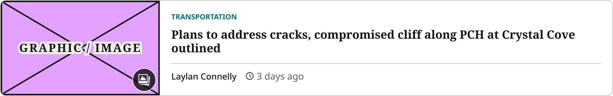
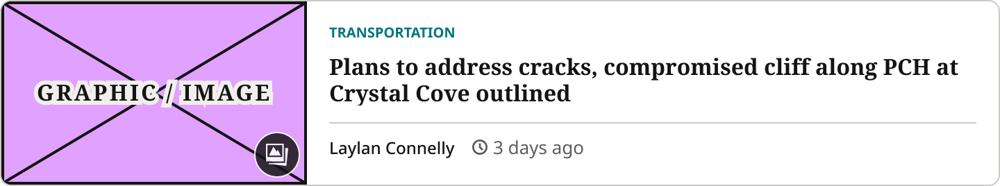
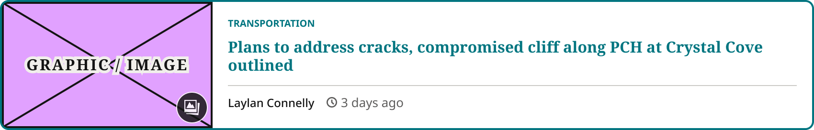
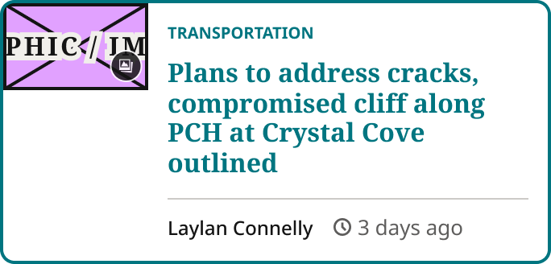
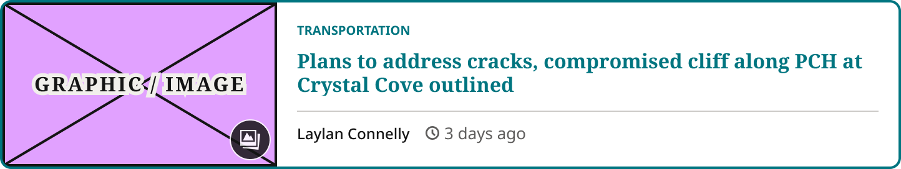
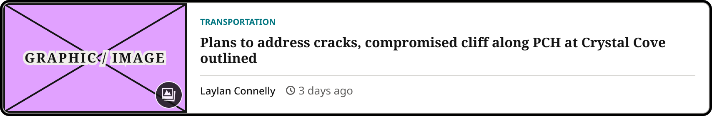
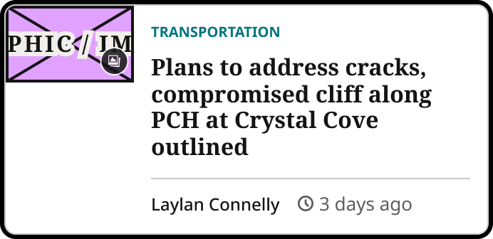
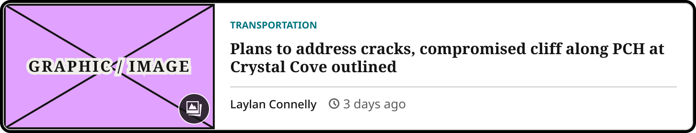

# Blocks Article Row

> The article row for Blocks (first used in the For You tab feed). State = Default / Hover / Focus × Device = Mobile / Tablet / Desktop; Show Gallery Icon. Built 2026-10-28 from Horizontal Thumbnail Card, Style=For You, as its own component (Karl).

## Figma

- File: **WordPress Elements** (`b1iZxkFwtAYq9rElmnCAzd`), page **Homepage**
- Component set: [`Blocks Article Row` · 3663:31214](https://www.figma.com/design/b1iZxkFwtAYq9rElmnCAzd/?node-id=3663-31214) · key `f3543c3d3a1ab06000ea1bced9cef16e9c49ea63`
- Documentation frame: [Blocks Article Row Container](https://www.figma.com/design/b1iZxkFwtAYq9rElmnCAzd/?node-id=3663-31205) · overview: [previews/blocks-article-row--documentation.png](previews/blocks-article-row--documentation.png)

## Properties

| Property | Default | Options |
|---|---|---|
| State | Default | Default, Hover, Focus |
| Device | Mobile | Desktop, Mobile, Tablet |

| Other property | Type | Default |
|---|---|---|
| Show Gallery Icon | boolean | True |

## Variants

| Variant | Size | Node | Instances | Preview |
|---|---|---|---|---|
| `Default / Desktop` | 848×134 | [3663:31261](https://www.figma.com/design/b1iZxkFwtAYq9rElmnCAzd/?node-id=3663-31261) | 0 |  |
| `Default / Mobile` | 340×162 | [3663:31239](https://www.figma.com/design/b1iZxkFwtAYq9rElmnCAzd/?node-id=3663-31239) | 0 |  |
| `Default / Tablet` | 720×134 | [3663:31250](https://www.figma.com/design/b1iZxkFwtAYq9rElmnCAzd/?node-id=3663-31250) | 0 |  |
| `Hover / Desktop` | 848×134 | [3663:31467](https://www.figma.com/design/b1iZxkFwtAYq9rElmnCAzd/?node-id=3663-31467) | 0 |  |
| `Hover / Mobile` | 340×162 | [3663:31407](https://www.figma.com/design/b1iZxkFwtAYq9rElmnCAzd/?node-id=3663-31407) | 0 |  |
| `Hover / Tablet` | 720×134 | [3663:31437](https://www.figma.com/design/b1iZxkFwtAYq9rElmnCAzd/?node-id=3663-31437) | 0 |  |
| `Focus / Desktop` | 848×134 | [3663:31486](https://www.figma.com/design/b1iZxkFwtAYq9rElmnCAzd/?node-id=3663-31486) | 0 |  |
| `Focus / Mobile` | 340×162 | [3663:31426](https://www.figma.com/design/b1iZxkFwtAYq9rElmnCAzd/?node-id=3663-31426) | 0 |  |
| `Focus / Tablet` | 720×134 | [3663:31456](https://www.figma.com/design/b1iZxkFwtAYq9rElmnCAzd/?node-id=3663-31456) | 0 |  |

## Anatomy

Default variant `Default / Desktop` (hidden layers marked):

- **State=Default, Device=Desktop** `COMPONENT`: 848×134, horizontal, gap 0, padding 0/0/0/0, fixed×hug
  - **Image Container** `FRAME`: 220×132, vertical, gap 0, padding 0/0/0/0, fixed×fill
    - **Article Image Placeholder** `INSTANCE`: 220×132, vertical, gap 8, padding 0/0/0/0, fill×fill, instance of Article Image Placeholder ()
    - **Gallery Icon Badge** `INSTANCE`: 33×33, horizontal, gap 0, padding 0/0/0/0, fixed×fixed, absolute, instance of Gallery Icon Badge (Size=Large, State=Default)
  - **Card Body** `FRAME`: 626×130, vertical, gap 12, padding 16/16/16/16, fill×hug
    - **Headline Container** `FRAME`: 594×59, vertical, gap 8, padding 0/0/0/0, fill×hug
      - **Article Section Kicker** `INSTANCE`: 91×13, horizontal, gap 0, padding 0/0/0/0, hug×hug, instance of Article Section Kicker ()
      - **Headline** `TEXT`: 594×38, fill×hug, "Plans to address cracks, compromised cli", Noto Serif Bold 16px
    - **Card Footer** `FRAME`: 594×27, horizontal, gap 12, padding 8/0/0/0, fill×hug
      - **Article Author** `INSTANCE`: 91×16, horizontal, gap 0, padding 0/0/0/0, hug×hug, instance of Article Author ()
      - **Article Timestamp** `INSTANCE`: 81×18, horizontal, gap 4, padding 0/0/0/0, hug×hug, instance of Article Timestamp ()

## Component tokens

From `blocks-article-row.tokens.json`. References point at system tokens (`tokens/core/`, `tokens/themes/`); the CSS variable is `--mng-` + the token path. A literal value means the Figma layer isn't bound to a token.

| Token | Value |
|---|---|
| `blocks-article-row.base.card-body.gap` | `{spacing.150}` |
| `blocks-article-row.base.card-body.card-footer.border-color` | `{color.gray.500}` |
| `blocks-article-row.base.card-body.card-footer.border-style` | solid |
| `blocks-article-row.base.card-body.card-footer.border-top-width` | 1px |
| `blocks-article-row.base.card-body.card-footer.gap` | `{spacing.150}` |
| `blocks-article-row.base.card-body.card-footer.padding-top` | `{spacing.100}` |
| `blocks-article-row.base.card-body.card-footer.article-author.height` | 16px |
| `blocks-article-row.base.card-body.card-footer.article-author.icon-color` | `{color.gray.min}` |
| `blocks-article-row.base.card-body.card-footer.article-author.width` | 91px |
| `blocks-article-row.base.card-body.card-footer.article-timestamp.height` | 18px |
| `blocks-article-row.base.card-body.card-footer.article-timestamp.width` | 81px |
| `blocks-article-row.base.card-body.headline-container.gap` | `{spacing.100}` |
| `blocks-article-row.base.card-body.headline-container.article-section-kicker.height` | 13px |
| `blocks-article-row.base.card-body.headline-container.article-section-kicker.icon-color` | `{color.theme.primary}` |
| `blocks-article-row.base.card-body.headline-container.article-section-kicker.width` | 91px |
| `blocks-article-row.base.card-body.headline-container.headline.font-family` | `{font.theme.heading-family}` |
| `blocks-article-row.base.card-body.headline-container.headline.font-size` | `{font.size.16}` |
| `blocks-article-row.base.card-body.headline-container.headline.font-weight` | `{font.weight.bold}` |
| `blocks-article-row.base.card-body.headline-container.headline.line-height` | 18.88px |
| `blocks-article-row.base.image-container.min-height` | 132px |
| `blocks-article-row.base.image-container.article-image-placeholder.icon-color` | `{color.gray.min}` |
| `blocks-article-row.base.root.background` | `{color.gray.max}` |
| `blocks-article-row.base.root.border-radius` | `{radius.lg}` |
| `blocks-article-row.base.root.border-style` | solid |
| `blocks-article-row.base.root.border-width` | 1px |
| `blocks-article-row.device-desktop.card-body.padding-bottom` | `{spacing.200}` |
| `blocks-article-row.device-desktop.card-body.padding-left` | `{spacing.200}` |
| `blocks-article-row.device-desktop.card-body.padding-right` | `{spacing.200}` |
| `blocks-article-row.device-desktop.card-body.padding-top` | `{spacing.200}` |
| `blocks-article-row.device-desktop.image-container.width` | 220px |
| `blocks-article-row.device-desktop.image-container.article-image-placeholder.height` | 132px |
| `blocks-article-row.device-desktop.image-container.article-image-placeholder.width` | 220px |
| `blocks-article-row.device-desktop.image-container.gallery-icon-badge.height` | 33px |
| `blocks-article-row.device-desktop.image-container.gallery-icon-badge.width` | 33px |
| `blocks-article-row.device-desktop.root.width` | 848px |
| `blocks-article-row.device-mobile.card-body.padding-bottom` | `{spacing.150}` |
| `blocks-article-row.device-mobile.card-body.padding-left` | `{spacing.150}` |
| `blocks-article-row.device-mobile.card-body.padding-right` | `{spacing.150}` |
| `blocks-article-row.device-mobile.card-body.padding-top` | `{spacing.150}` |
| `blocks-article-row.device-mobile.image-container.height` | 54px |
| `blocks-article-row.device-mobile.image-container.width` | 90px |
| `blocks-article-row.device-mobile.image-container.article-image-placeholder.height` | 54px |
| `blocks-article-row.device-mobile.image-container.article-image-placeholder.width` | 90px |
| `blocks-article-row.device-mobile.image-container.gallery-icon-badge.height` | 20px |
| `blocks-article-row.device-mobile.image-container.gallery-icon-badge.width` | 20px |
| `blocks-article-row.device-mobile.root.width` | 340px |
| `blocks-article-row.device-tablet.card-body.padding-bottom` | `{spacing.200}` |
| `blocks-article-row.device-tablet.card-body.padding-left` | `{spacing.200}` |
| `blocks-article-row.device-tablet.card-body.padding-right` | `{spacing.200}` |
| `blocks-article-row.device-tablet.card-body.padding-top` | `{spacing.200}` |
| `blocks-article-row.device-tablet.image-container.width` | 220px |
| `blocks-article-row.device-tablet.image-container.article-image-placeholder.height` | 132px |
| `blocks-article-row.device-tablet.image-container.article-image-placeholder.width` | 220px |
| `blocks-article-row.device-tablet.image-container.gallery-icon-badge.height` | 33px |
| `blocks-article-row.device-tablet.image-container.gallery-icon-badge.width` | 33px |
| `blocks-article-row.device-tablet.root.width` | 720px |
| `blocks-article-row.state-default.card-body.headline-container.headline.color` | `{color.gray.min}` |
| `blocks-article-row.state-default.root.border-color` | `{color.gray.500}` |
| `blocks-article-row.state-hover.card-body.headline-container.headline.color` | `{color.theme.primary}` |
| `blocks-article-row.state-hover.root.border-color` | `{color.theme.primary}` |
| `blocks-article-row.state-focus.card-body.headline-container.headline.color` | `{color.gray.min}` |
| `blocks-article-row.state-focus.root.border-color` | `{color.gray.500}` |

## Behavior and breakpoints

| Device | Viewport | Row |
|---|---|---|
| Mobile | below 640px | 90×54 image pinned top-left, 12px body padding; built at 340 |
| Tablet | 640px and up (768 template) | 220px image, 16px body padding; built at 720 |
| Desktop | 640px and up (1280 template) | Same as Tablet; built at 848 |

- **Container:** `color/gray/max` fill, 1px `color/gray/500` border, `radius/lg` (8px), clips its content. No shadow.
- **Image:** Article Image Placeholder pinned top-left. 640px and up: 220px wide, filling the row height (minimum 132, 5:3). Below 640px: 90×54, with white space below it.
- **Body:** Article Section Kicker; headline `Editorial/Titles/CardTertiaryCompact` (`color/gray/min`), not clamped; footer with a 1px `color/gray/500` top border, Article Author and Article Timestamp side by side.
- **Spacing:** body padding 16px (`spacing/200`), 12px (`spacing/150`) below 640px; 8px (`spacing/100`) kicker to headline; 12px (`spacing/150`) headline group to footer; 8px (`spacing/100`) above the footer content; 12px (`spacing/150`) between author and timestamp.
- **Hover** (prototype `.row:hover`): border and a 1px outside ring in `color/theme/primary`, headline `color/theme/primary`.
- **Focus** (prototype `.row:focus-visible`): `outline: 2px solid` `color/gray/black`, `outline-offset: 1px`.
- **Gallery Icon Badge:** Size=Large on the 220px image, Size=Small on the 90px image.

## Accessibility

- No InFocus state in Figma.
- Text color on its background must meet WCAG AA contrast (4.5:1 for text under 18px) in every theme; theme colors change per site.
- Icons inside a labelled control are decorative (`aria-hidden`); an icon-only control needs an accessible name (`aria-label`).

## Where it is used

Scope: instances in the Figma file **WordPress Elements** only (other files that use the library are not counted). Total: **0**.

**Built from:** Article Image Placeholder ×9, Gallery Icon Badge ×9, Article Section Kicker ×9, Article Author ×9, Article Timestamp ×9

## Production

New: the For You tab (prototype `.row`).

## Known issues

1. The exporter doesn't write Figma effects yet, so the Hover ring (`box-shadow: 0 0 0 1px`) and the Focus outline are in the rules above, not in the tokens or the HTML skeleton.

## Files

- `blocks-article-row.tokens.json`: component tokens (DTCG 2025.10).
- `blocks-article-row.html`: HTML/CSS skeleton of every variant, using the `dist/` CSS variables (open it in a browser).
- `previews/`: PNG of every variant @2x and the documentation frame.

*Generated 2026-10-30 by `scripts/component-export/export.py` (EXPORT-STANDARD.md section 7). Edit the text in `scripts/component-export/registry.json`, not here.*
