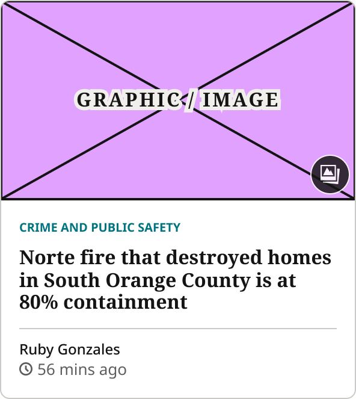
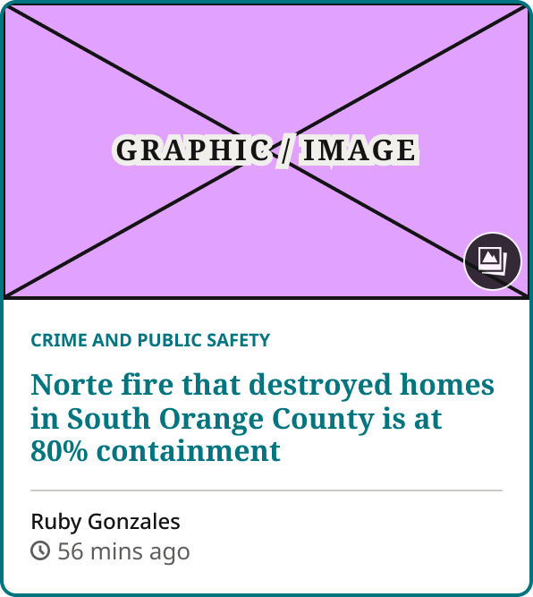
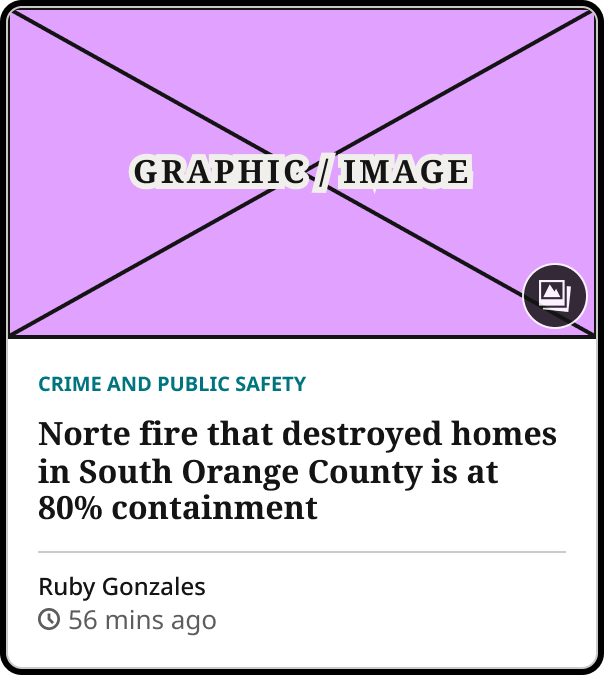

# Blocks Card

> The article card for Blocks (first used in the For You tab grid). State = Default / Hover / Focus; Show Gallery Icon. Built 2026-10-28 from 1Col Article Card, Style=For You, as its own component, separate from the Zone article cards (Karl).

## Figma

- File: **WordPress Elements** (`b1iZxkFwtAYq9rElmnCAzd`), page **Homepage**
- Component set: [`Blocks Card` · 3663:31072](https://www.figma.com/design/b1iZxkFwtAYq9rElmnCAzd/?node-id=3663-31072) · key `12f9d565a5107bd87fbbb91de42b3985cd934ed6`
- Documentation frame: [Blocks Card Container](https://www.figma.com/design/b1iZxkFwtAYq9rElmnCAzd/?node-id=3663-31066) · overview: [previews/blocks-card--documentation.png](previews/blocks-card--documentation.png)

## Properties

| Property | Default | Options |
|---|---|---|
| State | Default | Default, Hover, Focus |

| Other property | Type | Default |
|---|---|---|
| Show Gallery Icon | boolean | True |

## Variants

| Variant | Size | Node | Instances | Preview |
|---|---|---|---|---|
| `Default` | 296×331.5 | [3663:31093](https://www.figma.com/design/b1iZxkFwtAYq9rElmnCAzd/?node-id=3663-31093) | 0 |  |
| `Hover` | 296×331.5 | [3663:31157](https://www.figma.com/design/b1iZxkFwtAYq9rElmnCAzd/?node-id=3663-31157) | 0 |  |
| `Focus` | 296×331.5 | [3663:31173](https://www.figma.com/design/b1iZxkFwtAYq9rElmnCAzd/?node-id=3663-31173) | 0 |  |

## Anatomy

Default variant `Default` (hidden layers marked):

- **State=Default** `COMPONENT`: 296×331.5, vertical, gap 0, padding 0/0/0/0, fixed×hug
  - **Article Graphic** `INSTANCE`: 296×166.5, vertical, gap 8, padding 0/0/0/0, fill×fixed, instance of Article Image Placeholder ()
  - **Card Body** `FRAME`: 296×165, vertical, gap 12, padding 16/16/16/16, fill×hug
    - **Headline Container** `FRAME`: 264×78, vertical, gap 8, padding 0/0/0/0, fill×hug
      - **Article Section Kicker** `INSTANCE`: 135×13, horizontal, gap 0, padding 0/0/0/0, hug×hug, instance of Article Section Kicker ()
      - **Headline** `TEXT`: 264×57, fill×hug, "Norte fire that destroyed homes in South", Noto Serif Bold 16px
    - **Card Footer** `FRAME`: 264×43, vertical, gap 0, padding 8/0/0/0, fill×hug
      - **Article Author** `INSTANCE`: 84×16, horizontal, gap 0, padding 0/0/0/0, hug×hug, instance of Article Author ()
      - **Article Timestamp** `INSTANCE`: 90×18, horizontal, gap 4, padding 0/0/0/0, hug×hug, instance of Article Timestamp ()
  - **Gallery Icon Badge** `INSTANCE`: 33×33, horizontal, gap 0, padding 0/0/0/0, fixed×fixed, absolute, instance of Gallery Icon Badge (Size=Large, State=Default)

## Component tokens

From `blocks-card.tokens.json`. References point at system tokens (`tokens/core/`, `tokens/themes/`); the CSS variable is `--mng-` + the token path. A literal value means the Figma layer isn't bound to a token.

| Token | Value |
|---|---|
| `blocks-card.base.article-graphic.height` | 166.5px |
| `blocks-card.base.article-graphic.icon-color` | `{color.gray.min}` |
| `blocks-card.base.article-graphic.width` | 296px |
| `blocks-card.base.card-body.gap` | `{spacing.150}` |
| `blocks-card.base.card-body.padding-bottom` | `{spacing.200}` |
| `blocks-card.base.card-body.padding-left` | `{spacing.200}` |
| `blocks-card.base.card-body.padding-right` | `{spacing.200}` |
| `blocks-card.base.card-body.padding-top` | `{spacing.200}` |
| `blocks-card.base.card-body.card-footer.border-color` | `{color.gray.500}` |
| `blocks-card.base.card-body.card-footer.border-style` | solid |
| `blocks-card.base.card-body.card-footer.border-top-width` | 1px |
| `blocks-card.base.card-body.card-footer.padding-top` | `{spacing.100}` |
| `blocks-card.base.card-body.card-footer.article-author.height` | 16px |
| `blocks-card.base.card-body.card-footer.article-author.icon-color` | `{color.gray.min}` |
| `blocks-card.base.card-body.card-footer.article-author.width` | 84px |
| `blocks-card.base.card-body.card-footer.article-timestamp.height` | 18px |
| `blocks-card.base.card-body.card-footer.article-timestamp.width` | 90px |
| `blocks-card.base.card-body.headline-container.gap` | `{spacing.100}` |
| `blocks-card.base.card-body.headline-container.article-section-kicker.height` | 13px |
| `blocks-card.base.card-body.headline-container.article-section-kicker.icon-color` | `{color.theme.primary}` |
| `blocks-card.base.card-body.headline-container.article-section-kicker.width` | 135px |
| `blocks-card.base.card-body.headline-container.headline.font-family` | `{font.theme.heading-family}` |
| `blocks-card.base.card-body.headline-container.headline.font-size` | `{font.size.16}` |
| `blocks-card.base.card-body.headline-container.headline.font-weight` | `{font.weight.bold}` |
| `blocks-card.base.card-body.headline-container.headline.line-height` | 18.88px |
| `blocks-card.base.gallery-icon-badge.height` | 33px |
| `blocks-card.base.gallery-icon-badge.width` | 33px |
| `blocks-card.base.root.background` | `{color.gray.max}` |
| `blocks-card.base.root.border-radius` | `{radius.lg}` |
| `blocks-card.base.root.border-style` | solid |
| `blocks-card.base.root.border-width` | 1px |
| `blocks-card.base.root.width` | 296px |
| `blocks-card.state-default.card-body.headline-container.headline.color` | `{color.gray.min}` |
| `blocks-card.state-default.root.border-color` | `{color.gray.500}` |
| `blocks-card.state-hover.card-body.headline-container.headline.color` | `{color.theme.primary}` |
| `blocks-card.state-hover.root.border-color` | `{color.theme.primary}` |
| `blocks-card.state-focus.card-body.headline-container.headline.color` | `{color.gray.min}` |
| `blocks-card.state-focus.root.border-color` | `{color.gray.500}` |

## Behavior and breakpoints

No Breakpoint property: one size at every width.

- **Container:** `color/gray/max` fill, 1px `color/gray/500` border, `radius/lg` (8px), clips its content. No shadow.
- **Content:** 16:9 Article Image Placeholder; Article Section Kicker; headline `Editorial/Titles/CardTertiaryCompact` (Noto Serif Bold 16/18.88, `color/gray/min`), max 5 lines; footer with a 1px `color/gray/500` top border, Article Author with Article Timestamp under it.
- **Spacing:** 16px (`spacing/200`) body padding; 8px (`spacing/100`) kicker to headline; 12px (`spacing/150`) headline group to footer; 8px (`spacing/100`) above the author.
- **Width:** fills its column; 16px gaps; 3-up from 800px, 2-up at 640–799px, 1-up below 640px. Built at 296px.
- **Hover** (the whole card is one link; For You prototype `.card:hover`): border and a 1px outside ring in `color/theme/primary` (CSS `border-color` plus `box-shadow: 0 0 0 1px`), headline `color/theme/primary`. Contrast: theme primary on white passes AA on every site (lowest 4.75:1).
- **Focus** (keyboard; prototype `.card:focus-visible`): `outline: 2px solid` `color/gray/black`, `outline-offset: 1px`.
- **Gallery Icon Badge** (`Show Gallery Icon`): Size=Large, 5px in from the image's bottom-right corner.

## Accessibility

- No InFocus state in Figma.
- Text color on its background must meet WCAG AA contrast (4.5:1 for text under 18px) in every theme; theme colors change per site.
- Icons inside a labelled control are decorative (`aria-hidden`); an icon-only control needs an accessible name (`aria-label`).

## Where it is used

Scope: instances in the Figma file **WordPress Elements** only (other files that use the library are not counted). Total: **0**.

**Built from:** Article Image Placeholder ×3, Article Section Kicker ×3, Article Author ×3, Article Timestamp ×3, Gallery Icon Badge ×3

## Production

New: the For You tab (prototype `.card`). Production's homepage card hover only turns the headline primary (`h3 a:hover`).

## Known issues

1. In code the card body is space-between so footers line up in a row of cards; Figma uses the fixed 12px gap.
2. The exporter doesn't write Figma effects yet, so the Hover ring (`box-shadow: 0 0 0 1px`) and the Focus outline are in the rules above, not in the tokens or the HTML skeleton.

## Files

- `blocks-card.tokens.json`: component tokens (DTCG 2025.10).
- `blocks-card.html`: HTML/CSS skeleton of every variant, using the `dist/` CSS variables (open it in a browser).
- `previews/`: PNG of every variant @2x and the documentation frame.

*Generated 2026-10-30 by `scripts/component-export/export.py` (EXPORT-STANDARD.md section 7). Edit the text in `scripts/component-export/registry.json`, not here.*
