# Blocks Lead Article Card

> The featured (lead) story for Blocks (first used at the top of the For You tab feed). State = Default / Hover × Device = Mobile / Tablet / Desktop × Gallery = Image / Slideshow. Built 2026-10-28 from Zone 1 Lead Article Card, Style=For You, as its own component (Karl).

## Figma

- File: **WordPress Elements** (`b1iZxkFwtAYq9rElmnCAzd`), page **Homepage**
- Component set: [`Blocks Lead Article Card` · 3663:31557](https://www.figma.com/design/b1iZxkFwtAYq9rElmnCAzd/?node-id=3663-31557) · key `ee1e934379e375720ebe6d4cb298046435b8d9a1`
- Documentation frame: [Blocks Lead Article Card Container](https://www.figma.com/design/b1iZxkFwtAYq9rElmnCAzd/?node-id=3663-31548) · overview: [previews/blocks-lead-article-card--documentation.png](previews/blocks-lead-article-card--documentation.png)

## Properties

| Property | Default | Options |
|---|---|---|
| State | Default | Default, Hover |
| Device | Mobile | Desktop, Mobile, Tablet |
| Gallery | Image | Image, Slideshow |

## Variants

| Variant | Size | Node | Instances | Preview |
|---|---|---|---|---|
| `Default / Desktop / Image` | 706×289 | [3663:31633](https://www.figma.com/design/b1iZxkFwtAYq9rElmnCAzd/?node-id=3663-31633) | 0 | 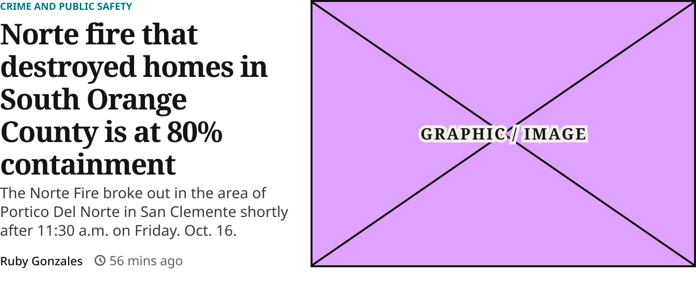 |
| `Default / Desktop / Slideshow` | 706×375 | [3663:31721](https://www.figma.com/design/b1iZxkFwtAYq9rElmnCAzd/?node-id=3663-31721) | 0 | 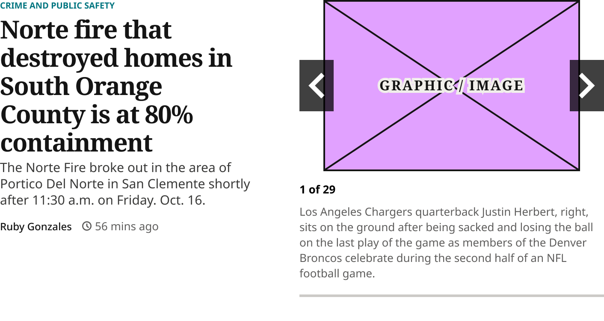 |
| `Default / Mobile / Image` | 340×507.65 | [3663:31607](https://www.figma.com/design/b1iZxkFwtAYq9rElmnCAzd/?node-id=3663-31607) | 0 | 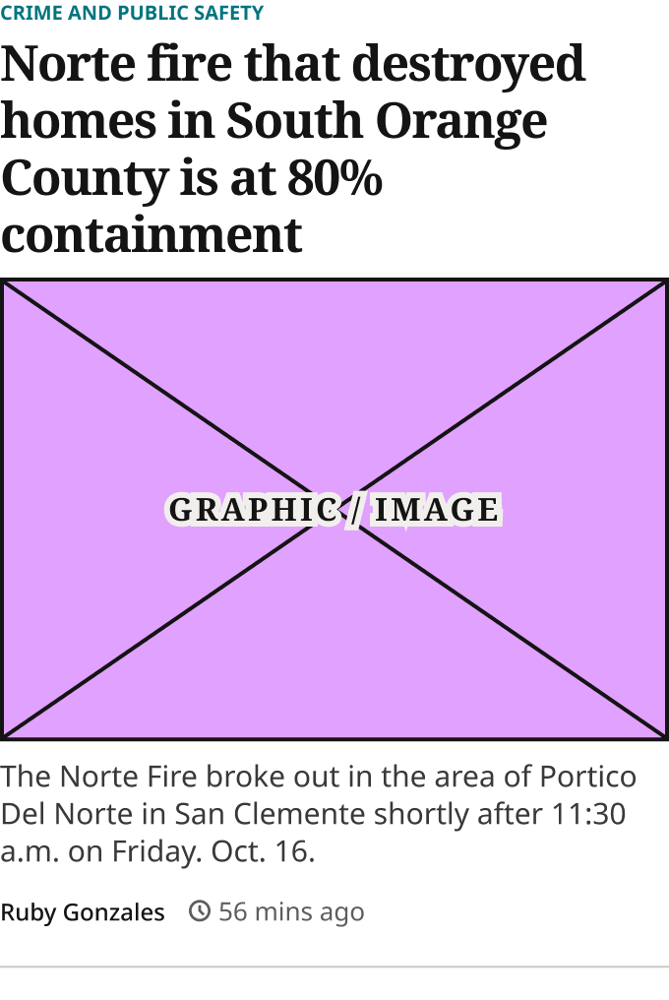 |
| `Default / Mobile / Slideshow` | 340×581 | [3663:31695](https://www.figma.com/design/b1iZxkFwtAYq9rElmnCAzd/?node-id=3663-31695) | 0 | 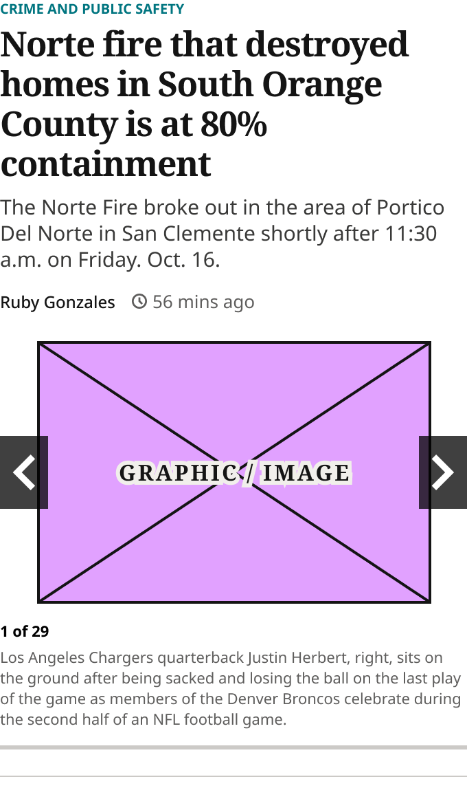 |
| `Default / Tablet / Image` | 748×287 | [3663:31620](https://www.figma.com/design/b1iZxkFwtAYq9rElmnCAzd/?node-id=3663-31620) | 0 | 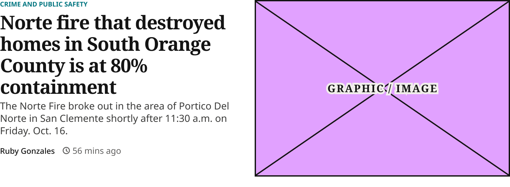 |
| `Default / Tablet / Slideshow` | 748×335 | [3663:31708](https://www.figma.com/design/b1iZxkFwtAYq9rElmnCAzd/?node-id=3663-31708) | 0 | 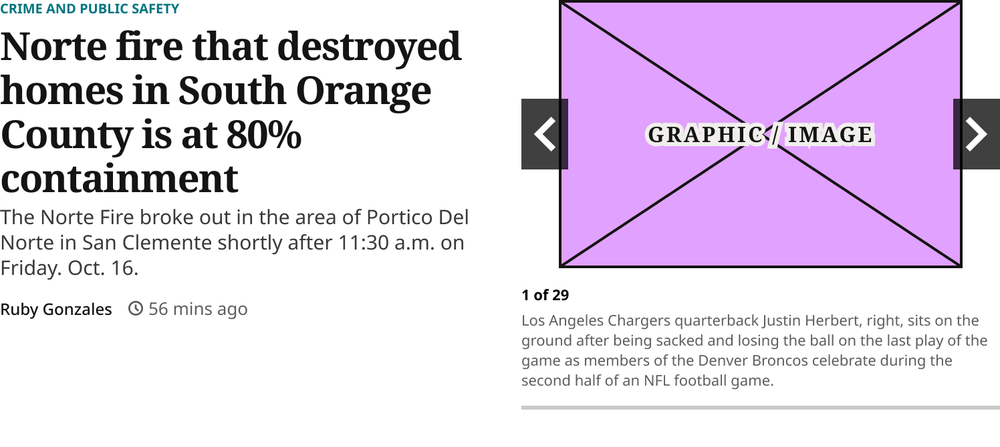 |
| `Hover / Desktop / Image` | 706×289 | [3663:32001](https://www.figma.com/design/b1iZxkFwtAYq9rElmnCAzd/?node-id=3663-32001) | 0 | 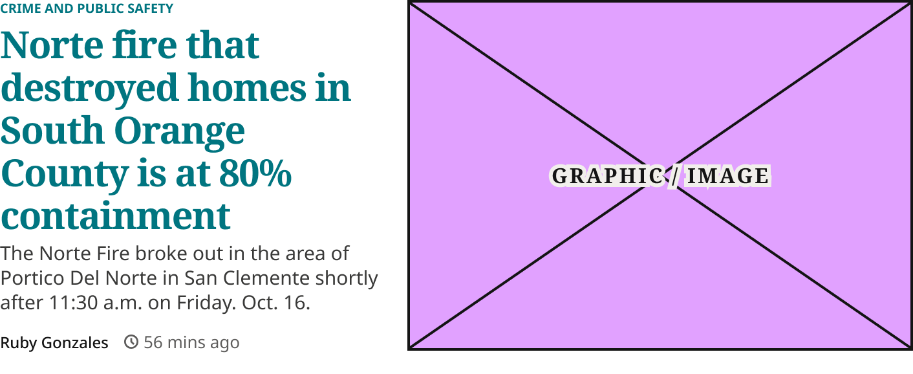 |
| `Hover / Desktop / Slideshow` | 706×375 | [3663:32094](https://www.figma.com/design/b1iZxkFwtAYq9rElmnCAzd/?node-id=3663-32094) | 0 | 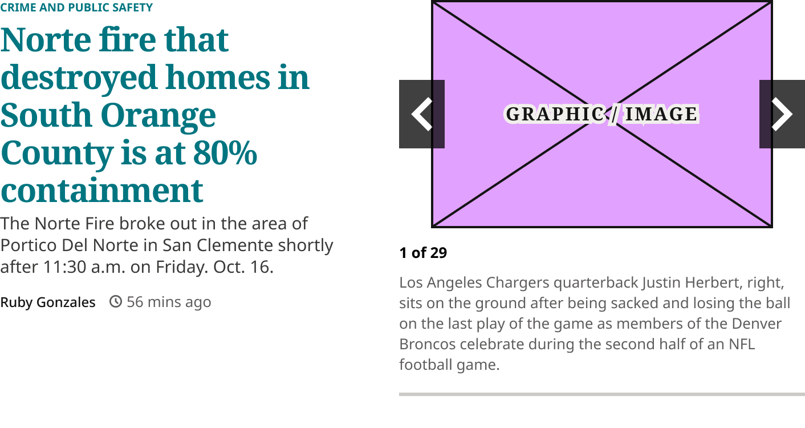 |
| `Hover / Mobile / Image` | 340×507.65 | [3663:31955](https://www.figma.com/design/b1iZxkFwtAYq9rElmnCAzd/?node-id=3663-31955) | 0 | 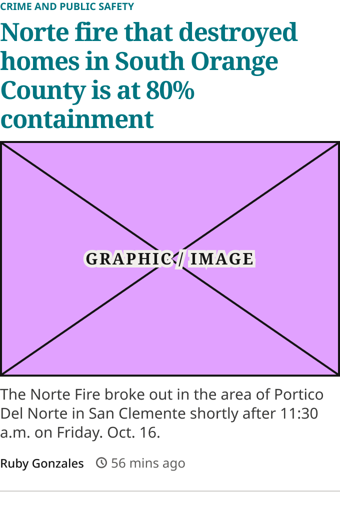 |
| `Hover / Mobile / Slideshow` | 340×581 | [3663:32024](https://www.figma.com/design/b1iZxkFwtAYq9rElmnCAzd/?node-id=3663-32024) | 0 | 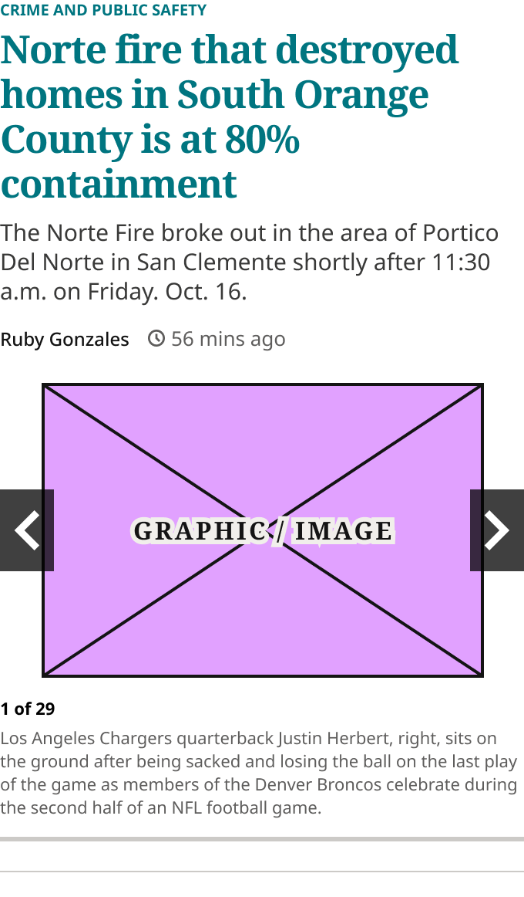 |
| `Hover / Tablet / Image` | 748×287 | [3663:31978](https://www.figma.com/design/b1iZxkFwtAYq9rElmnCAzd/?node-id=3663-31978) | 0 | 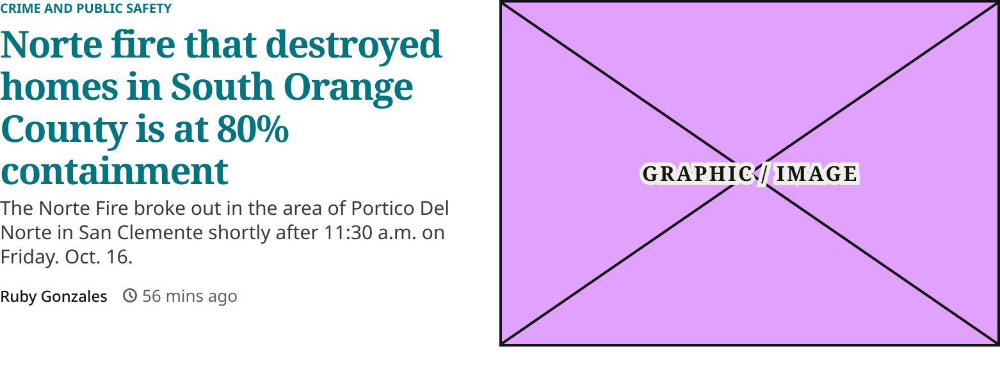 |
| `Hover / Tablet / Slideshow` | 748×335 | [3663:32059](https://www.figma.com/design/b1iZxkFwtAYq9rElmnCAzd/?node-id=3663-32059) | 0 | 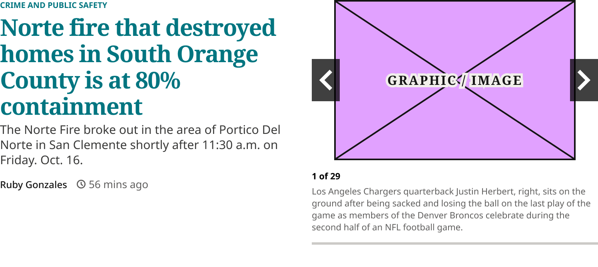 |

## Anatomy

Default variant `Default / Desktop / Image` (hidden layers marked):

- **State=Default, Device=Desktop, Gallery=Image** `COMPONENT`: 706×289, horizontal, gap 20, padding 0/0/16/0, hug×hug
  - **1st Col** `FRAME`: 295×273, vertical, gap 4, padding 0/0/0/0, fixed×hug
    - **Headline Group** `FRAME`: 295×182, vertical, gap 4, padding 0/0/0/0, fill×hug
      - **Article Section Kicker** `INSTANCE`: 135×13, horizontal, gap 0, padding 0/0/0/0, hug×hug, instance of Article Section Kicker ()
      - **Headline Container** `FRAME`: 295×165, horizontal, gap 8, padding 0/0/0/0, fill×hug
        - **Norte fire that destroyed homes in South Orange County is at 80% containment** `TEXT`: 295×165, fill×hug, "Norte fire that destroyed homes in South", Noto Serif Bold 29px
    - **Excerpt Container** `FRAME`: 295×57, horizontal, gap 8, padding 0/0/0/0, fill×hug
      - **The Norte Fire broke out in the area of Portico Del Norte in San Clemente shortly after 11:30 a.m. on Friday. Oct. 16.** `TEXT`: 295×57, fill×hug, "The Norte Fire broke out in the area of ", Noto Sans Regular 15px
    - **Byline** `FRAME`: 295×26, horizontal, gap 12, padding 8/0/0/0, fill×hug
      - **Article Author** `INSTANCE`: 84×16, horizontal, gap 0, padding 0/0/0/0, hug×hug, instance of Article Author ()
      - **Article Timestamp** `INSTANCE`: 90×18, horizontal, gap 4, padding 0/0/0/0, hug×hug, instance of Article Timestamp ()
  - **2nd Col** `FRAME`: 391×271, vertical, gap 8, padding 0/0/0/0, fixed×fixed
    - **Article Image Placeholder** `INSTANCE`: 391×271, vertical, gap 8, padding 0/0/0/0, fixed×fixed, instance of Article Image Placeholder ()

## Component tokens

From `blocks-lead-article-card.tokens.json`. References point at system tokens (`tokens/core/`, `tokens/themes/`); the CSS variable is `--mng-` + the token path. A literal value means the Figma layer isn't bound to a token.

| Token | Value |
|---|---|
| `blocks-lead-article-card.base.1st-col.gap` | 4px |
| `blocks-lead-article-card.base.1st-col.byline.gap` | `{spacing.150}` |
| `blocks-lead-article-card.base.1st-col.byline.padding-top` | `{spacing.100}` |
| `blocks-lead-article-card.base.1st-col.byline.article-author.height` | 16px |
| `blocks-lead-article-card.base.1st-col.byline.article-author.icon-color` | `{color.gray.min}` |
| `blocks-lead-article-card.base.1st-col.byline.article-author.width` | 84px |
| `blocks-lead-article-card.base.1st-col.byline.article-timestamp.height` | 18px |
| `blocks-lead-article-card.base.1st-col.byline.article-timestamp.width` | 90px |
| `blocks-lead-article-card.base.1st-col.excerpt-container.the-norte-fire-broke-out-in-the-area-of-portico-del-norte-in-san-clemente-shortly-after-11-30-a-m-on-friday-oct-16.color` | `{color.gray.100}` |
| `blocks-lead-article-card.base.1st-col.excerpt-container.the-norte-fire-broke-out-in-the-area-of-portico-del-norte-in-san-clemente-shortly-after-11-30-a-m-on-friday-oct-16.font-family` | Noto Sans |
| `blocks-lead-article-card.base.1st-col.excerpt-container.the-norte-fire-broke-out-in-the-area-of-portico-del-norte-in-san-clemente-shortly-after-11-30-a-m-on-friday-oct-16.font-size` | 15px |
| `blocks-lead-article-card.base.1st-col.excerpt-container.the-norte-fire-broke-out-in-the-area-of-portico-del-norte-in-san-clemente-shortly-after-11-30-a-m-on-friday-oct-16.font-weight` | 400 |
| `blocks-lead-article-card.base.1st-col.excerpt-container.the-norte-fire-broke-out-in-the-area-of-portico-del-norte-in-san-clemente-shortly-after-11-30-a-m-on-friday-oct-16.line-height` | 19px |
| `blocks-lead-article-card.base.1st-col.headline-group.gap` | `{spacing.050}` |
| `blocks-lead-article-card.base.1st-col.headline-group.article-section-kicker.height` | 13px |
| `blocks-lead-article-card.base.1st-col.headline-group.article-section-kicker.icon-color` | `{color.theme.primary}` |
| `blocks-lead-article-card.base.1st-col.headline-group.article-section-kicker.width` | 135px |
| `blocks-lead-article-card.base.1st-col.headline-group.headline-container.norte-fire-that-destroyed-homes-in-south-orange-county-is-at-80-containment.font-family` | `{font.family.noto-serif}` |
| `blocks-lead-article-card.base.1st-col.headline-group.headline-container.norte-fire-that-destroyed-homes-in-south-orange-county-is-at-80-containment.font-size` | `{font.size.29}` |
| `blocks-lead-article-card.base.1st-col.headline-group.headline-container.norte-fire-that-destroyed-homes-in-south-orange-county-is-at-80-containment.font-weight` | `{font.weight.bold}` |
| `blocks-lead-article-card.base.1st-col.headline-group.headline-container.norte-fire-that-destroyed-homes-in-south-orange-county-is-at-80-containment.letter-spacing` | -3px |
| `blocks-lead-article-card.base.1st-col.headline-group.headline-container.norte-fire-that-destroyed-homes-in-south-orange-county-is-at-80-containment.line-height` | 33px |
| `blocks-lead-article-card.base.2nd-col.height` | 271px |
| `blocks-lead-article-card.base.2nd-col.article-image-placeholder.height` | 271px |
| `blocks-lead-article-card.base.2nd-col.article-image-placeholder.icon-color` | `{color.gray.min}` |
| `blocks-lead-article-card.base.2nd-col.article-image-placeholder.width` | 391px |
| `blocks-lead-article-card.base.2nd-col.zone-1-slideshow.icon-color` | #e1a1ff |
| `blocks-lead-article-card.base.featured-image.height` | 235.65px |
| `blocks-lead-article-card.base.featured-image.article-image-placeholder.height` | 235.65px |
| `blocks-lead-article-card.base.featured-image.article-image-placeholder.icon-color` | `{color.gray.min}` |
| `blocks-lead-article-card.base.featured-image.article-image-placeholder.width` | 340px |
| `blocks-lead-article-card.base.root.background` | `{color.gray.max}` |
| `blocks-lead-article-card.base.root.padding-bottom` | 16px |
| `blocks-lead-article-card.base.slideshow.zone-1-slideshow.height` | 309px |
| `blocks-lead-article-card.base.slideshow.zone-1-slideshow.icon-color` | #e1a1ff |
| `blocks-lead-article-card.base.slideshow.zone-1-slideshow.width` | 340px |
| `blocks-lead-article-card.device-desktop.1st-col.width` | 295px |
| `blocks-lead-article-card.device-desktop.2nd-col.zone-1-slideshow.height` | 359px |
| `blocks-lead-article-card.device-desktop.2nd-col.zone-1-slideshow.width` | 356px |
| `blocks-lead-article-card.device-desktop.root.gap` | 20px |
| `blocks-lead-article-card.device-desktop.root.width` | 706px |
| `blocks-lead-article-card.device-tablet.1st-col.width` | 358px |
| `blocks-lead-article-card.device-tablet.2nd-col.zone-1-slideshow.height` | 319px |
| `blocks-lead-article-card.device-tablet.2nd-col.zone-1-slideshow.width` | 358px |
| `blocks-lead-article-card.device-tablet.root.gap` | 32px |
| `blocks-lead-article-card.state-default.1st-col.headline-group.headline-container.norte-fire-that-destroyed-homes-in-south-orange-county-is-at-80-containment.color` | `{color.gray.min}` |
| `blocks-lead-article-card.state-default.headline-group.headline-container.norte-fire-that-destroyed-homes-in-south-orange-county-is-at-80-containment.color` | `{color.gray.min}` |
| `blocks-lead-article-card.state-hover.1st-col.headline-group.headline-container.norte-fire-that-destroyed-homes-in-south-orange-county-is-at-80-containment.color` | `{color.theme.primary}` |
| `blocks-lead-article-card.state-hover.headline-group.headline-container.norte-fire-that-destroyed-homes-in-south-orange-county-is-at-80-containment.color` | `{color.theme.primary}` |
| `blocks-lead-article-card.device-desktop.gallery-image.2nd-col.width` | 391px |
| `blocks-lead-article-card.device-desktop.gallery-slideshow.2nd-col.width` | 356px |
| `blocks-lead-article-card.device-tablet.gallery-image.2nd-col.width` | 358px |
| `blocks-lead-article-card.device-tablet.gallery-slideshow.2nd-col.width` | 358px |
| `blocks-lead-article-card.device-mobile.bottom-border-line.border-color` | `{color.gray.500}` |
| `blocks-lead-article-card.device-mobile.bottom-border-line.border-style` | solid |
| `blocks-lead-article-card.device-mobile.bottom-border-line.border-width` | 1px |
| `blocks-lead-article-card.device-mobile.bottom-border-line.height` | 0px |
| `blocks-lead-article-card.device-mobile.byline.gap` | `{spacing.150}` |
| `blocks-lead-article-card.device-mobile.byline.padding-bottom` | `{spacing.150}` |
| `blocks-lead-article-card.device-mobile.byline.padding-top` | `{spacing.050}` |
| `blocks-lead-article-card.device-mobile.byline.article-author.height` | 16px |
| `blocks-lead-article-card.device-mobile.byline.article-author.icon-color` | `{color.gray.min}` |
| `blocks-lead-article-card.device-mobile.byline.article-author.width` | 84px |
| `blocks-lead-article-card.device-mobile.byline.article-timestamp.height` | 18px |
| `blocks-lead-article-card.device-mobile.byline.article-timestamp.width` | 90px |
| `blocks-lead-article-card.device-mobile.excerpt-container.the-norte-fire-broke-out-in-the-area-of-portico-del-norte-in-san-clemente-shortly-after-11-30-a-m-on-friday-oct-16.color` | `{color.gray.100}` |
| `blocks-lead-article-card.device-mobile.excerpt-container.the-norte-fire-broke-out-in-the-area-of-portico-del-norte-in-san-clemente-shortly-after-11-30-a-m-on-friday-oct-16.font-family` | Noto Sans |
| `blocks-lead-article-card.device-mobile.excerpt-container.the-norte-fire-broke-out-in-the-area-of-portico-del-norte-in-san-clemente-shortly-after-11-30-a-m-on-friday-oct-16.font-size` | 15px |
| `blocks-lead-article-card.device-mobile.excerpt-container.the-norte-fire-broke-out-in-the-area-of-portico-del-norte-in-san-clemente-shortly-after-11-30-a-m-on-friday-oct-16.font-weight` | 400 |
| `blocks-lead-article-card.device-mobile.excerpt-container.the-norte-fire-broke-out-in-the-area-of-portico-del-norte-in-san-clemente-shortly-after-11-30-a-m-on-friday-oct-16.line-height` | 19px |
| `blocks-lead-article-card.device-mobile.headline-group.gap` | `{spacing.050}` |
| `blocks-lead-article-card.device-mobile.headline-group.article-section-kicker.height` | 13px |
| `blocks-lead-article-card.device-mobile.headline-group.article-section-kicker.icon-color` | `{color.theme.primary}` |
| `blocks-lead-article-card.device-mobile.headline-group.article-section-kicker.width` | 135px |
| `blocks-lead-article-card.device-mobile.headline-group.headline-container.norte-fire-that-destroyed-homes-in-south-orange-county-is-at-80-containment.font-family` | `{font.family.noto-serif}` |
| `blocks-lead-article-card.device-mobile.headline-group.headline-container.norte-fire-that-destroyed-homes-in-south-orange-county-is-at-80-containment.font-size` | `{font.size.25}` |
| `blocks-lead-article-card.device-mobile.headline-group.headline-container.norte-fire-that-destroyed-homes-in-south-orange-county-is-at-80-containment.font-weight` | `{font.weight.bold}` |
| `blocks-lead-article-card.device-mobile.headline-group.headline-container.norte-fire-that-destroyed-homes-in-south-orange-county-is-at-80-containment.letter-spacing` | -3px |
| `blocks-lead-article-card.device-mobile.headline-group.headline-container.norte-fire-that-destroyed-homes-in-south-orange-county-is-at-80-containment.line-height` | 29px |
| `blocks-lead-article-card.device-mobile.root.gap` | 8px |
| `blocks-lead-article-card.device-mobile.root.width` | 340px |

## Behavior and breakpoints

| Device | Viewport | Layout |
|---|---|---|
| Mobile | below 640px | One column; 25/29 headline |
| Tablet | 640px and up (768 template) | Two columns |
| Desktop | 1024px and up | Two columns (text 295, image 391 or slideshow 356) |

- **Content:** Article Section Kicker 4px (`spacing/050`) above the headline; headline Noto Serif Bold 29/33, −0.87px at 640px and up, 25/29, −0.03em below; excerpt Noto Sans 15/19 `color/gray/100`, 4px below; byline (Article Author and Article Timestamp, 12px `spacing/150` apart, 12px above). No border, badge or Related list.
- **Layout:** follows the lead's width: two columns when it's about 700px wide or more, one column (headline, excerpt, byline, then the image or slideshow) when narrower. The For You feed has no side column, so that means two columns at 640px and up and one column below. Mobile has a 1px bottom rule 20px below the byline.
- **Gallery=Slideshow:** the image is replaced by the Zone 1 Slideshow (Desktop: slideshow 356, text 295; Tablet: the slideshow fills its 358 column).
- **Hover:** the headline is the link and turns `color/theme/primary` (prototype `a:hover`, production `h3 a:hover`). Large text, so 3:1 is enough; theme primary on white is 4.75:1 or more on every site.
- **Focus:** not drawn; the prototype has no custom style for the lead, so use the Blocks Card's `outline: 2px solid` `color/gray/black`, `outline-offset: 1px` on the headline link.

## Accessibility

- No InFocus state in Figma.
- Text color on its background must meet WCAG AA contrast (4.5:1 for text under 18px) in every theme; theme colors change per site.
- Icons inside a labelled control are decorative (`aria-hidden`); an icon-only control needs an accessible name (`aria-label`).

## Where it is used

Scope: instances in the Figma file **WordPress Elements** only (other files that use the library are not counted). Total: **0**.

**Built from:** Article Section Kicker ×12, Article Author ×12, Article Timestamp ×12, Article Image Placeholder ×6, Zone 1 Slideshow ×6

## Production

New: the For You tab (prototype `.fy-lead`), based on production's Zone 1 lead (`.feature-primary .feature-large`).

## Known issues

1. Tablet: the image (391px) is wider than its 358px column (as in Zone 1 Lead Article Card).
2. **Values not bound to a token** (literal in the component tokens): `base` 1st-col gap = 4px; `base` 2nd-col.zone-1-slideshow icon-color = #e1a1ff; `device-desktop` root gap = 20px; `device-mobile` root gap = 8px; `device-tablet` root gap = 32px; `base` root padding-bottom = 16px; `base` slideshow.zone-1-slideshow icon-color = #e1a1ff.

## Files

- `blocks-lead-article-card.tokens.json`: component tokens (DTCG 2025.10).
- `blocks-lead-article-card.html`: HTML/CSS skeleton of every variant, using the `dist/` CSS variables (open it in a browser).
- `previews/`: PNG of every variant @2x and the documentation frame.

*Generated 2026-10-28 by `scripts/component-export/export.py` (EXPORT-STANDARD.md section 7). Edit the text in `scripts/component-export/registry.json`, not here.*
