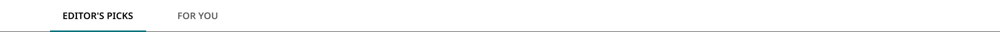
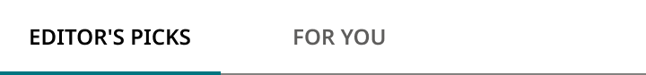

# Homepage Tabs

> The homepage tab bar built from Homepage Tab. Breakpoint = Desktop, Mobile.

## Figma

- File: **WordPress Elements** (`b1iZxkFwtAYq9rElmnCAzd`), page **Menus and Parts**
- Component set: [`Homepage Tabs` · 3629:44974](https://www.figma.com/design/b1iZxkFwtAYq9rElmnCAzd/?node-id=3629-44974) · key `f6f0992bc1126f8cfc17158b13600b3a8318213e`
- Documentation frame: [Homepage Tabs Container](https://www.figma.com/design/b1iZxkFwtAYq9rElmnCAzd/?node-id=3629-44928) · overview: [previews/homepage-tabs--documentation.png](previews/homepage-tabs--documentation.png)

## Properties

| Property | Default | Options |
|---|---|---|
| Breakpoint | Desktop | Desktop, Mobile |

## Variants

| Variant | Size | Node | Instances | Preview |
|---|---|---|---|---|
| `Desktop` | 1280×42 | [3629:44950](https://www.figma.com/design/b1iZxkFwtAYq9rElmnCAzd/?node-id=3629-44950) | 0 |  |
| `Mobile` | 360×42 | [3629:44962](https://www.figma.com/design/b1iZxkFwtAYq9rElmnCAzd/?node-id=3629-44962) | 0 |  |

## Anatomy

Default variant `Desktop` (hidden layers marked):

- **Breakpoint=Desktop** `COMPONENT`: 1280×42, vertical, gap 0, padding 0/0/0/0, fixed×hug
  - **Bottom Border** `RECTANGLE`: 1280×1, fixed×fixed, absolute
  - **Nav** `FRAME`: 1200×42, horizontal, gap 0, padding 0/24/0/24, fixed×hug
    - **Tab List** `FRAME`: 232×42, horizontal, gap 24, padding 0/0/0/0, hug×hug
      - **Tab** `INSTANCE`: 123×42, vertical, gap 0, padding 0/0/0/0, hug×hug, instance of Homepage Tab (State=Active)
      - **Tab** `INSTANCE`: 85×42, vertical, gap 0, padding 0/0/0/0, hug×hug, instance of Homepage Tab (State=Default)

## Component tokens

From `homepage-tabs.tokens.json`. References point at system tokens (`tokens/core/`, `tokens/themes/`); the CSS variable is `--mng-` + the token path. A literal value means the Figma layer isn't bound to a token.

| Token | Value |
|---|---|
| `homepage-tabs.base.bottom-border.background` | `{color.gray.300}` |
| `homepage-tabs.base.nav.tab-list.gap` | `{spacing.300}` |
| `homepage-tabs.base.nav.tab-list.tab.height` | 42px |
| `homepage-tabs.base.nav.tab-list.tab.icon-color` | `{color.gray.200}` |
| `homepage-tabs.base.nav.tab-list.tab.width` | 85px |
| `homepage-tabs.base.root.background` | `{color.gray.max}` |
| `homepage-tabs.breakpoint-desktop.nav.padding-left` | `{spacing.300}` |
| `homepage-tabs.breakpoint-desktop.nav.padding-right` | `{spacing.300}` |
| `homepage-tabs.breakpoint-desktop.nav.width` | 1200px |
| `homepage-tabs.breakpoint-desktop.root.width` | 1280px |
| `homepage-tabs.breakpoint-mobile.root.width` | 360px |

## Behavior and breakpoints

| Device | Viewport | Layout |
|---|---|---|
| Mobile | below 640px | No nav side padding |
| Desktop | 640px and up | Nav 1200px max, 24px side padding |

- **Bar:** full width, `color/gray/max`, with a 1px `color/gray/300` rule along the bottom; the active underline sits over it.
- **Nav:** max width 1200px, centered, 24px (`spacing/300`) side padding at 640px and up; no side padding below 640px.
- **Tabs:** left-aligned, 24px (`spacing/300`) apart; they scroll sideways (scrollbar hidden) if they don't fit.
- **Accessibility:** `ul role=tablist`, each `li role=presentation`; panels have matching ids and `role=tabpanel`.

## Accessibility

- No InFocus state in Figma.
- Text color on its background must meet WCAG AA contrast (4.5:1 for text under 18px) in every theme; theme colors change per site.
- Icons inside a labelled control are decorative (`aria-hidden`); an icon-only control needs an accessible name (`aria-label`).

## Where it is used

Scope: instances in the Figma file **WordPress Elements** only (other files that use the library are not counted). Total: **0**.

**Built from:** Homepage Tab ×4

## Production

Production World Cup tabs (`ul.sr-nav-tabs > button.tab-btn`, staging.dailylocal.com/world-cup/); differences are design-vs-production entry 12.

## Known issues

None open.

## Files

- `homepage-tabs.tokens.json`: component tokens (DTCG 2025.10).
- `homepage-tabs.html`: HTML/CSS skeleton of every variant, using the `dist/` CSS variables (open it in a browser).
- `previews/`: PNG of every variant @2x and the documentation frame.

*Generated 2026-10-28 by `scripts/component-export/export.py` (EXPORT-STANDARD.md section 7). Edit the text in `scripts/component-export/registry.json`, not here.*
