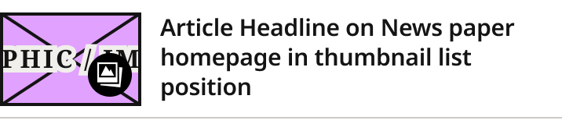
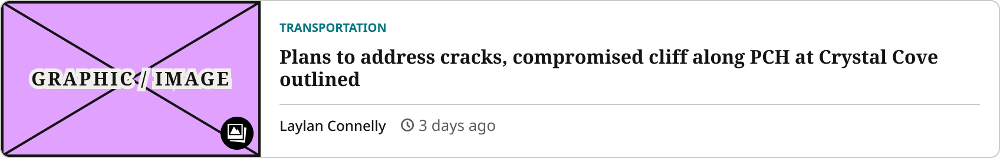
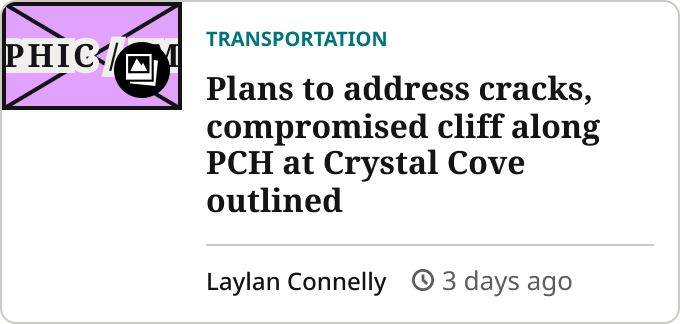
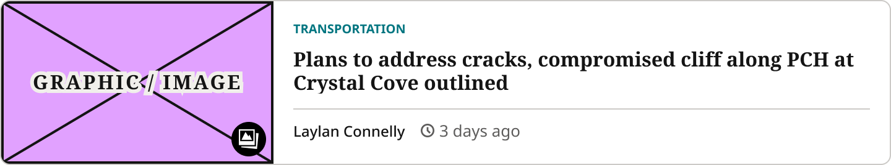

# Horizontal Thumbnail Card

> Horizontal article row. Style=Standard: compact thumbnail list item (Photos Block secondary list). Style=For You: the bordered For You tab article row.

## Figma

- File: **WordPress Elements** (`b1iZxkFwtAYq9rElmnCAzd`), page **Homepage**
- Component set: [`Horizontal Thumbnail Card` · 3362:2992](https://www.figma.com/design/b1iZxkFwtAYq9rElmnCAzd/?node-id=3362-2992) · key `c64c9a57e8074d5ae0481728bc08aa3f8c828174`
- Documentation frame: [Horizontal Thumbnail Card Container](https://www.figma.com/design/b1iZxkFwtAYq9rElmnCAzd/?node-id=3484-67724) · overview: [previews/horizontal-thumbnail-card--documentation.png](previews/horizontal-thumbnail-card--documentation.png)

## Properties

| Property | Default | Options |
|---|---|---|
| Style | Standard | Standard, For You |
| Device | Mobile | Desktop, Mobile, Tablet |

| Other property | Type | Default |
|---|---|---|
| Show Gallery Icon | boolean | True |

## Variants

| Variant | Size | Node | Instances | Preview |
|---|---|---|---|---|
| `Standard / Desktop` | 336×98 | [3362:2990](https://www.figma.com/design/b1iZxkFwtAYq9rElmnCAzd/?node-id=3362-2990) | 6 |  |
| `Standard / Mobile` | 336×67 | [3362:2991](https://www.figma.com/design/b1iZxkFwtAYq9rElmnCAzd/?node-id=3362-2991) | 63 |  |
| `Standard / Tablet` | 358×84 | [3383:46153](https://www.figma.com/design/b1iZxkFwtAYq9rElmnCAzd/?node-id=3383-46153) | 8 |  |
| `For You / Desktop` | 848×134 | [3628:44706](https://www.figma.com/design/b1iZxkFwtAYq9rElmnCAzd/?node-id=3628-44706) | 0 |  |
| `For You / Mobile` | 340×162 | [3628:44666](https://www.figma.com/design/b1iZxkFwtAYq9rElmnCAzd/?node-id=3628-44666) | 0 |  |
| `For You / Tablet` | 720×134 | [3628:44686](https://www.figma.com/design/b1iZxkFwtAYq9rElmnCAzd/?node-id=3628-44686) | 0 |  |

## Anatomy

Default variant `Standard / Desktop` (hidden layers marked):

- **Style=Standard, Device=Desktop** `COMPONENT`: 336×98, vertical, gap 8, padding 8/0/8/0, fixed×hug
  - **Content** `FRAME`: 336×74, horizontal, gap 12, padding 0/0/0/0, fill×hug
    - **Image Container** `FRAME`: 110×74, horizontal, gap 0, padding 0/0/0/0, fixed×fixed
      - **Article Image Placeholder** `INSTANCE`: 110×74, vertical, gap 8, padding 0/0/0/0, fixed×fixed, instance of Article Image Placeholder ()
      - **Gallery Icon Badge** `INSTANCE`: 28×28, horizontal, gap 0, padding 0/0/0/0, fixed×fixed, absolute, instance of Gallery Icon Badge ()
    - **Headline** `FRAME`: 214×57, vertical, gap 0, padding 0/0/0/0, fill×hug
      - **Article Headline on News paper homepage in thumbnail list position** `TEXT`: 214×57, fill×hug, "Article Headline on News paper homepage ", Noto Sans SemiBold 15px
  - **Bottom Border Line** `LINE`: 336×0, fill×fixed

## Component tokens

From `horizontal-thumbnail-card.tokens.json`. References point at system tokens (`tokens/core/`, `tokens/themes/`); the CSS variable is `--mng-` + the token path. A literal value means the Figma layer isn't bound to a token.

| Token | Value |
|---|---|
| `horizontal-thumbnail-card.style-standard.bottom-border-line.border-color` | `{color.gray.500}` |
| `horizontal-thumbnail-card.style-standard.bottom-border-line.border-style` | solid |
| `horizontal-thumbnail-card.style-standard.bottom-border-line.border-width` | 1px |
| `horizontal-thumbnail-card.style-standard.bottom-border-line.height` | 0px |
| `horizontal-thumbnail-card.style-standard.content.headline.article-headline-on-news-paper-homepage-in-thumbnail-list-position.color` | `{color.gray.min}` |
| `horizontal-thumbnail-card.style-standard.content.headline.article-headline-on-news-paper-homepage-in-thumbnail-list-position.font-family` | Noto Sans |
| `horizontal-thumbnail-card.style-standard.content.headline.article-headline-on-news-paper-homepage-in-thumbnail-list-position.font-size` | 15px |
| `horizontal-thumbnail-card.style-standard.content.headline.article-headline-on-news-paper-homepage-in-thumbnail-list-position.font-weight` | 600 |
| `horizontal-thumbnail-card.style-standard.content.headline.article-headline-on-news-paper-homepage-in-thumbnail-list-position.letter-spacing` | -0.15px |
| `horizontal-thumbnail-card.style-standard.content.headline.article-headline-on-news-paper-homepage-in-thumbnail-list-position.line-height` | 19px |
| `horizontal-thumbnail-card.style-standard.content.image-container.article-image-placeholder.icon-color` | `{color.gray.min}` |
| `horizontal-thumbnail-card.style-standard.content.image-container.gallery-icon-badge.height` | 28px |
| `horizontal-thumbnail-card.style-standard.content.image-container.gallery-icon-badge.width` | 28px |
| `horizontal-thumbnail-card.style-for-you.card-body.gap` | `{spacing.150}` |
| `horizontal-thumbnail-card.style-for-you.card-body.card-footer.border-color` | `{color.gray.500}` |
| `horizontal-thumbnail-card.style-for-you.card-body.card-footer.border-style` | solid |
| `horizontal-thumbnail-card.style-for-you.card-body.card-footer.border-top-width` | 1px |
| `horizontal-thumbnail-card.style-for-you.card-body.card-footer.gap` | `{spacing.150}` |
| `horizontal-thumbnail-card.style-for-you.card-body.card-footer.padding-top` | `{spacing.100}` |
| `horizontal-thumbnail-card.style-for-you.card-body.card-footer.article-author.height` | 16px |
| `horizontal-thumbnail-card.style-for-you.card-body.card-footer.article-author.icon-color` | `{color.gray.min}` |
| `horizontal-thumbnail-card.style-for-you.card-body.card-footer.article-author.width` | 91px |
| `horizontal-thumbnail-card.style-for-you.card-body.card-footer.article-timestamp.height` | 18px |
| `horizontal-thumbnail-card.style-for-you.card-body.card-footer.article-timestamp.width` | 81px |
| `horizontal-thumbnail-card.style-for-you.card-body.headline-container.gap` | `{spacing.100}` |
| `horizontal-thumbnail-card.style-for-you.card-body.headline-container.article-section-kicker.height` | 13px |
| `horizontal-thumbnail-card.style-for-you.card-body.headline-container.article-section-kicker.icon-color` | `{color.theme.primary}` |
| `horizontal-thumbnail-card.style-for-you.card-body.headline-container.article-section-kicker.width` | 91px |
| `horizontal-thumbnail-card.style-for-you.card-body.headline-container.headline.color` | `{color.gray.min}` |
| `horizontal-thumbnail-card.style-for-you.card-body.headline-container.headline.font-family` | Noto Serif |
| `horizontal-thumbnail-card.style-for-you.card-body.headline-container.headline.font-size` | 16px |
| `horizontal-thumbnail-card.style-for-you.card-body.headline-container.headline.font-weight` | 700 |
| `horizontal-thumbnail-card.style-for-you.card-body.headline-container.headline.line-height` | 18.88px |
| `horizontal-thumbnail-card.style-for-you.image-container.article-image-placeholder.icon-color` | `{color.gray.min}` |
| `horizontal-thumbnail-card.style-for-you.image-container.gallery-icon-badge.height` | 28px |
| `horizontal-thumbnail-card.style-for-you.image-container.gallery-icon-badge.width` | 28px |
| `horizontal-thumbnail-card.style-for-you.root.background` | `{color.gray.max}` |
| `horizontal-thumbnail-card.style-for-you.root.border-color` | `{color.gray.500}` |
| `horizontal-thumbnail-card.style-for-you.root.border-radius` | `{radius.lg}` |
| `horizontal-thumbnail-card.style-for-you.root.border-style` | solid |
| `horizontal-thumbnail-card.style-for-you.root.border-width` | 1px |
| `horizontal-thumbnail-card.device-desktop.card-body.padding-bottom` | `{spacing.200}` |
| `horizontal-thumbnail-card.device-desktop.card-body.padding-left` | `{spacing.200}` |
| `horizontal-thumbnail-card.device-desktop.card-body.padding-right` | `{spacing.200}` |
| `horizontal-thumbnail-card.device-desktop.card-body.padding-top` | `{spacing.200}` |
| `horizontal-thumbnail-card.device-desktop.content.gap` | 12px |
| `horizontal-thumbnail-card.device-desktop.content.image-container.height` | 74px |
| `horizontal-thumbnail-card.device-desktop.content.image-container.width` | 110px |
| `horizontal-thumbnail-card.device-desktop.content.image-container.article-image-placeholder.height` | 74px |
| `horizontal-thumbnail-card.device-desktop.content.image-container.article-image-placeholder.width` | 110px |
| `horizontal-thumbnail-card.device-desktop.image-container.width` | 220px |
| `horizontal-thumbnail-card.device-desktop.image-container.article-image-placeholder.height` | 132px |
| `horizontal-thumbnail-card.device-desktop.image-container.article-image-placeholder.width` | 220px |
| `horizontal-thumbnail-card.device-desktop.root.gap` | 8px |
| `horizontal-thumbnail-card.device-desktop.root.padding-bottom` | 8px |
| `horizontal-thumbnail-card.device-desktop.root.padding-top` | 8px |
| `horizontal-thumbnail-card.device-mobile.card-body.padding-bottom` | `{spacing.150}` |
| `horizontal-thumbnail-card.device-mobile.card-body.padding-left` | `{spacing.150}` |
| `horizontal-thumbnail-card.device-mobile.card-body.padding-right` | `{spacing.150}` |
| `horizontal-thumbnail-card.device-mobile.card-body.padding-top` | `{spacing.150}` |
| `horizontal-thumbnail-card.device-mobile.content.gap` | 15px |
| `horizontal-thumbnail-card.device-mobile.content.image-container.height` | 51px |
| `horizontal-thumbnail-card.device-mobile.content.image-container.width` | 90px |
| `horizontal-thumbnail-card.device-mobile.content.image-container.article-image-placeholder.height` | 51px |
| `horizontal-thumbnail-card.device-mobile.content.image-container.article-image-placeholder.width` | 90px |
| `horizontal-thumbnail-card.device-mobile.image-container.width` | 90px |
| `horizontal-thumbnail-card.device-mobile.image-container.article-image-placeholder.height` | 54px |
| `horizontal-thumbnail-card.device-mobile.image-container.article-image-placeholder.width` | 90px |
| `horizontal-thumbnail-card.device-mobile.root.gap` | 4px |
| `horizontal-thumbnail-card.device-mobile.root.padding-bottom` | 6px |
| `horizontal-thumbnail-card.device-mobile.root.padding-top` | 6px |
| `horizontal-thumbnail-card.device-tablet.card-body.padding-bottom` | `{spacing.200}` |
| `horizontal-thumbnail-card.device-tablet.card-body.padding-left` | `{spacing.200}` |
| `horizontal-thumbnail-card.device-tablet.card-body.padding-right` | `{spacing.200}` |
| `horizontal-thumbnail-card.device-tablet.card-body.padding-top` | `{spacing.200}` |
| `horizontal-thumbnail-card.device-tablet.content.gap` | 12px |
| `horizontal-thumbnail-card.device-tablet.content.image-container.height` | 60px |
| `horizontal-thumbnail-card.device-tablet.content.image-container.width` | 90px |
| `horizontal-thumbnail-card.device-tablet.content.image-container.article-image-placeholder.height` | 60px |
| `horizontal-thumbnail-card.device-tablet.content.image-container.article-image-placeholder.width` | 90px |
| `horizontal-thumbnail-card.device-tablet.image-container.width` | 220px |
| `horizontal-thumbnail-card.device-tablet.image-container.article-image-placeholder.height` | 132px |
| `horizontal-thumbnail-card.device-tablet.image-container.article-image-placeholder.width` | 220px |
| `horizontal-thumbnail-card.device-tablet.root.gap` | 8px |
| `horizontal-thumbnail-card.device-tablet.root.padding-bottom` | 8px |
| `horizontal-thumbnail-card.device-tablet.root.padding-top` | 8px |
| `horizontal-thumbnail-card.base.content.headline.height` | 51px |
| `horizontal-thumbnail-card.base.image-container.height` | 54px |
| `horizontal-thumbnail-card.base.image-container.min-height` | 132px |
| `horizontal-thumbnail-card.style-standard.device-desktop.root.width` | 336px |
| `horizontal-thumbnail-card.style-standard.device-mobile.root.width` | 336px |
| `horizontal-thumbnail-card.style-standard.device-tablet.root.width` | 358px |
| `horizontal-thumbnail-card.style-for-you.device-desktop.root.width` | 848px |
| `horizontal-thumbnail-card.style-for-you.device-mobile.root.width` | 340px |
| `horizontal-thumbnail-card.style-for-you.device-tablet.root.width` | 720px |

## Behavior and breakpoints

| Device | Viewport | Style=For You |
|---|---|---|
| Mobile | below 640px (340/360 templates) | 90×54 image pinned top-left, 12px body padding; built at 340 |
| Tablet | 640px and up (768 template) | 220px image, 16px body padding; built at 720 |
| Desktop | 640px and up (1280 template) | Same as Tablet; built at 848 (896px feed column minus 24px padding each side) |

- **Style=For You container:** `color/gray/max` fill, 1px `color/gray/500` border, `radius/lg` (8px) corners, clips its content. No shadow.
- **Style=For You image:** Article Image Placeholder pinned top-left. 640px and up: 220px wide, filling the row height (minimum 132px, 5:3). Below 640px: 90×54 (Style=Standard's 90px width at the same 5:3 ratio), with white space below it (Karl, 2026-10-26).
- **Style=For You body:** Article Section Kicker; headline in `Editorial/Titles/CardTertiaryCompact` (Noto Serif Bold 16/18.88, `color/gray/min`), not clamped; footer with a 1px `color/gray/500` top border, Article Author and Article Timestamp side by side.
- **Style=For You spacing:** body padding 16px (`spacing/200`), 12px (`spacing/150`) below 640px; 8px (`spacing/100`) kicker to headline; 12px (`spacing/150`) headline group to footer; 8px (`spacing/100`) above the footer content; 12px (`spacing/150`) between author and timestamp.
- **Style=For You width:** fills the feed column; rows stack 16px apart.
- **Gallery Icon Badge** (`Show Gallery Icon`, both styles): 28px black circle with a 16px white gallery icon, 6px in from the image's bottom-right corner.

## Accessibility

- No InFocus state in Figma.
- Text color on its background must meet WCAG AA contrast (4.5:1 for text under 18px) in every theme; theme colors change per site.
- Icons inside a labelled control are decorative (`aria-hidden`); an icon-only control needs an accessible name (`aria-label`).

## Where it is used

Scope: instances in the Figma file **WordPress Elements** only (other files that use the library are not counted). Total: **77**.

Inside components: Photos Block ×35, TOP ZONE Block ×4.
Placed on pages: Homepage ×38.

**Built from:** Article Image Placeholder ×6, Gallery Icon Badge ×6, Article Section Kicker ×3, Article Author ×3, Article Timestamp ×3

## Production

No production selector recorded yet. Production gaps go in `design-vs-production.md`.

## Known issues

1. Style=For You: hover state not built yet (parked).
2. **Values not bound to a token** (literal in the component tokens): `device-desktop` content gap = 12px; `device-mobile` content gap = 15px; `device-tablet` content gap = 12px; `device-desktop` root gap = 8px; `device-mobile` root gap = 4px; `device-tablet` root gap = 8px; `device-desktop` root padding-bottom = 8px; `device-mobile` root padding-bottom = 6px; `device-tablet` root padding-bottom = 8px; `device-desktop` root padding-top = 8px; `device-mobile` root padding-top = 6px; `device-tablet` root padding-top = 8px.

## Files

- `horizontal-thumbnail-card.tokens.json`: component tokens (DTCG 2025.10).
- `horizontal-thumbnail-card.html`: HTML/CSS skeleton of every variant, using the `dist/` CSS variables (open it in a browser).
- `previews/`: PNG of every variant @2x and the documentation frame.

*Generated 2026-10-28 by `scripts/component-export/export.py` (EXPORT-STANDARD.md section 7). Edit the text in `scripts/component-export/registry.json`, not here.*
