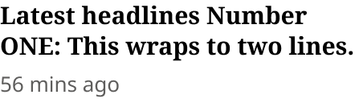
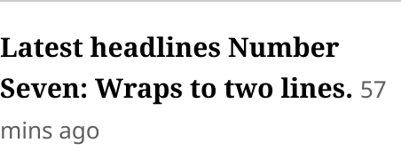
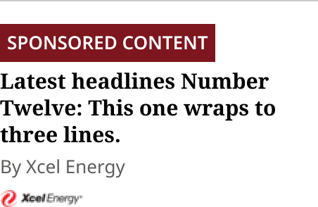

# Latest Headlines List Item

> One headline in the Zone 1 Latest Headlines list (production `article.headline-only` in `.headline-list`), built to match production (Karl, 2026-10-30). Type = First (no rule), Standard (rule above) and Sponsored (rule above, Article Status Badge, sponsor byline and logo).

## Figma

- File: **WordPress Elements** (`b1iZxkFwtAYq9rElmnCAzd`), page **Homepage**
- Component set: [`Latest Headlines List Item` · 3336:46118](https://www.figma.com/design/b1iZxkFwtAYq9rElmnCAzd/?node-id=3336-46118) · key `264c00580f01ace3ec1483efbb4da877a0238766`
- Documentation frame: [Latest Headlines List Item Container](https://www.figma.com/design/b1iZxkFwtAYq9rElmnCAzd/?node-id=3484-67635) · overview: [previews/latest-headlines-list-item--documentation.png](previews/latest-headlines-list-item--documentation.png)

## Properties

| Property | Default | Options |
|---|---|---|
| Type | First | First, Standard, Sponsored |

## Variants

| Variant | Size | Node | Instances | Preview |
|---|---|---|---|---|
| `First` | 226×64 | [3336:46115](https://www.figma.com/design/b1iZxkFwtAYq9rElmnCAzd/?node-id=3336-46115) | 14 |  |
| `Standard` | 226×84 | [3336:46116](https://www.figma.com/design/b1iZxkFwtAYq9rElmnCAzd/?node-id=3336-46116) | 84 |  |
| `Sponsored` | 226×146 | [3336:46117](https://www.figma.com/design/b1iZxkFwtAYq9rElmnCAzd/?node-id=3336-46117) | 14 |  |

## Anatomy

Default variant `First` (hidden layers marked):

- **Type=First** `COMPONENT`: 226×64, vertical, gap 4, padding 0/0/0/0, fixed×hug
  - **Article Status Badge** `INSTANCE`: 0.01×0.01, horizontal, gap 0, padding 0/0/0/0, hug×hug, instance of Article Status Badge (Type=None), **hidden**
  - **Headline Container** `FRAME`: 226×64, horizontal, gap 8, padding 0/0/0/0, fill×hug
    - **Headline and Time** `TEXT`: 226×64, fill×hug, "Latest headlines Number ONE: This wraps ", Noto Serif Bold 15px

## Component tokens

From `latest-headlines-list-item.tokens.json`. References point at system tokens (`tokens/core/`, `tokens/themes/`); the CSS variable is `--mng-` + the token path. A literal value means the Figma layer isn't bound to a token.

| Token | Value |
|---|---|
| `latest-headlines-list-item.base.bottom-border-line.border-color` | `{color.gray.500}` |
| `latest-headlines-list-item.base.bottom-border-line.border-style` | solid |
| `latest-headlines-list-item.base.bottom-border-line.border-width` | 1px |
| `latest-headlines-list-item.base.bottom-border-line.height` | 0px |
| `latest-headlines-list-item.base.root.background` | `{color.gray.max}` |
| `latest-headlines-list-item.base.root.gap` | `{spacing.200}` |
| `latest-headlines-list-item.base.root.width` | 226px |
| `latest-headlines-list-item.type-sponsored.content-card.gap` | `{spacing.050}` |
| `latest-headlines-list-item.type-sponsored.content-card.badge-container.article-status-badge.height` | 27px |
| `latest-headlines-list-item.type-sponsored.content-card.badge-container.article-status-badge.icon-color` | `{color.gray.max}` |
| `latest-headlines-list-item.type-sponsored.content-card.badge-container.article-status-badge.width` | 153px |
| `latest-headlines-list-item.type-sponsored.content-card.headline-container.headline.color` | `{color.gray.black}` |
| `latest-headlines-list-item.type-sponsored.content-card.headline-container.headline.font-family` | `{font.theme.heading-family}` |
| `latest-headlines-list-item.type-sponsored.content-card.headline-container.headline.font-size` | `{font.size.15}` |
| `latest-headlines-list-item.type-sponsored.content-card.headline-container.headline.font-weight` | `{font.weight.bold}` |
| `latest-headlines-list-item.type-sponsored.content-card.headline-container.headline.line-height` | 19px |
| `latest-headlines-list-item.type-sponsored.content-card.meta-container.gap` | `{spacing.100}` |
| `latest-headlines-list-item.type-sponsored.content-card.meta-container.byline.color` | `{color.gray.200}` |
| `latest-headlines-list-item.type-sponsored.content-card.meta-container.byline.font-family` | `{font.family.noto-sans}` |
| `latest-headlines-list-item.type-sponsored.content-card.meta-container.byline.font-size` | `{font.size.13}` |
| `latest-headlines-list-item.type-sponsored.content-card.meta-container.byline.font-weight` | `{font.weight.regular}` |
| `latest-headlines-list-item.type-sponsored.content-card.meta-container.sponsor-logo.height` | 12px |
| `latest-headlines-list-item.type-sponsored.content-card.meta-container.sponsor-logo.width` | 60px |
| `latest-headlines-list-item.type-standard.content-card.headline-container.headline-and-time.color` | `{color.gray.black}` |
| `latest-headlines-list-item.type-standard.content-card.headline-container.headline-and-time.font-family` | `{font.theme.heading-family}` |
| `latest-headlines-list-item.type-standard.content-card.headline-container.headline-and-time.font-size` | `{font.size.15}` |
| `latest-headlines-list-item.type-standard.content-card.headline-container.headline-and-time.font-weight` | `{font.weight.bold}` |
| `latest-headlines-list-item.type-standard.content-card.headline-container.headline-and-time.line-height` | 19px |
| `latest-headlines-list-item.type-first.headline-container.headline-and-time.color` | `{color.gray.black}` |
| `latest-headlines-list-item.type-first.headline-container.headline-and-time.font-family` | `{font.theme.heading-family}` |
| `latest-headlines-list-item.type-first.headline-container.headline-and-time.font-size` | `{font.size.15}` |
| `latest-headlines-list-item.type-first.headline-container.headline-and-time.font-weight` | `{font.weight.bold}` |
| `latest-headlines-list-item.type-first.headline-container.headline-and-time.line-height` | 19px |

## Behavior and breakpoints

No Breakpoint property: one size at every width.

- **Matches production** (Karl, 2026-10-30: components match production, rounded to the nearest multiple of 4 / 8 and its token). Checked on all 6 review sites 2026-10-30.
- **Rule:** First has none. Standard and Sponsored draw a 1px `color/gray/500` rule on top, then 16px (`spacing/200`) to the content. The 12px above the rule belongs to the list (Latest Headlines). Production: `border-top: 1px` with `padding-top: 16px` and `margin-top: 12px` on every item after the first.
- **Headline:** `Editorial/Titles/AdditionalHeadline`: `font/theme/heading-family` Bold 15 (`font/size/15`), 19px line height (changed from auto 2026-10-30, to match production), `color/gray/black` (was `color/gray/min`) on `color/gray/max`, 21:1. The family follows the theme (style bound 2026-10-30; it was Noto Serif itself): Noto Serif in Bold Coastal and Measured Vibrant, Noto Sans in Modern Earthy, as production renders it. Production's CSS weight is 600, but the sites load only the 400 and 700 faces of Noto Sans and Noto Serif, so it renders Bold; Figma keeps Bold. The style is also used by the Section Front page template (39 text layers), which follows these changes.
- **Time (First, Standard):** inline right after the headline, in the same text layer (since 2026-10-30, as production does): Noto Sans Regular 13 (`font/size/13`), 23px line height, `color/gray/200`, 6.6:1. It wraps under the headline when the headline's last line is full.
- **Sponsored:** Article Status Badge (`Type = Sponsored`) in a Badge Container, 4px (`spacing/050`) to the headline, 4px to the meta: "By <sponsor>" (Noto Sans Regular 13, `color/gray/200`) and the 60×12 sponsor logo, 8px (`spacing/100`) apart.
- **Markup:** `li > article` with the headline in an `h3` link followed by a `time` element (both inline); the list is a `ul`.

## Accessibility

- No InFocus state in Figma.
- Text color on its background must meet WCAG AA contrast (4.5:1 for text under 18px) in every theme; theme colors change per site.
- Icons inside a labelled control are decorative (`aria-hidden`); an icon-only control needs an accessible name (`aria-label`).

## Where it is used

Scope: instances in the Figma file **WordPress Elements** only (other files that use the library are not counted). Total: **112**.

Inside components: TOP ZONE Block ×40, Latest Headlines ×24.
Placed on pages: Homepage ×48.

**Built from:** Article Status Badge ×1

## Production

Production `.headline-list ul > li > article.headline-only` (homepage Zone 1, all 6 review sites, measured 2026-10-30 at 1728px and on ocregister.com at 700px).

## Known issues

1. Production rule is #D7D6D2 (Bold Coastal), #C8C4C0 (Measured Vibrant), #DDD8D5 (Modern Earthy); the design keeps `color/gray/500` #CCCAC7, the nearest token (Karl, 2026-10-30; design-vs-production 16.5; the Bold Coastal value is also entry 3).
2. Production's CSS headline weight is 600 with only the 400 and 700 font faces loaded, so it renders Bold; the design is Bold (design-vs-production 16.5).
3. The component tokens carry the headline's values for the First and Standard text layer (the exporter reads its first text run); the inline time's values (Noto Sans Regular 13 / 23px, `color/gray/200`) are in the rules above.
4. Figma wraps the time with the headline text; production does the same with inline elements, so line breaks can differ by a word.
5. Sponsored is drawn with a sample sponsor (Xcel Energy) and its logo as an image fill; no live sponsored item was on the 6 review sites on 2026-10-30, so Sponsored isn't checked against production.

## Files

- `latest-headlines-list-item.tokens.json`: component tokens (DTCG 2025.10).
- `latest-headlines-list-item.html`: HTML/CSS skeleton of every variant, using the `dist/` CSS variables (open it in a browser).
- `previews/`: PNG of every variant @2x and the documentation frame.

*Generated 2026-10-30 by `scripts/component-export/export.py` (EXPORT-STANDARD.md section 7). Edit the text in `scripts/component-export/registry.json`, not here.*
