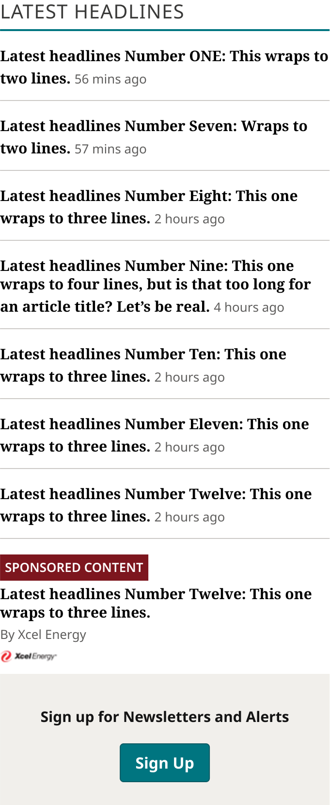
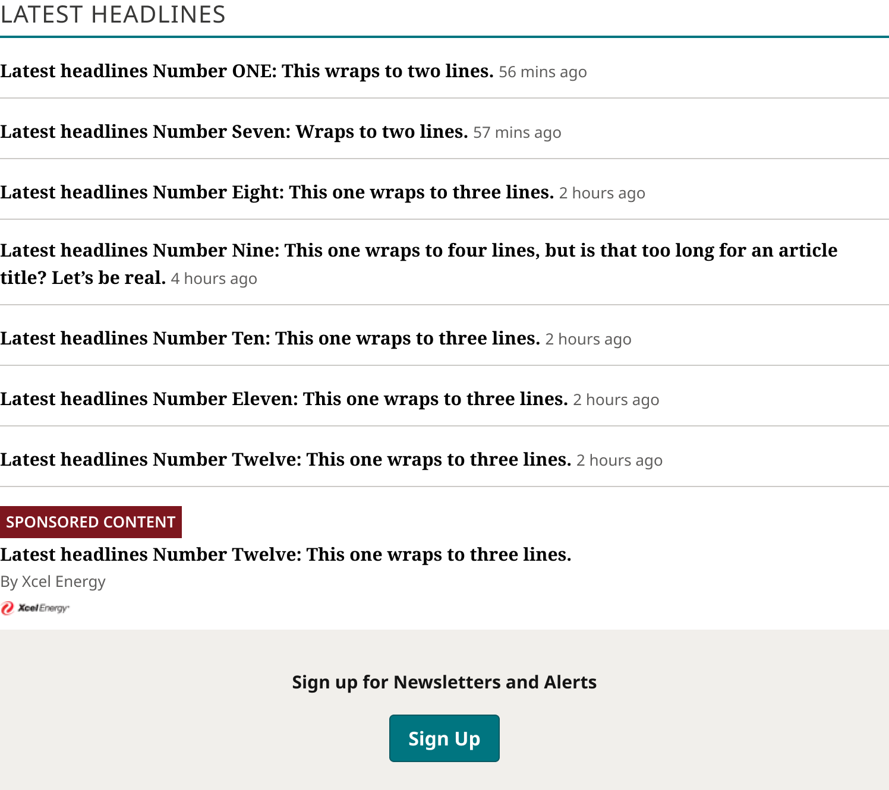
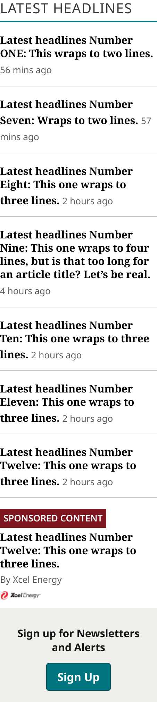

# Latest Headlines

> The Zone 1 Latest Headlines rail (Editor's Picks): Section Title / Eyebrow, 8 Latest Headlines List Items (First, Standard ×6, Sponsored) and Newsletter Signup in one column. Device values are production's own breakpoints for this list (`.busy .headline-list`, identical on all 6 review sites); only the width changes.

## Figma

- File: **WordPress Elements** (`b1iZxkFwtAYq9rElmnCAzd`), page **Homepage**
- Component set: [`Latest Headlines` · 3476:62396](https://www.figma.com/design/b1iZxkFwtAYq9rElmnCAzd/?node-id=3476-62396) · key `a8093d9af051cf493da6a481a57b6c9119f9cbbf`
- Documentation frame: [Latest Headlines Container](https://www.figma.com/design/b1iZxkFwtAYq9rElmnCAzd/?node-id=3484-67618) · overview: [previews/latest-headlines--documentation.png](previews/latest-headlines--documentation.png)

## Properties

| Property | Default | Options |
|---|---|---|
| Device | XS (≤639px) | XS (≤639px), S (640–799px), (≥800px) |

## Variants

| Variant | Size | Node | Instances | Preview |
|---|---|---|---|---|
| `XS (≤639px)` | 340×829 | [3476:62139](https://www.figma.com/design/b1iZxkFwtAYq9rElmnCAzd/?node-id=3476-62139) | 3 |  |
| `S (640–799px)` | 748×665 | [3476:62152](https://www.figma.com/design/b1iZxkFwtAYq9rElmnCAzd/?node-id=3476-62152) | 2 |  |
| `(≥800px)` | 226×1007 | [3476:62164](https://www.figma.com/design/b1iZxkFwtAYq9rElmnCAzd/?node-id=3476-62164) | 6 |  |

## Anatomy

Default variant `XS (≤639px)` (hidden layers marked):

- **Device=XS (≤639px)** `COMPONENT`: 340×829, vertical, gap 0, padding 0/0/0/0, fixed×hug
  - **Header Container** `FRAME`: 340×48, vertical, gap 8, padding 0/0/16/0, fill×hug
    - **Section Title / Eyebrow** `INSTANCE`: 340×32, vertical, gap 8, padding 0/0/0/0, fill×hug, instance of Section Title / Eyebrow (Style=Underline)
  - **List** `FRAME`: 340×781, vertical, gap 12, padding 0/0/0/0, fill×hug
    - **Latest Headlines List Item** `INSTANCE`: 340×44, vertical, gap 4, padding 0/0/0/0, fill×hug, instance of Latest Headlines List Item (Type=First)
    - **Latest Headlines List Item** `INSTANCE`: 340×60, vertical, gap 16, padding 0/0/0/0, fill×hug, instance of Latest Headlines List Item (Type=Standard)
    - **Latest Headlines List Item** `INSTANCE`: 340×60, vertical, gap 16, padding 0/0/0/0, fill×hug, instance of Latest Headlines List Item (Type=Standard)
    - **Latest Headlines List Item** `INSTANCE`: 340×79, vertical, gap 16, padding 0/0/0/0, fill×hug, instance of Latest Headlines List Item (Type=Standard)
    - **Latest Headlines List Item** `INSTANCE`: 340×60, vertical, gap 16, padding 0/0/0/0, fill×hug, instance of Latest Headlines List Item (Type=Standard)
    - **Latest Headlines List Item** `INSTANCE`: 340×60, vertical, gap 16, padding 0/0/0/0, fill×hug, instance of Latest Headlines List Item (Type=Standard)
    - **Latest Headlines List Item** `INSTANCE`: 340×60, vertical, gap 16, padding 0/0/0/0, fill×hug, instance of Latest Headlines List Item (Type=Standard)
    - **Latest Headlines List Item** `INSTANCE`: 340×127, vertical, gap 16, padding 0/0/0/0, fill×hug, instance of Latest Headlines List Item (Type=Sponsored)
    - **Newsletter Signup** `INSTANCE`: 340×135, vertical, gap 8, padding 16/16/16/16, fill×fixed, instance of Newsletter Signup (Device=Mobile)

## Component tokens

From `latest-headlines.tokens.json`. References point at system tokens (`tokens/core/`, `tokens/themes/`); the CSS variable is `--mng-` + the token path. A literal value means the Figma layer isn't bound to a token.

| Token | Value |
|---|---|
| `latest-headlines.base.header-container.background` | `{color.gray.max}` |
| `latest-headlines.base.header-container.padding-bottom` | `{spacing.200}` |
| `latest-headlines.base.header-container.section-title-eyebrow.height` | 32px |
| `latest-headlines.base.header-container.section-title-eyebrow.icon-color` | `{color.gray.100}` |
| `latest-headlines.base.list.gap` | `{spacing.150}` |
| `latest-headlines.base.list.latest-headlines-list-item.icon-color` | #7d161e |
| `latest-headlines.base.list.newsletter-signup.height` | 135px |
| `latest-headlines.base.list.newsletter-signup.icon-color` | `{color.gray.min}` |
| `latest-headlines.base.root.background` | `{color.gray.max}` |
| `latest-headlines.device-xs-639px.header-container.section-title-eyebrow.width` | 340px |
| `latest-headlines.device-xs-639px.list.latest-headlines-list-item.height` | 127px |
| `latest-headlines.device-xs-639px.list.latest-headlines-list-item.width` | 340px |
| `latest-headlines.device-xs-639px.list.newsletter-signup.width` | 340px |
| `latest-headlines.device-xs-639px.root.width` | 340px |
| `latest-headlines.device-s-640-799px.header-container.section-title-eyebrow.width` | 748px |
| `latest-headlines.device-s-640-799px.list.latest-headlines-list-item.height` | 108px |
| `latest-headlines.device-s-640-799px.list.latest-headlines-list-item.width` | 748px |
| `latest-headlines.device-s-640-799px.list.newsletter-signup.width` | 748px |
| `latest-headlines.device-s-640-799px.root.width` | 748px |
| `latest-headlines.device-800px.header-container.section-title-eyebrow.width` | 226px |
| `latest-headlines.device-800px.list.latest-headlines-list-item.height` | 146px |
| `latest-headlines.device-800px.list.latest-headlines-list-item.width` | 226px |
| `latest-headlines.device-800px.list.newsletter-signup.width` | 226px |
| `latest-headlines.device-800px.root.width` | 226px |

## Behavior and breakpoints

| Device (production range) | Grid token | Production layout | Built at | Future MNG Device breakpoint (not adopted yet) |
|---|---|---|---|---|
| XS (≤639px) | `wordpress-grid.xs` | Full width, capped at 540px and centered | 340px | Mobile (below 768) |
| S (640–799px) | `wordpress-grid.s` | Full width of the column | 748px | Mobile / Tablet (decide when standardizing) |
| (≥800px), M (800–1039px) | `wordpress-grid.m` | Side column, 40% − 12px | 226px (TOP ZONE Block 252) | Tablet (768–1023) |
| (≥800px), L (1040–1279px) | `wordpress-grid.l` | Side column, 30.77% − 13.92px | 226px (TOP ZONE Block 219) | Tablet landscape (1024–1279) |
| (≥800px), XL (≥1280px) | `wordpress-grid.xl` | Side column, 25% − 15px (224px) | 226px | Desktop (1280 and up) |

- **Matches production** (Karl, 2026-10-30: components match production, rounded to the nearest multiple of 4 / 8 and its token). CSS and live measurements on all 6 review sites 2026-10-30.
- **Breakpoints are production's, for this component** (Karl, 2026-10-30): each Device value is named by the range it covers (`XS (≤639px)`, `S (640–799px)`, `(≥800px)`); the width a variant is drawn at is a note, not a breakpoint. The list is one column at every width. Production CSS `.busy .headline-list` at 640 / 800 / 1040 / 1280px, the same on all 6 review sites (scan 2026-10-30, `components/breakpoint-audit.md`).
- **XS** (639px and below, built 340): full width of the page. Production caps it at 540px (33.75em) and centers it.
- **S** (640–799px, built 748): full width of the column. The items and Newsletter Signup fill the variant (fixed 2026-10-30, Karl: they were stuck at 340), as production does (680px wide on ocregister.com at a 700px window).
- **(≥800px)** (built 226): the side column beside the Zone 1 lead. Production width `calc(40% - 0.75rem)` at 800–1039, `calc(30.7692% - 0.87rem)` at 1040–1279 and `calc(25% - 0.94rem)` at 1280 and up (224px). TOP ZONE Block draws it at 252 (1024) and 219 (1100). Everything inside fills the width.
- **Title:** Section Title / Eyebrow, Style = Underline. Title to the first item is 16px (`spacing/200`), the Header Container's bottom padding (Karl, 2026-10-30): production uses the title's `margin-bottom`, measured 15px on Bold Coastal, 17px on Measured Vibrant and 21px on Modern Earthy; 16 is the nearest multiple of 4 / 8 with a token (design-vs-production 16.5). Before 2026-10-30 Figma had 16px (XS, S) and 12px (≥800).
- **List:** 12px (`spacing/150`) between the items and before Newsletter Signup (the `List` frame); Standard and Sponsored items draw their own top rule. Production: `margin-top: 12px` on every `li` after the first.
- **Contrast** is in the parts: headline 21:1 and time 6.6:1 (Latest Headlines List Item), eyebrow `color/gray/100` 11.6:1 (Section Title / Eyebrow).

## Accessibility

- No InFocus state in Figma.
- Text color on its background must meet WCAG AA contrast (4.5:1 for text under 18px) in every theme; theme colors change per site.
- Icons inside a labelled control are decorative (`aria-hidden`); an icon-only control needs an accessible name (`aria-label`).

## Where it is used

Scope: instances in the Figma file **WordPress Elements** only (other files that use the library are not counted). Total: **11**.

Inside components: TOP ZONE Block ×5.
6 instances are nested inside other instances.

**Built from:** Latest Headlines List Item ×24, Section Title / Eyebrow ×3, Newsletter Signup ×3

## Production

Production homepage Zone 1 `.feature-primary.busy .headline-list` (`div.headline-list > h2.headline-list-title + ul`), 7 headlines plus the newsletter `li.social-links`. CSS scanned on all 6 review sites 2026-10-30; measured live at 1728px on all 6 and on ocregister.com at 700px (Karl resized the window).

## Known issues

1. One variant, `(≥800px)`, covers three production ranges whose only difference is the column width (the list is the same).
2. Below 640px production caps the list at 540px; the XS variant is drawn at 340.
3. Production's title-to-list gap is 15 / 17 / 21px by theme; the design is 16px (`spacing/200`) on every theme (design-vs-production 16.5).
4. Newsletter Signup instances keep their component's fixed 135px height (next in the P2 list).
5. The eyebrow's production color and underline differ (design-vs-production 14).
6. **Values not bound to a token** (literal in the component tokens): `base` list.latest-headlines-list-item icon-color = #7d161e.

## Files

- `latest-headlines.tokens.json`: component tokens (DTCG 2025.10).
- `latest-headlines.html`: HTML/CSS skeleton of every variant, using the `dist/` CSS variables (open it in a browser).
- `previews/`: PNG of every variant @2x and the documentation frame.

*Generated 2026-10-30 by `scripts/component-export/export.py` (EXPORT-STANDARD.md section 7). Edit the text in `scripts/component-export/registry.json`, not here.*
