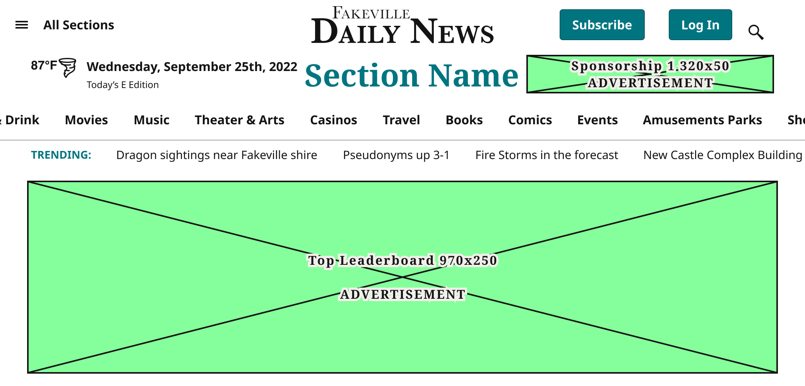
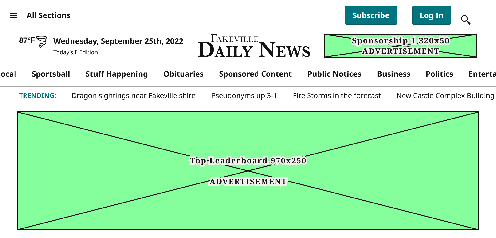
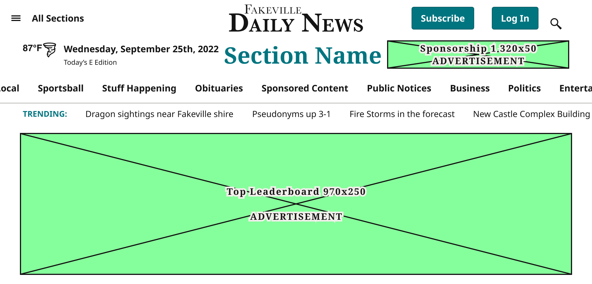
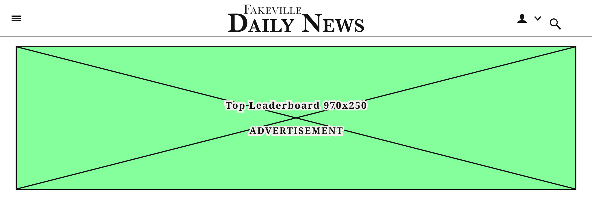
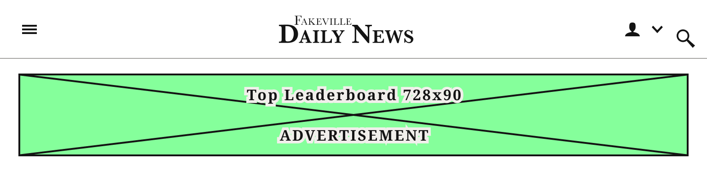
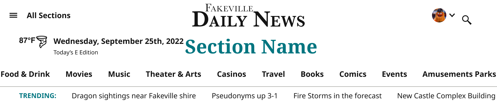
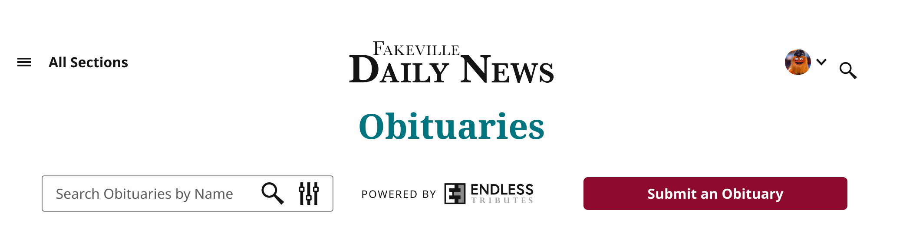
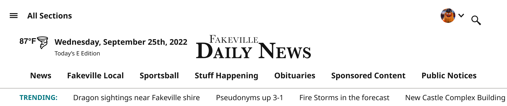
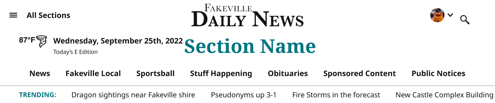

# Masthead

> The site header on every WordPress page. Page = Home, SectionFront, Article, Obituaries, Dashboard; State = Default (top of the page, with ads), AdFree (top of the page, subscriber), Scrolled (sticky condensed bar, logged out), AdFree-Scrolled (sticky condensed bar, subscriber); Device = the 5 WordPress grid widths. Built from SectionMenu, AccountMenu (UserStatus inside), Weather Bug, SocialButtons and Ad Blocks.

## Figma

- File: **WordPress Elements** (`b1iZxkFwtAYq9rElmnCAzd`), page **Menus and Parts**
- Component set: [`Masthead` · 456:2572](https://www.figma.com/design/b1iZxkFwtAYq9rElmnCAzd/?node-id=456-2572) · key `5cf04e3021e4ccd5357b9d77f3d03e02ed41dc28`
- Documentation frame: [Masthead Container](https://www.figma.com/design/b1iZxkFwtAYq9rElmnCAzd/?node-id=3676-41569) · overview: [previews/masthead--documentation.png](previews/masthead--documentation.png)

## Properties

| Property | Default | Options |
|---|---|---|
| State | Default | Default, AdFree, Scrolled, AdFree-Scrolled |
| Device | XS-Fold (≤639px · built 340px) | XL-Desktop (≥1040px), LG-TabletH (800–1039px), MD-TabletV (640–799px), SM-Mobile (≤639px · built 360px), XS-Fold (≤639px · built 340px) |
| Page | Home | SectionFront, Obituaries, Dashboard, Home, Article |

## Variants

| Variant | Size | Node | Instances | Preview |
|---|---|---|---|---|
| `Default / XL-Desktop (≥1040px) / SectionFront` | 1040×500 | [456:2653](https://www.figma.com/design/b1iZxkFwtAYq9rElmnCAzd/?node-id=456-2653) | 3 |  |
| `Default / XL-Desktop (≥1040px) / Obituaries` | 1040×261 | [456:3394](https://www.figma.com/design/b1iZxkFwtAYq9rElmnCAzd/?node-id=456-3394) | 0 |  |
| `Default / XL-Desktop (≥1040px) / Dashboard` | 1280×144 | [456:2715](https://www.figma.com/design/b1iZxkFwtAYq9rElmnCAzd/?node-id=456-2715) | 7 |  |
| `Default / XL-Desktop (≥1040px) / Home` | 1040×500 | [456:2573](https://www.figma.com/design/b1iZxkFwtAYq9rElmnCAzd/?node-id=456-2573) | 9 |  |
| `Default / XL-Desktop (≥1040px) / Article` | 1040×500 | [824:4526](https://www.figma.com/design/b1iZxkFwtAYq9rElmnCAzd/?node-id=824-4526) | 0 |  |
| `Default / LG-TabletH (800–1039px) / SectionFront` | 1024×346 | [456:2896](https://www.figma.com/design/b1iZxkFwtAYq9rElmnCAzd/?node-id=456-2896) | 0 |  |
| `Default / LG-TabletH (800–1039px) / Obituaries` | 1024×324 | [456:3653](https://www.figma.com/design/b1iZxkFwtAYq9rElmnCAzd/?node-id=456-3653) | 0 |  |
| `Default / LG-TabletH (800–1039px) / Dashboard` | 1024×64 | [456:2996](https://www.figma.com/design/b1iZxkFwtAYq9rElmnCAzd/?node-id=456-2996) | 6 |  |
| `Default / LG-TabletH (800–1039px) / Home` | 1024×346 | [819:2854](https://www.figma.com/design/b1iZxkFwtAYq9rElmnCAzd/?node-id=819-2854) | 1 |  |
| `Default / LG-TabletH (800–1039px) / Article` | 1024×346 | [824:5088](https://www.figma.com/design/b1iZxkFwtAYq9rElmnCAzd/?node-id=824-5088) | 0 |  |
| `Default / MD-TabletV (640–799px) / SectionFront` | 768×186 | [456:3100](https://www.figma.com/design/b1iZxkFwtAYq9rElmnCAzd/?node-id=456-3100) | 0 |  |
| `Default / MD-TabletV (640–799px) / Obituaries` | 768×349 | [456:3726](https://www.figma.com/design/b1iZxkFwtAYq9rElmnCAzd/?node-id=456-3726) | 0 |  |
| `Default / MD-TabletV (640–799px) / Dashboard` | 768×104 | [456:3152](https://www.figma.com/design/b1iZxkFwtAYq9rElmnCAzd/?node-id=456-3152) | 8 |  |
| `Default / MD-TabletV (640–799px) / Home` | 768×186 | [456:3071](https://www.figma.com/design/b1iZxkFwtAYq9rElmnCAzd/?node-id=456-3071) | 9 |  |
| `Default / MD-TabletV (640–799px) / Article` | 768×186 | [824:5147](https://www.figma.com/design/b1iZxkFwtAYq9rElmnCAzd/?node-id=824-5147) | 0 |  |
| `Default / SM-Mobile (≤639px · built 360px) / SectionFront` | 360×130 | [456:3230](https://www.figma.com/design/b1iZxkFwtAYq9rElmnCAzd/?node-id=456-3230) | 1 |  |
| `Default / SM-Mobile (≤639px · built 360px) / Obituaries` | 360×353 | [456:3531](https://www.figma.com/design/b1iZxkFwtAYq9rElmnCAzd/?node-id=456-3531) | 0 |  |
| `Default / SM-Mobile (≤639px · built 360px) / Dashboard` | 360×104 | [456:3300](https://www.figma.com/design/b1iZxkFwtAYq9rElmnCAzd/?node-id=456-3300) | 12 |  |
| `Default / SM-Mobile (≤639px · built 360px) / Home` | 360×130 | [456:3201](https://www.figma.com/design/b1iZxkFwtAYq9rElmnCAzd/?node-id=456-3201) | 11 |  |
| `Default / SM-Mobile (≤639px · built 360px) / Article` | 360×130 | [824:5173](https://www.figma.com/design/b1iZxkFwtAYq9rElmnCAzd/?node-id=824-5173) | 0 |  |
| `Default / XS-Fold (≤639px · built 340px) / SectionFront` | 340×180 | [736:1647](https://www.figma.com/design/b1iZxkFwtAYq9rElmnCAzd/?node-id=736-1647) | 0 |  |
| `Default / XS-Fold (≤639px · built 340px) / Obituaries` | 340×353 | [456:3592](https://www.figma.com/design/b1iZxkFwtAYq9rElmnCAzd/?node-id=456-3592) | 0 |  |
| `Default / XS-Fold (≤639px · built 340px) / Dashboard` | 340×104 | [456:3324](https://www.figma.com/design/b1iZxkFwtAYq9rElmnCAzd/?node-id=456-3324) | 0 |  |
| `Default / XS-Fold (≤639px · built 340px) / Home` | 340×180 | [736:2450](https://www.figma.com/design/b1iZxkFwtAYq9rElmnCAzd/?node-id=736-2450) | 1 |  |
| `Default / XS-Fold (≤639px · built 340px) / Article` | 340×180 | [824:5197](https://www.figma.com/design/b1iZxkFwtAYq9rElmnCAzd/?node-id=824-5197) | 0 |  |
| `AdFree / XL-Desktop (≥1040px) / SectionFront` | 1040×218 | [822:3434](https://www.figma.com/design/b1iZxkFwtAYq9rElmnCAzd/?node-id=822-3434) | 0 |  |
| `AdFree / XL-Desktop (≥1040px) / Obituaries` | 1040×261 | [827:6067](https://www.figma.com/design/b1iZxkFwtAYq9rElmnCAzd/?node-id=827-6067) | 0 |  |
| `AdFree / XL-Desktop (≥1040px) / Home` | 1040×218 | [819:1845](https://www.figma.com/design/b1iZxkFwtAYq9rElmnCAzd/?node-id=819-1845) | 0 |  |
| `AdFree / XL-Desktop (≥1040px) / Article` | 1040×218 | [824:4625](https://www.figma.com/design/b1iZxkFwtAYq9rElmnCAzd/?node-id=824-4625) | 0 |  |
| `AdFree / LG-TabletH (800–1039px) / SectionFront` | 1024×64 | [823:3812](https://www.figma.com/design/b1iZxkFwtAYq9rElmnCAzd/?node-id=823-3812) | 0 |  |
| `AdFree / LG-TabletH (800–1039px) / Obituaries` | 1024×324 | [827:5676](https://www.figma.com/design/b1iZxkFwtAYq9rElmnCAzd/?node-id=827-5676) | 0 |  |
| `AdFree / LG-TabletH (800–1039px) / Home` | 1024×64 | [823:3758](https://www.figma.com/design/b1iZxkFwtAYq9rElmnCAzd/?node-id=823-3758) | 0 |  |
| `AdFree / LG-TabletH (800–1039px) / Article` | 1024×64 | [824:4780](https://www.figma.com/design/b1iZxkFwtAYq9rElmnCAzd/?node-id=824-4780) | 0 |  |
| `AdFree / MD-TabletV (640–799px) / SectionFront` | 768×64 | [823:3969](https://www.figma.com/design/b1iZxkFwtAYq9rElmnCAzd/?node-id=823-3969) | 0 |  |
| `AdFree / MD-TabletV (640–799px) / Obituaries` | 768×285 | [827:5573](https://www.figma.com/design/b1iZxkFwtAYq9rElmnCAzd/?node-id=827-5573) | 0 |  |
| `AdFree / MD-TabletV (640–799px) / Home` | 768×64 | [819:1940](https://www.figma.com/design/b1iZxkFwtAYq9rElmnCAzd/?node-id=819-1940) | 0 |  |
| `AdFree / MD-TabletV (640–799px) / Article` | 768×64 | [824:4885](https://www.figma.com/design/b1iZxkFwtAYq9rElmnCAzd/?node-id=824-4885) | 0 |  |
| `AdFree / SM-Mobile (≤639px · built 360px) / SectionFront` | 360×64 | [823:4068](https://www.figma.com/design/b1iZxkFwtAYq9rElmnCAzd/?node-id=823-4068) | 0 |  |
| `AdFree / SM-Mobile (≤639px · built 360px) / Obituaries` | 360×295 | [827:5440](https://www.figma.com/design/b1iZxkFwtAYq9rElmnCAzd/?node-id=827-5440) | 0 |  |
| `AdFree / SM-Mobile (≤639px · built 360px) / Home` | 360×64 | [819:1966](https://www.figma.com/design/b1iZxkFwtAYq9rElmnCAzd/?node-id=819-1966) | 0 |  |
| `AdFree / SM-Mobile (≤639px · built 360px) / Article` | 360×64 | [824:4909](https://www.figma.com/design/b1iZxkFwtAYq9rElmnCAzd/?node-id=824-4909) | 0 |  |
| `AdFree / XS-Fold (≤639px · built 340px) / SectionFront` | 340×64 | [823:4190](https://www.figma.com/design/b1iZxkFwtAYq9rElmnCAzd/?node-id=823-4190) | 0 |  |
| `AdFree / XS-Fold (≤639px · built 340px) / Obituaries` | 340×295 | [827:5968](https://www.figma.com/design/b1iZxkFwtAYq9rElmnCAzd/?node-id=827-5968) | 0 |  |
| `AdFree / XS-Fold (≤639px · built 340px) / Home` | 340×64 | [819:1992](https://www.figma.com/design/b1iZxkFwtAYq9rElmnCAzd/?node-id=819-1992) | 0 |  |
| `AdFree / XS-Fold (≤639px · built 340px) / Article` | 340×64 | [824:4933](https://www.figma.com/design/b1iZxkFwtAYq9rElmnCAzd/?node-id=824-4933) | 0 |  |
| `Scrolled / XL-Desktop (≥1040px) / SectionFront` | 1040×64 | [822:3585](https://www.figma.com/design/b1iZxkFwtAYq9rElmnCAzd/?node-id=822-3585) | 0 |  |
| `Scrolled / XL-Desktop (≥1040px) / Obituaries` | 1040×145 | [456:3468](https://www.figma.com/design/b1iZxkFwtAYq9rElmnCAzd/?node-id=456-3468) | 0 |  |
| `Scrolled / XL-Desktop (≥1040px) / Dashboard` | 1280×64 | [456:2840](https://www.figma.com/design/b1iZxkFwtAYq9rElmnCAzd/?node-id=456-2840) | 0 |  |
| `Scrolled / XL-Desktop (≥1040px) / Home` | 1040×64 | [456:2776](https://www.figma.com/design/b1iZxkFwtAYq9rElmnCAzd/?node-id=456-2776) | 1 |  |
| `Scrolled / XL-Desktop (≥1040px) / Article` | 1040×64 | [456:2800](https://www.figma.com/design/b1iZxkFwtAYq9rElmnCAzd/?node-id=456-2800) | 0 |  |
| `Scrolled / LG-TabletH (800–1039px) / SectionFront` | 1024×64 | [823:3917](https://www.figma.com/design/b1iZxkFwtAYq9rElmnCAzd/?node-id=823-3917) | 0 |  |
| `Scrolled / LG-TabletH (800–1039px) / Obituaries` | 1024×244 | [456:3977](https://www.figma.com/design/b1iZxkFwtAYq9rElmnCAzd/?node-id=456-3977) | 0 |  |
| `Scrolled / LG-TabletH (800–1039px) / Dashboard` | 1024×64 | [456:3047](https://www.figma.com/design/b1iZxkFwtAYq9rElmnCAzd/?node-id=456-3047) | 0 |  |
| `Scrolled / LG-TabletH (800–1039px) / Home` | 1024×64 | [456:3023](https://www.figma.com/design/b1iZxkFwtAYq9rElmnCAzd/?node-id=456-3023) | 0 |  |
| `Scrolled / LG-TabletH (800–1039px) / Article` | 1024×64 | [824:4806](https://www.figma.com/design/b1iZxkFwtAYq9rElmnCAzd/?node-id=824-4806) | 0 |  |
| `Scrolled / MD-TabletV (640–799px) / SectionFront` | 768×64 | [823:4019](https://www.figma.com/design/b1iZxkFwtAYq9rElmnCAzd/?node-id=823-4019) | 0 |  |
| `Scrolled / MD-TabletV (640–799px) / Obituaries` | 768×212 | [456:3915](https://www.figma.com/design/b1iZxkFwtAYq9rElmnCAzd/?node-id=456-3915) | 0 |  |
| `Scrolled / MD-TabletV (640–799px) / Dashboard` | 768×104 | [456:3177](https://www.figma.com/design/b1iZxkFwtAYq9rElmnCAzd/?node-id=456-3177) | 0 |  |
| `Scrolled / MD-TabletV (640–799px) / Home` | 768×64 | [456:3129](https://www.figma.com/design/b1iZxkFwtAYq9rElmnCAzd/?node-id=456-3129) | 0 |  |
| `Scrolled / MD-TabletV (640–799px) / Article` | 768×64 | [456:2971](https://www.figma.com/design/b1iZxkFwtAYq9rElmnCAzd/?node-id=456-2971) | 0 |  |
| `Scrolled / SM-Mobile (≤639px · built 360px) / SectionFront` | 360×64 | [823:4092](https://www.figma.com/design/b1iZxkFwtAYq9rElmnCAzd/?node-id=823-4092) | 0 |  |
| `Scrolled / SM-Mobile (≤639px · built 360px) / Obituaries` | 360×215 | [456:3799](https://www.figma.com/design/b1iZxkFwtAYq9rElmnCAzd/?node-id=456-3799) | 0 |  |
| `Scrolled / SM-Mobile (≤639px · built 360px) / Dashboard` | 360×104 | [456:3348](https://www.figma.com/design/b1iZxkFwtAYq9rElmnCAzd/?node-id=456-3348) | 0 |  |
| `Scrolled / SM-Mobile (≤639px · built 360px) / Home` | 360×64 | [456:3254](https://www.figma.com/design/b1iZxkFwtAYq9rElmnCAzd/?node-id=456-3254) | 0 |  |
| `Scrolled / SM-Mobile (≤639px · built 360px) / Article` | 360×64 | [456:3277](https://www.figma.com/design/b1iZxkFwtAYq9rElmnCAzd/?node-id=456-3277) | 0 |  |
| `Scrolled / XS-Fold (≤639px · built 340px) / SectionFront` | 340×64 | [823:4167](https://www.figma.com/design/b1iZxkFwtAYq9rElmnCAzd/?node-id=823-4167) | 0 |  |
| `Scrolled / XS-Fold (≤639px · built 340px) / Obituaries` | 340×215 | [456:3857](https://www.figma.com/design/b1iZxkFwtAYq9rElmnCAzd/?node-id=456-3857) | 0 |  |
| `Scrolled / XS-Fold (≤639px · built 340px) / Dashboard` | 340×104 | [456:3371](https://www.figma.com/design/b1iZxkFwtAYq9rElmnCAzd/?node-id=456-3371) | 0 |  |
| `Scrolled / XS-Fold (≤639px · built 340px) / Home` | 340×64 | [736:2476](https://www.figma.com/design/b1iZxkFwtAYq9rElmnCAzd/?node-id=736-2476) | 0 |  |
| `Scrolled / XS-Fold (≤639px · built 340px) / Article` | 340×64 | [736:1671](https://www.figma.com/design/b1iZxkFwtAYq9rElmnCAzd/?node-id=736-1671) | 0 |  |
| `AdFree-Scrolled / XL-Desktop (≥1040px) / SectionFront` | 1040×64 | [3676:40813](https://www.figma.com/design/b1iZxkFwtAYq9rElmnCAzd/?node-id=3676-40813) | 0 |  |
| `AdFree-Scrolled / XL-Desktop (≥1040px) / Obituaries` | 1040×145 | [3415:52128](https://www.figma.com/design/b1iZxkFwtAYq9rElmnCAzd/?node-id=3415-52128) | 0 |  |
| `AdFree-Scrolled / XL-Desktop (≥1040px) / Home` | 1040×64 | [3676:40454](https://www.figma.com/design/b1iZxkFwtAYq9rElmnCAzd/?node-id=3676-40454) | 0 |  |
| `AdFree-Scrolled / XL-Desktop (≥1040px) / Article` | 1040×64 | [3676:41172](https://www.figma.com/design/b1iZxkFwtAYq9rElmnCAzd/?node-id=3676-41172) | 0 |  |
| `AdFree-Scrolled / LG-TabletH (800–1039px) / SectionFront` | 1024×64 | [3676:40895](https://www.figma.com/design/b1iZxkFwtAYq9rElmnCAzd/?node-id=3676-40895) | 0 |  |
| `AdFree-Scrolled / LG-TabletH (800–1039px) / Obituaries` | 1024×244 | [3415:52563](https://www.figma.com/design/b1iZxkFwtAYq9rElmnCAzd/?node-id=3415-52563) | 0 |  |
| `AdFree-Scrolled / LG-TabletH (800–1039px) / Home` | 1024×64 | [3676:40536](https://www.figma.com/design/b1iZxkFwtAYq9rElmnCAzd/?node-id=3676-40536) | 0 |  |
| `AdFree-Scrolled / LG-TabletH (800–1039px) / Article` | 1024×64 | [3676:41350](https://www.figma.com/design/b1iZxkFwtAYq9rElmnCAzd/?node-id=3676-41350) | 0 |  |
| `AdFree-Scrolled / MD-TabletV (640–799px) / SectionFront` | 768×64 | [3676:40968](https://www.figma.com/design/b1iZxkFwtAYq9rElmnCAzd/?node-id=3676-40968) | 0 |  |
| `AdFree-Scrolled / MD-TabletV (640–799px) / Obituaries` | 768×212 | [3415:52455](https://www.figma.com/design/b1iZxkFwtAYq9rElmnCAzd/?node-id=3415-52455) | 0 |  |
| `AdFree-Scrolled / MD-TabletV (640–799px) / Home` | 768×64 | [3676:40609](https://www.figma.com/design/b1iZxkFwtAYq9rElmnCAzd/?node-id=3676-40609) | 0 |  |
| `AdFree-Scrolled / MD-TabletV (640–799px) / Article` | 768×64 | [3676:41282](https://www.figma.com/design/b1iZxkFwtAYq9rElmnCAzd/?node-id=3676-41282) | 0 |  |
| `AdFree-Scrolled / SM-Mobile (≤639px · built 360px) / SectionFront` | 360×64 | [3676:41036](https://www.figma.com/design/b1iZxkFwtAYq9rElmnCAzd/?node-id=3676-41036) | 0 |  |
| `AdFree-Scrolled / SM-Mobile (≤639px · built 360px) / Obituaries` | 360×215 | [3415:52247](https://www.figma.com/design/b1iZxkFwtAYq9rElmnCAzd/?node-id=3415-52247) | 0 |  |
| `AdFree-Scrolled / SM-Mobile (≤639px · built 360px) / Home` | 360×64 | [3676:40677](https://www.figma.com/design/b1iZxkFwtAYq9rElmnCAzd/?node-id=3676-40677) | 1 |  |
| `AdFree-Scrolled / SM-Mobile (≤639px · built 360px) / Article` | 360×64 | [3676:41423](https://www.figma.com/design/b1iZxkFwtAYq9rElmnCAzd/?node-id=3676-41423) | 0 |  |
| `AdFree-Scrolled / XS-Fold (≤639px · built 340px) / SectionFront` | 340×64 | [3676:41104](https://www.figma.com/design/b1iZxkFwtAYq9rElmnCAzd/?node-id=3676-41104) | 0 |  |
| `AdFree-Scrolled / XS-Fold (≤639px · built 340px) / Obituaries` | 340×215 | [3415:52351](https://www.figma.com/design/b1iZxkFwtAYq9rElmnCAzd/?node-id=3415-52351) | 0 |  |
| `AdFree-Scrolled / XS-Fold (≤639px · built 340px) / Home` | 340×64 | [3676:40745](https://www.figma.com/design/b1iZxkFwtAYq9rElmnCAzd/?node-id=3676-40745) | 0 |  |
| `AdFree-Scrolled / XS-Fold (≤639px · built 340px) / Article` | 340×64 | [3676:41491](https://www.figma.com/design/b1iZxkFwtAYq9rElmnCAzd/?node-id=3676-41491) | 0 |  |

## Anatomy

Default variant `Default / XL-Desktop (≥1040px) / SectionFront` (hidden layers marked):

- **Device=XL-Desktop (≥1040px), State=Default, Page=SectionFront** `COMPONENT`: 1040×500, vertical, gap 0, padding 0/0/0/0, fixed×hug
  - **Masthead Container** `FRAME`: 1040×500, vertical, gap 0, padding 0/0/0/0, fill×hug
    - **MastheadTop** `FRAME`: 1040×64, vertical, gap 8, padding 0/0/0/0, fill×hug
      - **Menus Container** `FRAME`: 1040×64, horizontal, gap 14, padding 0/0/0/0, fill×fixed
        - **SectionMenu** `INSTANCE`: 300×64, vertical, gap 0, padding 0/0/0/0, hug×hug, instance of SectionMenu (View=Closed, Device=XL-Desktop, UserType=all)
        - **Logo** `FRAME`: 440×64, vertical, gap 8, padding 0/0/0/0, fill×fill
          - **Logo** `GROUP`: 235.25×48, fixed×fixed
            - **Vector** `VECTOR`: 12.43×15.8, fixed×fixed
            - **Vector** `VECTOR`: 11.46×11.22, fixed×fixed
            - **Vector** `VECTOR`: 12.61×11.08, fixed×fixed
            - **Vector** `VECTOR`: 9.41×11.06, fixed×fixed
            - **Vector** `VECTOR`: 12.09×11.31, fixed×fixed
            - **Vector** `VECTOR`: 5.1×11.08, fixed×fixed
            - **Vector** `VECTOR`: 9.52×11.06, fixed×fixed
            - **Vector** `VECTOR`: 9.52×11.06, fixed×fixed
            - **Vector** `VECTOR`: 9.41×11.06, fixed×fixed
            - **Vector** `VECTOR`: 33.46×31.99, fixed×fixed
            - **Vector** `VECTOR`: 22.44×22.53, fixed×fixed
            - **Vector** `VECTOR`: 11.26×22.1, fixed×fixed
            - **Vector** `VECTOR`: 19.89×22.1, fixed×fixed
            - **Vector** `VECTOR`: 22.59×22.12, fixed×fixed
            - **Vector** `VECTOR`: 34.6×31.86, fixed×fixed
            - **Vector** `VECTOR`: 19.97×22.1, fixed×fixed
            - **Vector** `VECTOR`: 31.91×22.5, fixed×fixed
            - **Vector** `VECTOR`: 15.79×22.89, fixed×fixed
        - **AccountMenu Container** `FRAME`: 300×64, horizontal, gap 16, padding 0/40/0/0, fixed×fixed
          - **AccountMenu** `INSTANCE`: 293×64, horizontal, gap 8, padding 0/8/0/8, hug×fixed, instance of AccountMenu (Status=loggedOut, View=Closed, Device=XL-Desktop, UserType=loggedOut)
    - **Container** `FRAME`: 1040×64, horizontal, gap 14, padding 8/40/8/40, fill×fixed
      - **Weather Bug** `INSTANCE`: 345×42, horizontal, gap 12, padding 0/0/0/0, hug×hug, instance of Weather Bug (Location=Masthead)
      - **Section Name** `TEXT`: 278×54, hug×hug, "Section Name", Noto Serif Bold 40px
      - **Ad Blocks** `INSTANCE`: 320×50, vertical, gap 8, padding 0/0/0/0, fixed×fixed, instance of Ad Blocks (Device=All, Name=Sponsorship 1 320x50)
    - **Container** `FRAME`: 1040×54, vertical, gap 0, padding 0/0/0/0, fill×hug
      - **Menu** `FRAME`: 1145×54, horizontal, gap 32, padding 16/0/16/0, hug×hug
        - **Menu Item** `TEXT`: 104×22, hug×hug, "Food & Drink", Noto Sans Bold 16px
        - **Menu Item** `TEXT`: 57×22, hug×hug, "Movies", Noto Sans Bold 16px
        - **Menu Item** `TEXT`: 47×22, hug×hug, "Music", Noto Sans Bold 16px
        - **Menu Item** `TEXT`: 117×22, hug×hug, "Theater & Arts", Noto Sans Bold 16px
        - **Menu Item** `TEXT`: 62×22, hug×hug, "Casinos", Noto Sans Bold 16px
        - **Menu Item** `TEXT`: 49×22, hug×hug, "Travel", Noto Sans Bold 16px
        - **Menu Item** `TEXT`: 49×22, hug×hug, "Books", Noto Sans Bold 16px
        - **Menu Item** `TEXT`: 57×22, hug×hug, "Comics", Noto Sans Bold 16px
        - **Menu Item** `TEXT`: 53×22, hug×hug, "Events", Noto Sans Bold 16px
        - **Menu Item** `TEXT`: 155×22, hug×hug, "Amusements Parks", Noto Sans Bold 16px
        - **Menu Item** `TEXT`: 75×22, hug×hug, "Shopping", Noto Sans Bold 16px
      - **Divider** `LINE`: 1040×0, fill×fixed
    - **Trending** `FRAME`: 1040×36, horizontal, gap 32, padding 8/40/8/40, fill×hug
      - **Trending Label** `TEXT`: 78×19, hug×hug, "Trending:", Noto Sans Bold 14px
      - **Trending Item** `TEXT`: 261×20, hug×hug, "Dragon sightings near Fakeville shire", Noto Sans Regular 15px
      - **Trending Item** `TEXT`: 139×20, hug×hug, "Pseudonyms up 3-1", Noto Sans Regular 15px
      - **Trending Item** `TEXT`: 185×20, hug×hug, "Fire Storms in the forecast", Noto Sans Regular 15px
      - **Trending Item** `TEXT`: 258×20, hug×hug, "New Castle Complex Building Stalled", Noto Sans Regular 15px
    - **Ad Container** `FRAME`: 1040×282, vertical, gap 8, padding 16/0/16/0, fill×hug
      - **Ad Blocks** `INSTANCE`: 970×250, vertical, gap 8, padding 0/0/0/0, fixed×fixed, instance of Ad Blocks (Device=Desktop, Name=Top Leaderboard 970x250)

## Component tokens

From `masthead.tokens.json`. References point at system tokens (`tokens/core/`, `tokens/themes/`); the CSS variable is `--mng-` + the token path. A literal value means the Figma layer isn't bound to a token.

| Token | Value |
|---|---|
| `masthead.base.ad-container.background` | `{color.gray.max}` |
| `masthead.base.ad-container.ad-blocks.icon-color` | `{color.gray.min}` |
| `masthead.base.button-frame.background` | `{color.gray.max}` |
| `masthead.base.button-frame.border-bottom-width` | 1px |
| `masthead.base.button-frame.border-color` | `{color.gray.min}` |
| `masthead.base.button-frame.border-style` | solid |
| `masthead.base.button-frame.gap` | `{spacing.100}` |
| `masthead.base.button-frame.padding-bottom` | `{spacing.200}` |
| `masthead.base.button-frame.padding-left` | `{spacing.100}` |
| `masthead.base.button-frame.padding-right` | `{spacing.100}` |
| `masthead.base.button-frame.padding-top` | `{spacing.100}` |
| `masthead.base.button-frame.button.border-radius` | 5px |
| `masthead.base.button-frame.button.height` | 49px |
| `masthead.base.button-frame.button.padding-bottom` | `{spacing.100}` |
| `masthead.base.button-frame.button.padding-top` | `{spacing.100}` |
| `masthead.base.button-frame.button.about.color` | `{color.gray.max}` |
| `masthead.base.button-frame.button.about.font-family` | `{font.family.noto-sans}` |
| `masthead.base.button-frame.button.about.font-size` | `{font.size.16}` |
| `masthead.base.button-frame.button.about.font-weight` | `{font.weight.bold}` |
| `masthead.base.button-frame.powered-by-container.gap` | 2px |
| `masthead.base.button-frame.powered-by-container.endless-tributes-black-logo-horizontal-1.height` | 20px |
| `masthead.base.button-frame.powered-by-container.endless-tributes-black-logo-horizontal-1.width` | 74.9px |
| `masthead.base.button-frame.powered-by-container.endless-tributes-black-logo-horizontal-1.logo-artwork.height` | 14.77px |
| `masthead.base.button-frame.powered-by-container.endless-tributes-black-logo-horizontal-1.logo-artwork.width` | 14.63px |
| `masthead.base.button-frame.powered-by-container.endless-tributes-black-logo-horizontal-1.logo-artwork.vector.background` | `{color.gray.max}` |
| `masthead.base.button-frame.powered-by-container.endless-tributes-black-logo-horizontal-1.logo-artwork.vector.height` | 14.77px |
| `masthead.base.button-frame.powered-by-container.endless-tributes-black-logo-horizontal-1.logo-artwork.vector.opacity` | 0.5 |
| `masthead.base.button-frame.powered-by-container.endless-tributes-black-logo-horizontal-1.logo-artwork.vector.width` | 8.14px |
| `masthead.base.button-frame.powered-by-container.endless-tributes-black-logo-horizontal-1.vector.background` | `{color.gray.min}` |
| `masthead.base.button-frame.powered-by-container.endless-tributes-black-logo-horizontal-1.vector.height` | 17.42px |
| `masthead.base.button-frame.powered-by-container.endless-tributes-black-logo-horizontal-1.vector.width` | 17.17px |
| `masthead.base.button-frame.powered-by-container.powered-by-text.color` | `{color.gray.min}` |
| `masthead.base.button-frame.powered-by-container.powered-by-text.font-family` | `{font.family.noto-sans}` |
| `masthead.base.button-frame.powered-by-container.powered-by-text.font-size` | `{font.size.12}` |
| `masthead.base.button-frame.powered-by-container.powered-by-text.font-weight` | `{font.weight.regular}` |
| `masthead.base.button-frame.search-container.background` | `{color.gray.max}` |
| `masthead.base.button-frame.search-container.padding-left` | `{spacing.100}` |
| `masthead.base.button-frame.search-container.padding-right` | `{spacing.100}` |
| `masthead.base.button-frame.search-container.search-field.background` | `{color.gray.max}` |
| `masthead.base.button-frame.search-container.search-field.border-color` | `{color.gray.min}` |
| `masthead.base.button-frame.search-container.search-field.border-radius` | `{radius.sm}` |
| `masthead.base.button-frame.search-container.search-field.border-style` | solid |
| `masthead.base.button-frame.search-container.search-field.border-width` | 1px |
| `masthead.base.button-frame.search-container.search-field.gap` | 8px |
| `masthead.base.button-frame.search-container.search-field.padding-bottom` | `{spacing.100}` |
| `masthead.base.button-frame.search-container.search-field.padding-left` | `{spacing.200}` |
| `masthead.base.button-frame.search-container.search-field.padding-right` | `{spacing.200}` |
| `masthead.base.button-frame.search-container.search-field.padding-top` | `{spacing.100}` |
| `masthead.base.button-frame.search-container.search-field.about.color` | `{color.gray.200}` |
| `masthead.base.button-frame.search-container.search-field.about.font-family` | `{font.family.noto-sans}` |
| `masthead.base.button-frame.search-container.search-field.about.font-size` | `{font.size.14}` |
| `masthead.base.button-frame.search-container.search-field.about.font-weight` | `{font.weight.regular}` |
| `masthead.base.button-frame.search-container.search-field.search-icons.gap` | `{spacing.200}` |
| `masthead.base.button-frame.search-container.search-field.search-icons.icons.height` | 26px |
| `masthead.base.button-frame.search-container.search-field.search-icons.icons.icon-color` | `{color.gray.min}` |
| `masthead.base.button-frame.search-container.search-field.search-icons.icons.width` | 24.75px |
| `masthead.base.button-frame.search-container.search-field.search-icons-container.gap` | `{spacing.200}` |
| `masthead.base.button-frame.search-container.search-field.search-icons-container.icons.height` | 26px |
| `masthead.base.button-frame.search-container.search-field.search-icons-container.icons.icon-color` | `{color.gray.min}` |
| `masthead.base.button-frame.search-container.search-field.search-icons-container.icons.width` | 24.75px |
| `masthead.base.container.padding-bottom` | `{spacing.100}` |
| `masthead.base.container.padding-left` | `{spacing.100}` |
| `masthead.base.container.padding-right` | `{spacing.100}` |
| `masthead.base.container.padding-top` | `{spacing.100}` |
| `masthead.base.container.button-frame.background` | `{color.gray.max}` |
| `masthead.base.container.button-frame.padding-left` | `{spacing.200}` |
| `masthead.base.container.button-frame.padding-right` | `{spacing.200}` |
| `masthead.base.container.button-frame.button.background` | `{color.theme.primary}` |
| `masthead.base.container.button-frame.button.border-radius` | 5px |
| `masthead.base.container.button-frame.button.padding-bottom` | `{spacing.100}` |
| `masthead.base.container.button-frame.button.padding-top` | `{spacing.100}` |
| `masthead.base.container.button-frame.button.about.color` | `{color.gray.max}` |
| `masthead.base.container.button-frame.button.about.font-family` | `{font.family.noto-sans}` |
| `masthead.base.container.button-frame.button.about.font-size` | `{font.size.16}` |
| `masthead.base.container.button-frame.button.about.font-weight` | `{font.weight.bold}` |
| `masthead.base.container.container.height` | 42px |
| `masthead.base.container.container.container.background` | `{color.gray.max}` |
| `masthead.base.container.container.container.padding-left` | `{spacing.200}` |
| `masthead.base.container.container.container.padding-right` | `{spacing.200}` |
| `masthead.base.container.container.container.width` | 752px |
| `masthead.base.container.container.container.search-field.background` | `{color.gray.max}` |
| `masthead.base.container.container.container.search-field.border-color` | `{color.gray.300}` |
| `masthead.base.container.container.container.search-field.border-radius` | 3px |
| `masthead.base.container.container.container.search-field.border-style` | solid |
| `masthead.base.container.container.container.search-field.border-width` | 1px |
| `masthead.base.container.container.container.search-field.gap` | 8px |
| `masthead.base.container.container.container.search-field.padding-bottom` | `{spacing.100}` |
| `masthead.base.container.container.container.search-field.padding-left` | `{spacing.200}` |
| `masthead.base.container.container.container.search-field.padding-right` | `{spacing.200}` |
| `masthead.base.container.container.container.search-field.padding-top` | `{spacing.100}` |
| `masthead.base.container.container.container.search-field.about.color` | `{color.gray.200}` |
| `masthead.base.container.container.container.search-field.about.font-family` | `{font.family.noto-sans}` |
| `masthead.base.container.container.container.search-field.about.font-size` | `{font.size.16}` |
| `masthead.base.container.container.container.search-field.about.font-weight` | `{font.weight.regular}` |
| `masthead.base.container.container.container.search-field.icon-group.gap` | `{spacing.200}` |
| `masthead.base.container.container.container.search-field.icon-group.icons.height` | 26px |
| `masthead.base.container.container.container.search-field.icon-group.icons.icon-color` | `{color.gray.min}` |
| `masthead.base.container.container.container.search-field.icon-group.icons.width` | 24.75px |
| `masthead.base.container.container.container.search-field.search-icons-container.gap` | `{spacing.200}` |
| `masthead.base.container.container.container.search-field.search-icons-container.icons.height` | 26px |
| `masthead.base.container.container.container.search-field.search-icons-container.icons.icon-color` | `{color.gray.min}` |
| `masthead.base.container.container.container.search-field.search-icons-container.icons.width` | 24.75px |
| `masthead.base.container.container.logo-container.padding-bottom` | `{spacing.100}` |
| `masthead.base.container.container.logo-container.padding-left` | `{spacing.100}` |
| `masthead.base.container.container.logo-container.padding-right` | `{spacing.100}` |
| `masthead.base.container.container.logo-container.padding-top` | `{spacing.100}` |
| `masthead.base.container.container.logo-container.endless-tributes-black-logo-horizontal.height` | 28px |
| `masthead.base.container.container.logo-container.endless-tributes-black-logo-horizontal.width` | 106px |
| `masthead.base.container.container.logo-container.endless-tributes-black-logo-horizontal.logo-artwork.height` | 20.68px |
| `masthead.base.container.container.logo-container.endless-tributes-black-logo-horizontal.logo-artwork.width` | 20.71px |
| `masthead.base.container.container.logo-container.endless-tributes-black-logo-horizontal.logo-artwork.vector.background` | `{color.gray.max}` |
| `masthead.base.container.container.logo-container.endless-tributes-black-logo-horizontal.logo-artwork.vector.height` | 20.68px |
| `masthead.base.container.container.logo-container.endless-tributes-black-logo-horizontal.logo-artwork.vector.opacity` | 0.5 |
| `masthead.base.container.container.logo-container.endless-tributes-black-logo-horizontal.logo-artwork.vector.width` | 11.52px |
| `masthead.base.container.container.logo-container.endless-tributes-black-logo-horizontal.vector.background` | `{color.gray.min}` |
| `masthead.base.container.container.logo-container.endless-tributes-black-logo-horizontal.vector.height` | 24.38px |
| `masthead.base.container.container.logo-container.endless-tributes-black-logo-horizontal.vector.width` | 24.3px |
| `masthead.base.container.container.powered-by-text.color` | `{color.gray.min}` |
| `masthead.base.container.container.powered-by-text.font-family` | `{font.family.noto-sans}` |
| `masthead.base.container.container.powered-by-text.font-size` | `{font.size.12}` |
| `masthead.base.container.container.powered-by-text.font-weight` | `{font.weight.regular}` |
| `masthead.base.container.container.powered-by-text.letter-spacing` | 1.2px |
| `masthead.base.container.powered-by-container.logo-container.padding-bottom` | `{spacing.100}` |
| `masthead.base.container.powered-by-container.logo-container.padding-left` | `{spacing.100}` |
| `masthead.base.container.powered-by-container.logo-container.padding-right` | `{spacing.100}` |
| `masthead.base.container.powered-by-container.logo-container.padding-top` | `{spacing.100}` |
| `masthead.base.container.powered-by-container.logo-container.endless-tributes-black-logo-horizontal.height` | 28px |
| `masthead.base.container.powered-by-container.logo-container.endless-tributes-black-logo-horizontal.width` | 106px |
| `masthead.base.container.powered-by-container.logo-container.endless-tributes-black-logo-horizontal.logo-artwork.height` | 20.68px |
| `masthead.base.container.powered-by-container.logo-container.endless-tributes-black-logo-horizontal.logo-artwork.width` | 20.71px |
| `masthead.base.container.powered-by-container.logo-container.endless-tributes-black-logo-horizontal.logo-artwork.vector.background` | `{color.gray.max}` |
| `masthead.base.container.powered-by-container.logo-container.endless-tributes-black-logo-horizontal.logo-artwork.vector.height` | 20.68px |
| `masthead.base.container.powered-by-container.logo-container.endless-tributes-black-logo-horizontal.logo-artwork.vector.opacity` | 0.5 |
| `masthead.base.container.powered-by-container.logo-container.endless-tributes-black-logo-horizontal.logo-artwork.vector.width` | 11.52px |
| `masthead.base.container.powered-by-container.logo-container.endless-tributes-black-logo-horizontal.vector.background` | `{color.gray.min}` |
| `masthead.base.container.powered-by-container.logo-container.endless-tributes-black-logo-horizontal.vector.height` | 24.38px |
| `masthead.base.container.powered-by-container.logo-container.endless-tributes-black-logo-horizontal.vector.width` | 24.3px |
| `masthead.base.container.powered-by-container.powered-by-text.color` | `{color.gray.min}` |
| `masthead.base.container.powered-by-container.powered-by-text.font-family` | `{font.family.noto-sans}` |
| `masthead.base.container.powered-by-container.powered-by-text.font-size` | `{font.size.12}` |
| `masthead.base.container.powered-by-container.powered-by-text.font-weight` | `{font.weight.regular}` |
| `masthead.base.container.powered-by-container.powered-by-text.letter-spacing` | 1.2px |
| `masthead.base.divider.border-color` | `{color.gray.400}` |
| `masthead.base.divider.border-style` | solid |
| `masthead.base.divider.border-width` | 1px |
| `masthead.base.divider.height` | 0px |
| `masthead.base.masthead-container.background` | `{color.gray.max}` |
| `masthead.base.masthead-container.border-bottom-width` | 1px |
| `masthead.base.masthead-container.border-color` | `{color.gray.300}` |
| `masthead.base.masthead-container.border-style` | solid |
| `masthead.base.masthead-container.gap` | 14px |
| `masthead.base.masthead-container.height` | 64px |
| `masthead.base.masthead-container.padding-right` | `{spacing.500}` |
| `masthead.base.masthead-container.accountmenu.height` | 64px |
| `masthead.base.masthead-container.accountmenu.icon-color` | `{color.gray.max}` |
| `masthead.base.masthead-container.accountmenu.width` | 104px |
| `masthead.base.masthead-container.accountmenu-container.background` | `{color.gray.max}` |
| `masthead.base.masthead-container.accountmenu-container.height` | 64px |
| `masthead.base.masthead-container.accountmenu-container.padding-right` | `{spacing.500}` |
| `masthead.base.masthead-container.accountmenu-container.width` | 300px |
| `masthead.base.masthead-container.accountmenu-container.accountmenu.height` | 64px |
| `masthead.base.masthead-container.accountmenu-container.accountmenu.icon-color` | `{color.gray.max}` |
| `masthead.base.masthead-container.accountmenu-container.accountmenu.width` | 104px |
| `masthead.base.masthead-container.ad-container.background` | `{color.gray.max}` |
| `masthead.base.masthead-container.ad-container.padding-bottom` | `{spacing.200}` |
| `masthead.base.masthead-container.ad-container.padding-top` | `{spacing.200}` |
| `masthead.base.masthead-container.ad-container.ad-blocks.height` | 250px |
| `masthead.base.masthead-container.ad-container.ad-blocks.icon-color` | `{color.gray.min}` |
| `masthead.base.masthead-container.ad-container.ad-blocks.width` | 970px |
| `masthead.base.masthead-container.container.gap` | 14px |
| `masthead.base.masthead-container.container.padding-left` | `{spacing.500}` |
| `masthead.base.masthead-container.container.padding-right` | `{spacing.500}` |
| `masthead.base.masthead-container.container.width` | 235.25px |
| `masthead.base.masthead-container.container.ad-blocks.icon-color` | `{color.gray.min}` |
| `masthead.base.masthead-container.container.container.gap` | `{spacing.400}` |
| `masthead.base.masthead-container.container.container.height` | 48px |
| `masthead.base.masthead-container.container.container.padding-bottom` | `{spacing.200}` |
| `masthead.base.masthead-container.container.container.padding-top` | `{spacing.200}` |
| `masthead.base.masthead-container.container.container.business.color` | `{color.gray.min}` |
| `masthead.base.masthead-container.container.container.business.font-family` | `{font.family.noto-sans}` |
| `masthead.base.masthead-container.container.container.business.font-size` | `{font.size.16}` |
| `masthead.base.masthead-container.container.container.business.font-weight` | `{font.weight.bold}` |
| `masthead.base.masthead-container.container.container.entertainment.color` | `{color.gray.min}` |
| `masthead.base.masthead-container.container.container.entertainment.font-family` | `{font.family.noto-sans}` |
| `masthead.base.masthead-container.container.container.entertainment.font-size` | `{font.size.16}` |
| `masthead.base.masthead-container.container.container.entertainment.font-weight` | `{font.weight.bold}` |
| `masthead.base.masthead-container.container.container.fakeville-local.color` | `{color.gray.min}` |
| `masthead.base.masthead-container.container.container.fakeville-local.font-family` | `{font.family.noto-sans}` |
| `masthead.base.masthead-container.container.container.fakeville-local.font-size` | `{font.size.16}` |
| `masthead.base.masthead-container.container.container.fakeville-local.font-weight` | `{font.weight.bold}` |
| `masthead.base.masthead-container.container.container.news.color` | `{color.gray.min}` |
| `masthead.base.masthead-container.container.container.news.font-family` | `{font.family.noto-sans}` |
| `masthead.base.masthead-container.container.container.news.font-size` | `{font.size.16}` |
| `masthead.base.masthead-container.container.container.news.font-weight` | `{font.weight.bold}` |
| `masthead.base.masthead-container.container.container.obituaries.color` | `{color.gray.min}` |
| `masthead.base.masthead-container.container.container.obituaries.font-family` | `{font.family.noto-sans}` |
| `masthead.base.masthead-container.container.container.obituaries.font-size` | `{font.size.16}` |
| `masthead.base.masthead-container.container.container.obituaries.font-weight` | `{font.weight.bold}` |
| `masthead.base.masthead-container.container.container.politics.color` | `{color.gray.min}` |
| `masthead.base.masthead-container.container.container.politics.font-family` | `{font.family.noto-sans}` |
| `masthead.base.masthead-container.container.container.politics.font-size` | `{font.size.16}` |
| `masthead.base.masthead-container.container.container.politics.font-weight` | `{font.weight.bold}` |
| `masthead.base.masthead-container.container.container.public-notices.color` | `{color.gray.min}` |
| `masthead.base.masthead-container.container.container.public-notices.font-family` | `{font.family.noto-sans}` |
| `masthead.base.masthead-container.container.container.public-notices.font-size` | `{font.size.16}` |
| `masthead.base.masthead-container.container.container.public-notices.font-weight` | `{font.weight.bold}` |
| `masthead.base.masthead-container.container.container.sponsored-content.color` | `{color.gray.min}` |
| `masthead.base.masthead-container.container.container.sponsored-content.font-family` | `{font.family.noto-sans}` |
| `masthead.base.masthead-container.container.container.sponsored-content.font-size` | `{font.size.16}` |
| `masthead.base.masthead-container.container.container.sponsored-content.font-weight` | `{font.weight.bold}` |
| `masthead.base.masthead-container.container.container.sportsball.color` | `{color.gray.min}` |
| `masthead.base.masthead-container.container.container.sportsball.font-family` | `{font.family.noto-sans}` |
| `masthead.base.masthead-container.container.container.sportsball.font-size` | `{font.size.16}` |
| `masthead.base.masthead-container.container.container.sportsball.font-weight` | `{font.weight.bold}` |
| `masthead.base.masthead-container.container.container.stuff-happening.color` | `{color.gray.min}` |
| `masthead.base.masthead-container.container.container.stuff-happening.font-family` | `{font.family.noto-sans}` |
| `masthead.base.masthead-container.container.container.stuff-happening.font-size` | `{font.size.16}` |
| `masthead.base.masthead-container.container.container.stuff-happening.font-weight` | `{font.weight.bold}` |
| `masthead.base.masthead-container.container.container.suburbs.color` | `{color.gray.min}` |
| `masthead.base.masthead-container.container.container.suburbs.font-family` | `{font.family.noto-sans}` |
| `masthead.base.masthead-container.container.container.suburbs.font-size` | `{font.size.16}` |
| `masthead.base.masthead-container.container.container.suburbs.font-weight` | `{font.weight.bold}` |
| `masthead.base.masthead-container.container.container.vector.background` | `{color.gray.min}` |
| `masthead.base.masthead-container.container.container.vector.height` | 22.89px |
| `masthead.base.masthead-container.container.container.vector.width` | 15.79px |
| `masthead.base.masthead-container.container.divider.border-color` | `{color.gray.400}` |
| `masthead.base.masthead-container.container.divider.border-style` | solid |
| `masthead.base.masthead-container.container.divider.border-width` | 1px |
| `masthead.base.masthead-container.container.divider.height` | 0px |
| `masthead.base.masthead-container.container.logo-container.height` | 29.79px |
| `masthead.base.masthead-container.container.logo-container.width` | 146px |
| `masthead.base.masthead-container.container.logo-container.vector.background` | `{color.gray.min}` |
| `masthead.base.masthead-container.container.logo-container.vector.height` | 14.21px |
| `masthead.base.masthead-container.container.logo-container.vector.width` | 9.8px |
| `masthead.base.masthead-container.container.menu.gap` | `{spacing.400}` |
| `masthead.base.masthead-container.container.menu.padding-bottom` | `{spacing.200}` |
| `masthead.base.masthead-container.container.menu.padding-top` | `{spacing.200}` |
| `masthead.base.masthead-container.container.menu.width` | 1202px |
| `masthead.base.masthead-container.container.menu.menu-item.color` | `{color.gray.min}` |
| `masthead.base.masthead-container.container.menu.menu-item.font-family` | `{font.family.noto-sans}` |
| `masthead.base.masthead-container.container.menu.menu-item.font-size` | `{font.size.16}` |
| `masthead.base.masthead-container.container.menu.menu-item.font-weight` | `{font.weight.bold}` |
| `masthead.base.masthead-container.container.section-menu-desktop.background` | `{color.gray.max}` |
| `masthead.base.masthead-container.container.section-menu-desktop.height` | 64px |
| `masthead.base.masthead-container.container.section-menu-desktop.padding-right` | `{spacing.500}` |
| `masthead.base.masthead-container.container.section-menu-desktop.width` | 300px |
| `masthead.base.masthead-container.container.section-menu-desktop.accountmenu.height` | 64px |
| `masthead.base.masthead-container.container.section-menu-desktop.accountmenu.width` | 104px |
| `masthead.base.masthead-container.container.section-name.color` | `{color.theme.primary}` |
| `masthead.base.masthead-container.container.section-name.font-family` | `{font.family.noto-serif}` |
| `masthead.base.masthead-container.container.section-name.font-size` | `{font.size.40}` |
| `masthead.base.masthead-container.container.section-name.font-weight` | `{font.weight.bold}` |
| `masthead.base.masthead-container.container.section-title.color` | `{color.theme.primary}` |
| `masthead.base.masthead-container.container.section-title.font-family` | `{font.family.noto-serif}` |
| `masthead.base.masthead-container.container.section-title.font-size` | `{font.size.40}` |
| `masthead.base.masthead-container.container.section-title.font-weight` | `{font.weight.bold}` |
| `masthead.base.masthead-container.container.sectionmenu.height` | 64px |
| `masthead.base.masthead-container.container.sectionmenu.icon-color` | `{color.gray.max}` |
| `masthead.base.masthead-container.container.title.color` | `{color.theme.primary}` |
| `masthead.base.masthead-container.container.title.font-family` | `{font.family.noto-serif}` |
| `masthead.base.masthead-container.container.title.font-size` | `{font.size.40}` |
| `masthead.base.masthead-container.container.title.font-weight` | `{font.weight.bold}` |
| `masthead.base.masthead-container.container.vector.background` | `{color.gray.min}` |
| `masthead.base.masthead-container.container.vector.height` | 22.89px |
| `masthead.base.masthead-container.container.vector.width` | 15.79px |
| `masthead.base.masthead-container.container.weather-and-date.background` | `{color.gray.max}` |
| `masthead.base.masthead-container.container.weather-and-date.gap` | `{spacing.150}` |
| `masthead.base.masthead-container.container.weather-and-date.opacity` | 0 |
| `masthead.base.masthead-container.container.weather-and-date.date-and-e-edition.gap` | `{spacing.050}` |
| `masthead.base.masthead-container.container.weather-and-date.date-and-e-edition.today-s-e-edition.color` | `{color.gray.min}` |
| `masthead.base.masthead-container.container.weather-and-date.date-and-e-edition.today-s-e-edition.font-family` | `{font.family.noto-sans}` |
| `masthead.base.masthead-container.container.weather-and-date.date-and-e-edition.today-s-e-edition.font-size` | `{font.size.12}` |
| `masthead.base.masthead-container.container.weather-and-date.date-and-e-edition.today-s-e-edition.font-weight` | `{font.weight.regular}` |
| `masthead.base.masthead-container.container.weather-and-date.date-and-e-edition.wednesday-september-25th-2022.color` | `{color.gray.min}` |
| `masthead.base.masthead-container.container.weather-and-date.date-and-e-edition.wednesday-september-25th-2022.font-family` | `{font.family.noto-sans}` |
| `masthead.base.masthead-container.container.weather-and-date.date-and-e-edition.wednesday-september-25th-2022.font-size` | `{font.size.16}` |
| `masthead.base.masthead-container.container.weather-and-date.date-and-e-edition.wednesday-september-25th-2022.font-weight` | `{font.weight.bold}` |
| `masthead.base.masthead-container.container.weather-and-date.weather.87-f.color` | `{color.gray.min}` |
| `masthead.base.masthead-container.container.weather-and-date.weather.87-f.font-family` | `{font.family.noto-sans}` |
| `masthead.base.masthead-container.container.weather-and-date.weather.87-f.font-size` | `{font.size.16}` |
| `masthead.base.masthead-container.container.weather-and-date.weather.87-f.font-weight` | `{font.weight.bold}` |
| `masthead.base.masthead-container.container.weather-and-date.weather.tornado.height` | 26px |
| `masthead.base.masthead-container.container.weather-and-date.weather.tornado.icon-color` | `{color.gray.min}` |
| `masthead.base.masthead-container.container.weather-and-date.weather.tornado.width` | 26px |
| `masthead.base.masthead-container.container.weather-bug.height` | 42px |
| `masthead.base.masthead-container.container.weather-bug.icon-color` | `{color.gray.min}` |
| `masthead.base.masthead-container.divider.border-color` | `{color.gray.400}` |
| `masthead.base.masthead-container.divider.border-style` | solid |
| `masthead.base.masthead-container.divider.border-width` | 1px |
| `masthead.base.masthead-container.divider.height` | 0px |
| `masthead.base.masthead-container.header.gap` | 14px |
| `masthead.base.masthead-container.header.icon-container.height` | 48px |
| `masthead.base.masthead-container.header.icon-container.width` | 235.25px |
| `masthead.base.masthead-container.header.icon-container.vector.background` | `{color.gray.min}` |
| `masthead.base.masthead-container.header.icon-container.vector.height` | 22.89px |
| `masthead.base.masthead-container.header.icon-container.vector.width` | 15.79px |
| `masthead.base.masthead-container.header.icon-group.height` | 29.79px |
| `masthead.base.masthead-container.header.icon-group.width` | 146px |
| `masthead.base.masthead-container.header.icon-group.vector.background` | `{color.gray.min}` |
| `masthead.base.masthead-container.header.icon-group.vector.height` | 14.21px |
| `masthead.base.masthead-container.header.icon-group.vector.width` | 9.8px |
| `masthead.base.masthead-container.header.section-menu-desktop.background` | `{color.gray.max}` |
| `masthead.base.masthead-container.header.section-menu-desktop.height` | 64px |
| `masthead.base.masthead-container.header.section-menu-desktop.padding-right` | `{spacing.500}` |
| `masthead.base.masthead-container.header.section-menu-desktop.width` | 300px |
| `masthead.base.masthead-container.header.section-menu-desktop.accountmenu.height` | 64px |
| `masthead.base.masthead-container.header.section-menu-desktop.accountmenu.icon-color` | `{color.gray.max}` |
| `masthead.base.masthead-container.header.section-menu-desktop.accountmenu.width` | 104px |
| `masthead.base.masthead-container.header.sectionmenu.height` | 64px |
| `masthead.base.masthead-container.header.sectionmenu.icon-color` | `{color.gray.max}` |
| `masthead.base.masthead-container.icon-group.height` | 29.79px |
| `masthead.base.masthead-container.icon-group.width` | 146px |
| `masthead.base.masthead-container.icon-group.vector.background` | `{color.gray.min}` |
| `masthead.base.masthead-container.icon-group.vector.height` | 14.21px |
| `masthead.base.masthead-container.icon-group.vector.width` | 9.8px |
| `masthead.base.masthead-container.logo.background` | `{color.gray.max}` |
| `masthead.base.masthead-container.logo.logo.height` | 48px |
| `masthead.base.masthead-container.logo.logo.width` | 235.25px |
| `masthead.base.masthead-container.logo.logo.vector.background` | `{color.gray.min}` |
| `masthead.base.masthead-container.logo.logo.vector.height` | 22.89px |
| `masthead.base.masthead-container.logo.logo.vector.width` | 15.79px |
| `masthead.base.masthead-container.logo.logo-vectors.height` | 48px |
| `masthead.base.masthead-container.logo.logo-vectors.width` | 235.25px |
| `masthead.base.masthead-container.logo.logo-vectors.vector.background` | `{color.gray.min}` |
| `masthead.base.masthead-container.logo.logo-vectors.vector.height` | 22.89px |
| `masthead.base.masthead-container.logo.logo-vectors.vector.width` | 15.79px |
| `masthead.base.masthead-container.logo.vector.background` | `{color.gray.min}` |
| `masthead.base.masthead-container.masthead-container.gap` | 14px |
| `masthead.base.masthead-container.masthead-container.height` | 64px |
| `masthead.base.masthead-container.masthead-container.icon-container.height` | 48px |
| `masthead.base.masthead-container.masthead-container.icon-container.width` | 235.25px |
| `masthead.base.masthead-container.masthead-container.icon-container.vector.background` | `{color.gray.min}` |
| `masthead.base.masthead-container.masthead-container.icon-container.vector.height` | 22.89px |
| `masthead.base.masthead-container.masthead-container.icon-container.vector.width` | 15.79px |
| `masthead.base.masthead-container.masthead-container.section-menu-desktop.background` | `{color.gray.max}` |
| `masthead.base.masthead-container.masthead-container.section-menu-desktop.height` | 64px |
| `masthead.base.masthead-container.masthead-container.section-menu-desktop.padding-right` | `{spacing.500}` |
| `masthead.base.masthead-container.masthead-container.section-menu-desktop.width` | 300px |
| `masthead.base.masthead-container.masthead-container.section-menu-desktop.accountmenu.height` | 64px |
| `masthead.base.masthead-container.masthead-container.sectionmenu.height` | 64px |
| `masthead.base.masthead-container.masthead-container.sectionmenu.icon-color` | `{color.gray.max}` |
| `masthead.base.masthead-container.masthead-container.sectionmenu.width` | 300px |
| `masthead.base.masthead-container.mastheadtop.background` | `{color.gray.max}` |
| `masthead.base.masthead-container.mastheadtop.menus-container.background` | `{color.gray.max}` |
| `masthead.base.masthead-container.mastheadtop.menus-container.gap` | 14px |
| `masthead.base.masthead-container.mastheadtop.menus-container.height` | 64px |
| `masthead.base.masthead-container.mastheadtop.menus-container.accountmenu-container.background` | `{color.gray.max}` |
| `masthead.base.masthead-container.mastheadtop.menus-container.accountmenu-container.height` | 64px |
| `masthead.base.masthead-container.mastheadtop.menus-container.accountmenu-container.padding-right` | `{spacing.500}` |
| `masthead.base.masthead-container.mastheadtop.menus-container.accountmenu-container.width` | 300px |
| `masthead.base.masthead-container.mastheadtop.menus-container.accountmenu-container.accountmenu.height` | 64px |
| `masthead.base.masthead-container.mastheadtop.menus-container.logo.background` | `{color.gray.max}` |
| `masthead.base.masthead-container.mastheadtop.menus-container.logo.opacity` | 0 |
| `masthead.base.masthead-container.mastheadtop.menus-container.logo.logo.height` | 48px |
| `masthead.base.masthead-container.mastheadtop.menus-container.logo.logo.width` | 235.25px |
| `masthead.base.masthead-container.mastheadtop.menus-container.logo.logo.vector.background` | `{color.gray.min}` |
| `masthead.base.masthead-container.mastheadtop.menus-container.logo.logo.vector.height` | 22.89px |
| `masthead.base.masthead-container.mastheadtop.menus-container.logo.logo.vector.width` | 15.79px |
| `masthead.base.masthead-container.mastheadtop.menus-container.logo.logo-artwork.height` | 48px |
| `masthead.base.masthead-container.mastheadtop.menus-container.logo.logo-artwork.width` | 235.25px |
| `masthead.base.masthead-container.mastheadtop.menus-container.logo.logo-artwork.vector.background` | `{color.gray.min}` |
| `masthead.base.masthead-container.mastheadtop.menus-container.logo.logo-artwork.vector.height` | 22.89px |
| `masthead.base.masthead-container.mastheadtop.menus-container.logo.logo-artwork.vector.width` | 15.79px |
| `masthead.base.masthead-container.mastheadtop.menus-container.sectionmenu.height` | 64px |
| `masthead.base.masthead-container.mastheadtop.menus-container.sectionmenu.icon-color` | `{color.gray.max}` |
| `masthead.base.masthead-container.mastheadtop.menus-container.sectionmenu.width` | 300px |
| `masthead.base.masthead-container.menus-container.background` | `{color.gray.max}` |
| `masthead.base.masthead-container.menus-container.gap` | 14px |
| `masthead.base.masthead-container.menus-container.height` | 64px |
| `masthead.base.masthead-container.menus-container.accountmenu-container.background` | `{color.gray.max}` |
| `masthead.base.masthead-container.menus-container.accountmenu-container.height` | 64px |
| `masthead.base.masthead-container.menus-container.accountmenu-container.padding-right` | `{spacing.500}` |
| `masthead.base.masthead-container.menus-container.accountmenu-container.width` | 300px |
| `masthead.base.masthead-container.menus-container.accountmenu-container.accountmenu.height` | 64px |
| `masthead.base.masthead-container.menus-container.logo.background` | `{color.gray.max}` |
| `masthead.base.masthead-container.menus-container.logo.opacity` | 0 |
| `masthead.base.masthead-container.menus-container.logo.logo.height` | 48px |
| `masthead.base.masthead-container.menus-container.logo.logo.width` | 235.25px |
| `masthead.base.masthead-container.menus-container.logo.logo.vector.background` | `{color.gray.min}` |
| `masthead.base.masthead-container.menus-container.logo.logo.vector.height` | 22.89px |
| `masthead.base.masthead-container.menus-container.logo.logo.vector.width` | 15.79px |
| `masthead.base.masthead-container.menus-container.logo.logo-artwork.height` | 48px |
| `masthead.base.masthead-container.menus-container.logo.logo-artwork.width` | 235.25px |
| `masthead.base.masthead-container.menus-container.logo.logo-artwork.vector.background` | `{color.gray.min}` |
| `masthead.base.masthead-container.menus-container.logo.logo-artwork.vector.height` | 22.89px |
| `masthead.base.masthead-container.menus-container.logo.logo-artwork.vector.width` | 15.79px |
| `masthead.base.masthead-container.menus-container.sectionmenu.height` | 64px |
| `masthead.base.masthead-container.menus-container.sectionmenu.icon-color` | `{color.gray.max}` |
| `masthead.base.masthead-container.menus-container.sectionmenu.width` | 300px |
| `masthead.base.masthead-container.navigation.gap` | 14px |
| `masthead.base.masthead-container.navigation.padding-left` | `{spacing.500}` |
| `masthead.base.masthead-container.navigation.padding-right` | `{spacing.500}` |
| `masthead.base.masthead-container.navigation.ad-blocks.height` | 50px |
| `masthead.base.masthead-container.navigation.ad-blocks.icon-color` | `{color.gray.min}` |
| `masthead.base.masthead-container.navigation.ad-blocks.width` | 320px |
| `masthead.base.masthead-container.navigation.title.color` | `{color.theme.primary}` |
| `masthead.base.masthead-container.navigation.title.font-family` | `{font.family.noto-serif}` |
| `masthead.base.masthead-container.navigation.title.font-size` | `{font.size.40}` |
| `masthead.base.masthead-container.navigation.title.font-weight` | `{font.weight.bold}` |
| `masthead.base.masthead-container.section-menu-desktop.background` | `{color.gray.max}` |
| `masthead.base.masthead-container.section-menu-desktop.height` | 64px |
| `masthead.base.masthead-container.section-menu-desktop.padding-right` | `{spacing.500}` |
| `masthead.base.masthead-container.section-menu-desktop.width` | 300px |
| `masthead.base.masthead-container.section-menu-desktop.accountmenu.height` | 64px |
| `masthead.base.masthead-container.section-menu-desktop.accountmenu.icon-color` | `{color.gray.max}` |
| `masthead.base.masthead-container.section-menu-desktop.accountmenu.width` | 104px |
| `masthead.base.masthead-container.section-title.color` | `{color.theme.primary-dark}` |
| `masthead.base.masthead-container.section-title.font-family` | `{font.family.noto-serif}` |
| `masthead.base.masthead-container.section-title.font-size` | `{font.size.16}` |
| `masthead.base.masthead-container.section-title.font-weight` | `{font.weight.bold}` |
| `masthead.base.masthead-container.section-title-row.padding-left` | `{spacing.200}` |
| `masthead.base.masthead-container.section-title-row.padding-right` | `{spacing.200}` |
| `masthead.base.masthead-container.section-title-row.contents-container.gap` | 14px |
| `masthead.base.masthead-container.section-title-row.contents-container.ad-blocks.height` | 50px |
| `masthead.base.masthead-container.section-title-row.contents-container.ad-blocks.icon-color` | `{color.gray.min}` |
| `masthead.base.masthead-container.section-title-row.contents-container.ad-blocks.width` | 300px |
| `masthead.base.masthead-container.section-title-row.contents-container.title-container.padding-left` | `{spacing.200}` |
| `masthead.base.masthead-container.section-title-row.contents-container.title-container.padding-right` | `{spacing.200}` |
| `masthead.base.masthead-container.section-title-row.contents-container.title-container.title.color` | `{color.theme.primary}` |
| `masthead.base.masthead-container.section-title-row.contents-container.title-container.title.font-family` | `{font.family.noto-serif}` |
| `masthead.base.masthead-container.section-title-row.contents-container.title-container.title.font-size` | `{font.size.26}` |
| `masthead.base.masthead-container.section-title-row.contents-container.title-container.title.font-weight` | `{font.weight.bold}` |
| `masthead.base.masthead-container.sectionmenu.height` | 64px |
| `masthead.base.masthead-container.sectionmenu.icon-color` | `{color.gray.max}` |
| `masthead.base.masthead-container.socialbuttons.height` | 40px |
| `masthead.base.masthead-container.socialbuttons.width` | 328px |
| `masthead.base.masthead-container.sponsorship-row.ad-blocks.height` | 50px |
| `masthead.base.masthead-container.sponsorship-row.ad-blocks.icon-color` | `{color.gray.min}` |
| `masthead.base.masthead-container.sponsorship-row.ad-blocks.width` | 300px |
| `masthead.base.masthead-container.title.height` | 30px |
| `masthead.base.masthead-container.title.width` | 147.03px |
| `masthead.base.masthead-container.title.vector.background` | `{color.gray.min}` |
| `masthead.base.masthead-container.title.vector.height` | 14.31px |
| `masthead.base.masthead-container.title.vector.width` | 9.87px |
| `masthead.base.masthead-container.top-nav-container.background` | `{color.gray.max}` |
| `masthead.base.masthead-container.top-nav-container.divider.border-color` | `{color.gray.400}` |
| `masthead.base.masthead-container.top-nav-container.divider.border-style` | solid |
| `masthead.base.masthead-container.top-nav-container.divider.border-width` | 1px |
| `masthead.base.masthead-container.top-nav-container.divider.height` | 0px |
| `masthead.base.masthead-container.top-nav-container.top-nav.background` | `{color.gray.max}` |
| `masthead.base.masthead-container.top-nav-container.top-nav.gap` | `{spacing.400}` |
| `masthead.base.masthead-container.top-nav-container.top-nav.padding-bottom` | `{spacing.200}` |
| `masthead.base.masthead-container.top-nav-container.top-nav.padding-top` | `{spacing.200}` |
| `masthead.base.masthead-container.top-nav-container.top-nav.width` | 1202px |
| `masthead.base.masthead-container.top-nav-container.top-nav.business.color` | `{color.gray.min}` |
| `masthead.base.masthead-container.top-nav-container.top-nav.business.font-family` | `{font.family.noto-sans}` |
| `masthead.base.masthead-container.top-nav-container.top-nav.business.font-size` | `{font.size.16}` |
| `masthead.base.masthead-container.top-nav-container.top-nav.business.font-weight` | `{font.weight.bold}` |
| `masthead.base.masthead-container.top-nav-container.top-nav.entertainment.color` | `{color.gray.min}` |
| `masthead.base.masthead-container.top-nav-container.top-nav.entertainment.font-family` | `{font.family.noto-sans}` |
| `masthead.base.masthead-container.top-nav-container.top-nav.entertainment.font-size` | `{font.size.16}` |
| `masthead.base.masthead-container.top-nav-container.top-nav.entertainment.font-weight` | `{font.weight.bold}` |
| `masthead.base.masthead-container.top-nav-container.top-nav.fakeville-local.color` | `{color.gray.min}` |
| `masthead.base.masthead-container.top-nav-container.top-nav.fakeville-local.font-family` | `{font.family.noto-sans}` |
| `masthead.base.masthead-container.top-nav-container.top-nav.fakeville-local.font-size` | `{font.size.16}` |
| `masthead.base.masthead-container.top-nav-container.top-nav.fakeville-local.font-weight` | `{font.weight.bold}` |
| `masthead.base.masthead-container.top-nav-container.top-nav.news.color` | `{color.gray.min}` |
| `masthead.base.masthead-container.top-nav-container.top-nav.news.font-family` | `{font.family.noto-sans}` |
| `masthead.base.masthead-container.top-nav-container.top-nav.news.font-size` | `{font.size.16}` |
| `masthead.base.masthead-container.top-nav-container.top-nav.news.font-weight` | `{font.weight.bold}` |
| `masthead.base.masthead-container.top-nav-container.top-nav.obituaries.color` | `{color.gray.min}` |
| `masthead.base.masthead-container.top-nav-container.top-nav.obituaries.font-family` | `{font.family.noto-sans}` |
| `masthead.base.masthead-container.top-nav-container.top-nav.obituaries.font-size` | `{font.size.16}` |
| `masthead.base.masthead-container.top-nav-container.top-nav.obituaries.font-weight` | `{font.weight.bold}` |
| `masthead.base.masthead-container.top-nav-container.top-nav.politics.color` | `{color.gray.min}` |
| `masthead.base.masthead-container.top-nav-container.top-nav.politics.font-family` | `{font.family.noto-sans}` |
| `masthead.base.masthead-container.top-nav-container.top-nav.politics.font-size` | `{font.size.16}` |
| `masthead.base.masthead-container.top-nav-container.top-nav.politics.font-weight` | `{font.weight.bold}` |
| `masthead.base.masthead-container.top-nav-container.top-nav.public-notices.color` | `{color.gray.min}` |
| `masthead.base.masthead-container.top-nav-container.top-nav.public-notices.font-family` | `{font.family.noto-sans}` |
| `masthead.base.masthead-container.top-nav-container.top-nav.public-notices.font-size` | `{font.size.16}` |
| `masthead.base.masthead-container.top-nav-container.top-nav.public-notices.font-weight` | `{font.weight.bold}` |
| `masthead.base.masthead-container.top-nav-container.top-nav.sponsored-content.color` | `{color.gray.min}` |
| `masthead.base.masthead-container.top-nav-container.top-nav.sponsored-content.font-family` | `{font.family.noto-sans}` |
| `masthead.base.masthead-container.top-nav-container.top-nav.sponsored-content.font-size` | `{font.size.16}` |
| `masthead.base.masthead-container.top-nav-container.top-nav.sponsored-content.font-weight` | `{font.weight.bold}` |
| `masthead.base.masthead-container.top-nav-container.top-nav.sportsball.color` | `{color.gray.min}` |
| `masthead.base.masthead-container.top-nav-container.top-nav.sportsball.font-family` | `{font.family.noto-sans}` |
| `masthead.base.masthead-container.top-nav-container.top-nav.sportsball.font-size` | `{font.size.16}` |
| `masthead.base.masthead-container.top-nav-container.top-nav.sportsball.font-weight` | `{font.weight.bold}` |
| `masthead.base.masthead-container.top-nav-container.top-nav.stuff-happening.color` | `{color.gray.min}` |
| `masthead.base.masthead-container.top-nav-container.top-nav.stuff-happening.font-family` | `{font.family.noto-sans}` |
| `masthead.base.masthead-container.top-nav-container.top-nav.stuff-happening.font-size` | `{font.size.16}` |
| `masthead.base.masthead-container.top-nav-container.top-nav.stuff-happening.font-weight` | `{font.weight.bold}` |
| `masthead.base.masthead-container.top-nav-container.top-nav.suburbs.color` | `{color.gray.min}` |
| `masthead.base.masthead-container.top-nav-container.top-nav.suburbs.font-family` | `{font.family.noto-sans}` |
| `masthead.base.masthead-container.top-nav-container.top-nav.suburbs.font-size` | `{font.size.16}` |
| `masthead.base.masthead-container.top-nav-container.top-nav.suburbs.font-weight` | `{font.weight.bold}` |
| `masthead.base.masthead-container.top-nav-container.trending.background` | `{color.gray.max}` |
| `masthead.base.masthead-container.top-nav-container.trending.gap` | `{spacing.400}` |
| `masthead.base.masthead-container.top-nav-container.trending.padding-bottom` | `{spacing.100}` |
| `masthead.base.masthead-container.top-nav-container.trending.padding-left` | `{spacing.500}` |
| `masthead.base.masthead-container.top-nav-container.trending.padding-right` | `{spacing.500}` |
| `masthead.base.masthead-container.top-nav-container.trending.padding-top` | `{spacing.100}` |
| `masthead.base.masthead-container.top-nav-container.trending.trending-item.color` | `{color.gray.min}` |
| `masthead.base.masthead-container.top-nav-container.trending.trending-item.font-family` | `{font.family.noto-sans}` |
| `masthead.base.masthead-container.top-nav-container.trending.trending-item.font-size` | `{font.size.15}` |
| `masthead.base.masthead-container.top-nav-container.trending.trending-item.font-weight` | `{font.weight.regular}` |
| `masthead.base.masthead-container.top-nav-container.trending.trending-label.color` | `{color.theme.primary}` |
| `masthead.base.masthead-container.top-nav-container.trending.trending-label.font-family` | `{font.family.noto-sans}` |
| `masthead.base.masthead-container.top-nav-container.trending.trending-label.font-size` | `{font.size.14}` |
| `masthead.base.masthead-container.top-nav-container.trending.trending-label.font-weight` | `{font.weight.bold}` |
| `masthead.base.masthead-container.trending.background` | `{color.gray.max}` |
| `masthead.base.masthead-container.trending.gap` | `{spacing.400}` |
| `masthead.base.masthead-container.trending.padding-bottom` | `{spacing.100}` |
| `masthead.base.masthead-container.trending.padding-left` | `{spacing.500}` |
| `masthead.base.masthead-container.trending.padding-right` | `{spacing.500}` |
| `masthead.base.masthead-container.trending.padding-top` | `{spacing.100}` |
| `masthead.base.masthead-container.trending.dragon-sightings-near-fakeville-shire.color` | `{color.gray.min}` |
| `masthead.base.masthead-container.trending.dragon-sightings-near-fakeville-shire.font-family` | `{font.family.noto-sans}` |
| `masthead.base.masthead-container.trending.dragon-sightings-near-fakeville-shire.font-size` | `{font.size.15}` |
| `masthead.base.masthead-container.trending.dragon-sightings-near-fakeville-shire.font-weight` | `{font.weight.regular}` |
| `masthead.base.masthead-container.trending.fire-storms-in-the-forecast.color` | `{color.gray.min}` |
| `masthead.base.masthead-container.trending.fire-storms-in-the-forecast.font-family` | `{font.family.noto-sans}` |
| `masthead.base.masthead-container.trending.fire-storms-in-the-forecast.font-size` | `{font.size.15}` |
| `masthead.base.masthead-container.trending.fire-storms-in-the-forecast.font-weight` | `{font.weight.regular}` |
| `masthead.base.masthead-container.trending.new-castle-complex-building-stalled.color` | `{color.gray.min}` |
| `masthead.base.masthead-container.trending.new-castle-complex-building-stalled.font-family` | `{font.family.noto-sans}` |
| `masthead.base.masthead-container.trending.new-castle-complex-building-stalled.font-size` | `{font.size.15}` |
| `masthead.base.masthead-container.trending.new-castle-complex-building-stalled.font-weight` | `{font.weight.regular}` |
| `masthead.base.masthead-container.trending.pseudonyms-up-3-1.color` | `{color.gray.min}` |
| `masthead.base.masthead-container.trending.pseudonyms-up-3-1.font-family` | `{font.family.noto-sans}` |
| `masthead.base.masthead-container.trending.pseudonyms-up-3-1.font-size` | `{font.size.15}` |
| `masthead.base.masthead-container.trending.pseudonyms-up-3-1.font-weight` | `{font.weight.regular}` |
| `masthead.base.masthead-container.trending.trending.color` | `{color.theme.primary}` |
| `masthead.base.masthead-container.trending.trending.font-family` | `{font.family.noto-sans}` |
| `masthead.base.masthead-container.trending.trending.font-size` | `{font.size.14}` |
| `masthead.base.masthead-container.trending.trending.font-weight` | `{font.weight.bold}` |
| `masthead.base.masthead-container.trending.trending-item.color` | `{color.gray.min}` |
| `masthead.base.masthead-container.trending.trending-item.font-family` | `{font.family.noto-sans}` |
| `masthead.base.masthead-container.trending.trending-item.font-size` | `{font.size.15}` |
| `masthead.base.masthead-container.trending.trending-item.font-weight` | `{font.weight.regular}` |
| `masthead.base.masthead-container.trending.trending-label.color` | `{color.theme.primary}` |
| `masthead.base.masthead-container.trending.trending-label.font-family` | `{font.family.noto-sans}` |
| `masthead.base.masthead-container.trending.trending-label.font-size` | `{font.size.14}` |
| `masthead.base.masthead-container.trending.trending-label.font-weight` | `{font.weight.bold}` |
| `masthead.base.masthead-container.weather-ad-row.background` | `{color.gray.max}` |
| `masthead.base.masthead-container.weather-ad-row.gap` | 14px |
| `masthead.base.masthead-container.weather-ad-row.height` | 64px |
| `masthead.base.masthead-container.weather-ad-row.padding-bottom` | `{spacing.100}` |
| `masthead.base.masthead-container.weather-ad-row.padding-left` | `{spacing.500}` |
| `masthead.base.masthead-container.weather-ad-row.padding-right` | `{spacing.500}` |
| `masthead.base.masthead-container.weather-ad-row.padding-top` | `{spacing.100}` |
| `masthead.base.masthead-container.weather-ad-row.ad-blocks.height` | 50px |
| `masthead.base.masthead-container.weather-ad-row.ad-blocks.icon-color` | `{color.gray.min}` |
| `masthead.base.masthead-container.weather-ad-row.ad-blocks.width` | 320px |
| `masthead.base.masthead-container.weather-ad-row.logo.background` | `{color.gray.max}` |
| `masthead.base.masthead-container.weather-ad-row.logo.logo.height` | 48px |
| `masthead.base.masthead-container.weather-ad-row.logo.logo.width` | 235.25px |
| `masthead.base.masthead-container.weather-ad-row.logo.logo.vector.background` | `{color.gray.min}` |
| `masthead.base.masthead-container.weather-ad-row.logo.logo.vector.height` | 22.89px |
| `masthead.base.masthead-container.weather-ad-row.logo.logo.vector.width` | 15.79px |
| `masthead.base.masthead-container.weather-ad-row.logo.logo-vectors.height` | 48px |
| `masthead.base.masthead-container.weather-ad-row.logo.logo-vectors.width` | 235.25px |
| `masthead.base.masthead-container.weather-ad-row.logo.logo-vectors.vector.background` | `{color.gray.min}` |
| `masthead.base.masthead-container.weather-ad-row.logo.logo-vectors.vector.height` | 22.89px |
| `masthead.base.masthead-container.weather-ad-row.logo.logo-vectors.vector.width` | 15.79px |
| `masthead.base.masthead-container.weather-ad-row.weather-bug.height` | 42px |
| `masthead.base.masthead-container.weather-ad-row.weather-bug.icon-color` | `{color.gray.min}` |
| `masthead.base.masthead-container.weather-ad-row.weather-bug.width` | 345px |
| `masthead.base.mastheadtop.background` | `{color.gray.max}` |
| `masthead.base.mastheadtop.menus-container.background` | `{color.gray.max}` |
| `masthead.base.mastheadtop.menus-container.gap` | 14px |
| `masthead.base.mastheadtop.menus-container.height` | 64px |
| `masthead.base.mastheadtop.menus-container.accountmenu-container.background` | `{color.gray.max}` |
| `masthead.base.mastheadtop.menus-container.accountmenu-container.height` | 64px |
| `masthead.base.mastheadtop.menus-container.accountmenu-container.padding-right` | `{spacing.500}` |
| `masthead.base.mastheadtop.menus-container.accountmenu-container.width` | 300px |
| `masthead.base.mastheadtop.menus-container.accountmenu-container.accountmenu.height` | 64px |
| `masthead.base.mastheadtop.menus-container.logo.background` | `{color.gray.max}` |
| `masthead.base.mastheadtop.menus-container.logo.logo.height` | 48px |
| `masthead.base.mastheadtop.menus-container.logo.logo.width` | 235.25px |
| `masthead.base.mastheadtop.menus-container.logo.logo.vector.background` | `{color.gray.min}` |
| `masthead.base.mastheadtop.menus-container.logo.logo.vector.height` | 22.89px |
| `masthead.base.mastheadtop.menus-container.logo.logo.vector.width` | 15.79px |
| `masthead.base.mastheadtop.menus-container.sectionmenu.height` | 64px |
| `masthead.base.mastheadtop.menus-container.sectionmenu.icon-color` | `{color.gray.max}` |
| `masthead.base.mastheadtop.menus-container.sectionmenu.width` | 300px |
| `masthead.base.obits-nav.gap` | `{spacing.200}` |
| `masthead.base.obits-nav.height` | 73px |
| `masthead.base.obits-nav.padding-bottom` | `{spacing.100}` |
| `masthead.base.obits-nav.padding-left` | `{spacing.400}` |
| `masthead.base.obits-nav.padding-right` | `{spacing.400}` |
| `masthead.base.obits-nav.padding-top` | `{spacing.100}` |
| `masthead.base.obits-nav.button-frame.background` | `{color.gray.max}` |
| `masthead.base.obits-nav.button-frame.padding-bottom` | `{spacing.200}` |
| `masthead.base.obits-nav.button-frame.padding-left` | `{spacing.400}` |
| `masthead.base.obits-nav.button-frame.padding-right` | `{spacing.400}` |
| `masthead.base.obits-nav.button-frame.padding-top` | `{spacing.200}` |
| `masthead.base.obits-nav.button-frame.button.background` | `{color.theme.primary}` |
| `masthead.base.obits-nav.button-frame.button.border-radius` | 5px |
| `masthead.base.obits-nav.button-frame.button.padding-bottom` | `{spacing.100}` |
| `masthead.base.obits-nav.button-frame.button.padding-top` | `{spacing.100}` |
| `masthead.base.obits-nav.button-frame.button.about.color` | `{color.gray.max}` |
| `masthead.base.obits-nav.button-frame.button.about.font-family` | `{font.family.noto-sans}` |
| `masthead.base.obits-nav.button-frame.button.about.font-size` | `{font.size.16}` |
| `masthead.base.obits-nav.button-frame.button.about.font-weight` | `{font.weight.bold}` |
| `masthead.base.obits-nav.et-logo.endless-tributes-logo.padding-bottom` | `{spacing.100}` |
| `masthead.base.obits-nav.et-logo.endless-tributes-logo.padding-left` | `{spacing.100}` |
| `masthead.base.obits-nav.et-logo.endless-tributes-logo.padding-right` | `{spacing.100}` |
| `masthead.base.obits-nav.et-logo.endless-tributes-logo.padding-top` | `{spacing.100}` |
| `masthead.base.obits-nav.et-logo.endless-tributes-logo.endless-tributes-black-logo-horizontal.height` | 28px |
| `masthead.base.obits-nav.et-logo.endless-tributes-logo.endless-tributes-black-logo-horizontal.width` | 106px |
| `masthead.base.obits-nav.et-logo.endless-tributes-logo.endless-tributes-black-logo-horizontal.logo-artwork.height` | 20.68px |
| `masthead.base.obits-nav.et-logo.endless-tributes-logo.endless-tributes-black-logo-horizontal.logo-artwork.width` | 20.71px |
| `masthead.base.obits-nav.et-logo.endless-tributes-logo.endless-tributes-black-logo-horizontal.logo-artwork.vector.background` | `{color.gray.max}` |
| `masthead.base.obits-nav.et-logo.endless-tributes-logo.endless-tributes-black-logo-horizontal.logo-artwork.vector.height` | 20.68px |
| `masthead.base.obits-nav.et-logo.endless-tributes-logo.endless-tributes-black-logo-horizontal.logo-artwork.vector.opacity` | 0.5 |
| `masthead.base.obits-nav.et-logo.endless-tributes-logo.endless-tributes-black-logo-horizontal.logo-artwork.vector.width` | 11.52px |
| `masthead.base.obits-nav.et-logo.endless-tributes-logo.endless-tributes-black-logo-horizontal.vector.background` | `{color.gray.min}` |
| `masthead.base.obits-nav.et-logo.endless-tributes-logo.endless-tributes-black-logo-horizontal.vector.height` | 24.38px |
| `masthead.base.obits-nav.et-logo.endless-tributes-logo.endless-tributes-black-logo-horizontal.vector.width` | 24.3px |
| `masthead.base.obits-nav.et-logo.logo-container.padding-bottom` | `{spacing.100}` |
| `masthead.base.obits-nav.et-logo.logo-container.padding-left` | `{spacing.100}` |
| `masthead.base.obits-nav.et-logo.logo-container.padding-right` | `{spacing.100}` |
| `masthead.base.obits-nav.et-logo.logo-container.padding-top` | `{spacing.100}` |
| `masthead.base.obits-nav.et-logo.logo-container.endless-tributes-black-logo-horizontal.height` | 28px |
| `masthead.base.obits-nav.et-logo.logo-container.endless-tributes-black-logo-horizontal.width` | 106px |
| `masthead.base.obits-nav.et-logo.logo-container.endless-tributes-black-logo-horizontal.logo-artwork.height` | 20.68px |
| `masthead.base.obits-nav.et-logo.logo-container.endless-tributes-black-logo-horizontal.logo-artwork.width` | 20.71px |
| `masthead.base.obits-nav.et-logo.logo-container.endless-tributes-black-logo-horizontal.logo-artwork.vector.background` | `{color.gray.max}` |
| `masthead.base.obits-nav.et-logo.logo-container.endless-tributes-black-logo-horizontal.logo-artwork.vector.height` | 20.68px |
| `masthead.base.obits-nav.et-logo.logo-container.endless-tributes-black-logo-horizontal.logo-artwork.vector.opacity` | 0.5 |
| `masthead.base.obits-nav.et-logo.logo-container.endless-tributes-black-logo-horizontal.logo-artwork.vector.width` | 11.52px |
| `masthead.base.obits-nav.et-logo.logo-container.endless-tributes-black-logo-horizontal.vector.background` | `{color.gray.min}` |
| `masthead.base.obits-nav.et-logo.logo-container.endless-tributes-black-logo-horizontal.vector.height` | 24.38px |
| `masthead.base.obits-nav.et-logo.logo-container.endless-tributes-black-logo-horizontal.vector.width` | 24.3px |
| `masthead.base.obits-nav.et-logo.powered-by.color` | `{color.gray.min}` |
| `masthead.base.obits-nav.et-logo.powered-by.font-family` | `{font.family.noto-sans}` |
| `masthead.base.obits-nav.et-logo.powered-by.font-size` | `{font.size.12}` |
| `masthead.base.obits-nav.et-logo.powered-by.font-weight` | `{font.weight.regular}` |
| `masthead.base.obits-nav.et-logo.powered-by.letter-spacing` | 1.2px |
| `masthead.base.obits-nav.et-logo.powered-by-text.color` | `{color.gray.min}` |
| `masthead.base.obits-nav.et-logo.powered-by-text.font-family` | `{font.family.noto-sans}` |
| `masthead.base.obits-nav.et-logo.powered-by-text.font-size` | `{font.size.12}` |
| `masthead.base.obits-nav.et-logo.powered-by-text.font-weight` | `{font.weight.regular}` |
| `masthead.base.obits-nav.et-logo.powered-by-text.letter-spacing` | 1.2px |
| `masthead.base.obits-nav.search-container.background` | `{color.gray.max}` |
| `masthead.base.obits-nav.search-container.padding-bottom` | `{spacing.200}` |
| `masthead.base.obits-nav.search-container.padding-left` | `{spacing.200}` |
| `masthead.base.obits-nav.search-container.padding-right` | `{spacing.200}` |
| `masthead.base.obits-nav.search-container.padding-top` | `{spacing.200}` |
| `masthead.base.obits-nav.search-container.search-field.background` | `{color.gray.max}` |
| `masthead.base.obits-nav.search-container.search-field.border-color` | `{color.gray.300}` |
| `masthead.base.obits-nav.search-container.search-field.border-radius` | 3px |
| `masthead.base.obits-nav.search-container.search-field.border-style` | solid |
| `masthead.base.obits-nav.search-container.search-field.border-width` | 1px |
| `masthead.base.obits-nav.search-container.search-field.gap` | 8px |
| `masthead.base.obits-nav.search-container.search-field.padding-bottom` | `{spacing.100}` |
| `masthead.base.obits-nav.search-container.search-field.padding-left` | `{spacing.200}` |
| `masthead.base.obits-nav.search-container.search-field.padding-right` | `{spacing.200}` |
| `masthead.base.obits-nav.search-container.search-field.padding-top` | `{spacing.100}` |
| `masthead.base.obits-nav.search-container.search-field.controls.gap` | `{spacing.200}` |
| `masthead.base.obits-nav.search-container.search-field.controls.icons.height` | 26px |
| `masthead.base.obits-nav.search-container.search-field.controls.icons.icon-color` | `{color.gray.min}` |
| `masthead.base.obits-nav.search-container.search-field.controls.icons.width` | 24.75px |
| `masthead.base.obits-nav.search-container.search-field.placeholder-text.color` | `{color.gray.200}` |
| `masthead.base.obits-nav.search-container.search-field.placeholder-text.font-family` | `{font.family.noto-sans}` |
| `masthead.base.obits-nav.search-container.search-field.placeholder-text.font-size` | `{font.size.16}` |
| `masthead.base.obits-nav.search-container.search-field.placeholder-text.font-weight` | `{font.weight.regular}` |
| `masthead.base.obits-nav-what-it-is.button-frame.background` | `{color.gray.max}` |
| `masthead.base.obits-nav-what-it-is.button-frame.padding-bottom` | `{spacing.200}` |
| `masthead.base.obits-nav-what-it-is.button-frame.padding-left` | `{spacing.200}` |
| `masthead.base.obits-nav-what-it-is.button-frame.padding-right` | `{spacing.200}` |
| `masthead.base.obits-nav-what-it-is.button-frame.padding-top` | `{spacing.200}` |
| `masthead.base.obits-nav-what-it-is.button-frame.button.background` | `{color.theme.primary}` |
| `masthead.base.obits-nav-what-it-is.button-frame.button.border-radius` | 5px |
| `masthead.base.obits-nav-what-it-is.button-frame.button.padding-bottom` | `{spacing.100}` |
| `masthead.base.obits-nav-what-it-is.button-frame.button.padding-top` | `{spacing.100}` |
| `masthead.base.obits-nav-what-it-is.button-frame.button.about.color` | `{color.gray.max}` |
| `masthead.base.obits-nav-what-it-is.button-frame.button.about.font-family` | `{font.family.noto-sans}` |
| `masthead.base.obits-nav-what-it-is.button-frame.button.about.font-size` | `{font.size.16}` |
| `masthead.base.obits-nav-what-it-is.button-frame.button.about.font-weight` | `{font.weight.bold}` |
| `masthead.base.obits-nav-what-it-is.container.background` | `{color.gray.max}` |
| `masthead.base.obits-nav-what-it-is.container.height` | 102px |
| `masthead.base.obits-nav-what-it-is.container.padding-left` | `{spacing.200}` |
| `masthead.base.obits-nav-what-it-is.container.padding-right` | `{spacing.200}` |
| `masthead.base.obits-nav-what-it-is.container.padding-top` | `{spacing.200}` |
| `masthead.base.obits-nav-what-it-is.container.container.background` | `{color.gray.max}` |
| `masthead.base.obits-nav-what-it-is.container.container.padding-left` | `{spacing.200}` |
| `masthead.base.obits-nav-what-it-is.container.container.padding-right` | `{spacing.200}` |
| `masthead.base.obits-nav-what-it-is.container.container.padding-top` | `{spacing.200}` |
| `masthead.base.obits-nav-what-it-is.container.container.width` | 1024px |
| `masthead.base.obits-nav-what-it-is.container.container.container.padding-bottom` | `{spacing.100}` |
| `masthead.base.obits-nav-what-it-is.container.container.container.padding-left` | `{spacing.100}` |
| `masthead.base.obits-nav-what-it-is.container.container.container.padding-right` | `{spacing.100}` |
| `masthead.base.obits-nav-what-it-is.container.container.container.padding-top` | `{spacing.100}` |
| `masthead.base.obits-nav-what-it-is.container.container.container.endless-tributes-black-logo-horizontal.height` | 28px |
| `masthead.base.obits-nav-what-it-is.container.container.container.endless-tributes-black-logo-horizontal.width` | 106px |
| `masthead.base.obits-nav-what-it-is.container.container.container.endless-tributes-black-logo-horizontal.logo-artwork.height` | 20.68px |
| `masthead.base.obits-nav-what-it-is.container.container.container.endless-tributes-black-logo-horizontal.logo-artwork.width` | 20.71px |
| `masthead.base.obits-nav-what-it-is.container.container.container.endless-tributes-black-logo-horizontal.logo-artwork.vector.background` | `{color.gray.max}` |
| `masthead.base.obits-nav-what-it-is.container.container.container.endless-tributes-black-logo-horizontal.logo-artwork.vector.height` | 20.68px |
| `masthead.base.obits-nav-what-it-is.container.container.container.endless-tributes-black-logo-horizontal.logo-artwork.vector.opacity` | 0.5 |
| `masthead.base.obits-nav-what-it-is.container.container.container.endless-tributes-black-logo-horizontal.logo-artwork.vector.width` | 11.52px |
| `masthead.base.obits-nav-what-it-is.container.container.container.endless-tributes-black-logo-horizontal.vector.background` | `{color.gray.min}` |
| `masthead.base.obits-nav-what-it-is.container.container.container.endless-tributes-black-logo-horizontal.vector.height` | 24.38px |
| `masthead.base.obits-nav-what-it-is.container.container.container.endless-tributes-black-logo-horizontal.vector.width` | 24.3px |
| `masthead.base.obits-nav-what-it-is.container.container.powered-by-container.logo-container.padding-bottom` | `{spacing.100}` |
| `masthead.base.obits-nav-what-it-is.container.container.powered-by-container.logo-container.padding-left` | `{spacing.100}` |
| `masthead.base.obits-nav-what-it-is.container.container.powered-by-container.logo-container.padding-right` | `{spacing.100}` |
| `masthead.base.obits-nav-what-it-is.container.container.powered-by-container.logo-container.padding-top` | `{spacing.100}` |
| `masthead.base.obits-nav-what-it-is.container.container.powered-by-container.logo-container.endless-tributes-black-logo-horizontal.height` | 28px |
| `masthead.base.obits-nav-what-it-is.container.container.powered-by-container.logo-container.endless-tributes-black-logo-horizontal.width` | 106px |
| `masthead.base.obits-nav-what-it-is.container.container.powered-by-container.logo-container.endless-tributes-black-logo-horizontal.logo-artwork.height` | 20.68px |
| `masthead.base.obits-nav-what-it-is.container.container.powered-by-container.logo-container.endless-tributes-black-logo-horizontal.logo-artwork.width` | 20.71px |
| `masthead.base.obits-nav-what-it-is.container.container.powered-by-container.logo-container.endless-tributes-black-logo-horizontal.logo-artwork.vector.background` | `{color.gray.max}` |
| `masthead.base.obits-nav-what-it-is.container.container.powered-by-container.logo-container.endless-tributes-black-logo-horizontal.logo-artwork.vector.height` | 20.68px |
| `masthead.base.obits-nav-what-it-is.container.container.powered-by-container.logo-container.endless-tributes-black-logo-horizontal.logo-artwork.vector.opacity` | 0.5 |
| `masthead.base.obits-nav-what-it-is.container.container.powered-by-container.logo-container.endless-tributes-black-logo-horizontal.logo-artwork.vector.width` | 11.52px |
| `masthead.base.obits-nav-what-it-is.container.container.powered-by-container.logo-container.endless-tributes-black-logo-horizontal.vector.background` | `{color.gray.min}` |
| `masthead.base.obits-nav-what-it-is.container.container.powered-by-container.logo-container.endless-tributes-black-logo-horizontal.vector.height` | 24.38px |
| `masthead.base.obits-nav-what-it-is.container.container.powered-by-container.logo-container.endless-tributes-black-logo-horizontal.vector.width` | 24.3px |
| `masthead.base.obits-nav-what-it-is.container.container.powered-by-container.powered-by-text.color` | `{color.gray.min}` |
| `masthead.base.obits-nav-what-it-is.container.container.powered-by-container.powered-by-text.font-family` | `{font.family.noto-sans}` |
| `masthead.base.obits-nav-what-it-is.container.container.powered-by-container.powered-by-text.font-size` | `{font.size.12}` |
| `masthead.base.obits-nav-what-it-is.container.container.powered-by-container.powered-by-text.font-weight` | `{font.weight.regular}` |
| `masthead.base.obits-nav-what-it-is.container.container.powered-by-container.powered-by-text.letter-spacing` | 1.2px |
| `masthead.base.obits-nav-what-it-is.container.container.search-field.background` | `{color.gray.max}` |
| `masthead.base.obits-nav-what-it-is.container.container.search-field.border-color` | `{color.gray.300}` |
| `masthead.base.obits-nav-what-it-is.container.container.search-field.border-radius` | 3px |
| `masthead.base.obits-nav-what-it-is.container.container.search-field.border-style` | solid |
| `masthead.base.obits-nav-what-it-is.container.container.search-field.border-width` | 1px |
| `masthead.base.obits-nav-what-it-is.container.container.search-field.gap` | 8px |
| `masthead.base.obits-nav-what-it-is.container.container.search-field.padding-bottom` | `{spacing.100}` |
| `masthead.base.obits-nav-what-it-is.container.container.search-field.padding-left` | `{spacing.200}` |
| `masthead.base.obits-nav-what-it-is.container.container.search-field.padding-right` | `{spacing.200}` |
| `masthead.base.obits-nav-what-it-is.container.container.search-field.padding-top` | `{spacing.100}` |
| `masthead.base.obits-nav-what-it-is.container.container.search-field.about.color` | `{color.gray.200}` |
| `masthead.base.obits-nav-what-it-is.container.container.search-field.about.font-family` | `{font.family.noto-sans}` |
| `masthead.base.obits-nav-what-it-is.container.container.search-field.about.font-size` | `{font.size.16}` |
| `masthead.base.obits-nav-what-it-is.container.container.search-field.about.font-weight` | `{font.weight.regular}` |
| `masthead.base.obits-nav-what-it-is.container.container.search-field.search-icons.gap` | `{spacing.200}` |
| `masthead.base.obits-nav-what-it-is.container.container.search-field.search-icons.icons.height` | 26px |
| `masthead.base.obits-nav-what-it-is.container.container.search-field.search-icons.icons.icon-color` | `{color.gray.min}` |
| `masthead.base.obits-nav-what-it-is.container.container.search-field.search-icons.icons.width` | 24.75px |
| `masthead.base.obits-nav-what-it-is.container.container.subtitle.color` | `{color.gray.min}` |
| `masthead.base.obits-nav-what-it-is.container.container.subtitle.font-family` | `{font.family.noto-sans}` |
| `masthead.base.obits-nav-what-it-is.container.container.subtitle.font-size` | `{font.size.12}` |
| `masthead.base.obits-nav-what-it-is.container.container.subtitle.font-weight` | `{font.weight.regular}` |
| `masthead.base.obits-nav-what-it-is.container.container.subtitle.letter-spacing` | 1.2px |
| `masthead.base.obits-nav-what-it-is.container.search-field.background` | `{color.gray.max}` |
| `masthead.base.obits-nav-what-it-is.container.search-field.border-color` | `{color.gray.300}` |
| `masthead.base.obits-nav-what-it-is.container.search-field.border-radius` | 3px |
| `masthead.base.obits-nav-what-it-is.container.search-field.border-style` | solid |
| `masthead.base.obits-nav-what-it-is.container.search-field.border-width` | 1px |
| `masthead.base.obits-nav-what-it-is.container.search-field.gap` | 8px |
| `masthead.base.obits-nav-what-it-is.container.search-field.padding-bottom` | `{spacing.100}` |
| `masthead.base.obits-nav-what-it-is.container.search-field.padding-left` | `{spacing.200}` |
| `masthead.base.obits-nav-what-it-is.container.search-field.padding-right` | `{spacing.200}` |
| `masthead.base.obits-nav-what-it-is.container.search-field.padding-top` | `{spacing.100}` |
| `masthead.base.obits-nav-what-it-is.container.search-field.about.color` | `{color.gray.200}` |
| `masthead.base.obits-nav-what-it-is.container.search-field.about.font-family` | `{font.family.noto-sans}` |
| `masthead.base.obits-nav-what-it-is.container.search-field.about.font-size` | `{font.size.16}` |
| `masthead.base.obits-nav-what-it-is.container.search-field.about.font-weight` | `{font.weight.regular}` |
| `masthead.base.obits-nav-what-it-is.container.search-field.container.gap` | `{spacing.200}` |
| `masthead.base.obits-nav-what-it-is.container.search-field.container.icons.height` | 26px |
| `masthead.base.obits-nav-what-it-is.container.search-field.container.icons.icon-color` | `{color.gray.min}` |
| `masthead.base.obits-nav-what-it-is.container.search-field.container.icons.width` | 24.75px |
| `masthead.base.obits-nav-what-it-is.search-container.background` | `{color.gray.max}` |
| `masthead.base.obits-nav-what-it-is.search-container.height` | 102px |
| `masthead.base.obits-nav-what-it-is.search-container.padding-left` | `{spacing.200}` |
| `masthead.base.obits-nav-what-it-is.search-container.padding-right` | `{spacing.200}` |
| `masthead.base.obits-nav-what-it-is.search-container.padding-top` | `{spacing.200}` |
| `masthead.base.obits-nav-what-it-is.search-container.powered-by-container.logo-container.padding-bottom` | `{spacing.100}` |
| `masthead.base.obits-nav-what-it-is.search-container.powered-by-container.logo-container.padding-left` | `{spacing.100}` |
| `masthead.base.obits-nav-what-it-is.search-container.powered-by-container.logo-container.padding-right` | `{spacing.100}` |
| `masthead.base.obits-nav-what-it-is.search-container.powered-by-container.logo-container.padding-top` | `{spacing.100}` |
| `masthead.base.obits-nav-what-it-is.search-container.powered-by-container.logo-container.endless-tributes-black-logo-horizontal.height` | 28px |
| `masthead.base.obits-nav-what-it-is.search-container.powered-by-container.logo-container.endless-tributes-black-logo-horizontal.width` | 106px |
| `masthead.base.obits-nav-what-it-is.search-container.powered-by-container.logo-container.endless-tributes-black-logo-horizontal.logo-artwork.height` | 20.68px |
| `masthead.base.obits-nav-what-it-is.search-container.powered-by-container.logo-container.endless-tributes-black-logo-horizontal.logo-artwork.width` | 20.71px |
| `masthead.base.obits-nav-what-it-is.search-container.powered-by-container.logo-container.endless-tributes-black-logo-horizontal.logo-artwork.vector.background` | `{color.gray.max}` |
| `masthead.base.obits-nav-what-it-is.search-container.powered-by-container.logo-container.endless-tributes-black-logo-horizontal.logo-artwork.vector.height` | 20.68px |
| `masthead.base.obits-nav-what-it-is.search-container.powered-by-container.logo-container.endless-tributes-black-logo-horizontal.logo-artwork.vector.opacity` | 0.5 |
| `masthead.base.obits-nav-what-it-is.search-container.powered-by-container.logo-container.endless-tributes-black-logo-horizontal.logo-artwork.vector.width` | 11.52px |
| `masthead.base.obits-nav-what-it-is.search-container.powered-by-container.logo-container.endless-tributes-black-logo-horizontal.vector.background` | `{color.gray.min}` |
| `masthead.base.obits-nav-what-it-is.search-container.powered-by-container.logo-container.endless-tributes-black-logo-horizontal.vector.height` | 24.38px |
| `masthead.base.obits-nav-what-it-is.search-container.powered-by-container.logo-container.endless-tributes-black-logo-horizontal.vector.width` | 24.3px |
| `masthead.base.obits-nav-what-it-is.search-container.powered-by-container.powered-by-text.color` | `{color.gray.min}` |
| `masthead.base.obits-nav-what-it-is.search-container.powered-by-container.powered-by-text.font-family` | `{font.family.noto-sans}` |
| `masthead.base.obits-nav-what-it-is.search-container.powered-by-container.powered-by-text.font-size` | `{font.size.12}` |
| `masthead.base.obits-nav-what-it-is.search-container.powered-by-container.powered-by-text.font-weight` | `{font.weight.regular}` |
| `masthead.base.obits-nav-what-it-is.search-container.powered-by-container.powered-by-text.letter-spacing` | 1.2px |
| `masthead.base.obits-nav-what-it-is.search-container.search-field.background` | `{color.gray.max}` |
| `masthead.base.obits-nav-what-it-is.search-container.search-field.border-color` | `{color.gray.300}` |
| `masthead.base.obits-nav-what-it-is.search-container.search-field.border-radius` | 3px |
| `masthead.base.obits-nav-what-it-is.search-container.search-field.border-style` | solid |
| `masthead.base.obits-nav-what-it-is.search-container.search-field.border-width` | 1px |
| `masthead.base.obits-nav-what-it-is.search-container.search-field.gap` | 8px |
| `masthead.base.obits-nav-what-it-is.search-container.search-field.padding-bottom` | `{spacing.100}` |
| `masthead.base.obits-nav-what-it-is.search-container.search-field.padding-left` | `{spacing.200}` |
| `masthead.base.obits-nav-what-it-is.search-container.search-field.padding-right` | `{spacing.200}` |
| `masthead.base.obits-nav-what-it-is.search-container.search-field.padding-top` | `{spacing.100}` |
| `masthead.base.obits-nav-what-it-is.search-container.search-field.about.color` | `{color.gray.200}` |
| `masthead.base.obits-nav-what-it-is.search-container.search-field.about.font-family` | `{font.family.noto-sans}` |
| `masthead.base.obits-nav-what-it-is.search-container.search-field.about.font-size` | `{font.size.16}` |
| `masthead.base.obits-nav-what-it-is.search-container.search-field.about.font-weight` | `{font.weight.regular}` |
| `masthead.base.obits-nav-what-it-is.search-container.search-field.search-icons-container.gap` | `{spacing.200}` |
| `masthead.base.obits-nav-what-it-is.search-container.search-field.search-icons-container.icons.height` | 26px |
| `masthead.base.obits-nav-what-it-is.search-container.search-field.search-icons-container.icons.icon-color` | `{color.gray.min}` |
| `masthead.base.obits-nav-what-it-is.search-container.search-field.search-icons-container.icons.width` | 24.75px |
| `masthead.base.page-title.background` | `{color.gray.max}` |
| `masthead.base.page-title.navmenu.height` | 40px |
| `masthead.base.page-title.navmenu.icon-color` | `{color.gray.min}` |
| `masthead.base.root.background` | `{color.gray.max}` |
| `masthead.base.root.gap` | `{spacing.100}` |
| `masthead.base.search-section.padding-bottom` | `{spacing.100}` |
| `masthead.base.search-section.padding-left` | `{spacing.100}` |
| `masthead.base.search-section.padding-right` | `{spacing.100}` |
| `masthead.base.search-section.padding-top` | `{spacing.100}` |
| `masthead.base.search-section.button-frame.background` | `{color.gray.max}` |
| `masthead.base.search-section.button-frame.padding-left` | `{spacing.200}` |
| `masthead.base.search-section.button-frame.padding-right` | `{spacing.200}` |
| `masthead.base.search-section.button-frame.button.background` | `{color.theme.primary}` |
| `masthead.base.search-section.button-frame.button.border-radius` | 5px |
| `masthead.base.search-section.button-frame.button.padding-bottom` | `{spacing.100}` |
| `masthead.base.search-section.button-frame.button.padding-top` | `{spacing.100}` |
| `masthead.base.search-section.button-frame.button.about.color` | `{color.gray.max}` |
| `masthead.base.search-section.button-frame.button.about.font-family` | `{font.family.noto-sans}` |
| `masthead.base.search-section.button-frame.button.about.font-size` | `{font.size.16}` |
| `masthead.base.search-section.button-frame.button.about.font-weight` | `{font.weight.bold}` |
| `masthead.base.search-section.powered-by-container.logo-container.padding-bottom` | `{spacing.100}` |
| `masthead.base.search-section.powered-by-container.logo-container.padding-left` | `{spacing.100}` |
| `masthead.base.search-section.powered-by-container.logo-container.padding-right` | `{spacing.100}` |
| `masthead.base.search-section.powered-by-container.logo-container.padding-top` | `{spacing.100}` |
| `masthead.base.search-section.powered-by-container.logo-container.endless-tributes-black-logo-horizontal.height` | 28px |
| `masthead.base.search-section.powered-by-container.logo-container.endless-tributes-black-logo-horizontal.width` | 106px |
| `masthead.base.search-section.powered-by-container.logo-container.endless-tributes-black-logo-horizontal.logo-artwork.height` | 20.68px |
| `masthead.base.search-section.powered-by-container.logo-container.endless-tributes-black-logo-horizontal.logo-artwork.width` | 20.71px |
| `masthead.base.search-section.powered-by-container.logo-container.endless-tributes-black-logo-horizontal.logo-artwork.vector.background` | `{color.gray.max}` |
| `masthead.base.search-section.powered-by-container.logo-container.endless-tributes-black-logo-horizontal.logo-artwork.vector.height` | 20.68px |
| `masthead.base.search-section.powered-by-container.logo-container.endless-tributes-black-logo-horizontal.logo-artwork.vector.opacity` | 0.5 |
| `masthead.base.search-section.powered-by-container.logo-container.endless-tributes-black-logo-horizontal.logo-artwork.vector.width` | 11.52px |
| `masthead.base.search-section.powered-by-container.logo-container.endless-tributes-black-logo-horizontal.vector.background` | `{color.gray.min}` |
| `masthead.base.search-section.powered-by-container.logo-container.endless-tributes-black-logo-horizontal.vector.height` | 24.38px |
| `masthead.base.search-section.powered-by-container.logo-container.endless-tributes-black-logo-horizontal.vector.width` | 24.3px |
| `masthead.base.search-section.powered-by-container.powered-by-text.color` | `{color.gray.min}` |
| `masthead.base.search-section.powered-by-container.powered-by-text.font-family` | `{font.family.noto-sans}` |
| `masthead.base.search-section.powered-by-container.powered-by-text.font-size` | `{font.size.12}` |
| `masthead.base.search-section.powered-by-container.powered-by-text.font-weight` | `{font.weight.regular}` |
| `masthead.base.search-section.powered-by-container.powered-by-text.letter-spacing` | 1.2px |
| `masthead.base.search-section.search-container.height` | 42px |
| `masthead.base.search-section.search-container.search-row.background` | `{color.gray.max}` |
| `masthead.base.search-section.search-container.search-row.padding-left` | `{spacing.200}` |
| `masthead.base.search-section.search-container.search-row.padding-right` | `{spacing.200}` |
| `masthead.base.search-section.search-container.search-row.width` | 752px |
| `masthead.base.search-section.search-container.search-row.search-field.background` | `{color.gray.max}` |
| `masthead.base.search-section.search-container.search-row.search-field.border-color` | `{color.gray.300}` |
| `masthead.base.search-section.search-container.search-row.search-field.border-radius` | 3px |
| `masthead.base.search-section.search-container.search-row.search-field.border-style` | solid |
| `masthead.base.search-section.search-container.search-row.search-field.border-width` | 1px |
| `masthead.base.search-section.search-container.search-row.search-field.gap` | 8px |
| `masthead.base.search-section.search-container.search-row.search-field.padding-bottom` | `{spacing.100}` |
| `masthead.base.search-section.search-container.search-row.search-field.padding-left` | `{spacing.200}` |
| `masthead.base.search-section.search-container.search-row.search-field.padding-right` | `{spacing.200}` |
| `masthead.base.search-section.search-container.search-row.search-field.padding-top` | `{spacing.100}` |
| `masthead.base.search-section.search-container.search-row.search-field.about.color` | `{color.gray.200}` |
| `masthead.base.search-section.search-container.search-row.search-field.about.font-family` | `{font.family.noto-sans}` |
| `masthead.base.search-section.search-container.search-row.search-field.about.font-size` | `{font.size.16}` |
| `masthead.base.search-section.search-container.search-row.search-field.about.font-weight` | `{font.weight.regular}` |
| `masthead.base.search-section.search-container.search-row.search-field.search-icons.gap` | `{spacing.200}` |
| `masthead.base.search-section.search-container.search-row.search-field.search-icons.icons.height` | 26px |
| `masthead.base.search-section.search-container.search-row.search-field.search-icons.icons.icon-color` | `{color.gray.min}` |
| `masthead.base.search-section.search-container.search-row.search-field.search-icons.icons.width` | 24.75px |
| `masthead.base.section-menu.background` | `{color.gray.max}` |
| `masthead.base.section-menu.navmenu.height` | 40px |
| `masthead.base.section-menu.navmenu.icon-color` | `{color.gray.min}` |
| `masthead.base.section-title-row.background` | `{color.gray.max}` |
| `masthead.base.section-title-row.height` | 80px |
| `masthead.base.section-title-row.padding-left` | `{spacing.200}` |
| `masthead.base.section-title-row.padding-right` | `{spacing.200}` |
| `masthead.base.section-title-row.contents-container.title-container.padding-left` | `{spacing.200}` |
| `masthead.base.section-title-row.contents-container.title-container.padding-right` | `{spacing.200}` |
| `masthead.base.section-title-row.contents-container.title-container.section-title.color` | `{color.theme.primary}` |
| `masthead.base.section-title-row.contents-container.title-container.section-title.font-family` | `{font.family.noto-serif}` |
| `masthead.base.section-title-row.contents-container.title-container.section-title.font-size` | `{font.size.26}` |
| `masthead.base.section-title-row.contents-container.title-container.section-title.font-weight` | `{font.weight.bold}` |
| `masthead.base.sponsorship-row.padding-bottom` | `{spacing.100}` |
| `masthead.base.sponsorship-row.ad-blocks.height` | 50px |
| `masthead.base.sponsorship-row.ad-blocks.icon-color` | `{color.gray.min}` |
| `masthead.base.sponsorship-row.ad-blocks.width` | 300px |
| `masthead.base.subtitle.background` | `{color.gray.max}` |
| `masthead.base.subtitle.navmenu.height` | 40px |
| `masthead.base.subtitle.navmenu.icon-color` | `{color.gray.min}` |
| `masthead.base.subtitle.navmenu.width` | 340px |
| `masthead.device-lg-tableth-800-1039px.ad-container.padding-bottom` | `{spacing.200}` |
| `masthead.device-lg-tableth-800-1039px.ad-container.padding-top` | `{spacing.200}` |
| `masthead.device-lg-tableth-800-1039px.ad-container.ad-blocks.height` | 250px |
| `masthead.device-lg-tableth-800-1039px.ad-container.ad-blocks.width` | 970px |
| `masthead.device-lg-tableth-800-1039px.masthead-container.padding-bottom` | `{spacing.200}` |
| `masthead.device-lg-tableth-800-1039px.masthead-container.padding-top` | `{spacing.100}` |
| `masthead.device-lg-tableth-800-1039px.masthead-container.container.sectionmenu.width` | 300px |
| `masthead.device-lg-tableth-800-1039px.masthead-container.header.sectionmenu.width` | 300px |
| `masthead.device-md-tabletv-640-799px.ad-container.padding-bottom` | `{spacing.200}` |
| `masthead.device-md-tabletv-640-799px.ad-container.padding-left` | `{spacing.200}` |
| `masthead.device-md-tabletv-640-799px.ad-container.padding-right` | `{spacing.200}` |
| `masthead.device-md-tabletv-640-799px.ad-container.padding-top` | `{spacing.200}` |
| `masthead.device-md-tabletv-640-799px.ad-container.ad-blocks.height` | 90px |
| `masthead.device-md-tabletv-640-799px.ad-container.ad-blocks.width` | 728px |
| `masthead.device-md-tabletv-640-799px.masthead-container.padding-bottom` | `{spacing.200}` |
| `masthead.device-md-tabletv-640-799px.masthead-container.padding-top` | `{spacing.100}` |
| `masthead.device-md-tabletv-640-799px.masthead-container.container.sectionmenu.width` | 88px |
| `masthead.device-md-tabletv-640-799px.masthead-container.header.sectionmenu.width` | 88px |
| `masthead.device-sm-mobile-639px-built-360px.ad-container.padding-bottom` | `{spacing.100}` |
| `masthead.device-sm-mobile-639px-built-360px.ad-container.padding-left` | `{spacing.100}` |
| `masthead.device-sm-mobile-639px-built-360px.ad-container.padding-right` | `{spacing.100}` |
| `masthead.device-sm-mobile-639px-built-360px.ad-container.padding-top` | `{spacing.100}` |
| `masthead.device-sm-mobile-639px-built-360px.ad-container.ad-blocks.height` | 50px |
| `masthead.device-sm-mobile-639px-built-360px.ad-container.ad-blocks.width` | 320px |
| `masthead.device-sm-mobile-639px-built-360px.masthead-container.width` | 360px |
| `masthead.device-sm-mobile-639px-built-360px.page-title.navmenu.width` | 360px |
| `masthead.device-xs-fold-639px-built-340px.ad-container.padding-bottom` | `{spacing.100}` |
| `masthead.device-xs-fold-639px-built-340px.ad-container.padding-left` | `{spacing.100}` |
| `masthead.device-xs-fold-639px-built-340px.ad-container.padding-right` | `{spacing.100}` |
| `masthead.device-xs-fold-639px-built-340px.ad-container.padding-top` | `{spacing.100}` |
| `masthead.device-xs-fold-639px-built-340px.ad-container.ad-blocks.height` | 100px |
| `masthead.device-xs-fold-639px-built-340px.ad-container.ad-blocks.width` | 320px |
| `masthead.device-xs-fold-639px-built-340px.page-title.navmenu.width` | 340px |
| `masthead.state-default.device-sm-mobile-639px-built-360px.button-frame.button.background` | `{color.theme.primary}` |
| `masthead.state-default.device-xs-fold-639px-built-340px.button-frame.button.background` | `{color.theme.primary}` |
| `masthead.state-adfree.device-sm-mobile-639px-built-360px.button-frame.button.background` | `{color.tributes.primary}` |
| `masthead.state-adfree.device-xs-fold-639px-built-340px.button-frame.button.background` | `{color.theme.primary}` |
| `masthead.state-scrolled.device-sm-mobile-639px-built-360px.button-frame.button.background` | `{color.theme.primary}` |
| `masthead.state-scrolled.device-xs-fold-639px-built-340px.button-frame.button.background` | `{color.theme.primary}` |
| `masthead.state-adfree-scrolled.device-sm-mobile-639px-built-360px.button-frame.button.background` | `{color.theme.primary}` |
| `masthead.state-adfree-scrolled.device-xs-fold-639px-built-340px.button-frame.button.background` | `{color.theme.primary}` |
| `masthead.device-xl-desktop-1040px.masthead-container.padding-bottom` | `{spacing.100}` |
| `masthead.device-xl-desktop-1040px.masthead-container.padding-top` | `{spacing.500}` |
| `masthead.page-sectionfront.masthead-container.container.height` | 64px |
| `masthead.page-sectionfront.masthead-container.container.ad-blocks.height` | 50px |
| `masthead.page-sectionfront.masthead-container.container.ad-blocks.width` | 320px |
| `masthead.page-dashboard.masthead-container.container.height` | 80px |
| `masthead.page-dashboard.masthead-container.container.container.width` | 235.25px |
| `masthead.page-article.masthead-container.container.height` | 64px |
| `masthead.page-article.masthead-container.container.ad-blocks.height` | 250px |
| `masthead.page-article.masthead-container.container.ad-blocks.width` | 970px |
| `masthead.page-article.masthead-container.container.container.width` | 1202px |
| `masthead.page-obituaries.masthead-container.container.height` | 48px |
| `masthead.page-obituaries.masthead-container.container.ad-blocks.height` | 50px |
| `masthead.page-obituaries.masthead-container.container.ad-blocks.width` | 300px |
| `masthead.page-obituaries.masthead-container.container.container.width` | 235.25px |
| `masthead.state-default.page-sectionfront.masthead-container.container.padding-bottom` | `{spacing.100}` |
| `masthead.state-default.page-sectionfront.masthead-container.container.padding-top` | `{spacing.100}` |
| `masthead.state-default.page-sectionfront.masthead-container.mastheadtop.menus-container.accountmenu-container.accountmenu.width` | 293px |
| `masthead.state-default.page-dashboard.masthead-container.container.padding-bottom` | `{spacing.100}` |
| `masthead.state-default.page-dashboard.masthead-container.container.padding-top` | `{spacing.100}` |
| `masthead.state-default.page-dashboard.masthead-container.mastheadtop.menus-container.accountmenu-container.accountmenu.width` | 104px |
| `masthead.state-default.page-article.masthead-container.container.padding-bottom` | `{spacing.200}` |
| `masthead.state-default.page-article.masthead-container.container.padding-top` | `{spacing.200}` |
| `masthead.state-default.page-article.masthead-container.mastheadtop.menus-container.accountmenu-container.accountmenu.width` | 293px |
| `masthead.state-adfree.page-sectionfront.masthead-container.container.padding-bottom` | `{spacing.100}` |
| `masthead.state-adfree.page-sectionfront.masthead-container.container.padding-top` | `{spacing.100}` |
| `masthead.state-adfree.page-sectionfront.masthead-container.mastheadtop.menus-container.accountmenu-container.accountmenu.width` | 104px |
| `masthead.state-adfree.page-article.masthead-container.container.padding-bottom` | `{spacing.100}` |
| `masthead.state-adfree.page-article.masthead-container.container.padding-top` | `{spacing.100}` |
| `masthead.state-adfree.page-article.masthead-container.mastheadtop.menus-container.accountmenu-container.accountmenu.width` | 104px |
| `masthead.state-default.masthead-container.container.weather-bug.width` | 345px |
| `masthead.state-default.masthead-container.menus-container.accountmenu-container.accountmenu.width` | 293px |
| `masthead.state-default.section-menu.navmenu.width` | 366px |
| `masthead.state-adfree.masthead-container.container.weather-bug.width` | 333px |
| `masthead.state-adfree.masthead-container.menus-container.accountmenu-container.accountmenu.width` | 104px |
| `masthead.device-md-tabletv-640-799px.page-sectionfront.masthead-container.logo.height` | 29.79px |
| `masthead.device-md-tabletv-640-799px.page-sectionfront.masthead-container.logo.width` | 146px |
| `masthead.device-md-tabletv-640-799px.page-sectionfront.masthead-container.logo.vector.height` | 14.21px |
| `masthead.device-md-tabletv-640-799px.page-sectionfront.masthead-container.logo.vector.width` | 9.8px |
| `masthead.device-md-tabletv-640-799px.page-sectionfront.masthead-container.sectionmenu.width` | 88px |
| `masthead.device-md-tabletv-640-799px.page-sectionfront.root.width` | 768px |
| `masthead.device-md-tabletv-640-799px.page-dashboard.masthead-container.logo.height` | 29.79px |
| `masthead.device-md-tabletv-640-799px.page-dashboard.masthead-container.logo.width` | 146px |
| `masthead.device-md-tabletv-640-799px.page-dashboard.masthead-container.logo.vector.height` | 14.21px |
| `masthead.device-md-tabletv-640-799px.page-dashboard.masthead-container.logo.vector.width` | 9.8px |
| `masthead.device-md-tabletv-640-799px.page-dashboard.masthead-container.sectionmenu.width` | 88px |
| `masthead.device-md-tabletv-640-799px.page-dashboard.root.width` | 768px |
| `masthead.device-md-tabletv-640-799px.page-home.masthead-container.logo.height` | 29.79px |
| `masthead.device-md-tabletv-640-799px.page-home.masthead-container.logo.width` | 146px |
| `masthead.device-md-tabletv-640-799px.page-home.masthead-container.logo.vector.height` | 14.21px |
| `masthead.device-md-tabletv-640-799px.page-home.masthead-container.logo.vector.width` | 9.8px |
| `masthead.device-md-tabletv-640-799px.page-home.masthead-container.sectionmenu.width` | 88px |
| `masthead.device-md-tabletv-640-799px.page-home.root.width` | 768px |
| `masthead.device-md-tabletv-640-799px.page-article.masthead-container.logo.height` | 29.79px |
| `masthead.device-md-tabletv-640-799px.page-article.masthead-container.logo.width` | 146px |
| `masthead.device-md-tabletv-640-799px.page-article.masthead-container.logo.vector.height` | 14.21px |
| `masthead.device-md-tabletv-640-799px.page-article.masthead-container.logo.vector.width` | 9.8px |
| `masthead.device-md-tabletv-640-799px.page-article.masthead-container.sectionmenu.width` | 88px |
| `masthead.device-md-tabletv-640-799px.page-article.root.width` | 768px |
| `masthead.device-sm-mobile-639px-built-360px.page-sectionfront.masthead-container.logo.height` | 30px |
| `masthead.device-sm-mobile-639px-built-360px.page-sectionfront.masthead-container.logo.width` | 147.03px |
| `masthead.device-sm-mobile-639px-built-360px.page-sectionfront.masthead-container.logo.vector.height` | 14.31px |
| `masthead.device-sm-mobile-639px-built-360px.page-sectionfront.masthead-container.logo.vector.width` | 9.87px |
| `masthead.device-sm-mobile-639px-built-360px.page-sectionfront.masthead-container.sectionmenu.width` | 64px |
| `masthead.device-sm-mobile-639px-built-360px.page-obituaries.masthead-container.logo.height` | 20.4px |
| `masthead.device-sm-mobile-639px-built-360px.page-obituaries.masthead-container.logo.width` | 100px |
| `masthead.device-sm-mobile-639px-built-360px.page-obituaries.masthead-container.logo.vector.height` | 9.73px |
| `masthead.device-sm-mobile-639px-built-360px.page-obituaries.masthead-container.logo.vector.width` | 6.71px |
| `masthead.device-sm-mobile-639px-built-360px.page-obituaries.masthead-container.sectionmenu.width` | 64px |
| `masthead.device-sm-mobile-639px-built-360px.page-obituaries.root.width` | 360px |
| `masthead.device-sm-mobile-639px-built-360px.page-dashboard.masthead-container.logo.height` | 30px |
| `masthead.device-sm-mobile-639px-built-360px.page-dashboard.masthead-container.logo.width` | 147.03px |
| `masthead.device-sm-mobile-639px-built-360px.page-dashboard.masthead-container.logo.vector.height` | 14.31px |
| `masthead.device-sm-mobile-639px-built-360px.page-dashboard.masthead-container.logo.vector.width` | 9.87px |
| `masthead.device-sm-mobile-639px-built-360px.page-dashboard.masthead-container.sectionmenu.width` | 64px |
| `masthead.device-sm-mobile-639px-built-360px.page-home.masthead-container.logo.height` | 30px |
| `masthead.device-sm-mobile-639px-built-360px.page-home.masthead-container.logo.width` | 147.03px |
| `masthead.device-sm-mobile-639px-built-360px.page-home.masthead-container.logo.vector.height` | 14.31px |
| `masthead.device-sm-mobile-639px-built-360px.page-home.masthead-container.logo.vector.width` | 9.87px |
| `masthead.device-sm-mobile-639px-built-360px.page-home.masthead-container.sectionmenu.width` | 64px |
| `masthead.device-sm-mobile-639px-built-360px.page-article.masthead-container.logo.height` | 30px |
| `masthead.device-sm-mobile-639px-built-360px.page-article.masthead-container.logo.width` | 147.03px |
| `masthead.device-sm-mobile-639px-built-360px.page-article.masthead-container.logo.vector.height` | 14.31px |
| `masthead.device-sm-mobile-639px-built-360px.page-article.masthead-container.logo.vector.width` | 9.87px |
| `masthead.device-sm-mobile-639px-built-360px.page-article.masthead-container.sectionmenu.width` | 64px |
| `masthead.device-xs-fold-639px-built-340px.page-sectionfront.masthead-container.logo.height` | 30px |
| `masthead.device-xs-fold-639px-built-340px.page-sectionfront.masthead-container.logo.width` | 147.03px |
| `masthead.device-xs-fold-639px-built-340px.page-sectionfront.masthead-container.logo.vector.height` | 14.31px |
| `masthead.device-xs-fold-639px-built-340px.page-sectionfront.masthead-container.logo.vector.width` | 9.87px |
| `masthead.device-xs-fold-639px-built-340px.page-sectionfront.masthead-container.sectionmenu.width` | 64px |
| `masthead.device-xs-fold-639px-built-340px.page-sectionfront.root.width` | 340px |
| `masthead.device-xs-fold-639px-built-340px.page-obituaries.masthead-container.logo.height` | 20.4px |
| `masthead.device-xs-fold-639px-built-340px.page-obituaries.masthead-container.logo.width` | 100px |
| `masthead.device-xs-fold-639px-built-340px.page-obituaries.masthead-container.logo.vector.height` | 9.73px |
| `masthead.device-xs-fold-639px-built-340px.page-obituaries.masthead-container.logo.vector.width` | 6.71px |
| `masthead.device-xs-fold-639px-built-340px.page-obituaries.masthead-container.sectionmenu.width` | 64px |
| `masthead.device-xs-fold-639px-built-340px.page-obituaries.root.width` | 340px |
| `masthead.device-xs-fold-639px-built-340px.page-dashboard.masthead-container.logo.height` | 30px |
| `masthead.device-xs-fold-639px-built-340px.page-dashboard.masthead-container.logo.width` | 147.03px |
| `masthead.device-xs-fold-639px-built-340px.page-dashboard.masthead-container.logo.vector.height` | 14.31px |
| `masthead.device-xs-fold-639px-built-340px.page-dashboard.masthead-container.logo.vector.width` | 9.87px |
| `masthead.device-xs-fold-639px-built-340px.page-dashboard.masthead-container.sectionmenu.width` | 64px |
| `masthead.device-xs-fold-639px-built-340px.page-dashboard.root.width` | 340px |
| `masthead.device-xs-fold-639px-built-340px.page-home.masthead-container.logo.height` | 30px |
| `masthead.device-xs-fold-639px-built-340px.page-home.masthead-container.logo.width` | 147.03px |
| `masthead.device-xs-fold-639px-built-340px.page-home.masthead-container.logo.vector.height` | 14.31px |
| `masthead.device-xs-fold-639px-built-340px.page-home.masthead-container.logo.vector.width` | 9.87px |
| `masthead.device-xs-fold-639px-built-340px.page-home.masthead-container.sectionmenu.width` | 64px |
| `masthead.device-xs-fold-639px-built-340px.page-home.root.width` | 340px |
| `masthead.device-xs-fold-639px-built-340px.page-article.masthead-container.logo.height` | 30px |
| `masthead.device-xs-fold-639px-built-340px.page-article.masthead-container.logo.width` | 147.03px |
| `masthead.device-xs-fold-639px-built-340px.page-article.masthead-container.logo.vector.height` | 14.31px |
| `masthead.device-xs-fold-639px-built-340px.page-article.masthead-container.logo.vector.width` | 9.87px |
| `masthead.device-xs-fold-639px-built-340px.page-article.masthead-container.sectionmenu.width` | 64px |
| `masthead.device-xs-fold-639px-built-340px.page-article.root.width` | 340px |
| `masthead.device-xl-desktop-1040px.page-article.masthead-container.logo.height` | 36px |
| `masthead.device-xl-desktop-1040px.page-article.masthead-container.logo.width` | 176.43px |
| `masthead.device-xl-desktop-1040px.page-article.masthead-container.logo.vector.height` | 17.17px |
| `masthead.device-xl-desktop-1040px.page-article.masthead-container.logo.vector.width` | 11.84px |
| `masthead.device-xl-desktop-1040px.page-article.masthead-container.sectionmenu.width` | 64px |
| `masthead.device-xl-desktop-1040px.page-article.root.width` | 1040px |
| `masthead.state-scrolled.masthead-container.masthead-container.section-menu-desktop.accountmenu.width` | 293px |
| `masthead.state-scrolled.mastheadtop.menus-container.accountmenu-container.accountmenu.width` | 293px |
| `masthead.state-scrolled.section-menu.navmenu.width` | 768px |
| `masthead.state-adfree-scrolled.masthead-container.masthead-container.section-menu-desktop.accountmenu.width` | 104px |
| `masthead.state-adfree-scrolled.mastheadtop.menus-container.accountmenu-container.accountmenu.width` | 104px |
| `masthead.device-lg-tableth-800-1039px.page-sectionfront.masthead-container.sectionmenu.width` | 300px |
| `masthead.device-lg-tableth-800-1039px.page-sectionfront.root.width` | 1024px |
| `masthead.device-lg-tableth-800-1039px.page-dashboard.masthead-container.sectionmenu.width` | 300px |
| `masthead.device-lg-tableth-800-1039px.page-dashboard.root.width` | 1024px |
| `masthead.device-lg-tableth-800-1039px.page-home.masthead-container.sectionmenu.width` | 300px |
| `masthead.device-lg-tableth-800-1039px.page-home.root.width` | 1024px |
| `masthead.device-lg-tableth-800-1039px.page-article.masthead-container.sectionmenu.width` | 300px |
| `masthead.device-lg-tableth-800-1039px.page-article.root.width` | 1024px |
| `masthead.device-xl-desktop-1040px.page-dashboard.masthead-container.sectionmenu.width` | 300px |
| `masthead.device-xl-desktop-1040px.page-dashboard.root.width` | 1280px |
| `masthead.device-lg-tableth-800-1039px.page-obituaries.masthead-container.sectionmenu.width` | 300px |
| `masthead.device-lg-tableth-800-1039px.page-obituaries.root.width` | 1024px |
| `masthead.device-md-tabletv-640-799px.page-obituaries.masthead-container.sectionmenu.width` | 88px |
| `masthead.device-md-tabletv-640-799px.page-obituaries.root.width` | 768px |
| `masthead.device-xl-desktop-1040px.page-sectionfront.root.width` | 1040px |
| `masthead.device-xl-desktop-1040px.page-obituaries.root.width` | 1040px |
| `masthead.device-xl-desktop-1040px.page-home.root.width` | 1040px |

## Behavior and breakpoints

| Device | Viewport | Built at |
|---|---|---|
| XS-Fold | below 640px | 340px |
| SM-Mobile | below 640px | 360px |
| MD-TabletV | 640–799px | 768px |
| LG-TabletH | 800–1039px | 1024px |
| XL-Desktop | 1040px and up | 1040px (Masthead) / 1280px |

- **Bar:** `color/gray/max`; every variant ends in a 1px `color/gray/400` rule (production #9D9A98, design-vs-production 9.3).
- **Below 1040px:** one 64px row: hamburger (SectionMenu) left, logo centered, account icon or avatar (AccountMenu) and search right. The Top Leaderboard sits under the rule: 970x250 at 800–1039px and 728x90 at 640–799px with 16px (`spacing/200`) around it; 320x50 at 360px and 320x100 at 340px with 8px (`spacing/100`) around it.
- **1040px and up, top of the page:** a 64px menus row (All Sections left; Subscribe / Log In or the avatar, then search, 40px `spacing/500` right padding); the weather, date and logo row with Sponsorship 1 320x50 (8px `spacing/100` top and bottom, 40px `spacing/500` sides); the Top Nav (16px `spacing/200` top and bottom, items 32px `spacing/400` apart, centered); the rule; the Trending row (8px top and bottom, 40px sides, 32px apart); then the Top Leaderboard 970x250 with 16px above and below.
- **Type:** Top Nav items Noto Sans Bold 16 `color/gray/min` (18.4:1). Trending label Noto Sans Bold 14 uppercase `color/theme/primary` (4.75:1 or more on every site; 5.5:1 Bold Coastal); Trending items Noto Sans Regular 15 `color/gray/min`. Section front: the section name under the logo.
- **Top Nav overflow:** the row keeps its natural width and is clipped at both edges when a site has more items than fit (11 on Chicago Tribune and Orlando Sentinel), as production does (design-vs-production 9.1).
- **Scroll (Scrolled / AdFree-Scrolled):** after about 450px of scrolling (production adds `.headroom--not-top`) the masthead becomes a 64px bar fixed to the top of the viewport, with the rule and `shadow/masthead` (0 3px 3px, black 25%, production's value). The ads under it scroll away. No shadow at the top of the page. On articles at 1040px and up the bar shows the section name, headline and share buttons instead of All Sections / Subscribe / Log In.
- **Subscribers (AdFree, AdFree-Scrolled):** no ads; the avatar (AccountMenu, loggedIn) replaces Subscribe / Log In. Below 1040px the subscriber bar is the same at the top and when scrolled. AdFree-Scrolled for Home, Section Front and Article added 2026-10-30 (Karl).
- **Accessibility:** a `header` landmark with the section links in a `nav` (aria-label "Main"); the hamburger is a button with aria-expanded; search is a labelled button. Keep focused elements clear of the sticky bar (scroll-padding-top 65px).
- **Obituaries title:** centered horizontally and vertically in its row at every width (Karl, 2026-10-30). Ads show wherever ads are expected: in Default, Sponsorship 1 300x50 sits to the right of the title at 800px and up and in its own centered row under the title below 800px; AdFree hides it.

## Accessibility

- No InFocus state in Figma.
- Text color on its background must meet WCAG AA contrast (4.5:1 for text under 18px) in every theme; theme colors change per site.
- Icons inside a labelled control are decorative (`aria-hidden`); an icon-only control needs an accessible name (`aria-label`).

## Where it is used

Scope: instances in the Figma file **WordPress Elements** only (other files that use the library are not counted). Total: **70**.

Placed on pages: Menus and Parts ×55, Homepage ×6, Article Page ×4, Section Front ×2.

**Built from:** SectionMenu ×90, AccountMenu ×88, Icons ×40, Ad Blocks ×29, Weather Bug ×10, NavMenu ×6, SocialButtons ×2, tornado ×1
Icon variants: `search` ×20, `equalizer2` ×20.

## Production

WordPress themes header (`.nav-wrapper-primary`, headroom.js `.headroom--top` / `--not-top`), audited on the 6 review sites 2026-09-15 (`components/breakpoint-audit.md`), logged out and as an ad-free subscriber. Gaps: design-vs-production 9, 10, 11, 24 and 33.

## Known issues

1. The Top Nav overflow at 1040–1322px is built in on purpose to match production (design-vs-production 9.1).
2. Article, Scrolled, XL-Desktop: in Figma the logo touches the section name (the row's content is wider than 1040px with space-between); production's headline overlap is design-vs-production 9.2. Found 2026-10-30.
3. Obituaries and Dashboard variants aren't audited for the design system yet (open item 17): they keep raw 14px and 2px gaps and 3px / 5px radii.
4. The 7px top and bottom padding of the weather row (Home, Section Front, Article, Dashboard) was rounded to 8px (`spacing/100`) on 2026-10-30; the row height didn't change. Production not measured.
5. The logo is the Fakeville Daily News placeholder drawn as vectors, not an instance of the Logo component (status open item 10(d)).
6. The search bar's own shadow (production 0 3px 3px, 25%) hasn't been checked.
7. **Values not bound to a token** (literal in the component tokens): `base` button-frame.button border-radius = 5px; `base` button-frame.powered-by-container gap = 2px; `base` button-frame.search-container.search-field gap = 8px; `base` container.button-frame.button border-radius = 5px; `base` container.container.container.search-field border-radius = 3px; `base` container.container.container.search-field gap = 8px; `base` masthead-container gap = 14px; `base` masthead-container.container gap = 14px; `base` masthead-container.header gap = 14px; `base` masthead-container.masthead-container gap = 14px; `base` masthead-container.mastheadtop.menus-container gap = 14px; `base` masthead-container.menus-container gap = 14px; and 17 more.

## Files

- `masthead.tokens.json`: component tokens (DTCG 2025.10).
- `masthead.html`: HTML/CSS skeleton of every variant, using the `dist/` CSS variables (open it in a browser).
- `previews/`: PNG of every variant @2x and the documentation frame.

*Generated 2026-10-30 by `scripts/component-export/export.py` (EXPORT-STANDARD.md section 7). Edit the text in `scripts/component-export/registry.json`, not here.*
