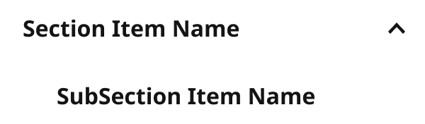
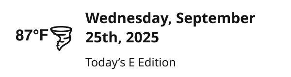

# SectionMenuItem

> One row of the section menu drawer: kind = main, subItem, Weather, CTAButton, CTAMessage; withSubItems adds a chevron and View sets its open state; leftIcon adds an icon.

## Figma

- File: **WordPress Elements** (`b1iZxkFwtAYq9rElmnCAzd`), page **Menus and Parts**
- Component set: [`SectionMenuItem` · 456:5781](https://www.figma.com/design/b1iZxkFwtAYq9rElmnCAzd/?node-id=456-5781) · key `4739909bf219a46a34480ef19995cbe58b3f99d5`

## Properties

| Property | Default | Options |
|---|---|---|
| View | default | open, default, closed |
| kind | CTAButton | Weather, main, CTAButton, subItem, CTAMessage |
| leftIcon | no | no, yes |
| withSubItems | no | no, yes |

## Variants

| Variant | Size | Node | Instances | Preview |
|---|---|---|---|---|
| `open / main / no / yes` | 300×88 | [456:5821](https://www.figma.com/design/b1iZxkFwtAYq9rElmnCAzd/?node-id=456-5821) | 0 |  |
| `default / Weather / no / no` | 300×80 | [456:5787](https://www.figma.com/design/b1iZxkFwtAYq9rElmnCAzd/?node-id=456-5787) | 8 |  |
| `default / main / no / no` | 300×40 | [456:5804](https://www.figma.com/design/b1iZxkFwtAYq9rElmnCAzd/?node-id=456-5804) | 12 |  |
| `default / main / yes / no` | 300×40 | [456:5794](https://www.figma.com/design/b1iZxkFwtAYq9rElmnCAzd/?node-id=456-5794) | 12 |  |
| `default / CTAButton / no / no` | 300×72 | [456:5782](https://www.figma.com/design/b1iZxkFwtAYq9rElmnCAzd/?node-id=456-5782) | 6 |  |
| `default / subItem / no / no` | 300×40 | [456:5816](https://www.figma.com/design/b1iZxkFwtAYq9rElmnCAzd/?node-id=456-5816) | 1 |  |
| `default / CTAMessage / no / no` | 300×156 | [456:5828](https://www.figma.com/design/b1iZxkFwtAYq9rElmnCAzd/?node-id=456-5828) | 12 |  |
| `closed / main / no / yes` | 300×40 | [456:5810](https://www.figma.com/design/b1iZxkFwtAYq9rElmnCAzd/?node-id=456-5810) | 108 |  |
| `closed / main / yes / yes` | 300×40 | [456:5798](https://www.figma.com/design/b1iZxkFwtAYq9rElmnCAzd/?node-id=456-5798) | 0 |  |

## Anatomy

Default variant `open / main / no / yes` (hidden layers marked):

- **leftIcon=no, withSubItems=yes, View=open, kind=main** `COMPONENT`: 300×88, vertical, gap 8, padding 0/0/0/0, fixed×hug
  - **Container** `FRAME`: 300×40, horizontal, gap 8, padding 0/0/0/16, fill×fixed
    - **Icons** `INSTANCE`: 16×16, horizontal, gap 8, padding 0/0/0/0, fixed×fixed, instance of Icons (Name=home3), **hidden**
    - **Item Name** `TEXT`: 236×22, fill×hug, "Section Item Name", Noto Sans Bold 16px
    - **Submenu** `FRAME`: 40×40, vertical, gap 8, padding 10/2/10/2, fixed×fixed
      - **Icons** `INSTANCE`: 16×16, vertical, gap 8, padding 3/2/3/2, fixed×fixed, instance of Icons (Name=arrow-upSmall)
  - **SectionMenuItem** `INSTANCE`: 300×40, horizontal, gap 8, padding 0/0/0/16, fixed×fixed, instance of SectionMenuItem (leftIcon=no, withSubItems=no, View=default, kind=subItem)

## Component tokens

From `section-menu-item.tokens.json`. References point at system tokens (`tokens/core/`, `tokens/themes/`); the CSS variable is `--mng-` + the token path. A literal value means the Figma layer isn't bound to a token.

| Token | Value |
|---|---|
| `section-menu-item.base.container.gap` | `{spacing.100}` |
| `section-menu-item.base.container.height` | 40px |
| `section-menu-item.base.container.padding-left` | `{spacing.200}` |
| `section-menu-item.base.container.padding-right` | `{spacing.200}` |
| `section-menu-item.base.container.button-primary.height` | 40px |
| `section-menu-item.base.container.button-primary.width` | 268px |
| `section-menu-item.base.root.background` | `{color.gray.max}` |
| `section-menu-item.base.root.gap` | `{spacing.100}` |
| `section-menu-item.base.root.width` | 300px |
| `section-menu-item.kind-ctabutton.container.padding-bottom` | `{spacing.200}` |
| `section-menu-item.kind-ctabutton.container.padding-top` | `{spacing.200}` |
| `section-menu-item.kind-ctamessage.container.padding-bottom` | `{spacing.300}` |
| `section-menu-item.kind-ctamessage.container.padding-top` | `{spacing.300}` |
| `section-menu-item.kind-ctamessage.container.cta-text.color` | `{color.gray.min}` |
| `section-menu-item.kind-ctamessage.container.cta-text.font-family` | `{font.family.noto-sans}` |
| `section-menu-item.kind-ctamessage.container.cta-text.font-size` | `{font.size.16}` |
| `section-menu-item.kind-ctamessage.container.cta-text.font-weight` | `{font.weight.bold}` |
| `section-menu-item.kind-ctamessage.divider.border-color` | `{color.gray.500}` |
| `section-menu-item.kind-ctamessage.divider.border-style` | solid |
| `section-menu-item.kind-ctamessage.divider.border-width` | 1px |
| `section-menu-item.kind-ctamessage.divider.height` | 0px |
| `section-menu-item.kind-ctamessage.root.padding-top` | `{spacing.200}` |
| `section-menu-item.lefticon-yes.container.icons.height` | 16px |
| `section-menu-item.lefticon-yes.container.icons.icon-color` | `{color.gray.min}` |
| `section-menu-item.lefticon-yes.container.icons.width` | 16px |
| `section-menu-item.kind-main.container.item-name.color` | `{color.gray.min}` |
| `section-menu-item.kind-main.container.item-name.font-family` | `{font.family.noto-sans}` |
| `section-menu-item.kind-main.container.item-name.font-size` | `{font.size.16}` |
| `section-menu-item.kind-main.container.item-name.font-weight` | `{font.weight.bold}` |
| `section-menu-item.kind-main.root.height` | 40px |
| `section-menu-item.withsubitems-yes.container.submenu.height` | 40px |
| `section-menu-item.withsubitems-yes.container.submenu.padding-bottom` | 10px |
| `section-menu-item.withsubitems-yes.container.submenu.padding-left` | 2px |
| `section-menu-item.withsubitems-yes.container.submenu.padding-right` | 2px |
| `section-menu-item.withsubitems-yes.container.submenu.padding-top` | 10px |
| `section-menu-item.withsubitems-yes.container.submenu.width` | 40px |
| `section-menu-item.withsubitems-yes.container.submenu.icons.height` | 16px |
| `section-menu-item.withsubitems-yes.container.submenu.icons.icon-color` | `{color.gray.min}` |
| `section-menu-item.withsubitems-yes.container.submenu.icons.width` | 16px |
| `section-menu-item.kind-subitem.icons.height` | 16px |
| `section-menu-item.kind-subitem.icons.icon-color` | `{color.gray.min}` |
| `section-menu-item.kind-subitem.icons.width` | 16px |
| `section-menu-item.kind-subitem.root.height` | 40px |
| `section-menu-item.kind-subitem.root.padding-left` | `{spacing.200}` |
| `section-menu-item.kind-subitem.subitem-name.color` | `{color.gray.min}` |
| `section-menu-item.kind-subitem.subitem-name.font-family` | `{font.family.noto-sans}` |
| `section-menu-item.kind-subitem.subitem-name.font-size` | `{font.size.16}` |
| `section-menu-item.kind-subitem.subitem-name.font-weight` | `{font.weight.bold}` |
| `section-menu-item.kind-subitem.submenu.height` | 40px |
| `section-menu-item.kind-subitem.submenu.padding-bottom` | 10px |
| `section-menu-item.kind-subitem.submenu.padding-left` | 2px |
| `section-menu-item.kind-subitem.submenu.padding-right` | 2px |
| `section-menu-item.kind-subitem.submenu.padding-top` | 10px |
| `section-menu-item.kind-subitem.submenu.width` | 40px |
| `section-menu-item.kind-weather.root.height` | 80px |
| `section-menu-item.kind-weather.weather-bug.height` | 80px |
| `section-menu-item.kind-weather.weather-bug.icon-color` | `{color.gray.min}` |
| `section-menu-item.kind-weather.weather-bug.width` | 300px |
| `section-menu-item.view-open.sectionmenuitem.height` | 40px |
| `section-menu-item.view-open.sectionmenuitem.width` | 300px |

## Behavior and breakpoints

No Breakpoint property: one size at every width.

- Used inside SectionMenu only.
- Rows with sub-items are disclosure buttons (aria-expanded).

## Accessibility

- No InFocus state in Figma.
- Text color on its background must meet WCAG AA contrast (4.5:1 for text under 18px) in every theme; theme colors change per site.
- Icons inside a labelled control are decorative (`aria-hidden`); an icon-only control needs an accessible name (`aria-label`).

## Where it is used

Scope: instances in the Figma file **WordPress Elements** only (other files that use the library are not counted). Total: **159**.

Inside components: SectionMenu ×158, SectionMenuItem ×1.

**Built from:** Icons ×6, Button Primary ×2, SectionMenuItem ×1, Weather Bug ×1
Icon variants: `home3` ×3, `arrow-downSMALL` ×2, `arrow-upSmall` ×1.

## Production

Production section menu items.

## Known issues

1. No documentation container yet. Raw values with no token: 2px and 10px spacing.
2. **Values not bound to a token** (literal in the component tokens): `withsubitems-yes` container.submenu padding-bottom = 10px; `withsubitems-yes` container.submenu padding-left = 2px; `withsubitems-yes` container.submenu padding-right = 2px; `withsubitems-yes` container.submenu padding-top = 10px; `kind-subitem` submenu padding-bottom = 10px; `kind-subitem` submenu padding-left = 2px; `kind-subitem` submenu padding-right = 2px; `kind-subitem` submenu padding-top = 10px.

## Files

- `section-menu-item.tokens.json`: component tokens (DTCG 2025.10).
- `section-menu-item.html`: HTML/CSS skeleton of every variant, using the `dist/` CSS variables (open it in a browser).
- `previews/`: PNG of every variant @2x.

*Generated 2026-10-30 by `scripts/component-export/export.py` (EXPORT-STANDARD.md section 7). Edit the text in `scripts/component-export/registry.json`, not here.*
