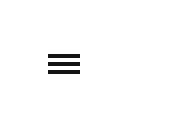
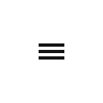
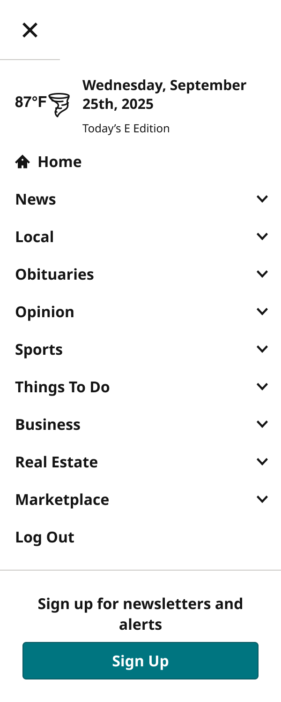
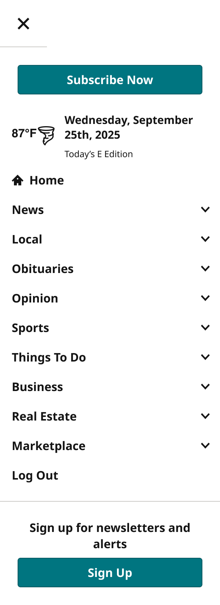
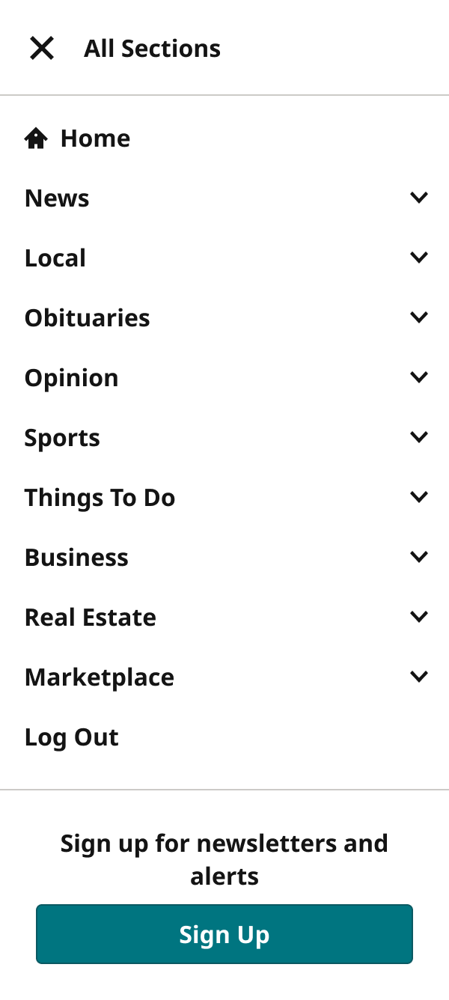
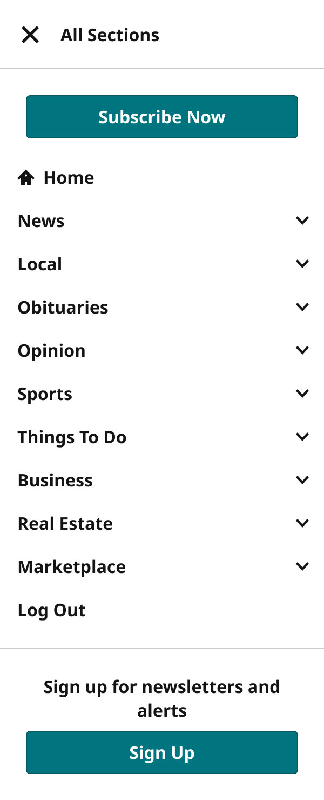

# SectionMenu

> The hamburger / All Sections toggle (View=Closed) and the section menu drawer it opens (View=Open). Device = the 5 Masthead widths; UserType (all, subscriber, nonSub) changes the drawer's call to action.

## Figma

- File: **WordPress Elements** (`b1iZxkFwtAYq9rElmnCAzd`), page **Menus and Parts**
- Component set: [`SectionMenu` · 456:5837](https://www.figma.com/design/b1iZxkFwtAYq9rElmnCAzd/?node-id=456-5837) · key `c8e491010e441c0201b947dfc91b0af3a1d466f9`
- Documentation frame: [SectionMenu Documented](https://www.figma.com/design/b1iZxkFwtAYq9rElmnCAzd/?node-id=3349-66621) · overview: [previews/section-menu--documentation.png](previews/section-menu--documentation.png)

## Properties

| Property | Default | Options |
|---|---|---|
| Device | XS-Fold | XL-Desktop, MD-TabletV, SM-Mobile, XS-Fold, LG-TabletH |
| UserType | all | all, subscriber, nonSub |
| View | Closed | Closed, Open |

## Variants

| Variant | Size | Node | Instances | Preview |
|---|---|---|---|---|
| `XL-Desktop / all / Closed` | 300×64 | [456:5838](https://www.figma.com/design/b1iZxkFwtAYq9rElmnCAzd/?node-id=456-5838) | 86 |  |
| `XL-Desktop / subscriber / Open` | 300×668 | [456:5844](https://www.figma.com/design/b1iZxkFwtAYq9rElmnCAzd/?node-id=456-5844) | 0 |  |
| `XL-Desktop / nonSub / Open` | 300×740 | [456:5859](https://www.figma.com/design/b1iZxkFwtAYq9rElmnCAzd/?node-id=456-5859) | 0 |  |
| `MD-TabletV / all / Closed` | 88×64 | [456:5840](https://www.figma.com/design/b1iZxkFwtAYq9rElmnCAzd/?node-id=456-5840) | 41 |  |
| `MD-TabletV / subscriber / Open` | 300×748 | [3344:64973](https://www.figma.com/design/b1iZxkFwtAYq9rElmnCAzd/?node-id=3344-64973) | 0 |  |
| `MD-TabletV / nonSub / Open` | 300×820 | [3344:64989](https://www.figma.com/design/b1iZxkFwtAYq9rElmnCAzd/?node-id=3344-64989) | 0 |  |
| `SM-Mobile / all / Closed` | 64×64 | [456:5842](https://www.figma.com/design/b1iZxkFwtAYq9rElmnCAzd/?node-id=456-5842) | 110 |  |
| `SM-Mobile / subscriber / Open` | 300×748 | [456:5875](https://www.figma.com/design/b1iZxkFwtAYq9rElmnCAzd/?node-id=456-5875) | 0 |  |
| `SM-Mobile / nonSub / Open` | 300×820 | [456:5891](https://www.figma.com/design/b1iZxkFwtAYq9rElmnCAzd/?node-id=456-5891) | 0 |  |
| `XS-Fold / all / Closed` | 64×64 | [3344:64074](https://www.figma.com/design/b1iZxkFwtAYq9rElmnCAzd/?node-id=3344-64074) | 0 |  |
| `XS-Fold / subscriber / Open` | 300×748 | [3344:64078](https://www.figma.com/design/b1iZxkFwtAYq9rElmnCAzd/?node-id=3344-64078) | 0 |  |
| `XS-Fold / nonSub / Open` | 300×820 | [3344:64109](https://www.figma.com/design/b1iZxkFwtAYq9rElmnCAzd/?node-id=3344-64109) | 0 |  |
| `LG-TabletH / all / Closed` | 300×64 | [3344:64076](https://www.figma.com/design/b1iZxkFwtAYq9rElmnCAzd/?node-id=3344-64076) | 0 |  |
| `LG-TabletH / subscriber / Open` | 300×668 | [3344:64094](https://www.figma.com/design/b1iZxkFwtAYq9rElmnCAzd/?node-id=3344-64094) | 0 |  |
| `LG-TabletH / nonSub / Open` | 300×740 | [3344:64126](https://www.figma.com/design/b1iZxkFwtAYq9rElmnCAzd/?node-id=3344-64126) | 0 |  |

## Anatomy

Default variant `XL-Desktop / all / Closed` (hidden layers marked):

- **View=Closed, Device=XL-Desktop, UserType=all** `COMPONENT`: 300×64, vertical, gap 0, padding 0/0/0/0, hug×hug
  - **SectionMenuHeader** `INSTANCE`: 300×64, vertical, gap 0, padding 0/0/0/0, fixed×fixed, instance of SectionMenuHeader (View=Closed, Device=Desktop)

## Component tokens

From `section-menu.tokens.json`. References point at system tokens (`tokens/core/`, `tokens/themes/`); the CSS variable is `--mng-` + the token path. A literal value means the Figma layer isn't bound to a token.

| Token | Value |
|---|---|
| `section-menu.view-open.container.background` | `{color.gray.max}` |
| `section-menu.view-open.container.padding-top` | `{spacing.100}` |
| `section-menu.view-open.container.sectionmenuitem.height` | 156px |
| `section-menu.view-open.container.sectionmenuitem.icon-color` | `{color.gray.min}` |
| `section-menu.view-open.container.sectionmenuitem.width` | 300px |
| `section-menu.base.sectionmenuheader.height` | 64px |
| `section-menu.device-xl-desktop.usertype-all.sectionmenuheader.width` | 300px |
| `section-menu.device-xl-desktop.usertype-subscriber.sectionmenuheader.width` | 300px |
| `section-menu.device-xl-desktop.usertype-nonsub.sectionmenuheader.width` | 300px |
| `section-menu.device-md-tabletv.usertype-all.sectionmenuheader.width` | 88px |
| `section-menu.device-md-tabletv.usertype-subscriber.sectionmenuheader.width` | 64px |
| `section-menu.device-md-tabletv.usertype-nonsub.sectionmenuheader.width` | 64px |
| `section-menu.device-sm-mobile.usertype-all.sectionmenuheader.width` | 64px |
| `section-menu.device-sm-mobile.usertype-subscriber.sectionmenuheader.width` | 64px |
| `section-menu.device-sm-mobile.usertype-nonsub.sectionmenuheader.width` | 64px |
| `section-menu.device-xs-fold.usertype-all.sectionmenuheader.width` | 64px |
| `section-menu.device-xs-fold.usertype-subscriber.sectionmenuheader.width` | 64px |
| `section-menu.device-xs-fold.usertype-nonsub.sectionmenuheader.width` | 64px |
| `section-menu.device-lg-tableth.usertype-all.sectionmenuheader.width` | 300px |
| `section-menu.device-lg-tableth.usertype-subscriber.sectionmenuheader.width` | 300px |
| `section-menu.device-lg-tableth.usertype-nonsub.sectionmenuheader.width` | 300px |

## Behavior and breakpoints

| Device | Viewport | Built at |
|---|---|---|
| XS-Fold | below 640px | 340px |
| SM-Mobile | below 640px | 360px |
| MD-TabletV | 640–799px | 768px |
| LG-TabletH | 800–1039px | 1024px |
| XL-Desktop | 1040px and up | 1040px (Masthead) / 1280px |

- **Closed:** the hamburger icon (and "All Sections" at 1040px and up) in the masthead's 64px row.
- **Open:** a drawer under the masthead with SectionMenuHeader, the Weather Bug (SectionMenu location) and SectionMenuItem rows; non-subscribers get a Subscribe call to action.
- **Accessibility:** the toggle is a button with aria-expanded and aria-controls pointing at the drawer; Esc closes it and returns focus to the toggle.

## Accessibility

- No InFocus state in Figma.
- Text color on its background must meet WCAG AA contrast (4.5:1 for text under 18px) in every theme; theme colors change per site.
- Icons inside a labelled control are decorative (`aria-hidden`); an icon-only control needs an accessible name (`aria-label`).

## Where it is used

Scope: instances in the Figma file **WordPress Elements** only (other files that use the library are not counted). Total: **237**.

Inside components: Masthead ×101, ObitMastHead ×41, AccountMenu ×5.
Placed on pages: Menus and Parts ×78, Homepage ×6, Article Page ×4, Section Front ×2.

**Built from:** SectionMenuItem ×131, SectionMenuHeader ×15

## Production

Production section menu (`.sections-menu`), checked with the Masthead audit 2026-09-15.

## Known issues

1. Variant descriptions are empty; the set description documents the grid.

## Files

- `section-menu.tokens.json`: component tokens (DTCG 2025.10).
- `section-menu.html`: HTML/CSS skeleton of every variant, using the `dist/` CSS variables (open it in a browser).
- `previews/`: PNG of every variant @2x and the documentation frame.

*Generated 2026-10-30 by `scripts/component-export/export.py` (EXPORT-STANDARD.md section 7). Edit the text in `scripts/component-export/registry.json`, not here.*
