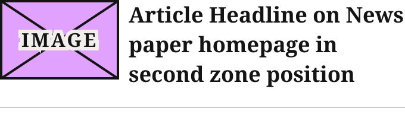
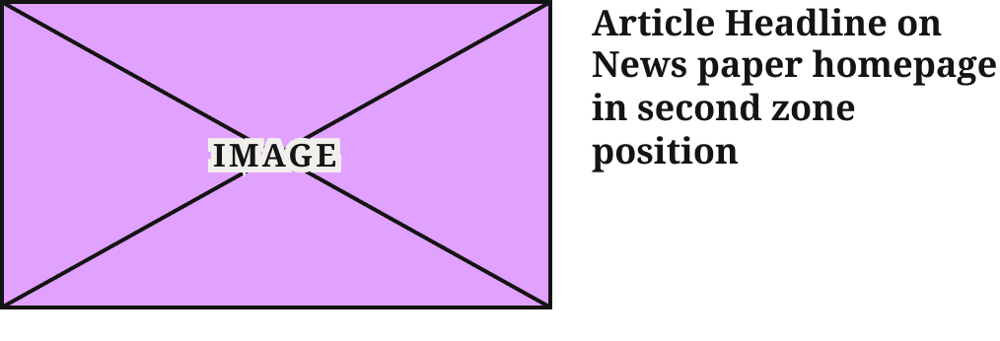

# TopZone Article Card

> The four homepage Zone 1 story cards beside the Zone 1 lead (Editor's Picks): stacked cards (image over headline) on Desktop and at 1024, thumbnail rows (image beside headline) on Mobile and at 1100.

## Figma

- File: **WordPress Elements** (`b1iZxkFwtAYq9rElmnCAzd`), page **Homepage**
- Component set: [`TopZone Article Card` · 3336:46079](https://www.figma.com/design/b1iZxkFwtAYq9rElmnCAzd/?node-id=3336-46079) · key `4daecb8ad8cafb30916853070665c768d1fc18e8`
- Documentation frame: [TopZone Article Card Container](https://www.figma.com/design/b1iZxkFwtAYq9rElmnCAzd/?node-id=3484-67610) · overview: [previews/topzone-article-card--documentation.png](previews/topzone-article-card--documentation.png)

## Properties

| Property | Default | Options |
|---|---|---|
| Device | Mobile | Desktop, Mobile, 1024, 1100 |

## Variants

| Variant | Size | Node | Instances | Preview |
|---|---|---|---|---|
| `Desktop` | 336×261 | [3336:46077](https://www.figma.com/design/b1iZxkFwtAYq9rElmnCAzd/?node-id=3336-46077) | 8 |  |
| `Mobile` | 340×107 | [3336:46078](https://www.figma.com/design/b1iZxkFwtAYq9rElmnCAzd/?node-id=3336-46078) | 12 |  |
| `1024` | 197×191.81 | [3553:32800](https://www.figma.com/design/b1iZxkFwtAYq9rElmnCAzd/?node-id=3553-32800) | 8 |  |
| `1100` | 507×173 | [3553:32811](https://www.figma.com/design/b1iZxkFwtAYq9rElmnCAzd/?node-id=3553-32811) | 8 |  |

## Anatomy

Default variant `Desktop` (hidden layers marked):

- **Device=Desktop** `COMPONENT`: 336×261, vertical, gap 8, padding 0/0/16/0, fixed×hug
  - **Article Image Placeholder** `INSTANCE`: 336×189, vertical, gap 8, padding 0/0/0/0, fill×fixed, instance of Article Image Placeholder ()
  - **Article Status Badge** `INSTANCE`: 153×27, horizontal, gap 8, padding 2/5/2/5, hug×hug, instance of Article Status Badge (Type=Sponsored), **hidden**
  - **Headline** `FRAME`: 336×48, vertical, gap 15, padding 0/0/0/0, fill×hug
    - **Article Headline on News paper homepage in second zone position** `TEXT`: 336×48, fill×hug, "Article Headline on News paper homepage ", Noto Serif Bold 20px

## Component tokens

From `topzone-article-card.tokens.json`. References point at system tokens (`tokens/core/`, `tokens/themes/`); the CSS variable is `--mng-` + the token path. A literal value means the Figma layer isn't bound to a token.

| Token | Value |
|---|---|
| `topzone-article-card.device-desktop.article-image-placeholder.height` | 189px |
| `topzone-article-card.device-desktop.article-image-placeholder.width` | 336px |
| `topzone-article-card.device-desktop.headline.article-headline-on-news-paper-homepage-in-second-zone-position.font-family` | `{font.theme.heading-family}` |
| `topzone-article-card.device-desktop.headline.article-headline-on-news-paper-homepage-in-second-zone-position.font-size` | `{font.size.20}` |
| `topzone-article-card.device-desktop.headline.article-headline-on-news-paper-homepage-in-second-zone-position.font-weight` | `{font.weight.bold}` |
| `topzone-article-card.device-desktop.headline.article-headline-on-news-paper-homepage-in-second-zone-position.letter-spacing` | -0.4px |
| `topzone-article-card.device-desktop.headline.article-headline-on-news-paper-homepage-in-second-zone-position.line-height` | 23.6px |
| `topzone-article-card.device-desktop.root.gap` | `{spacing.100}` |
| `topzone-article-card.device-desktop.root.width` | 336px |
| `topzone-article-card.device-1024.article-image-placeholder.height` | 110.81px |
| `topzone-article-card.device-1024.article-image-placeholder.width` | 197px |
| `topzone-article-card.device-1024.headline.article-headline-on-news-paper-homepage-in-second-zone-position.font-family` | `{font.theme.heading-family}` |
| `topzone-article-card.device-1024.headline.article-headline-on-news-paper-homepage-in-second-zone-position.font-size` | `{font.size.16}` |
| `topzone-article-card.device-1024.headline.article-headline-on-news-paper-homepage-in-second-zone-position.font-weight` | `{font.weight.bold}` |
| `topzone-article-card.device-1024.headline.article-headline-on-news-paper-homepage-in-second-zone-position.line-height` | 18.88px |
| `topzone-article-card.device-1024.root.gap` | `{spacing.100}` |
| `topzone-article-card.device-1024.root.width` | 197px |
| `topzone-article-card.base.article-image-placeholder.icon-color` | `{color.gray.min}` |
| `topzone-article-card.base.content.article-image-placeholder.icon-color` | `{color.gray.min}` |
| `topzone-article-card.base.content.headline.article-headline-on-news-paper-homepage-in-second-zone-position.color` | `{color.gray.min}` |
| `topzone-article-card.base.headline.article-headline-on-news-paper-homepage-in-second-zone-position.color` | `{color.gray.min}` |
| `topzone-article-card.base.root.background` | `{color.gray.max}` |
| `topzone-article-card.base.root.padding-bottom` | `{spacing.200}` |
| `topzone-article-card.device-mobile.bottom-border-line.border-color` | `{color.gray.500}` |
| `topzone-article-card.device-mobile.bottom-border-line.border-style` | solid |
| `topzone-article-card.device-mobile.bottom-border-line.border-width` | 1px |
| `topzone-article-card.device-mobile.bottom-border-line.height` | 0px |
| `topzone-article-card.device-mobile.content.gap` | `{spacing.100}` |
| `topzone-article-card.device-mobile.content.article-image-placeholder.height` | 67px |
| `topzone-article-card.device-mobile.content.article-image-placeholder.width` | 100px |
| `topzone-article-card.device-mobile.content.headline.width` | 232px |
| `topzone-article-card.device-mobile.content.headline.article-headline-on-news-paper-homepage-in-second-zone-position.font-family` | `{font.theme.heading-family}` |
| `topzone-article-card.device-mobile.content.headline.article-headline-on-news-paper-homepage-in-second-zone-position.font-size` | `{font.size.18}` |
| `topzone-article-card.device-mobile.content.headline.article-headline-on-news-paper-homepage-in-second-zone-position.font-weight` | `{font.weight.bold}` |
| `topzone-article-card.device-mobile.root.gap` | `{spacing.200}` |
| `topzone-article-card.device-mobile.root.width` | 340px |
| `topzone-article-card.device-1100.content.gap` | `{spacing.250}` |
| `topzone-article-card.device-1100.content.article-image-placeholder.height` | 157px |
| `topzone-article-card.device-1100.content.article-image-placeholder.width` | 280px |
| `topzone-article-card.device-1100.content.headline.article-headline-on-news-paper-homepage-in-second-zone-position.font-family` | `{font.theme.heading-family}` |
| `topzone-article-card.device-1100.content.headline.article-headline-on-news-paper-homepage-in-second-zone-position.font-size` | `{font.size.18}` |
| `topzone-article-card.device-1100.content.headline.article-headline-on-news-paper-homepage-in-second-zone-position.font-weight` | `{font.weight.bold}` |
| `topzone-article-card.device-1100.content.headline.article-headline-on-news-paper-homepage-in-second-zone-position.line-height` | 21.6px |
| `topzone-article-card.device-1100.root.width` | 507px |

## Behavior and breakpoints

| Device | Card width | Layout |
|---|---|---|
| Desktop | 336px | Stacked: image over headline |
| 1024 | 197px | Stacked, compact headline |
| 1100 | 507px | Thumbnail row: 280px image beside the headline |
| Mobile | 340px | Thumbnail row: 100px image beside the headline, bottom rule |

- **Desktop** (336 wide): Article Image 336×189; 8px (`spacing/100`) to the headline; headline `Editorial/Titles/CardTertiary` (20/23.6, −0.4px); 16px (`spacing/200`) bottom padding.
- **1024** (197 wide): Article Image 197×111; 8px; headline `Editorial/Titles/CardTertiaryCompact` (16/18.88); 16px bottom padding.
- **1100** (507 wide, thumbnail row): Article Image 280×157; 20px (`spacing/250`) to the headline column; headline `Editorial/Titles/CardTertiaryRow` (18/21.6); 16px bottom padding; the bottom rule is hidden.
- **Mobile** (340 wide, thumbnail row): Article Image 100×67; 8px to the headline column; headline Noto Serif Bold 18 (`font/size/18`), auto line height; 16px to the 1px `color/gray/500` bottom rule.
- **Headline font follows the theme** (`font/theme/heading-family`; Mobile bound to it 2026-10-30, like the other headlines). `color/gray/min` on `color/gray/max`, 18.4:1.
- **Headline group gap 15px is raw on purpose** (Karl, 2026-10-30): no token is made for it. It only shows when the Article Status Badge is on.

## Accessibility

- No InFocus state in Figma.
- Text color on its background must meet WCAG AA contrast (4.5:1 for text under 18px) in every theme; theme colors change per site.
- Icons inside a labelled control are decorative (`aria-hidden`); an icon-only control needs an accessible name (`aria-label`).

## Where it is used

Scope: instances in the Figma file **WordPress Elements** only (other files that use the library are not counted). Total: **36**.

Inside components: TOP ZONE Block ×16.
Placed on pages: Homepage ×20.

**Built from:** Article Image Placeholder ×4

## Production

Production homepage Zone 1 (`.feature-primary`), the four secondary stories beside the lead. Not audited for this export.

## Known issues

1. The Device values (Desktop, 1024, 1100, Mobile) aren't the official breakpoint names, and the viewport each one applies at isn't recorded in Figma.
2. Article Status Badge: hidden in every variant and no component property turns it on; Desktop and 1024 hold it outside the headline group (Type = Sponsored), Mobile and 1100 inside it (Type = None).
3. The headline-group gap is 15px with no token (kept raw by decision, Karl 2026-10-30).

## Files

- `topzone-article-card.tokens.json`: component tokens (DTCG 2025.10).
- `topzone-article-card.html`: HTML/CSS skeleton of every variant, using the `dist/` CSS variables (open it in a browser).
- `previews/`: PNG of every variant @2x and the documentation frame.

*Generated 2026-10-30 by `scripts/component-export/export.py` (EXPORT-STANDARD.md section 7). Edit the text in `scripts/component-export/registry.json`, not here.*
