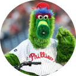

# UserImage

> The reader's avatar art. Size = small / medium / large; Graphic = unknown, monogram, monogramPP, social, socialPhillip.

## Figma

- File: **WordPress Elements** (`b1iZxkFwtAYq9rElmnCAzd`), page **Menus and Parts**
- Component set: [`UserImage` · 456:5708](https://www.figma.com/design/b1iZxkFwtAYq9rElmnCAzd/?node-id=456-5708) · key `72a3f7d5c88a366288aae1b0835999779027f8ea`

## Properties

| Property | Default | Options |
|---|---|---|
| Graphic | unknown | unknown, monogram, monogramPP, social, socialPhillip |
| Size | small | small, large, medium |

## Variants

| Variant | Size | Node | Instances | Preview |
|---|---|---|---|---|
| `unknown / small` | 30×30 | [456:5715](https://www.figma.com/design/b1iZxkFwtAYq9rElmnCAzd/?node-id=456-5715) | 62 |  |
| `unknown / large` | 64×64 | [712:1495](https://www.figma.com/design/b1iZxkFwtAYq9rElmnCAzd/?node-id=712-1495) | 0 |  |
| `unknown / medium` | 40×40 | [712:6283](https://www.figma.com/design/b1iZxkFwtAYq9rElmnCAzd/?node-id=712-6283) | 0 |  |
| `monogram / small` | 30×30 | [456:5718](https://www.figma.com/design/b1iZxkFwtAYq9rElmnCAzd/?node-id=456-5718) | 0 |  |
| `monogram / large` | 64×64 | [456:5720](https://www.figma.com/design/b1iZxkFwtAYq9rElmnCAzd/?node-id=456-5720) | 0 |  |
| `monogram / medium` | 40×40 | [712:6286](https://www.figma.com/design/b1iZxkFwtAYq9rElmnCAzd/?node-id=712-6286) | 0 |  |
| `monogramPP / large` | 64×64 | [456:5722](https://www.figma.com/design/b1iZxkFwtAYq9rElmnCAzd/?node-id=456-5722) | 0 |  |
| `social / small` | 30×30 | [456:5709](https://www.figma.com/design/b1iZxkFwtAYq9rElmnCAzd/?node-id=456-5709) | 192 |  |
| `social / large` | 64×64 | [456:5711](https://www.figma.com/design/b1iZxkFwtAYq9rElmnCAzd/?node-id=456-5711) | 2 |  |
| `social / medium` | 40×40 | [712:6288](https://www.figma.com/design/b1iZxkFwtAYq9rElmnCAzd/?node-id=712-6288) | 3 |  |
| `socialPhillip / large` | 64×64 | [456:5713](https://www.figma.com/design/b1iZxkFwtAYq9rElmnCAzd/?node-id=456-5713) | 0 |  |
| `socialPhillip / medium` | 40×40 | [712:6290](https://www.figma.com/design/b1iZxkFwtAYq9rElmnCAzd/?node-id=712-6290) | 0 |  |

## Anatomy

Default variant `unknown / small` (hidden layers marked):

- **Size=small, Graphic=unknown** `COMPONENT`: 30×30, horizontal, gap 0, padding 0/0/0/0, fixed×fixed
  - **Icons** `INSTANCE`: 16×16, horizontal, gap 8, padding 0/0/0/0, fixed×fixed, instance of Icons (Name=user)

## Component tokens

From `user-image.tokens.json`. References point at system tokens (`tokens/core/`, `tokens/themes/`); the CSS variable is `--mng-` + the token path. A literal value means the Figma layer isn't bound to a token.

| Token | Value |
|---|---|
| `user-image.size-small.gritty-1.height` | 30px |
| `user-image.size-small.icons.height` | 16px |
| `user-image.size-small.icons.width` | 16px |
| `user-image.size-small.initials.font-size` | `{font.size.12}` |
| `user-image.size-small.root.height` | 30px |
| `user-image.size-small.root.width` | 30px |
| `user-image.size-medium.gritty-1.height` | 40px |
| `user-image.size-medium.icons.height` | 24px |
| `user-image.size-medium.icons.width` | 24px |
| `user-image.size-medium.initials.font-size` | 22px |
| `user-image.size-medium.root.height` | 40px |
| `user-image.size-medium.root.width` | 40px |
| `user-image.size-large.icons.height` | 24px |
| `user-image.size-large.icons.width` | 24px |
| `user-image.size-large.initials.font-size` | 27px |
| `user-image.size-large.root.height` | 64px |
| `user-image.size-large.root.width` | 64px |
| `user-image.graphic-unknown.icons.icon-color` | `{color.gray.min}` |
| `user-image.graphic-unknown.root.background` | `{color.gray.max}` |
| `user-image.base.initials.color` | `{color.gray.min}` |
| `user-image.base.initials.font-family` | `{font.family.noto-sans}` |
| `user-image.base.initials.font-weight` | `{font.weight.regular}` |
| `user-image.base.root.border-radius` | 80px |
| `user-image.graphic-monogram.root.background` | #ff702c |
| `user-image.graphic-monogrampp.root.background` | `{color.feedback.low-success}` |

## Behavior and breakpoints

No Breakpoint property: one size at every width.

- Used inside UserPic.
- Monogram text sizes (22, 27px) are avatar art, not type tokens (Karl, 2026-10-08).

## Accessibility

- No InFocus state in Figma.
- Text color on its background must meet WCAG AA contrast (4.5:1 for text under 18px) in every theme; theme colors change per site.
- Icons inside a labelled control are decorative (`aria-hidden`); an icon-only control needs an accessible name (`aria-label`).

## Where it is used

Scope: instances in the Figma file **WordPress Elements** only (other files that use the library are not counted). Total: **259**.

Inside components: UserPic ×6.
253 instances are nested inside other instances.

**Built from:** Icons ×3
Icon variants: `user` ×3.

## Production

Production avatar service image (120×120 shown at 30×30).

## Known issues

1. Raw values: 80px circle radius, #FF702C monogram background.
2. **Values not bound to a token** (literal in the component tokens): `size-large` initials font-size = 27px; `size-medium` initials font-size = 22px; `graphic-monogram` root background = #ff702c; `base` root border-radius = 80px.

## Files

- `user-image.tokens.json`: component tokens (DTCG 2025.10).
- `user-image.html`: HTML/CSS skeleton of every variant, using the `dist/` CSS variables (open it in a browser).
- `previews/`: PNG of every variant @2x.

*Generated 2026-10-30 by `scripts/component-export/export.py` (EXPORT-STANDARD.md section 7). Edit the text in `scripts/component-export/registry.json`, not here.*
