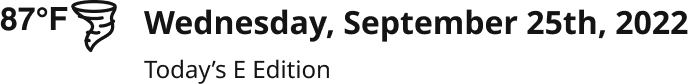

# Weather Bug

> Current temperature and weather icon with the date and the Today's E Edition link. Location = Masthead or SectionMenu.

## Figma

- File: **WordPress Elements** (`b1iZxkFwtAYq9rElmnCAzd`), page **Menus and Parts**
- Component set: [`Weather Bug` · 654:10020](https://www.figma.com/design/b1iZxkFwtAYq9rElmnCAzd/?node-id=654-10020) · key `edece4e844bea8a8dd7526e6e39df1d00a56ad72`

## Properties

| Property | Default | Options |
|---|---|---|
| Location | SectionMenu | SectionMenu, Masthead |

## Variants

| Variant | Size | Node | Instances | Preview |
|---|---|---|---|---|
| `SectionMenu` | 300×80 | [654:10019](https://www.figma.com/design/b1iZxkFwtAYq9rElmnCAzd/?node-id=654-10019) | 7 |  |
| `Masthead` | 345×42 | [653:5076](https://www.figma.com/design/b1iZxkFwtAYq9rElmnCAzd/?node-id=653-5076) | 32 |  |

## Anatomy

Default variant `SectionMenu` (hidden layers marked):

- **Location=SectionMenu** `COMPONENT`: 300×80, horizontal, gap 12, padding 8/16/8/16, fixed×fixed
  - **Weather** `FRAME`: 60×26, horizontal, gap 0, padding 0/0/0/0, hug×hug
    - **87°F** `TEXT`: 34×18, hug×hug, "87°F", Helvetica Bold 16px
    - **tornado** `INSTANCE`: 26×26, fixed×fixed, instance of tornado ()
  - **Date and E-Edition** `FRAME`: 196×64, vertical, gap 8, padding 0/0/0/0, fill×hug
    - **Wednesday, September 25th, 2025** `TEXT`: 196×40, fill×hug, "Wednesday, September 25th, 2025", Noto Sans Bold 15px
    - **Today’s E Edition** `TEXT`: 94×16, hug×hug, "Today’s E Edition", Noto Sans Regular 12px

## Component tokens

From `weather-bug.tokens.json`. References point at system tokens (`tokens/core/`, `tokens/themes/`); the CSS variable is `--mng-` + the token path. A literal value means the Figma layer isn't bound to a token.

| Token | Value |
|---|---|
| `weather-bug.location-sectionmenu.date-and-e-edition.gap` | `{spacing.100}` |
| `weather-bug.location-sectionmenu.date-and-e-edition.wednesday-september-25th-2025.color` | `{color.gray.min}` |
| `weather-bug.location-sectionmenu.date-and-e-edition.wednesday-september-25th-2025.font-family` | `{font.family.noto-sans}` |
| `weather-bug.location-sectionmenu.date-and-e-edition.wednesday-september-25th-2025.font-size` | `{font.size.15}` |
| `weather-bug.location-sectionmenu.date-and-e-edition.wednesday-september-25th-2025.font-weight` | `{font.weight.bold}` |
| `weather-bug.location-sectionmenu.root.height` | 80px |
| `weather-bug.location-sectionmenu.root.padding-bottom` | `{spacing.100}` |
| `weather-bug.location-sectionmenu.root.padding-left` | `{spacing.200}` |
| `weather-bug.location-sectionmenu.root.padding-right` | `{spacing.200}` |
| `weather-bug.location-sectionmenu.root.padding-top` | `{spacing.100}` |
| `weather-bug.location-sectionmenu.root.width` | 300px |
| `weather-bug.location-masthead.date-and-e-edition.gap` | `{spacing.050}` |
| `weather-bug.location-masthead.date-and-e-edition.wednesday-september-25th-2022.color` | `{color.gray.min}` |
| `weather-bug.location-masthead.date-and-e-edition.wednesday-september-25th-2022.font-family` | `{font.family.noto-sans}` |
| `weather-bug.location-masthead.date-and-e-edition.wednesday-september-25th-2022.font-size` | `{font.size.16}` |
| `weather-bug.location-masthead.date-and-e-edition.wednesday-september-25th-2022.font-weight` | `{font.weight.bold}` |
| `weather-bug.base.date-and-e-edition.today-s-e-edition.color` | `{color.gray.min}` |
| `weather-bug.base.date-and-e-edition.today-s-e-edition.font-family` | `{font.family.noto-sans}` |
| `weather-bug.base.date-and-e-edition.today-s-e-edition.font-size` | `{font.size.12}` |
| `weather-bug.base.date-and-e-edition.today-s-e-edition.font-weight` | `{font.weight.regular}` |
| `weather-bug.base.root.background` | `{color.gray.max}` |
| `weather-bug.base.root.gap` | `{spacing.150}` |
| `weather-bug.base.weather.87-f.color` | `{color.gray.min}` |
| `weather-bug.base.weather.87-f.font-family` | Helvetica |
| `weather-bug.base.weather.87-f.font-size` | `{font.size.16}` |
| `weather-bug.base.weather.87-f.font-weight` | 700 |
| `weather-bug.base.weather.tornado.height` | 26px |
| `weather-bug.base.weather.tornado.icon-color` | `{color.gray.min}` |
| `weather-bug.base.weather.tornado.width` | 26px |

## Behavior and breakpoints

No Breakpoint property: one size at every width.

- Masthead: top of the page at 1040px and up, left of the logo.
- SectionMenu: inside the open drawer.
- **Temperature:** Helvetica Bold 16, on purpose: the weather is a third-party widget we can't control (Karl, 2026-10-30). The date and E Edition link are Noto Sans.

## Accessibility

- No InFocus state in Figma.
- Text color on its background must meet WCAG AA contrast (4.5:1 for text under 18px) in every theme; theme colors change per site.
- Icons inside a labelled control are decorative (`aria-hidden`); an icon-only control needs an accessible name (`aria-label`).

## Where it is used

Scope: instances in the Figma file **WordPress Elements** only (other files that use the library are not counted). Total: **39**.

Inside components: Masthead ×18, SectionMenuItem ×1.
Placed on pages: Menus and Parts ×14.
6 instances are nested inside other instances.

**Built from:** tornado ×2

## Production

Production masthead weather widget.

## Known issues

1. No documentation container yet.
2. **Values not bound to a token** (literal in the component tokens): `base` weather.87-f font-family = Helvetica; `base` weather.87-f font-weight = 700.
3. **Fonts outside Noto Sans / Noto Serif:** Helvetica.

## Files

- `weather-bug.tokens.json`: component tokens (DTCG 2025.10).
- `weather-bug.html`: HTML/CSS skeleton of every variant, using the `dist/` CSS variables (open it in a browser).
- `previews/`: PNG of every variant @2x.

*Generated 2026-10-30 by `scripts/component-export/export.py` (EXPORT-STANDARD.md section 7). Edit the text in `scripts/component-export/registry.json`, not here.*
