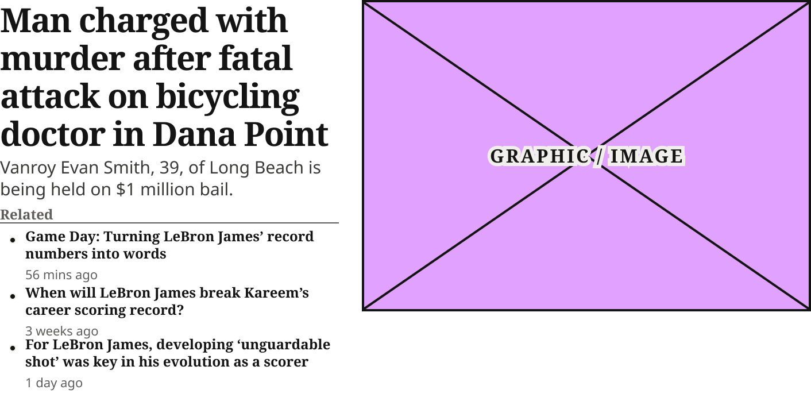
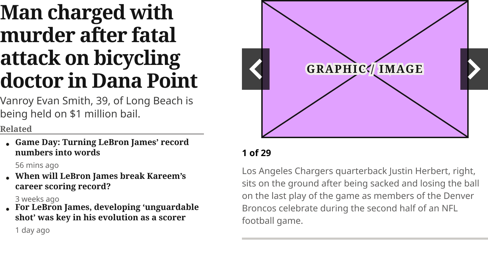
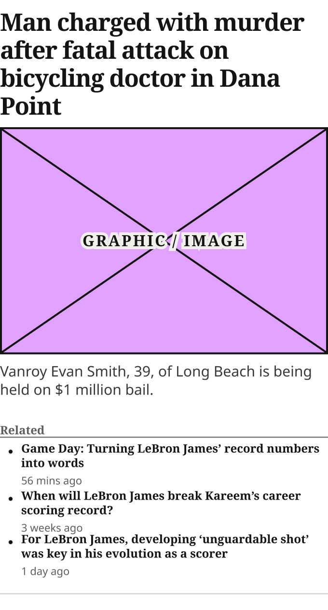
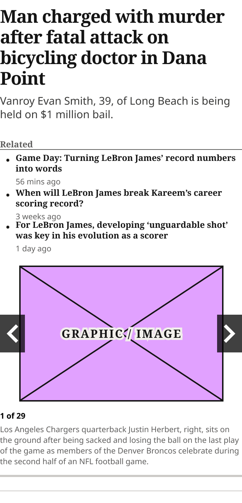
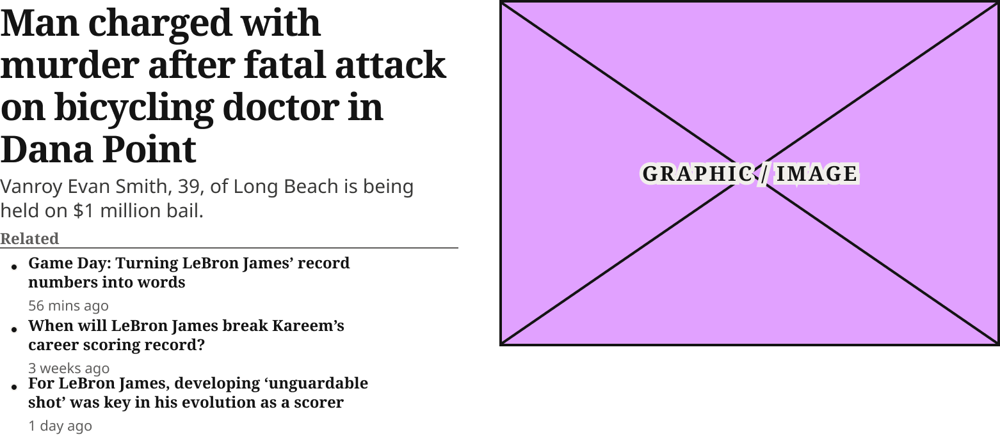
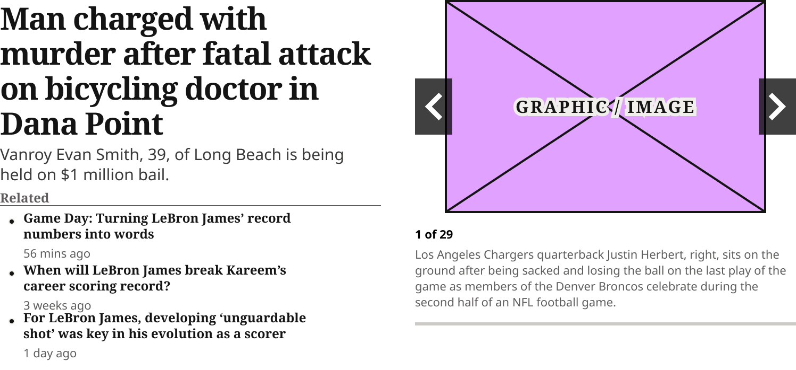

# Zone 1 Lead Article Card

> The homepage Zone 1 lead story (production lead with Related list); Gallery=Image or Gallery=Slideshow (a photo gallery lead, which shows the Zone 1 Slideshow instead of the image). The For You featured story is its own component, Blocks Lead Article Card (2026-10-28).

## Figma

- File: **WordPress Elements** (`b1iZxkFwtAYq9rElmnCAzd`), page **Homepage**
- Component set: [`Zone 1 Lead Article Card` · 3336:46157](https://www.figma.com/design/b1iZxkFwtAYq9rElmnCAzd/?node-id=3336-46157) · key `20dc946d8602b998c7cb522bb6e28d102459bf66`
- Documentation frame: [Zone 1 Lead Article Card Container](https://www.figma.com/design/b1iZxkFwtAYq9rElmnCAzd/?node-id=3484-67601) · overview: [previews/zone-1-lead-article-card--documentation.png](previews/zone-1-lead-article-card--documentation.png)

## Properties

| Property | Default | Options |
|---|---|---|
| Style | Standard | Standard |
| Device | Mobile | Desktop, Mobile, Tablet |
| Gallery | Image | Image, Slideshow |

## Variants

| Variant | Size | Node | Instances | Preview |
|---|---|---|---|---|
| `Standard / Desktop / Image` | 706×349 | [3336:46155](https://www.figma.com/design/b1iZxkFwtAYq9rElmnCAzd/?node-id=3336-46155) | 2 |  |
| `Standard / Desktop / Slideshow` | 706×375 | [3640:50328](https://www.figma.com/design/b1iZxkFwtAYq9rElmnCAzd/?node-id=3640-50328) | 0 |  |
| `Standard / Mobile / Image` | 340×632.66 | [3336:46156](https://www.figma.com/design/b1iZxkFwtAYq9rElmnCAzd/?node-id=3336-46156) | 7 |  |
| `Standard / Mobile / Slideshow` | 340×706.01 | [3640:50288](https://www.figma.com/design/b1iZxkFwtAYq9rElmnCAzd/?node-id=3640-50288) | 0 |  |
| `Standard / Tablet / Image` | 748×349 | [3383:46111](https://www.figma.com/design/b1iZxkFwtAYq9rElmnCAzd/?node-id=3383-46111) | 2 |  |
| `Standard / Tablet / Slideshow` | 748×349 | [3640:50388](https://www.figma.com/design/b1iZxkFwtAYq9rElmnCAzd/?node-id=3640-50388) | 0 |  |

## Anatomy

Default variant `Standard / Desktop / Image` (hidden layers marked):

- **Style=Standard, Device=Desktop, Gallery=Image** `COMPONENT`: 706×349, horizontal, gap 20, padding 0/0/16/0, hug×hug
  - **1st Col** `FRAME`: 295×333, vertical, gap 4, padding 0/0/0/0, fixed×hug
    - **Article Status Badge** `INSTANCE`: 0.01×0.01, horizontal, gap 0, padding 0/0/0/0, hug×hug, instance of Article Status Badge (Type=None), **hidden**
    - **Headline Container** `FRAME`: 295×132, horizontal, gap 8, padding 0/0/0/0, fill×hug
      - **Man charged with murder after fatal attack on bicycling doctor in Dana Point** `TEXT`: 295×132, fill×hug, "Man charged with murder after fatal atta", Noto Serif Bold 29px
    - **Excerpt Container** `FRAME`: 295×38, horizontal, gap 8, padding 0/0/0/0, fill×hug
      - **Vanroy Evan Smith, 39, of Long Beach is being held on $1 million bail.** `TEXT`: 295×38, fill×hug, "Vanroy Evan Smith, 39, of Long Beach is ", Noto Sans Regular 15px
    - **Relate Articles Zone 1 Container** `FRAME`: 295×155, vertical, gap 4, padding 0/0/0/0, fill×hug
      - **Related Articles Header** `FRAME`: 295×16, horizontal, gap 8, padding 0/0/0/0, fill×hug
        - **Header** `TEXT`: 47×16, hug×hug, "Related", Noto Serif Bold 12px
      - **Related Articles Body** `FRAME`: 295×135, vertical, gap 4, padding 0/0/0/0, fill×hug
        - **Related Article List Item** `INSTANCE`: 295×45, horizontal, gap 0, padding 0/0/0/0, fixed×fixed, instance of Related Article List Item ()
        - **Related Article List Item** `INSTANCE`: 295×41, horizontal, gap 0, padding 0/0/0/0, fixed×fixed, instance of Related Article List Item ()
        - **Related Article List Item** `INSTANCE`: 295×41, horizontal, gap 0, padding 0/0/0/0, fixed×fixed, instance of Related Article List Item ()
  - **2nd Col** `FRAME`: 391×271, vertical, gap 8, padding 0/0/0/0, fixed×fixed
    - **Article Image Placeholder** `INSTANCE`: 391×271, vertical, gap 8, padding 0/0/0/0, fixed×fixed, instance of Article Image Placeholder ()

## Component tokens

From `zone-1-lead-article-card.tokens.json`. References point at system tokens (`tokens/core/`, `tokens/themes/`); the CSS variable is `--mng-` + the token path. A literal value means the Figma layer isn't bound to a token.

| Token | Value |
|---|---|
| `zone-1-lead-article-card.base.1st-col.gap` | 4px |
| `zone-1-lead-article-card.base.1st-col.excerpt-container.vanroy-evan-smith-39-of-long-beach-is-being-held-on-1-million-bail.color` | `{color.gray.100}` |
| `zone-1-lead-article-card.base.1st-col.excerpt-container.vanroy-evan-smith-39-of-long-beach-is-being-held-on-1-million-bail.font-family` | Noto Sans |
| `zone-1-lead-article-card.base.1st-col.excerpt-container.vanroy-evan-smith-39-of-long-beach-is-being-held-on-1-million-bail.font-size` | 15px |
| `zone-1-lead-article-card.base.1st-col.excerpt-container.vanroy-evan-smith-39-of-long-beach-is-being-held-on-1-million-bail.font-weight` | 400 |
| `zone-1-lead-article-card.base.1st-col.excerpt-container.vanroy-evan-smith-39-of-long-beach-is-being-held-on-1-million-bail.line-height` | 19px |
| `zone-1-lead-article-card.base.1st-col.headline-container.man-charged-with-murder-after-fatal-attack-on-bicycling-doctor-in-dana-point.color` | `{color.gray.min}` |
| `zone-1-lead-article-card.base.1st-col.headline-container.man-charged-with-murder-after-fatal-attack-on-bicycling-doctor-in-dana-point.font-family` | `{font.family.noto-serif}` |
| `zone-1-lead-article-card.base.1st-col.headline-container.man-charged-with-murder-after-fatal-attack-on-bicycling-doctor-in-dana-point.font-size` | `{font.size.29}` |
| `zone-1-lead-article-card.base.1st-col.headline-container.man-charged-with-murder-after-fatal-attack-on-bicycling-doctor-in-dana-point.font-weight` | `{font.weight.bold}` |
| `zone-1-lead-article-card.base.1st-col.headline-container.man-charged-with-murder-after-fatal-attack-on-bicycling-doctor-in-dana-point.letter-spacing` | -3px |
| `zone-1-lead-article-card.base.1st-col.headline-container.man-charged-with-murder-after-fatal-attack-on-bicycling-doctor-in-dana-point.line-height` | 33px |
| `zone-1-lead-article-card.base.1st-col.relate-articles-zone-1-container.gap` | 4px |
| `zone-1-lead-article-card.base.1st-col.relate-articles-zone-1-container.related-articles-body.gap` | 4px |
| `zone-1-lead-article-card.base.1st-col.relate-articles-zone-1-container.related-articles-body.related-article-list-item.height` | 41px |
| `zone-1-lead-article-card.base.1st-col.relate-articles-zone-1-container.related-articles-body.related-article-list-item.icon-color` | `{color.gray.min}` |
| `zone-1-lead-article-card.base.1st-col.relate-articles-zone-1-container.related-articles-body.related-article-list-item.width` | 295px |
| `zone-1-lead-article-card.base.1st-col.relate-articles-zone-1-container.related-articles-header.border-bottom-width` | 1px |
| `zone-1-lead-article-card.base.1st-col.relate-articles-zone-1-container.related-articles-header.border-color` | `{color.gray.200}` |
| `zone-1-lead-article-card.base.1st-col.relate-articles-zone-1-container.related-articles-header.border-style` | solid |
| `zone-1-lead-article-card.base.1st-col.relate-articles-zone-1-container.related-articles-header.header.color` | `{color.gray.200}` |
| `zone-1-lead-article-card.base.1st-col.relate-articles-zone-1-container.related-articles-header.header.font-family` | `{font.family.noto-serif}` |
| `zone-1-lead-article-card.base.1st-col.relate-articles-zone-1-container.related-articles-header.header.font-size` | `{font.size.12}` |
| `zone-1-lead-article-card.base.1st-col.relate-articles-zone-1-container.related-articles-header.header.font-weight` | `{font.weight.bold}` |
| `zone-1-lead-article-card.base.2nd-col.height` | 271px |
| `zone-1-lead-article-card.base.2nd-col.article-image-placeholder.height` | 271px |
| `zone-1-lead-article-card.base.2nd-col.article-image-placeholder.icon-color` | `{color.gray.min}` |
| `zone-1-lead-article-card.base.2nd-col.article-image-placeholder.width` | 391px |
| `zone-1-lead-article-card.base.2nd-col.zone-1-slideshow.icon-color` | #e1a1ff |
| `zone-1-lead-article-card.base.featured-image.height` | 235.65px |
| `zone-1-lead-article-card.base.featured-image.article-image-placeholder.height` | 235.65px |
| `zone-1-lead-article-card.base.featured-image.article-image-placeholder.icon-color` | `{color.gray.min}` |
| `zone-1-lead-article-card.base.featured-image.article-image-placeholder.width` | 340px |
| `zone-1-lead-article-card.base.root.background` | `{color.gray.max}` |
| `zone-1-lead-article-card.base.root.padding-bottom` | 16px |
| `zone-1-lead-article-card.base.slideshow.zone-1-slideshow.height` | 309px |
| `zone-1-lead-article-card.base.slideshow.zone-1-slideshow.icon-color` | #e1a1ff |
| `zone-1-lead-article-card.base.slideshow.zone-1-slideshow.width` | 340px |
| `zone-1-lead-article-card.device-desktop.1st-col.width` | 295px |
| `zone-1-lead-article-card.device-desktop.2nd-col.zone-1-slideshow.height` | 359px |
| `zone-1-lead-article-card.device-desktop.2nd-col.zone-1-slideshow.width` | 356px |
| `zone-1-lead-article-card.device-desktop.root.gap` | 20px |
| `zone-1-lead-article-card.device-desktop.root.width` | 706px |
| `zone-1-lead-article-card.device-tablet.1st-col.width` | 358px |
| `zone-1-lead-article-card.device-tablet.2nd-col.zone-1-slideshow.height` | 319px |
| `zone-1-lead-article-card.device-tablet.2nd-col.zone-1-slideshow.width` | 358px |
| `zone-1-lead-article-card.device-tablet.root.gap` | 32px |
| `zone-1-lead-article-card.device-desktop.gallery-image.2nd-col.width` | 391px |
| `zone-1-lead-article-card.device-desktop.gallery-slideshow.2nd-col.width` | 356px |
| `zone-1-lead-article-card.device-tablet.gallery-image.2nd-col.width` | 358px |
| `zone-1-lead-article-card.device-tablet.gallery-slideshow.2nd-col.width` | 358px |
| `zone-1-lead-article-card.device-mobile.bottom-border-line.border-color` | `{color.gray.500}` |
| `zone-1-lead-article-card.device-mobile.bottom-border-line.border-style` | solid |
| `zone-1-lead-article-card.device-mobile.bottom-border-line.border-width` | 1px |
| `zone-1-lead-article-card.device-mobile.bottom-border-line.height` | 0px |
| `zone-1-lead-article-card.device-mobile.excerpt-container.padding-bottom` | 16px |
| `zone-1-lead-article-card.device-mobile.excerpt-container.vanroy-evan-smith-39-of-long-beach-is-being-held-on-1-million-bail.color` | `{color.gray.100}` |
| `zone-1-lead-article-card.device-mobile.excerpt-container.vanroy-evan-smith-39-of-long-beach-is-being-held-on-1-million-bail.font-family` | Noto Sans |
| `zone-1-lead-article-card.device-mobile.excerpt-container.vanroy-evan-smith-39-of-long-beach-is-being-held-on-1-million-bail.font-size` | 15px |
| `zone-1-lead-article-card.device-mobile.excerpt-container.vanroy-evan-smith-39-of-long-beach-is-being-held-on-1-million-bail.font-weight` | 400 |
| `zone-1-lead-article-card.device-mobile.excerpt-container.vanroy-evan-smith-39-of-long-beach-is-being-held-on-1-million-bail.line-height` | 19px |
| `zone-1-lead-article-card.device-mobile.headline-container.man-charged-with-murder-after-fatal-attack-on-bicycling-doctor-in-dana-point.color` | `{color.gray.min}` |
| `zone-1-lead-article-card.device-mobile.headline-container.man-charged-with-murder-after-fatal-attack-on-bicycling-doctor-in-dana-point.font-family` | `{font.family.noto-serif}` |
| `zone-1-lead-article-card.device-mobile.headline-container.man-charged-with-murder-after-fatal-attack-on-bicycling-doctor-in-dana-point.font-size` | `{font.size.25}` |
| `zone-1-lead-article-card.device-mobile.headline-container.man-charged-with-murder-after-fatal-attack-on-bicycling-doctor-in-dana-point.font-weight` | `{font.weight.bold}` |
| `zone-1-lead-article-card.device-mobile.headline-container.man-charged-with-murder-after-fatal-attack-on-bicycling-doctor-in-dana-point.letter-spacing` | -3px |
| `zone-1-lead-article-card.device-mobile.headline-container.man-charged-with-murder-after-fatal-attack-on-bicycling-doctor-in-dana-point.line-height` | 29px |
| `zone-1-lead-article-card.device-mobile.relate-articles-zone-1-container.gap` | 4px |
| `zone-1-lead-article-card.device-mobile.relate-articles-zone-1-container.padding-bottom` | 16px |
| `zone-1-lead-article-card.device-mobile.relate-articles-zone-1-container.related-articles-body.gap` | 4px |
| `zone-1-lead-article-card.device-mobile.relate-articles-zone-1-container.related-articles-body.related-article-list-item.height` | 41px |
| `zone-1-lead-article-card.device-mobile.relate-articles-zone-1-container.related-articles-body.related-article-list-item.icon-color` | `{color.gray.min}` |
| `zone-1-lead-article-card.device-mobile.relate-articles-zone-1-container.related-articles-body.related-article-list-item.width` | 340px |
| `zone-1-lead-article-card.device-mobile.relate-articles-zone-1-container.related-articles-header.border-bottom-width` | 1px |
| `zone-1-lead-article-card.device-mobile.relate-articles-zone-1-container.related-articles-header.border-color` | `{color.gray.200}` |
| `zone-1-lead-article-card.device-mobile.relate-articles-zone-1-container.related-articles-header.border-style` | solid |
| `zone-1-lead-article-card.device-mobile.relate-articles-zone-1-container.related-articles-header.header.color` | `{color.gray.200}` |
| `zone-1-lead-article-card.device-mobile.relate-articles-zone-1-container.related-articles-header.header.font-family` | `{font.family.noto-serif}` |
| `zone-1-lead-article-card.device-mobile.relate-articles-zone-1-container.related-articles-header.header.font-size` | `{font.size.12}` |
| `zone-1-lead-article-card.device-mobile.relate-articles-zone-1-container.related-articles-header.header.font-weight` | `{font.weight.bold}` |
| `zone-1-lead-article-card.device-mobile.root.gap` | 8px |
| `zone-1-lead-article-card.device-mobile.root.width` | 340px |

## Behavior and breakpoints

| Device | Viewport | Layout |
|---|---|---|
| Mobile | below 640px | One column; 25/29 headline |
| Tablet | 640px and up (768 template) | Two columns, 32px apart |
| Desktop | 1024px and up | Two columns, 20px apart (text 295, image 391) |

- **Headline and excerpt:** (Noto Serif Bold 29/33, −0.87px at 640px and up; 25/29, −0.03em below; excerpt Noto Sans 15/19 `color/gray/100`, 4px below the headline group on Desktop and Tablet, as in production).
- **Layout:** Desktop and Tablet are two columns (text, then image; 20px and 32px apart); Mobile is one column (headline group, image, excerpt, Related list; 8px gaps) with a 1px bottom rule below.
- **Gallery** (Karl, 2026-10-26): `Gallery=Slideshow` replaces the image with the Zone 1 Slideshow, as production does for gallery leads (`.feature-large .article-slideshow`). Zone 1 has no Gallery Icon Badge.
- **Gallery=Slideshow layout follows the lead's width, not the screen:** two columns when the lead is about 700px wide or more (Desktop: text 295 and slideshow 356, the rest of the 706 card between them; Tablet: the slideshow fills the 358 column); one column when narrower: headline, excerpt, then the Related list, then the slideshow full width. On the homepage the third page column narrows the lead, so it is one column from 800 to 1279px (594 wide at 1024) and below 640px, and two columns from 640 to 799px and from 1280px up (production, checked on develop.denverpost.com 2026-10-26).
- **The For You featured story** moved to Blocks Lead Article Card (Karl, 2026-10-28); its Style=For You variants were deleted. `Style` has one value (Standard) and is kept so existing instances don't change.

## Accessibility

- No InFocus state in Figma.
- Text color on its background must meet WCAG AA contrast (4.5:1 for text under 18px) in every theme; theme colors change per site.
- Icons inside a labelled control are decorative (`aria-hidden`); an icon-only control needs an accessible name (`aria-label`).

## Where it is used

Scope: instances in the Figma file **WordPress Elements** only (other files that use the library are not counted). Total: **11**.

Inside components: TOP ZONE Block ×5.
Placed on pages: Homepage ×6.

**Built from:** Related Article List Item ×18, Article Image Placeholder ×3, Zone 1 Slideshow ×3

## Production

Production `.feature-primary .feature-large` (Zone 1 lead).

## Known issues

1. Tablet: the image (391px) is wider than its 358px column.
2. Column gaps 20px (spacing/250) and 32px (no token) are raw values.
3. **Values not bound to a token** (literal in the component tokens): `base` 1st-col gap = 4px; `base` 1st-col.relate-articles-zone-1-container gap = 4px; `base` 1st-col.relate-articles-zone-1-container.related-articles-body gap = 4px; `base` 2nd-col.zone-1-slideshow icon-color = #e1a1ff; `device-mobile` excerpt-container padding-bottom = 16px; `device-mobile` relate-articles-zone-1-container gap = 4px; `device-mobile` relate-articles-zone-1-container padding-bottom = 16px; `device-mobile` relate-articles-zone-1-container.related-articles-body gap = 4px; `device-desktop` root gap = 20px; `device-mobile` root gap = 8px; `device-tablet` root gap = 32px; `base` root padding-bottom = 16px; and 1 more.

## Files

- `zone-1-lead-article-card.tokens.json`: component tokens (DTCG 2025.10).
- `zone-1-lead-article-card.html`: HTML/CSS skeleton of every variant, using the `dist/` CSS variables (open it in a browser).
- `previews/`: PNG of every variant @2x and the documentation frame.

*Generated 2026-10-28 by `scripts/component-export/export.py` (EXPORT-STANDARD.md section 7). Edit the text in `scripts/component-export/registry.json`, not here.*
