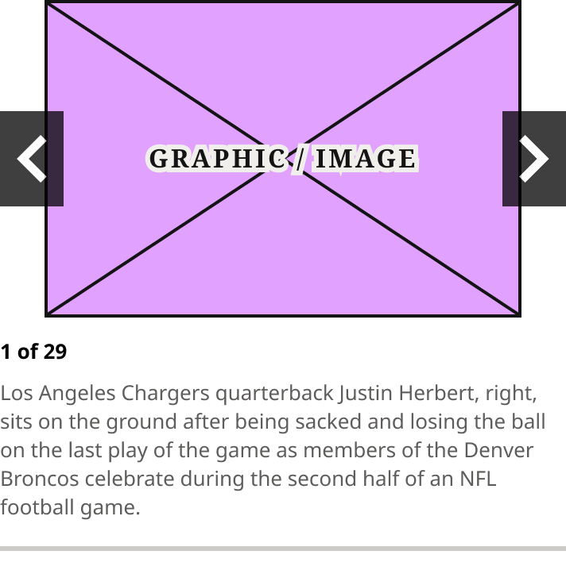
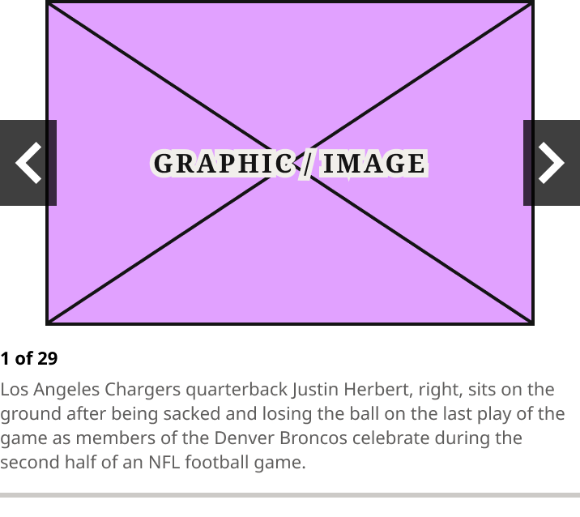
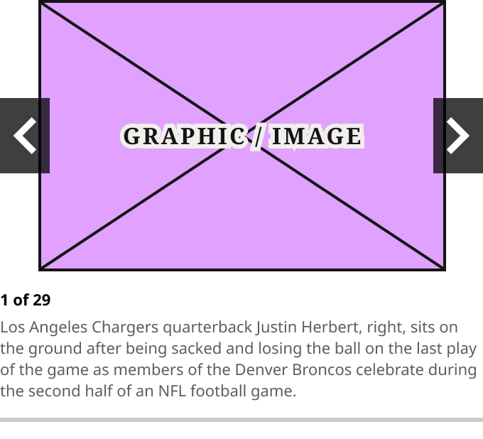

# Zone 1 Slideshow

> Inline slideshow a Zone 1 lead shows in place of its image when the story is a photo gallery. Breakpoint = Desktop, Tablet, Mobile; Show Credit (off by default), Slide Count and Caption text properties.

## Figma

- File: **WordPress Elements** (`b1iZxkFwtAYq9rElmnCAzd`), page **Homepage**
- Component set: [`Zone 1 Slideshow` · 3640:50278](https://www.figma.com/design/b1iZxkFwtAYq9rElmnCAzd/?node-id=3640-50278) · key `d52844d268f315912210d4b2f2051577a5ffc3cb`
- Documentation frame: [Zone 1 Slideshow Container](https://www.figma.com/design/b1iZxkFwtAYq9rElmnCAzd/?node-id=3640-50279) · overview: [previews/zone-1-slideshow--documentation.png](previews/zone-1-slideshow--documentation.png)

## Properties

| Property | Default | Options |
|---|---|---|
| Breakpoint | Desktop | Desktop, Mobile, Tablet |

| Other property | Type | Default |
|---|---|---|
| Show Credit | boolean | False |
| Slide Count | text | 1 of 29 |
| Caption | text | Los Angeles Chargers quarterback Justin Herbert, right, sits on the ground after being sacked and losing the ball on the last play of the game as members of the Denver Broncos celebrate during the second half of an NFL football game. |

## Variants

| Variant | Size | Node | Instances | Preview |
|---|---|---|---|---|
| `Desktop` | 356×359 | [3640:50224](https://www.figma.com/design/b1iZxkFwtAYq9rElmnCAzd/?node-id=3640-50224) | 2 |  |
| `Tablet` | 358×319 | [3640:50242](https://www.figma.com/design/b1iZxkFwtAYq9rElmnCAzd/?node-id=3640-50242) | 2 |  |
| `Mobile` | 340×309 | [3640:50260](https://www.figma.com/design/b1iZxkFwtAYq9rElmnCAzd/?node-id=3640-50260) | 2 |  |

## Anatomy

Default variant `Desktop` (hidden layers marked):

- **Breakpoint=Desktop** `COMPONENT`: 356×359, vertical, gap 0, padding 0/0/12/0, fixed×hug
  - **Image Area** `FRAME`: 356×200, fill×fixed
    - **Article Image Placeholder** `INSTANCE`: 300×200, vertical, gap 8, padding 0/0/0/0, fixed×fixed, instance of Article Image Placeholder ()
    - **Previous Arrow** `INSTANCE`: 40×60, horizontal, gap 0, padding 0/0/0/0, fixed×fixed, instance of Slideshow Arrow (Direction=Previous, Size=Large, State=Default)
    - **Next Arrow** `INSTANCE`: 40×60, horizontal, gap 0, padding 0/0/0/0, fixed×fixed, instance of Slideshow Arrow (Direction=Next, Size=Large, State=Default)
  - **Caption Block** `FRAME`: 356×147, vertical, gap 8, padding 12/0/16/0, fill×hug
    - **Credit** `TEXT`: 356×15, fixed×fixed, "AP Photo/Gregory Bull", Noto Sans Bold 11px, **hidden**
    - **Slide Count** `TEXT`: 356×18, fill×hug, "1 of 29", Noto Sans Bold 13px
    - **Caption** `TEXT`: 356×90, fill×hug, "Los Angeles Chargers quarterback Justin ", Noto Sans Regular 13px

## Component tokens

From `zone-1-slideshow.tokens.json`. References point at system tokens (`tokens/core/`, `tokens/themes/`); the CSS variable is `--mng-` + the token path. A literal value means the Figma layer isn't bound to a token.

| Token | Value |
|---|---|
| `zone-1-slideshow.base.caption-block.border-bottom-width` | 3px |
| `zone-1-slideshow.base.caption-block.border-color` | `{color.gray.500}` |
| `zone-1-slideshow.base.caption-block.border-style` | solid |
| `zone-1-slideshow.base.caption-block.padding-top` | `{spacing.150}` |
| `zone-1-slideshow.base.caption-block.caption.color` | `{color.gray.200}` |
| `zone-1-slideshow.base.caption-block.caption.font-family` | Noto Sans |
| `zone-1-slideshow.base.caption-block.caption.font-weight` | `{font.weight.regular}` |
| `zone-1-slideshow.base.caption-block.slide-count.color` | `{color.gray.black}` |
| `zone-1-slideshow.base.caption-block.slide-count.font-family` | Noto Sans |
| `zone-1-slideshow.base.caption-block.slide-count.font-weight` | `{font.weight.bold}` |
| `zone-1-slideshow.base.image-area.article-image-placeholder.icon-color` | `{color.gray.min}` |
| `zone-1-slideshow.base.root.padding-bottom` | `{spacing.150}` |
| `zone-1-slideshow.breakpoint-desktop.caption-block.gap` | `{spacing.100}` |
| `zone-1-slideshow.breakpoint-desktop.caption-block.padding-bottom` | `{spacing.200}` |
| `zone-1-slideshow.breakpoint-desktop.caption-block.caption.font-size` | `{font.size.13}` |
| `zone-1-slideshow.breakpoint-desktop.caption-block.slide-count.font-size` | `{font.size.13}` |
| `zone-1-slideshow.breakpoint-desktop.image-area.height` | 200px |
| `zone-1-slideshow.breakpoint-desktop.image-area.article-image-placeholder.height` | 200px |
| `zone-1-slideshow.breakpoint-desktop.image-area.article-image-placeholder.width` | 300px |
| `zone-1-slideshow.breakpoint-desktop.image-area.next-arrow.height` | 60px |
| `zone-1-slideshow.breakpoint-desktop.image-area.next-arrow.width` | 40px |
| `zone-1-slideshow.breakpoint-desktop.image-area.previous-arrow.height` | 60px |
| `zone-1-slideshow.breakpoint-desktop.image-area.previous-arrow.width` | 40px |
| `zone-1-slideshow.breakpoint-desktop.root.width` | 356px |
| `zone-1-slideshow.breakpoint-tablet.caption-block.gap` | `{spacing.050}` |
| `zone-1-slideshow.breakpoint-tablet.caption-block.padding-bottom` | `{spacing.150}` |
| `zone-1-slideshow.breakpoint-tablet.caption-block.caption.font-size` | `{font.size.11}` |
| `zone-1-slideshow.breakpoint-tablet.caption-block.slide-count.font-size` | `{font.size.11}` |
| `zone-1-slideshow.breakpoint-tablet.image-area.height` | 201px |
| `zone-1-slideshow.breakpoint-tablet.image-area.article-image-placeholder.height` | 201px |
| `zone-1-slideshow.breakpoint-tablet.image-area.article-image-placeholder.width` | 302px |
| `zone-1-slideshow.breakpoint-tablet.image-area.next-arrow.height` | 53px |
| `zone-1-slideshow.breakpoint-tablet.image-area.next-arrow.width` | 35px |
| `zone-1-slideshow.breakpoint-tablet.image-area.previous-arrow.height` | 53px |
| `zone-1-slideshow.breakpoint-tablet.image-area.previous-arrow.width` | 35px |
| `zone-1-slideshow.breakpoint-tablet.root.width` | 358px |
| `zone-1-slideshow.breakpoint-mobile.caption-block.gap` | `{spacing.050}` |
| `zone-1-slideshow.breakpoint-mobile.caption-block.padding-bottom` | `{spacing.150}` |
| `zone-1-slideshow.breakpoint-mobile.caption-block.caption.font-size` | `{font.size.11}` |
| `zone-1-slideshow.breakpoint-mobile.caption-block.slide-count.font-size` | `{font.size.11}` |
| `zone-1-slideshow.breakpoint-mobile.image-area.height` | 191px |
| `zone-1-slideshow.breakpoint-mobile.image-area.article-image-placeholder.height` | 191px |
| `zone-1-slideshow.breakpoint-mobile.image-area.article-image-placeholder.width` | 287px |
| `zone-1-slideshow.breakpoint-mobile.image-area.next-arrow.height` | 53px |
| `zone-1-slideshow.breakpoint-mobile.image-area.next-arrow.width` | 35px |
| `zone-1-slideshow.breakpoint-mobile.image-area.previous-arrow.height` | 53px |
| `zone-1-slideshow.breakpoint-mobile.image-area.previous-arrow.width` | 35px |
| `zone-1-slideshow.breakpoint-mobile.root.width` | 340px |

## Behavior and breakpoints

| Lead width / viewport | Layout (set by the card) | Controls (production 800px breakpoint) |
|---|---|---|
| Lead about 700px or wider (homepage: 640–799px, 1280px and up) | Two columns: slideshow 356 (Desktop) or filling the 358 column (Tablet) | small below 800px, large from 800px |
| Lead narrower (homepage: below 640px, 800–1279px) | One column: slideshow full width after the text (and Related) | small below 800px, large from 800px |

- **Image area:** 16:9 (Desktop 356×200, Tablet 358×201, Mobile 340×191); the photo is letterboxed and centered with no background.
- **Controls breakpoint (production's):** large controls (40×60 arrows, 13px count and caption, Desktop spacing) at 800px and up; small controls below 800px. The Tablet variant shows the 768 template, so it uses the small controls; from 800 to 1023px use the large ones.
- **Arrows:** previous and next, 40×60 at 800px and up and 35×53 below 800px, `color/gray/black` at 75% opacity, arrow-left / arrow-right icons in `color/gray/max` (30px; 26px below 800px), vertically centered at the image area's edges.
- **Text:** credit (optional) Noto Sans Bold 11 `color/gray/200`; slide count Noto Sans Bold `color/gray/black`; caption Noto Sans Regular `color/gray/200`. Count and caption `font/size/13` at 800px and up, `font/size/11` below 800px; line height auto.
- **Caption block:** 12px top (`spacing/150`); 8px between lines and 16px bottom at 800px and up (`spacing/100`, `spacing/200`); 4px and 12px below 800px (`spacing/050`, `spacing/150`); 3px `color/gray/500` rule along the bottom. 12px (`spacing/150`) below the slideshow.
- **Arrow states** (Slideshow Arrow set `3641:50772`: Direction × Size × State): hover has no visual change (production sets the same colors; pointer cursor). Keyboard focus (`:focus-visible`): 2px `color/gray/max` outline 3px outside the button, at the button's 75% opacity. Buttons have `aria-label` "Previous" / "Next".
- **Behavior:** the gallery loops (Previous on slide 1 goes to the last slide), so production's disabled style (20% opacity) never shows. The image strip can be dragged or swiped. No dots or autoplay.
- **Screen readers (required, not in production yet):** announce the slide count when the photo changes (`aria-live="polite"` on the count). Design-vs-production entry 17.2.

## Accessibility

- No InFocus state in Figma.
- Text color on its background must meet WCAG AA contrast (4.5:1 for text under 18px) in every theme; theme colors change per site.
- Icons inside a labelled control are decorative (`aria-hidden`); an icon-only control needs an accessible name (`aria-label`).

## Where it is used

Scope: instances in the Figma file **WordPress Elements** only (other files that use the library are not counted). Total: **6**.

Inside components: Zone 1 Lead Article Card ×6.

**Built from:** Slideshow Arrow ×6, Article Image Placeholder ×3

## Production

Production `article.slideshow.feature-large > .article-slideshow` (mng-gallery slider), seen on develop.denverpost.com.

## Known issues

1. Production type, spacing and colors are off-token: design-vs-production entry 17.1.
2. Production does not announce the slide count to screen readers (design-vs-production entry 17.2, required).
3. **Values not bound to a token** (literal in the component tokens): `base` caption-block.caption font-family = Noto Sans; `base` caption-block.slide-count font-family = Noto Sans.

## Files

- `zone-1-slideshow.tokens.json`: component tokens (DTCG 2025.10).
- `zone-1-slideshow.html`: HTML/CSS skeleton of every variant, using the `dist/` CSS variables (open it in a browser).
- `previews/`: PNG of every variant @2x and the documentation frame.

*Generated 2026-10-28 by `scripts/component-export/export.py` (EXPORT-STANDARD.md section 7). Edit the text in `scripts/component-export/registry.json`, not here.*
